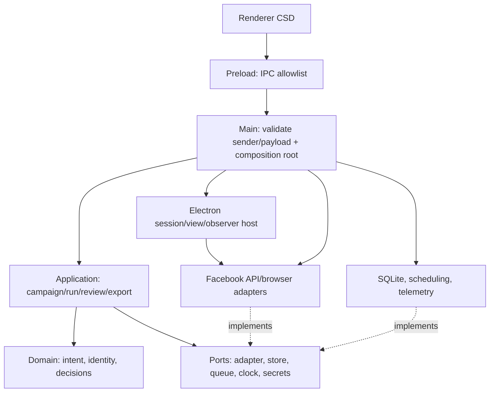

# ADR-001 — Runtime, ranh giới module và tái sử dụng HotMatch

Ngày: 2026-10-27, Asia/Bangkok. Quyết định áp dụng cho bootstrap offline CSD; xem lại theo các điều kiện cuối tài liệu. Task/owner/gate chỉ theo [master plan](../master_plan.md).

Ghi nhận triển khai sau quyết định: P01.01 đã tạo bootstrap theo baseline này, có type checks/unit tests và smoke Electron offline; xem [README](../../README.md) và [bằng chứng bootstrap](../evidence/p01-bootstrap-validation-2026-10-27.md). Các đoạn bối cảnh/probe bên dưới giữ mốc audit P00.03; chưa có SQLite repositories, session Facebook hoặc benchmark thật.

## Bối cảnh và phiên bản thực đã kiểm tra

CSD hiện chưa có package hay source sản phẩm, chưa khởi tạo Git. Nguồn tham khảo `C:/OwnProject/hotmatch-desktop` có package version `1.0.10`, HEAD `632c4227c33ea54475a1aeb0181c8b6d37335144`, working tree có thay đổi và có file observer chưa tracked. Vì vậy commit không đủ tái hiện nguồn đã đọc; [source manifest](../evidence/p00-hotmatch-source-manifest.json) lưu SHA-256, import graph trực tiếp và Git status của từng file được audit. Không sửa, reset hoặc chạy ứng dụng HotMatch.

Không tìm thấy AGENTS.md ở CSD, các thư mục cha áp dụng hoặc source HotMatch tại thời điểm kiểm tra. Quy tắc nội bộ CSD lấy từ `.brain/README.md` và master plan. `hotmatch-desktop/package.json` ghi `private: true`, `license: ISC`; không có LICENSE/COPYING/NOTICE tại root trong bản source đã đọc. Các metadata này chưa xác định nguồn gốc/quyền phát hành lại từng đoạn source. Quyết định đợt này là tái triển khai các pattern hạ tầng, không copy nguyên văn code HotMatch, không vendor cả repo và không mang theo dữ liệu. Nếu một task sau cần copy code cụ thể, phải ghi provenance và xác lập quyền cho phần đó trước khi tích hợp; việc đọc audit không tự cấp quyền phát hành code.

[Danh mục reuse](../specs/hotmatch_reuse_inventory.md) ghi module giữ ý tưởng/sửa/bỏ, lý do, phụ thuộc bị loại và nơi triển khai mới. Chưa có module HotMatch nào được đưa vào CSD ở P00.

## Quyết định

### Runtime và tooling

| Thành phần | Lựa chọn cho P01.01 | Cơ sở / giới hạn |
| --- | --- | --- |
| OS/kiến trúc PoC | Windows x64 | Probe đã chạy trên win32 x64; chưa kiểm chứng arm64 hoặc OS khác |
| Electron | Pin `44.7.0` | Cùng bản binary đã kiểm tra, main process thực báo Node `24.21.0`, Chromium `152.0.7977.130`, modules ABI `149` |
| Node phát triển | Pin môi trường `24.19.0`, engine `>=24.19.0 <25` | Node máy hiện tại; modules ABI `137`; không đồng nhất với Node nhúng trong Electron |
| Package manager | npm `11.17.0`, package-lock và `npm ci` | Máy hiện có; package/lock CSD sẽ được tạo ở P01.01, không dùng lock hoặc node_modules HotMatch làm dependency runtime |
| Language/module | TypeScript `6.0.3`, ESM (`type: module`) | Pin bản stable 6.x đã kiểm tra npm, không cần API compiler mới; domain/application/contracts mới dùng TS strict. Chọn baseline này không có nghĩa là bản mới nhất |
| Compile | `tsc`, NodeNext cho main, `.cts → .cjs` cho preload; config renderer DOM riêng | Import dùng extension `.js`; static HTML/CSS và renderer ESM tối thiểu, không thêm bundler/UI framework chỉ để dựng PoC |
| Types/validation | `@types/node` dòng 24.x, pin chính xác ở P01; Ajv `8.20.0` cho schema/IPC cần runtime validation | Không suy type TS thành validation runtime; DOM không nhận global Node; API chỉ dùng những gì probe/runtime hỗ trợ |
| Tests | `node:test` + assert cho offline; Electron harness cho session/observer | Kiểm contract/invariant có ý nghĩa; fixture giả. Tests Node không thay smoke Electron |
| Packaging | Pin electron-builder `26.15.3`; Windows portable x64 + ASAR | Bản builder đã có trong lock và cài đặt HotMatch; chưa chạy build CSD, chưa có cam kết portable/release hoạt động |
| SQLite | `node:sqlite` / `DatabaseSync`, repository bao bọc | Tích hợp trong cả Node/Electron đã chạy; không thêm `better-sqlite3`, `sqlite3` hoặc ORM/native addon ban đầu |

Đã kiểm metadata npm trực tiếp cho Electron `44.7.0`, builder `26.15.3`, TypeScript `6.0.3` ngày 2026-10-27. Bản cài Electron yêu cầu Node phát triển >=22.12.0, baseline Node 24.19 đáp ứng. Dependency cụ thể và lockfile thuộc P01.01; P00 không cài thêm thư viện vào HotMatch hay làm ứng dụng CSD giả.

### Module và chiều phụ thuộc



`domain` không import Electron, SQLite, filesystem, UI hoặc adapter Facebook. `application` phụ thuộc domain và interface; main nối implementation bằng constructor/factory injection. Các adapter phụ thuộc contracts/domain và browser port khi cần, không sửa UI, không tự mở rộng intent, không tự persist/checkpoint hoặc gọi thẳng IPC. Browser host cung cấp transport/session/view lifecycle, không parse payload Facebook thành bài. Application quản lý persist candidates/observations/checkpoint trong transaction của store. Scheduler quyết định job/lease/budget/deadline, không định nghĩa post identity hoặc suy nguồn từ loại tác giả.

Nhánh R08 của master plan được giữ ở P11.04–P11.08: registry dùng `profile_id` ổn định và binding tới `account_id` nội bộ đã kiểm, job/observation có access context cùng visibility tại thời điểm quan sát. Thay danh tính đăng nhập trong cùng profile buộc kiểm lại binding/quyền/checkpoint, không chỉ đổi nhãn profile. Bỏ account/game của HotMatch không có nghĩa bỏ bối cảnh tài khoản cần cho CSD. MVP dùng PUBLIC_DISCOVERY và nguồn công khai; JOINED_GROUPS/multi-account UI/private content cần contract version riêng, không thêm enum riêng tư vào schema MVP.

```text
src/
  main/                    bootstrap, validated IPC, composition root
  preload/                 bridge UI hẹp, output CommonJS .cjs
  renderer/                HTML/CSS/TS, chỉ dùng bridge được cấp
  domain/                  campaign/post/source/identity/decision types + rules
  application/
    ports/                 store, queue, clock, secret/browser interfaces
                           use cases campaign/run/review/export thêm theo task
  adapters/
    contracts/             capabilities, PageResult, errors, host capture metadata
    facebook/              API và browser tách route, chọn sau P00.02
  infrastructure/
    browser/               session registry, view lifecycle, observer transport
    persistence/           SQLite connection, migrations, repositories
    scheduling/            durable jobs, leases, retry/deadline
    secrets/               OS-protected credential vault
    telemetry/             events, redaction, metrics
tests/
  fixtures/                chỉ dữ liệu giả/làm sạch
  contract/                schema/adapter/data invariants
  integration/             transaction, queue, recovery
  e2e/                     local Electron harness khi cần
scripts/                   build/check/probes; không đặt dữ liệu tài khoản
dist/                      generated build output, không commit dữ liệu runtime
```

Chỉ tạo module khi task cần. `web-search/` chỉ thêm khi P00.02 chọn đường bổ sung. Cấu trúc này điều chỉnh mục 7.2 master plan bằng `application/ports`; chưa tạo cây thư mục rỗng hoặc các service tương lai. P01.01 chỉ dựng main/preload/renderer/domain/application tối thiểu cùng fixture, check/test/build; không làm trước scheduler và schema dữ liệu đầy đủ.

### Namespace và dữ liệu độc lập

| Thuộc tính | Giá trị quyết định |
| --- | --- |
| npm package | `csd-desktop`, private ban đầu |
| Product/window title | `CSD` — Crawl Socials Data |
| app ID và Windows AppUserModelID | `io.csd.desktop` |
| userData (dev và portable cùng quy tắc) | `join(app.getPath('appData'), 'csd-desktop')`, thông thường `%APPDATA%/csd-desktop` |
| sessionData | `<userData>/browser`, đặt trước tạo session/view |
| Site partition | `persist:csd-v1-<session_uuid>`; registry mới, không nhận ID/partition HotMatch |
| UI partition | `csd-ui` in-memory; không dùng partition site hoặc cấp secret APIs cho trang ngoài |
| Database và protected evidence | `<userData>/data/csd.sqlite`, `<userData>/data/evidence/` |
| Vault / logs | `<userData>/secrets/`, `<userData>/logs/`; log redact ngay lúc tạo |
| Offline probe/test | thư mục temp `csd-*` riêng; override tường minh, không tự dùng profile người dùng |
| Portable artifact dự kiến | `CSD-Portable-${version}.exe`; dữ liệu nằm ngoài thư mục cài/ASAR |

Main đặt tên/path trước `app.whenReady` và trước mọi `session.fromPartition`, khóa single instance, kiểm tra root đã resolve thuộc namespace CSD. Không dùng `hotmatch-desktop`, `persist:p*`, `hm:*`, `PORTABLE_EXECUTABLE_DIR` hoặc đường dẫn source HotMatch làm fallback. Các test phải chứng minh không đọc/ghi dữ liệu HotMatch; probe P00 chỉ nạp binary Electron đã cài, không nạp entrypoint HotMatch.

### Browser, observer và secrets

Ứng dụng điều khiển dùng BrowserWindow; trang Facebook dùng WebContentsView trong host riêng khi cần. Mỗi session chỉ một navigation job điều khiển tại một thời điểm; chưa tăng concurrency theo số profile HotMatch. Job đang chạy giữ view hoạt động; suspend chỉ sau checkpoint an toàn và release lease. Destroy webContents phải được cleanup tường minh, không kỳ vọng DOM/cursor còn nguyên khi wake. [Electron BaseWindow](https://www.electronjs.org/docs/latest/api/base-window) quy định việc sở hữu và giải phóng các view.

Đặt `nodeIntegration: false`, `contextIsolation: true`, `sandbox: true`, `webviewTag: false`; renderer ngoài không có preload bridge CSD. IPC có channel allowlist, payload schema, kiểm sender/frame/origin, result/error đã làm sạch. Navigation/new-window/permission policy riêng cho UI và site; mặc định deny quyền không cần. Đây là ranh giới triển khai theo [Electron Security](https://www.electronjs.org/docs/latest/tutorial/security), không là bằng chứng quyền truy cập dữ liệu Facebook.

Observer mới giữ ý tưởng bounded buffers/read slots, timeout, attach/dispose idempotent và redacted reason codes; bỏ endpoint GET `/api/v1/refresh`, MIME/schema `payload.user` và account identity của HotMatch. Lifecycle host tách parser Facebook, gắn capture mode từ host, phân biệt auth/rate-limit/schema error/end-of-results. DevTools/closed target có thể detach, theo [Electron Debugger](https://www.electronjs.org/docs/latest/api/debugger); warmup/timeout/reload phải được test P01.03. Không copy blacklist cache của observer cũ thành quy tắc LIVE của CSD; dùng contract campaign cho provenance.

Session persist bằng Chromium trong sessionData riêng. Không snapshot cookie plaintext. API credentials nếu route cần dùng vault qua safeStorage/Windows DPAPI; không có API đọc secrets tùy ý từ renderer. P01.02 kiểm nhu cầu giữ session cookies qua restart; chỉ thêm encrypted snapshot tối thiểu khi có bằng chứng cần, và fail rõ nếu không mã hóa được. [safeStorage trên Windows](https://www.electronjs.org/docs/latest/api/safe-storage) bảo vệ theo người dùng OS, không bảo vệ khỏi mọi ứng dụng chạy cùng tài khoản. Probe chỉ round-trip chuỗi giả, chưa chứng minh lifecycle Facebook session.

`session.fetch` và network lock là transport tiện ích; không tự chạy JavaScript của website hoặc tạo quyền/token mới. Dùng [Electron Session](https://www.electronjs.org/docs/latest/api/session) theo capability route P00.02. Proxy không là dependency bắt buộc; không mang `proxy-chain`, health scheduler hoặc mua proxy trước khi route cần. Lite mặc định off; chỉ bật sau kiểm tính đúng và yield. Không bê các rule livestream/chat/site cũ, bỏ sửa UA/Client Hints không có nhu cầu sản phẩm.

### SQLite, ABI và đóng gói

Dùng SQLite tích hợp, raw prepared SQL và migration có version sau lớp repository. Một connection/writer do persistence sở hữu; bật WAL, foreign keys, busy timeout hữu hạn và transaction batch+checkpoint. ID MXH lưu TEXT, text UTF-8; observations/evidence version không overwrite. Các test Node và Electron phải chạy vì SQLite nhúng khác bản: Node phát triển `3.53.3`, Electron main `3.53.4` trong probe. Không coi việc mở cùng định dạng DB là bằng chứng mọi extension/SQL API giống nhau.

[Node 24 SQLite docs](https://nodejs.org/download/release/latest-v24.x/docs/api/sqlite.html) đánh dấu module ở mức release candidate và API `DatabaseSync` chạy đồng bộ. Chỉ dùng subset đã kiểm và bọc trong repository để thay được; batch nhỏ, không chạy tác vụ SQLite kéo dài trên UI event loop. Ban đầu chạy connection trong main cho PoC tối thiểu; nếu profiling cho thấy block đáng kể, chuyển store sang worker/process sở hữu duy nhất, giữ port/transaction semantics. Không thêm worker hoặc queue phân tán trước phép đo.

Probe [p00-runtime-probe.json](../evidence/p00-runtime-probe.json) chạy trong **Electron main thực**, không chỉ ELECTRON_RUN_AS_NODE. Kiểm WAL/foreign keys/rollback/idempotent insert/integrity check, mở lại DB giữ text tiếng Việt và ID string >2^53. ABI của Node máy = 137, Electron = 149; không dùng addon build bằng Node máy cho Electron. `node:sqlite` tích hợp nên không có `.node` bên thứ ba cần rebuild/unpack. Nếu chuyển sang addon, phải pin bản có hỗ trợ Electron/Windows x64, rebuild theo Electron bằng công cụ phù hợp và test `app.asar` đóng gói; [Electron native modules](https://www.electronjs.org/docs/latest/tutorial/using-native-node-modules) giải thích khác biệt ABI này.

P01.01 tạo manifest/build config allowlist chỉ gồm compiled main/domain/application/adapters/infrastructure, preload `.cjs`, renderer assets và package metadata; exclude `.brain`, source evidence, test data, HotMatch source, runtime data và vault. Database/migrations writable ngoài ASAR; migrations read-only có thể nằm trong package. Dùng config của builder **26.15.3 đã pin**, không copy tùy chọn từ v27/latest khi schema khác. Portable x64 là target đầu, code signing/installer/update thuộc P10; chưa tự phát hành hoặc ký số. Hướng dẫn [electron-builder](https://www.electron.build/docs/) chỉ làm tham khảo, kiểm schema của version đã pin khi bootstrap.

## Các phương án đã cân nhắc

| Phương án | Kết luận |
| --- | --- |
| Clone nguyên HotMatch, đổi tên sản phẩm | Bỏ: kéo account/game/prediction/claim flow, JSON cookie store, namespace và UI cũ vào CSD |
| Copy từng module nguyên trạng | Chưa chọn: imports/lifecycle/identity/account code còn gắn nhau, quyền source chưa được xác lập đủ cho copy phát hành |
| Tái triển khai TS các pattern hạ tầng nhỏ | Chọn: không buộc source/runtime CSD phụ thuộc repo/dữ liệu HotMatch; giữ kinh nghiệm lifecycle/locking có giá trị |
| better-sqlite3 / sqlite3 addon | Dự phòng: có đường native rebuild/ABI, chưa cần khi builtin đã vượt probe |
| sql.js/WASM | Chưa chọn: thêm cách serialize/durability không cần thiết cho queue/checkpoint file-backed |
| Framework frontend/bundler/full dashboard ngay | Hoãn: PoC chỉ cần điều khiển nhỏ và fixture; UI đầy đủ sau G02 |
| Nâng mọi dependency lên latest ngay | Không cần cho P00: chọn baseline thực đã audit; nâng bằng task/check riêng khi có nhu cầu hoặc trước release |

## Hệ quả, bằng chứng và điều kiện xem lại

P01.01 được bắt đầu offline theo lựa chọn này khi P00.01 hoàn tất. Không cần copy cả repo/dữ liệu hoặc dựa vào profile đã đăng nhập để bootstrap. Phải tự triển khai các module CSD cần dùng; không tính phần code đã có của HotMatch thành phần trăm sản phẩm CSD hoàn thành.

Giới hạn kiểm chứng: chưa compile TypeScript trong CSD, chưa tạo BrowserWindow/WebContentsView, chưa kiểm session isolation/login/observer và chưa build artifact. Native compatibility probe chứng minh subset SQLite ở runtime phát triển đã đọc, không thay G01/G02 hoặc kiểm Windows sạch P10.02. G00 vẫn phụ thuộc P00.02/P00.04.

Xem lại ADR khi route P00.02 đòi capability khác; builtin SQLite không đạt dữ liệu/recovery/performance; API RC thay đổi; đóng gói khác behavior dev; cần code copy với provenance/license rõ; profiling yêu cầu worker; Electron/Node baseline cần nâng để sửa lỗi hoặc hỗ trợ release. Ghi ADR thay thế, giữ bằng chứng cũ và chạy lại probe theo version mới.
