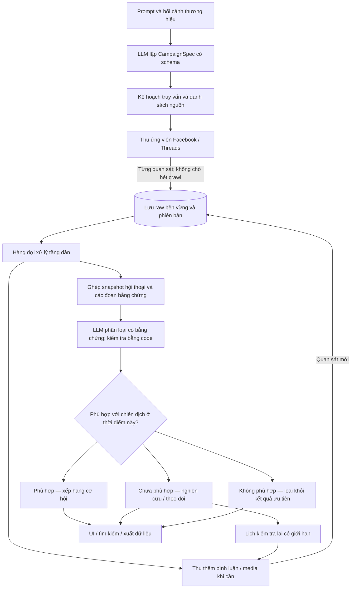

# ADR-022 — CSD tìm và xếp hạng cơ hội tham gia thảo luận

- Ngày: 30/10/2026, Asia/Bangkok.
- Trạng thái: ACCEPTED cho kiến trúc và kế hoạch; chưa triển khai production.
- Nhánh nền: `codex/csd-production`, kế thừa ADR-021 và sản phẩm 0.2.2.
- Phạm vi: đa chủ đề, Facebook + Threads; triển khai khả năng hội thoại trên Threads trước.
- Đặc tả và kế hoạch thực hiện: [Conversation opportunity v1](../specs/conversation-opportunity-v1.md).
- Trạng thái task hiện hành: [master_plan.md](../master_plan.md), không tạo backlog trạng thái thứ hai.

## 1. Quyết định người dùng đã chốt

**Cập nhật khi bắt đầu triển khai ngày 30/10/2026:** mục tiêu là **1.000 bài tinh tổng Facebook + Threads**, ưu tiên tỷ lệ Threads:Facebook 8:2, chấp nhận 7:3. Điều này thay diễn giải mục tiêu 1.000/mạng trước đó; báo chất lượng từng mạng vẫn giữ. Chế độ/run thu thô legacy không bị đổi nghĩa âm thầm.

Mục tiêu chính là tìm cuộc thảo luận phù hợp để thương hiệu tham gia. Nghiên cứu thị trường là đầu ra thứ hai và dùng chung dữ liệu. Không giới hạn công cụ ở ngành café. Ba nhóm hiển thị, theo thứ tự ưu tiên:

1. **Phù hợp**: có cơ hội tham gia phù hợp với chiến dịch, kèm bằng chứng ở bài gốc hoặc bình luận.
2. **Chưa phù hợp**: có liên quan, hữu ích để nghiên cứu hoặc theo dõi, chưa đủ điều kiện tham gia hiện tại.
3. **Không phù hợp**: không liên quan tới phạm vi chiến dịch.

Ví dụ đã được xác nhận: check-in chỉ có ảnh/tên địa điểm thuộc nhóm theo dõi, chưa được nhận là cơ hội. Khi có bình luận hỏi giá/chất lượng/đặc tính liên quan tới chiến dịch, hệ thống đánh giá lại và có thể chuyển sang Phù hợp. Quy tắc này tổng quát cho sản phẩm, dịch vụ và cộng đồng khác.

Người dùng không tiếp tục gán nhãn thủ công. Agent chịu trách nhiệm hoàn tất nhãn, kiểm tra và phân xử bằng AI. Không giữ việc người dùng duyệt thêm làm điều kiện để tiếp tục triển khai. Nhãn AI phải ghi đúng nguồn gốc, không đổi tên thành human gold.

**Làm rõ ngay trong phiên 30/10: lưu và lọc diễn ra trong lúc thu thập.** Mỗi quan sát được lưu bền vững rồi phát công việc lọc ngay; UI nhận kết quả tinh tăng dần trong khi crawler vẫn tìm bài tiếp. Không có hàng rào “crawl hết rồi mới lọc”. Việc lưu trước ở cấp từng record là bảo đảm không mất dữ liệu, không phải một phase crawl riêng phải hoàn tất.

## 2. Sơ đồ được chốt

Giữ đúng ý sơ đồ phác thảo: vừa thu, vừa lưu toàn bộ raw đã quan sát, vừa lọc và trả dữ liệu tinh. Bổ sung: LLM đầu vào lập cả tiêu chí và kế hoạch nguồn, không chỉ sinh từ khóa; bình luận là một luồng thu riêng; Chưa phù hợp có vòng đánh giá lại; Không phù hợp không tự xóa quan sát gốc. Ba nhóm là các view của cùng kho dữ liệu, không phải ba bản sao rời rạc.

## 3. Đơn vị dữ liệu và phân loại

Đơn vị kết quả là **một cuộc thảo luận gốc trên một nền tảng**, gồm bài gốc, các nhánh bình luận đã quan sát, media và nguồn gốc bằng chứng. Nhiều câu hỏi trong cùng cuộc thảo luận có thể là nhiều tín hiệu, nhưng không được tính thành nhiều bài để đạt quota.

Nhãn phụ thuộc `(campaign_version, conversation_snapshot, filter_version)`. Cùng một hội thoại có thể phù hợp với chiến dịch này và không phù hợp với chiến dịch khác. Bình luận mới, nhu cầu đã giải quyết hoặc điều kiện trả lời thay đổi có thể làm nhãn thay đổi; lưu lịch sử, không ghi đè kết luận cũ.

Tách **nhãn nghiệp vụ** khỏi **trạng thái xử lý**. Thiếu text, chưa tải được bình luận, lỗi API hoặc hết ngân sách không phải bằng chứng ngoài chủ đề. Những trường hợp chưa biết đủ để phân loại giữ `assessment_status` riêng và nhãn có thể null; UI vẫn chỉ có ba nhóm nghiệp vụ, kèm số lượng đang xử lý/chờ dữ liệu. Khi đã biết có liên quan nhưng chưa biết khả năng tham gia, dùng Chưa phù hợp với lý do rõ ràng.

Giá trị nghiên cứu là thuộc tính độc lập. Một bài Phù hợp vẫn có thể phục vụ nghiên cứu. Bài giới thiệu của đối thủ liên quan ngành thường ở Chưa phù hợp/research-only; không đưa vào Không phù hợp chỉ vì là quảng cáo. Các hội thoại không liên quan vẫn nằm trong raw theo chính sách lưu giữ, để kiểm tra bỏ sót hoặc dùng lại với chiến dịch khác.

## 4. Kiến trúc kỹ thuật được chọn

- Giữ Electron/TypeScript và các session hiện tại. Chia thành module trong ứng dụng, chưa cần microservices hay hạ tầng phân tán.
- Kho quan sát chuẩn hóa gốc dạng JSONL append-only theo revision dưới appData. SQLite giữ công việc, checkpoint, chỉ mục, trạng thái hiện tại và quyết định có phiên bản; projection tái dựng được từ observation/decision log. Không xây hai nguồn sự thật cạnh tranh.
- Xử lý streaming bằng worker/hàng đợi có giới hạn. Sau mỗi raw append đã flush, transaction cập nhật projection/checkpoint và tạo job idempotent. Bộ lọc đọc snapshot hiện có ngay, không bắt đợi toàn bộ comments; comments mới làm phát sinh revision và đánh giá lại. Micro-batch nhỏ có thời gian chờ tối đa, không gom đến cuối crawl. Khi backlog vượt ngưỡng, giảm tốc discovery thay vì bỏ raw hoặc nuốt job.
- Bộ lập kế hoạch dùng LLM và schema, tạo chiến dịch tổng quát. Có bản xem lại và sửa trực tiếp; chỉ hỏi ngược khi thiếu thông tin làm thay đổi đáng kể phạm vi. Không tự bịa địa bàn, giá, năng lực hoặc lời hứa của thương hiệu.
- Thu theo nhiều luồng: truy vấn intent, nguồn chọn lọc, reply dẫn về bài gốc. Facebook ưu tiên nguồn người dùng/nhóm; Pages vẫn phục vụ nghiên cứu và phát hiện hội thoại. Phân biệt `source_container` với `author_role`.
- Giữ ứng viên có ID/permalink dù text rỗng. Lưu media reference và lý do thiếu bằng chứng. Không bỏ reply; gắn parent/root hoặc lưu trạng thái chưa tìm thấy cha.
- Bộ thu bình luận và bộ xử lý media tách khỏi bộ tìm kiếm. Mở rộng có chọn lọc và có ngân sách. Không hứa thu được mọi bình luận hoặc mọi bài trên mạng xã hội.
- Lọc gồm chuẩn hóa/dedup, triage nhẹ, LLM nhỏ cho ngữ nghĩa, bước kiểm tra code bắt buộc và AI mạnh hơn cho ca khó theo ngân sách. Model/provider có thể thay thế; Gemini 3.1 Flash-Lite là baseline đã gọi được, không phải model cố định vĩnh viễn.
- LLM trả mã lớp thống nhất và ID đoạn bằng chứng. Code lấy nguyên văn từ snapshot; không bắt model tự chép lại evidence và không để decision/reason mâu thuẫn như benchmark v1.
- Embedding là module tùy chọn cho gom nhóm, tìm kiếm ngữ nghĩa và near-duplicate; chưa là dependency của bản đầu, không dùng cosine similarity để thay quyết định tham gia.
- Nhãn và thứ tự ưu tiên có thể thay đổi khi có bình luận mới. Lịch theo dõi chạy trong scheduler của CSD khi campaign được bật, có giới hạn tuổi bài/số lượt/chi phí; không tạo automation Codex bên ngoài.
- Các nguồn và tác vụ chạy song song có giới hạn, nhưng mỗi browser profile có khóa sử dụng. Stop ngừng giao việc mới, hủy/chờ có hạn các request đang chạy, lưu trạng thái và flush session. Không tự chạy tiếp sau khi mở ứng dụng nếu người dùng chưa Resume.

## 5. Chất lượng, chi phí và nhãn

Giữ bộ café 2.160 bài và benchmark v1 làm đường cơ sở lịch sử, không dùng số điểm cũ làm chứng nhận cho rubric mới. Giữ nguyên 158 nhãn người dùng và ghi chú; nhãn suy ra theo rubric mới nằm ở phiên bản riêng. Các trường hợp nhận để đủ chỉ tiêu hoặc ghi chú mâu thuẫn được AI phân xử, không ép theo majority hoặc tự sửa bản gốc.

Agent tạo bộ đánh giá đa ngành, dùng hai lượt đọc độc lập không thấy output bộ lọc, phân xử bất đồng bằng evidence, lưu provenance và trường chưa giải quyết. Dùng holdout hội thoại mới trước tinh chỉnh, tránh cùng root/tác giả/cụm nội dung gần trùng vượt qua các split. Khác ngữ cảnh không bảo đảm sai số độc lập; khi có provider/model khác phù hợp thì dùng làm cross-check.

Tiêu chí phát hành gồm chất lượng cơ hội, bỏ sót, độ tin cậy bằng chứng, khả năng lấy bình luận, Stop/resume và chi phí toàn pipeline. Mục tiêu **1.000 cơ hội từ 2.000–3.000 bài thô trên từng mạng** là mục tiêu hiệu suất nguồn; không làm điều kiện để nới nhãn. Ngân sách **dưới $3/1.000 cơ hội đã kiểm bằng bộ tham chiếu** tính cả planning, model, embeddings/OCR/vision nếu dùng, retry và kiểm tra lại được phân bổ. Báo chi phí crawl/hạ tầng riêng; không tự tuyên bố đạt tổng chi phí nếu phần đó chưa đo.

## 6. Phạm vi phiên bản đầu và hệ quả

Threads có lát cắt end-to-end trước; Facebook vẫn được hỗ trợ và nâng cấp nguồn/bình luận tiếp theo. Không đặt việc xin API app/token mới thành điều kiện của toàn kiến trúc: adapter nào có capability đã chứng minh thì dùng; browser hiện tại là một route cần kiểm chứng thêm cho comments. Không nhầm endpoint tồn tại với quyền đọc replies của mọi người.

**Hiện trạng bình luận chưa được giải quyết ở implementation.** Hai dataset hiện tại không có nội dung bình luận; collector production mới có bộ đếm. Kiểm chứng đọc comment/reply tree trên permalink của **cả Facebook và Threads là task đầu**, có thể chạy song song với thiết kế contract; không đẩy việc chứng minh Facebook tới cuối. Cần adapter riêng, pagination, ngữ cảnh cha/con, phân biệt không có bình luận với không đọc được và ghi coverage. Có phương án kiến trúc không đồng nghĩa đã crawl thành công hay đã đạt độ chính xác phân tích bình luận.

Bản này tìm, giải thích và xếp hạng cơ hội; thao tác tham gia thảo luận vẫn do người dùng thực hiện. Không phát sinh tự động bình luận, kết bạn hoặc tham gia nhóm từ quyết định kiến trúc này.

Không đóng băng UI prototype cũ hoặc nhánh thử nghiệm vào sản phẩm. Không bỏ dữ liệu/phiên hiện tại. Kế hoạch có migration, checkpoint, chống gọi model trùng và rollback, thay vì ghép một hàm lọc đồng bộ vào vòng crawl.

## 7. Cơ sở quyết định

- [Benchmark v1](../evidence/intent-benchmark-2026-10-30.md): precision AI-reference Facebook 73,1%, Threads 83,6%; sau một recovery còn 57 lỗi schema/evidence. Chưa đủ chứng nhận rubric mới.
- Bản duyệt của người dùng: 158/300 nhãn, 38 Facebook và 120 Threads; có thay đổi tiêu chí và nhãn cần phân xử. Snapshot/audit nằm ngoài repo dưới appData, không chép bài thô vào tài liệu này.
- [Gemini structured outputs](https://ai.google.dev/gemini-api/docs/structured-output): schema hỗ trợ cấu trúc đầu ra; kiểm nghiệp vụ vẫn do ứng dụng đảm nhiệm.
- [Giá Gemini](https://ai.google.dev/gemini-api/docs/pricing): đơn giá có thể thay đổi, lưu cùng ledger từng run.
- [Threads API của Meta](https://www.postman.com/meta/threads/documentation/dht3nzz/threads-api): dùng làm tài liệu capability, chưa thay thế phép thử quyền truy cập trên app/tài khoản thực tế.
