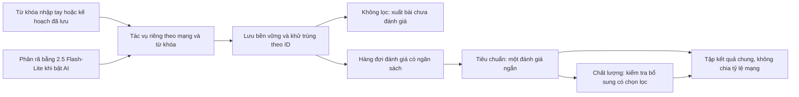

# ADR-025 — Phát triển lại CSD với chi phí được kiểm soát

### R9 — Sửa việc dừng nhầm theo số lần gọi AI, 03/11/2026

Người dùng yêu cầu sửa sau lượt tiếng Anh/IELTS Standard: 3.003 bài gốc, 2.996 chưa lọc xong, chi phí 0,0059655/3 USD. Nhật ký ghi `MODEL_CALL_LIMIT_REACHED`; giao diện đặt `maxCalls=3`. Sổ USER gồm một lần 2.5 cũ chi phí 0, một lần phân rã prompt và một batch phân loại 8 bài. Đây là trần cục bộ CSD, không phải bằng chứng Google hết tiền. Chưa xác định thao tác nào đã lưu giá trị 3.

- Bỏ giới hạn tổng số lần gọi khỏi luồng USER và giao diện. Đọc được cấu hình cũ nhưng bỏ trường `maxCalls`, giữ nguyên các trần tiền và lịch sử. Không tăng trần tiền hay xóa số tiền đã dùng. DEVELOPMENT vẫn bắt buộc tuân thủ số lần gọi được cấp.
- Giữ đặt chỗ chi phí trước mỗi yêu cầu, trần tiền từng lượt/cộng dồn/ngày, tốc độ gọi và số lần thử lại hữu hạn. Không thay model hoặc chính sách phân loại.
- Phân biệt rõ bài chưa lọc với yêu cầu đang chờ gửi; giải thích nguyên nhân tạm dừng bằng tiếng Việt, phân biệt tiền trong CSD với lỗi thanh toán/quota của Google.
- Tiếp tục lượt đã đạt trần bài thô sẽ xử lý công việc đã lưu, không khởi động lại tìm kiếm. Thu bình luận có giới hạn vẫn hoạt động khi AI tạm dừng vì tiền/quota; lỗi lưu trữ, mất quyền xử lý công việc, chặn tài khoản và Dừng của người dùng vẫn được tôn trọng.
- Kiểm chứng bằng fixture/mocks và AppData cô lập, **0 lần gọi AI thật**. Không tự tiếp tục lượt tiếng Anh bằng API trong nhiệm vụ sửa lỗi này.

Chi tiết bàn giao: [báo cáo R9](../reports/csd-budget-stop-fix-20261103.md).

- Ngày: 03/11/2026, Asia/Bangkok.
- Phạm vi ban đầu: lập kế hoạch, kiểm tra model và tổ chức Git. Người dùng sau đó duyệt triển khai; trạng thái bản ứng viên được cập nhật ở mục 9.
- Nền: `csd-next-rc7-20261103`, commit `c4c48ed9ec0389ab4e504777a6cbbde1375301f0`.
- Nhánh hiện hành: `codex/csd-rebuild`.
- Thay quyết định vận hành của ADR-023/024 cho phần phát triển mới; giữ các mốc cũ để đối chiếu.

### Quyết định bổ sung ngày 03/11/2026: model 3.1 và phép thử trực tiếp

Sau khi 2.5 Flash-Lite trả 404, người dùng đã chọn **Gemini 3.1 Flash-Lite** và cấp tối đa **6 USD tổng** cho nhiệm vụ crawl prompt piano mở rộng bằng Tiêu chuẩn/Chất lượng. Quyết định mới thay lựa chọn 2.5 cho lượt mới, không xóa lịch sử chi phí hoặc cho phép fallback tự động. Giá văn bản 3.1 dùng khi đo: 0,25 USD/triệu token vào, 1,50 USD/triệu token ra; số tiền theo usage không thay hóa đơn Google. [Giá Google](https://aistudio.google.com/docs/pricing#gemini-3.1-flash-lite).

Nhánh triển khai và đo: `codex/csd-r7-piano-comparison`, từ candidate R6. Hai mode dùng chung dữ liệu mới, cùng mục tiêu và bằng chứng; mục tiêu 1.000 bài phù hợp/mode. Mỗi `(mạng, từ khóa)` có cửa sổ/checkpoint riêng. Toàn bộ planner, preflight, phân loại, kiểm tra bổ sung và lỗi/thử lại cùng dùng ledger DEVELOPMENT đã tồn tại, trần nhiệm vụ 6 USD. Không dùng lại nhãn tham chiếu của prompt piano cũ để chấm prompt mới rộng hơn.

Preflight generation 3.1 và phép thử trực tiếp đã hoàn tất. Kết quả: 3.222 bài gốc, Tiêu chuẩn nhận 1.356, Chất lượng nhận 1.005; xuất 1.000 bài/mức. Tổng token cost 1,253847 USD, không còn dự phòng. Người dùng làm rõ chỉ lấy nội dung liên quan piano. Chi tiết chất lượng và giới hạn ở mục 10; chưa coi đủ số lượng hay unit tests là nghiệm thu toàn bộ bộ lọc.

## 1. Vấn đề và trách nhiệm

Người dùng báo AI Studio đã ghi nhận 40 USD sử dụng, trong đó 17 USD đã trừ từ thẻ Visa qua thanh toán tự động. Đây là số người dùng kiểm tra trên nhà cung cấp, không phải số đã được đối soát bằng ledger của CSD. Hai lượt piano mới nhất chỉ giải thích khoảng 5,6567 USD chi phí theo token usage tại giá gateway; không được coi chúng là toàn bộ hóa đơn 40 USD.

RC7 đã tăng số cửa sổ và yêu cầu AI đồng thời trước khi chứng minh chi phí cho mỗi bài được giữ và chất lượng có ích. Đây là thiếu sót của quá trình phát triển. Kiểm thử phần mềm đạt không bù được việc kết quả ít, chi phí cao hoặc loại nhầm nhu cầu thật.

Mục tiêu mới: có một đường thu thập hữu ích không dùng API trả phí; thêm AI theo mức lọc người dùng chọn; mỗi thử nghiệm có giới hạn tiền, đầu ra có thể kiểm tra và một giả thuyết cụ thể.

### Bằng chứng đã xác minh

| Chỉ số | Lượt 11:59 ngày 03/11 | Lượt 12:18 ngày 03/11 |
|---|---:|---:|
| Cửa sổ collector | 4 | 6 |
| Bản ghi crawler | 524 | 433 |
| Bài gốc vào bộ lọc | 522 | 428 |
| Phù hợp / không phù hợp / chưa xong | 116 / 218 / 188 | 108 / 138 / 182 |
| Lần gọi AI | 235 | 178 |
| Chi phí ước tính USD | 2,8175232 | 2,8391890 |
| Token đầu ra, gồm thinking | 1.028.991 | 1.054.093 |
| Tỷ trọng chi phí đầu ra | 91,30% | 92,82% |
| Nguyên nhân dừng | MODEL_BUDGET_EXHAUSTED | HTTP 402 / MODEL_BILLING_EMPTY |

Hai lượt không có lỗi HTTP 429 trong ledger. Lượt sau mới bắt đầu 3/8 từ khóa trên mỗi mạng; chưa thu bình luận. Hai và năm bản ghi chênh với số bài gốc là trả lời Threads không có root_post_id trong bản xuất thô. Không cộng kết quả hai lượt thành số người duy nhất.

Một lỗi đã xác nhận: phụ huynh tìm giáo viên piano cho con được vòng đầu nhận SUITABLE, rồi vòng kiểm định đổi sang NOT_SUITABLE vì hiểu sai vai trò. Cần giữ trường hợp này trong bộ hồi quy. Chưa đo tỷ lệ sai trên toàn bộ dữ liệu.

Nguồn kiểm tra: hai collection `crawl-6b59136f-a4e7-4219-9c13-559d90077c15` và `crawl-9a6373d3-414d-4e3a-9172-076fd0e38220`; aggregate và hash trong [evidence](../evidence/csd-rebuild-baseline-20261103.json). Dữ liệu thô và script đọc chỉ nằm ở AppData/artifacts, không đưa vào Git.

## 2. Quyết định model và quản lý chi phí

**Người dùng đã chọn Gemini 2.5 Flash-Lite**, sau khi làm rõ lựa chọn 3.1 hay rẻ hơn 3.1. Dùng `gemini-2.5-flash-lite` cho phân rã, hỏi làm rõ và các mức lọc có AI. Không tự chuyển sang model đắt hơn khi lỗi hoặc thiếu quyền.

Giá Standard cho text, kiểm tra ngày 03/11/2026:

| Model | USD / triệu token đầu vào | USD / triệu token đầu ra |
|---|---:|---:|
| Gemini 2.5 Flash-Lite — được chọn | 0,10 | 0,40 |
| Gemini 3.1 Flash-Lite | 0,25 | 1,50 |
| Gemini 3.5 Flash-Lite — RC7 | 0,30 | 2,50 |

Đơn giá đầu ra của 2.5 thấp hơn 3.5 là 84%; đây không phải cam kết giảm tổng chi phí 84%, vì số token, số lượt sửa và chất lượng có thể thay đổi. [Giá chính thức](https://aistudio.google.com/docs/pricing#gemini-2.5-flash-lite).

Google hiện ghi 2.5 Flash-Lite chưa deprecated và còn qua API, nhưng có điều kiện truy cập với nhóm 2.5. GET metadata bằng key lấy từ cấu hình môi trường Windows trả HTTP 200 ngày 03/11, model version 001, có generateContent. Chưa gọi generateContent nên **chưa xác nhận quyền inference và trạng thái billing thực tế**. Nếu bị chặn thì giữ chế độ không lọc và báo đúng lỗi. [Vòng đời model](https://aistudio.google.com/docs/deprecations#gemini-2.5-flash-models).

### Những thay đổi phải làm trước khi thử AI trả phí

1. Một sổ chi phí phát triển dùng chung giữa script, app và worktree, ngoài Git; cộng ngân sách toàn đợt, không reset theo campaign. Có khóa/transaction để không vượt trần do chạy đồng thời.
2. Trước khi dispatch, giữ chỗ chi phí tối đa cho input/output; đối soát usage sau phản hồi. Yêu cầu gián đoạn chưa biết chi phí tiếp tục giữ khoản dự phòng sau restart.
3. Phân biệt đang thiếu chỗ vì request khác còn chạy với đã hết ngân sách thực: đợi request đang chạy quyết toán trước khi báo hết tiền. Không hủy cả pipeline do một batch lớn chưa đặt được chỗ.
4. Tách trần phát triển, trần mỗi lượt người dùng, trần chi tiêu CSD cộng dồn/ngày do người dùng chọn và giới hạn lưu trữ. Tạo lượt mới không reset trần cộng dồn. Mọi planner/clarifier/reviewer/retry/background job đều phải đi qua một bộ kiểm soát chi phí; không có đường gọi fetch riêng bỏ qua hạn mức. Đổi ngày chỉ ảnh hưởng ngân sách ngày, không xóa lịch sử hoặc ngân sách toàn đợt phát triển.
5. Hiển thị đã dùng, đang dự phòng, còn lại và giới hạn đã chọn. Sổ CSD là chi phí ước tính, không đại diện số dư/hóa đơn toàn tài khoản Google hoặc ứng dụng khác.
6. Thinking của 2.5 mặc định tắt cho phân rã và Standard; Quality chỉ tăng khi thử nghiệm nhỏ chứng minh đáng giá. Dùng tham số hợp lệ của 2.5 (`thinkingBudget`), không gửi `thinkingLevel` của 3.x.
7. Metadata và giá theo model riêng. Không gán quota 4K RPM của 3.5 cho 2.5, cũng không dùng nhầm giới hạn Free Tier 13 RPM/500 RPD đang hardcode cho mọi model khác 3.5. Giới hạn concurrency ban đầu nhỏ, tách khỏi số cửa sổ; điều chỉnh bằng quota thực và số đo.
8. Không tự bật theo dõi/revisit/sửa format vô hạn. Mỗi batch có số lần thử và trần token hữu hạn; lỗi lặp giữ lại để xử lý sau. Cache theo nội dung, phiên bản mục tiêu, mode, model và recipe; metadata like/view thay đổi không đủ để gọi lại AI.
9. Giữ ledger của model cũ để tính tiền đã dùng và audit. Chuyển model cho một lượt cũ là revision rõ ràng, không sửa nhãn/model quá khứ hoặc đọc nhầm giá. App RC7 đã phát hành không tự đổi model khi chỉ sửa kế hoạch.

### Ngân sách phát triển

- Lượt lập kế hoạch này: **0 yêu cầu sinh nội dung**; chỉ GET metadata, đọc tài liệu và dữ liệu cục bộ.
- Coding, typecheck, unit tests, replay parser và UI fixture: mặc định **0 USD API**.
- Phép thử inference sau khi có guard: đề xuất tối đa **0,10 USD / phép thử**, tối đa **1 USD cộng dồn cho đợt đánh giá đầu**, kèm giới hạn số call/số bài trước khi chạy. Đây là đề xuất để cấp ngân sách, chưa phải quyền tự tiêu tiền.
- Không chạy lại toàn bộ 5.778 bài chỉ vì sửa prompt. Tái sử dụng snapshot/cache; chạy tập nhỏ rồi mới mở rộng trong ngân sách được cấp.
- Không tự thay đổi auto-reload/billing của Google. Chặn chi tiêu CSD không ngăn chi tiêu từ các phần mềm khác hoặc thanh toán tự động do Google quản lý.

## 3. Electron — một từ khóa, một tác vụ/cửa sổ

Ý tưởng mở riêng từng từ khóa đúng ở việc tách công việc và tăng độ phủ sớm. Đơn vị thực tế là `(mạng xã hội, hồ sơ, từ khóa)`: 8 từ khóa trên 2 mạng là 16 tác vụ; Top/Recent là trạng thái của cùng tác vụ, không nhân đôi cửa sổ mặc định.

Giới hạn cứng 2–3 cửa sổ/mạng trong RC7 là lựa chọn triển khai bảo thủ, chưa dựa trên profiling của máy người dùng. Thiết kế mới:

- Mỗi tác vụ có query, cursor, checkpoint, trạng thái, số bài mới/trùng và lý do dừng riêng; có thể sở hữu một BrowserWindow riêng.
- Có chế độ mở toàn bộ tác vụ song song khi tài nguyên đủ. Khởi động lệch nhau để tránh dồn việc tải trang trong cùng một thời điểm.
- Mặc định điều phối tự động: tăng dần số cửa sổ đang hoạt động, đo RAM/CPU/thời gian phản hồi; pause/checkpoint tác vụ khi có áp lực rồi tiếp tục sau. Giảm số cửa sổ không làm mất query khỏi kế hoạch.
- Máy đo tại thời điểm lập kế hoạch có khoảng 15,9 GiB RAM, 6 logical processors, còn 4,8 GiB RAM. Chưa đo bộ nhớ cho mỗi cửa sổ Facebook/Threads; không lấy một con số RAM giả định làm kết luận 16 cửa sổ chắc chắn chạy tốt hoặc chắc chắn không chạy được.
- Khi số tác vụ lớn hơn số cửa sổ có thể chạy, cấp lát xử lý ngắn cho mỗi query trước khi đào sâu tiếp. Thử 2–3 trang mỗi lát như tham số ban đầu rồi đo; không cho query đầu chiếm toàn bộ thời gian.
- Chung session theo hồ sơ, observer gắn đúng webContents. Không chia sẻ cursor giữa query. Giới hạn/cảnh báo từ mạng xã hội được xử lý theo đúng hồ sơ; thêm cửa sổ không tạo thêm quyền/quota của nhà cung cấp.
- UI cho thấy tác vụ đã chạy, đang chờ, hết nguồn hoặc lỗi. Không gọi hoàn tất khi còn query chưa chạy mà không ghi rõ nguyên nhân.

Mỗi BrowserWindow có renderer riêng, nên RAM/CPU có liên quan thực tế. Tuy nhiên, giới hạn tài nguyên chỉ nên điều khiển số tác vụ hoạt động, không được làm mất kế hoạch tìm kiếm. [Electron process model](https://www.electronjs.org/docs/latest/tutorial/process-model), [đo hiệu năng](https://www.electronjs.org/docs/latest/tutorial/performance).

Không hứa “không bỏ sót mọi bài”: kết quả tìm kiếm có ranking, giới hạn truy cập/phân trang và bài không được trả về. Cam kết có thể kiểm tra là mọi query được ghi nhận và mọi batch đã nhận được lưu trước khi checkpoint; truy vấn chưa chạy được báo rõ.

## 4. Thu thập và AI hoạt động độc lập

- Ghi dữ liệu thô trước, checkpoint sau. Dedup trong transaction theo `(platform, root_post_id)` và alias URL đã xác minh; giữ provenance của tất cả query tìm ra bài đó.
- Không xóa hai nhu cầu khác người chỉ vì câu chữ giống nhau. Trùng nội dung giữa hai mạng được đánh dấu nghi ngờ; chỉ gộp khi có bằng chứng cùng bài/thực thể. Mục tiêu là số bài/hội thoại, không tự đổi thành số người duy nhất.
- AI hết tiền, hết quota, timeout hoặc thiếu key chỉ làm hàng đợi AI tạm dừng. Crawler tiếp tục đến trần bài thô, dung lượng, mục tiêu đã đạt hoặc người dùng dừng.
- Backpressure theo byte/hàng đợi trên đĩa được công khai; bỏ phụ thuộc cứng “128 job phân loại thì dừng lấy trang” đang trói tốc độ crawl vào AI. Khi chạm giới hạn thật thì pause có checkpoint, không bỏ bản ghi.
- Người dùng có thể thu trước, lọc sau và đổi mức lọc trên dữ liệu đã thu. Không phải crawl hoặc phân rã lại nếu đầu vào/mục tiêu không đổi.
- Chỉ thay đổi bằng chứng ảnh hưởng ngữ nghĩa mới tạo yêu cầu đánh giá mới; gộp các cập nhật gần nhau. Không lặp lại đánh giá toàn bài vì mỗi lần nhìn thấy cùng bài hoặc thay đổi counter.
- Xử lý dở dang, model error và thiếu bằng chứng để xác định cả chủ đề/vai/mục đích có trạng thái vận hành riêng. Không ép chúng vào nhãn không phù hợp và không tính như kết quả đạt. Phân biệt các trường hợp này với bài đã đánh giá có tín hiệu nhu cầu hợp lý nhưng chưa trực tiếp hoặc thiếu thông tin phụ: mức Tiêu chuẩn có thể nhận nhóm sau theo chính sách ở mục 5.

## 5. Thanh gạt ba mức lọc

**Làm rõ yêu cầu ngày 03/11/2026:** “50% năng lực” là cách người dùng diễn đạt việc chấp nhận giảm độ tinh của tập đầu ra xuống khoảng 60% để tăng số lượng bài hữu ích và tiến gần chỉ tiêu trong ngân sách. Đây là yêu cầu thay đổi chính sách tuyển bài, không chỉ giảm một nửa lượt gọi API, token hay chạy bộ lọc chặt hiện tại với ít vòng hơn.

Ví dụ mục tiêu 1.000 bài: người dùng chấp nhận tập có khoảng 600 bài đúng nhu cầu, phần còn lại có tín hiệu yếu hơn hoặc cần xem thêm, thay vì tiêu hết ngân sách và chỉ nhận 40–100 bài mà vẫn có nhu cầu thật bị loại nhầm. Khoảng 60% là mục tiêu chất lượng của cả tập được nhận, cần đo bằng nhãn kiểm tra độc lập; không phải confidence 0,6 do LLM tự chấm, không phải chủ đích chèn 40% bài sai cho đủ số lượng và chưa phải cam kết đã đạt.

Hướng thiết kế Tiêu chuẩn: **thu rộng → xếp hạng ứng viên → tuyển dần tới chỉ tiêu theo ngưỡng chất lượng đã chọn và ngân sách**. Giảm số vòng, đầu ra và tái sử dụng kết quả là biện pháp tiết kiệm hỗ trợ hướng này; không thay thế việc tăng độ bao phủ và giảm loại nhầm.

| Mức | Hành vi | Đếm mục tiêu | Chi phí model |
|---|---|---|---|
| Không lọc — mặc định lần đầu | Giữ bài tìm được, bỏ trùng chính xác và bản ghi kỹ thuật lỗi; xuất trạng thái chưa đánh giá | N bài gốc duy nhất | 0; không khởi tạo planner/classifier/reviewer/watch |
| Tiêu chuẩn | Thu rộng, nhận cả tín hiệu nhu cầu hợp lý; xếp hạng và tuyển dần, ngưỡng nhận rộng hơn Chất lượng; một lần đọc ngữ nghĩa theo batch | Ưu tiên tiến tới N bài, với mục tiêu độ tinh khoảng 60% được kiểm chứng | 2.5 Flash-Lite; đầu ra gọn, trần chi phí riêng |
| Chất lượng | Tái dùng kết quả Tiêu chuẩn; kiểm tra thêm ca có ràng buộc khó, mâu thuẫn hoặc bằng chứng yếu | N bài được mức Chất lượng nhận | Cùng model; tối đa một lượt bổ sung cho mỗi phiên bản bằng chứng |

### Không lọc thực sự miễn phí API

Nhập trực tiếp danh sách từ khóa hoặc dùng lại kế hoạch đã lưu. Phân rã/hỏi ngược bằng LLM là thao tác có phí riêng, chỉ có khi người dùng bật AI; không gọi ngầm rồi ghi “miễn phí”. Không tự tạo từ khóa giả và gắn nhãn LLM. Không gắn SUITABLE cho bài chưa đánh giá.

### Tiêu chuẩn

- Giữ mục tiêu và các nhánh HOẶC đã chốt. Người đăng, người đại diện và người thụ hưởng tách nhau: phụ huynh tìm giáo viên cho con là nhu cầu học; hỏi mua/mượn/thuê là các ý riêng, không tự thay cho nhau.
- Nhận cả nhu cầu trực tiếp và tín hiệu nhu cầu gián tiếp hợp lý trong phạm vi đã chốt. Với piano, xét người tìm lớp, phụ huynh tìm giáo viên cho con, người hỏi chọn đàn hoặc cân nhắc bắt đầu học; không bắt người đăng phải viết đúng câu “tôi muốn mua/học”. Việc chỉ nhắc đến piano hoặc đăng quảng cáo bán khóa học không tự trở thành nhu cầu học/mua đàn.
- Mỗi câu trả lời chỉ cần ID, kết quả theo mode, vai/mục đích, quote hoặc span thực và lý do ngắn. Không trả lại ma trận 15 tiêu chí với quote lặp cho mỗi nhánh. Bằng chứng và kiểm tra ràng buộc bắt buộc vẫn được giữ.
- Mục tiêu kỹ thuật ban đầu: khoảng 80–160 token đầu ra/bài, batch bị chặn bởi token/byte chứ không chỉ số bài. Đây là mục tiêu để đo, không được cắt mất bằng chứng quyết định để đạt định mức.
- Ưu tiên độ bao phủ; thiếu thông tin phụ hoặc chưa có câu xác nhận nhu cầu trực tiếp không tự thành lý do loại. Bài có tín hiệu hợp lý được giữ trong tập ứng viên và có thể được Tiêu chuẩn nhận với bằng chứng cùng mức tín hiệu hiển thị rõ. Không bắt toàn bộ ứng viên này chờ kiểm định theo chuẩn Chất lượng mới được tính vào chỉ tiêu.
- Không nới sai chủ đề, đảo vai cung/cầu hoặc tự bỏ ràng buộc người dùng đã xác định là bắt buộc. Không coi ràng buộc bắt buộc đã đạt khi không có bằng chứng. Nếu chưa đủ dữ kiện để xác định cả chủ đề/vai/mục đích hoặc xét ràng buộc bắt buộc, giữ chưa quyết định và nêu lý do. Mức tín hiệu là thông tin giải thích/xếp hạng, không thêm nhãn phân loại cuối cùng thứ ba.
- Mục tiêu nghiệm thu là **độ tinh khoảng 60%, phấn đấu trên 60%, đồng thời tăng số bài đúng được giữ trong cùng ngân sách**. Hiệu chỉnh ngưỡng trên mẫu phát triển, sau đó đo trên mẫu độc lập; không lấy confidence LLM làm bằng chứng đạt mục tiêu.

### Tuyển đủ theo mức chất lượng và thích ứng khi thiếu bài

- Duy trì tập ứng viên chung từ các nguồn, xếp hạng theo bằng chứng chủ đề, vai, mục đích và khả năng hành động. Trong tập ứng viên đang có, ưu tiên tín hiệu mạnh rồi bổ sung tín hiệu vừa phù hợp mức Tiêu chuẩn. Không chờ crawl toàn bộ mạng xã hội mới trả kết quả.
- Khi còn thiếu chỉ tiêu, có thể nới ngưỡng nhận trong phạm vi Tiêu chuẩn đã được hiệu chỉnh bằng dữ liệu có nhãn; không hạ tùy tiện tới khi đủ N. Giữ lại ứng viên yếu để có thể xem lại mà không crawl lại; không bỏ vĩnh viễn chỉ vì chưa đạt mức Chất lượng, và không gọi lại AI cho cùng bằng chứng chỉ để thử lấy nhãn khác.
- Thay đổi cách tìm trước khi tiếp tục tiêu tiền lọc: mở rộng cách diễn đạt và tín hiệu gián tiếp trong mục tiêu đã chốt, khai thác bằng chứng từ bình luận, thử các query chưa được chạy. Theo dõi số bài mới duy nhất, tỷ lệ được nhận và bài đúng qua kiểm tra mẫu để ưu tiên query hữu ích; vẫn cho các query khác cơ hội chạy. Không lấy số nhãn được nhận làm bằng chứng chất lượng thực tế, không lặp mãi vài query rồi kiểm định nhiều vòng cùng nhóm bài.
- Theo dõi đồng thời số bài đạt/chỉ tiêu, precision, recall trên mẫu có nhãn, bài đúng ước tính trên mỗi USD, chi phí còn lại, độ phủ query và số bài đang chờ. Khi tiến độ cho thấy khó đạt N trong ngân sách, báo sớm căn cứ và lựa chọn mở rộng phạm vi hoặc dừng; không đợi tiêu hết tiền mới báo thiếu. Mở rộng vượt mục tiêu/ràng buộc đã chốt cần người dùng quyết định; thay đổi query bằng LLM vẫn nằm trong ngân sách chung.
- Nếu nguồn thực sự không đủ, không thể bảo đảm đồng thời 1.000 bài và độ tinh khoảng 60% bằng cách hạ ngưỡng. Hai lượt piano hiện tại chưa chứng minh đã cạn nguồn: còn query chưa chạy, bài chưa xử lý và ca nhu cầu thật bị loại nhầm. Phân biệt dừng do ngân sách, lỗi API, việc chưa xử lý và nguồn đã tìm hết trong phạm vi truy cập; không bù chỉ tiêu bằng bài trùng, sai chủ đề hoặc đếm bình luận thành bài gốc mới.

### Chất lượng

- Chọn trường hợp cần kiểm tra theo dữ kiện: phủ định, ràng buộc số/địa lý, người đại diện, bằng chứng từ bình luận, bất đồng vai/mục đích. Không gọi lại toàn bộ tập đầu ra theo mặc định.
- Vòng sau phải chỉ rõ tiêu chí và bằng chứng làm thay đổi quyết định. Nếu hai vòng mâu thuẫn mà chưa giải quyết được, giữ cả kết quả để xem lại; không lấy vòng sau làm chân lý và loại bài tự động.
- Không tự tăng model và không mở vòng thứ ba để chữa tiếp. Cache đánh giá theo recipe/mode/model; ngân sách mỗi mode vẫn nằm trong ngân sách tổng.
- Kiểm chứng thêm phải làm chất lượng đo được tốt hơn Tiêu chuẩn. Theo dõi cả bài đúng bị bỏ sót; không gọi “chất lượng” chỉ vì tập kết quả ít hơn.

Mốc chi phí mục tiêu ban đầu, cần đo trên mẫu trước: Tiêu chuẩn tối đa 0,20 USD / 1.000 bài gốc được đánh giá; Chất lượng tối đa 0,50 USD / 1.000 bài. Planner ghi riêng và tính vào tổng tiền lượt chạy. Không dùng các mốc này để hứa đủ 1.000 bài phù hợp, vì tỷ lệ phù hợp chưa biết. Tối ưu token/lượt gọi trước khi tăng ngân sách.

## 6. Bỏ chia tỷ lệ Facebook/Threads

Thay `threadsShare`, `desired_platform_weights` và mọi `platformTargets` bằng chính sách `GLOBAL_FIRST_QUALIFIED`.

- Không thay 70:30 bằng 50:50. Mọi mạng dùng chung một mục tiêu N; không có mức tối thiểu hoặc hạn mức kết quả riêng cho một mạng.
- Việc xếp hạng/tuyển ứng viên ở mục 5 diễn ra trước khi chấp nhận, áp dụng như nhau cho mọi mạng. Trong tập ứng viên đang chờ tuyển, ưu tiên mức tín hiệu; khi tương đương, ưu tiên bài hoàn tất đánh giá trước. Khi một bài duy nhất được chấp nhận theo mode, transaction cấp `accepted_sequence`. N bài đầu theo thứ tự này là kết quả mục tiêu; không đợi nền tảng còn lại bù tỷ lệ.
- Không lọc dùng thứ tự ghi nhận bài gốc mới; các mức có AI dùng thứ tự chấp nhận sau bước tuyển theo mode, không đơn thuần thứ tự API trả về. Đây không phải thứ tự ngày đăng bài.
- Khởi động các nguồn bình đẳng và giữ hàng đợi công bằng khi thiếu slot. Công bằng quyền chạy không đồng nghĩa chia đều số kết quả.
- Khi đủ N, dừng nhận trang mới, hoàn tất lưu batch đã nhận. Phần vượt N do yêu cầu đang chạy được lưu riêng, không xóa; UI phân biệt tập N mục tiêu và phần bổ sung.
- Ranking trong tập đã nhận dùng tính phù hợp/khả năng hành động/ngày đăng, không cộng điểm mặc định cho Threads hay Facebook. Metadata nguồn vẫn để kiểm tra.
- Dữ liệu cũ giữ nguyên phiên bản policy/nhãn để audit. Tiếp tục một lượt cũ dưới quy tắc mới tạo revision/migration có backup; không âm thầm dùng lại tỷ lệ cũ hoặc sửa file export cũ.

Các điểm cần thay gồm config/preset/draft, compiler, retained import, pipeline target/stop, progress, renderer và cooler. Chỉ bỏ dropdown ở giao diện là chưa hoàn tất.

## 7. Các chặng triển khai và tiêu chí bàn giao

| Chặng | Công việc | Bằng chứng phải có trước khi sang chặng tiếp |
|---|---|---|
| R0 — kế hoạch và mốc Git | ADR này, model đã chọn, baseline/chi phí, giữ mốc RC7 | Hoàn thành trong lượt này; không paid inference |
| R1 — chặn chi phí, đổi model | Guard dùng chung; 2.5 routing/thinking/pricing; chặn fallback; giữ ledger; mọi script cùng policy | Mock chứng minh không gọi khi hết budget, không reset sau restart, concurrent reserve đúng; metadata 200 chỉ là kiểm tra ban đầu |
| R2 — đường thu miễn phí và mục tiêu chung | OFF không gọi model; raw store/AI queue độc lập; bỏ tỷ lệ nền tảng; bộ đếm toàn cục | Fake gateway có call count=0; đủ N dù chỉ một nguồn có kết quả; model pause không làm mất crawl; Stop/Resume giữ dữ liệu |
| R3 — một tác vụ/cửa sổ mỗi query | Tạo đủ task, adaptive windows, lát thời gian, dedup và checkpoint | Fixture 8 từ khóa × 2 mạng; mọi query có trạng thái; không lẫn observer/cursor; đóng/crash một cửa sổ không phá cửa sổ khác; đo RAM/CPU thực |
| R4 — Tiêu chuẩn | Thu rộng, xếp hạng và tuyển dần với ngưỡng nhận rộng hơn Chất lượng; quyết định gọn một lượt; thích ứng query; UI thanh gạt | Hồi quy phụ huynh, cung/cầu, mua/thuê/mượn, nhu cầu gián tiếp; so với bộ lọc cũ về số bài đạt/chỉ tiêu, precision khoảng 60%, recall, token/bài và bài đúng/USD trong cùng ngân sách; không chỉ nghiệm thu số lượt API giảm |
| R5 — Chất lượng | Kiểm tra có chọn lọc, tối đa một lượt bổ sung, xử lý bất đồng và cache | Không có vòng lặp tốn tiền; so sánh với Standard trên cùng tập; không tự loại ca bất đồng |
| R6 — thử nhỏ và bản ứng viên | Mẫu có nhãn, đo thật trong envelope được cấp, người dùng thử | Số bài thô/đúng/bị bỏ sót, giá mỗi 1.000 đầu vào và mỗi bài đúng, thời gian, độ phủ query, RAM; rồi mới quyết định phát hành |

R2 là bàn giao hữu ích đầu tiên: thu và xuất không tốn API, không phải chờ hoàn thiện bộ lọc. R3 không phụ thuộc việc dùng hết hạn mức Gemini. Không thay những mốc này bằng chỉnh giao diện thương mại hoặc thêm provider không cần thiết.

### Kiểm thử tiết kiệm nhưng có ý nghĩa

- Dữ liệu piano và bốn bộ AppData trước đó được đọc lại như fixture; nguồn gốc giữ nguyên. Parser/dedup/queue/UI chạy offline.
- Tập ca hồi quy gồm lỗi đã biết; không dùng tỷ lệ đạt trên tập tuyển chọn này làm precision thực tế.
- Chuẩn bị một mẫu ngẫu nhiên cố định khoảng 100 bài gốc piano đã khử trùng giữa hai lượt, gồm cả bài bị loại và chưa xử lý; gán nhãn từ nội dung trước khi xem nhãn candidate. Mẫu độc lập dùng đánh giá, không dùng để chỉnh prompt rồi báo điểm trên chính mẫu đó.
- Báo precision = bài nhận đúng / bài được nhận; recall = bài đúng được nhận / tổng bài đúng trong mẫu; ghi số mẫu và ca chưa đủ dữ kiện. Tập nhỏ chỉ cho bằng chứng bước đầu, không bảo đảm mọi chủ đề >60%.
- So sánh các mức lọc trên cùng dữ liệu có nhãn và giới hạn chi phí; tách hiệu quả mở rộng nguồn khỏi hiệu quả thay ngưỡng lọc. Tiêu chuẩn phải chứng minh giảm bỏ sót và tăng số bài đúng hữu ích, không chỉ tăng tổng bài được nhận. Báo tỷ lệ hoàn thành chỉ tiêu kèm độ tinh đo được; không tuyên bố đạt 1.000 bài chỉ vì đã crawl 1.000 bài thô.
- Trước paid sample, một kiểm tra cực nhỏ của 2.5 để xác minh generation access trong envelope đã được cấp. Metadata 200 không thay thế phép kiểm tra này. Nếu thất bại, không retry liên tục và không đổi model đắt hơn.
- Mỗi vòng cải tiến nêu giả thuyết, thay đổi, chi phí và kết quả. Chỉ chạy phần bị ảnh hưởng; suite toàn bộ ở mốc tích hợp. Chưa cần đào tạo model/RL: vòng phản hồi là cải tiến có kiểm chứng, không tuyên bố model tự học từ feedback.

## 8. Git và quay lại cải tiến từng phần

Một nhánh tích hợp mới `codex/csd-rebuild` từ RC7, tại workspace gốc. Các nhánh dài hạn cũ được giữ làm checkpoint; không xóa worktree, reset hoặc rebase lịch sử đã bàn giao.

Khi bắt đầu từng chặng, tạo nhánh ngắn `codex/csd-r1-cost`, `codex/csd-r2-raw`, `codex/csd-r3-windows`, `codex/csd-r4-standard`, `codex/csd-r5-quality` từ rebuild mới nhất. Chưa tạo hàng loạt nhánh rỗng. Mỗi chặng có commit rõ phạm vi, kiểm tra rồi merge `--no-ff` vào rebuild. Interface dùng chung/migration tách commit khi cần.

- Tag hiện có `csd-next-rc7-20261103` giữ nguyên.
- Tag kế hoạch mới: `csd-rebuild-plan-20261103` — chỉ chứng nhận kế hoạch/Git, không phải bản phần mềm đã hoạt động.
- Khi từng bản chạy đạt tiêu chí mới tạo tag `csd-rebuild-rN-YYYYMMDD`; không gắn tag hoàn tất trước khi có bằng chứng.
- Giữ raw collector và filter engine qua interface/version riêng. Khi bộ lọc chưa đạt, sửa nhánh lọc hoặc chọn mode OFF/recipe cũ tương thích; không quay lùi cả crawler.
- Revert một thay đổi phải xét phụ thuộc. Git không tự bảo đảm code sau revert vẫn tương thích; tag/worktree là mốc để đối chiếu, không thay kiểm thử.
- `codex/csd-production` và remote chưa nhận bản rebuild. Chỉ promote mốc đã được người dùng chấp nhận; local commit không được trình bày như đã publish.
- File xuất bài người dùng đang có trong workspace, AppData, API key và portable không được stage/commit. Không sửa bộ dữ liệu để làm đẹp kết quả đo.

## 9. Trạng thái triển khai ngày 03/11/2026

Đã triển khai R1–R5 vào nhánh tích hợp `codex/csd-rebuild` qua các nhánh chặng riêng. Bản ứng viên **0.4.0-rebuild.1** có đường OFF miễn phí, mục tiêu chung, cửa sổ theo query, guard chi phí và Standard/Quality theo recipe mới. Giữ nguyên mốc RC7, chưa promote production hoặc push remote.

Kiểm tra offline đã đọc và replay 6.728 snapshot từ bốn nguồn cũ và hai lượt piano, không sửa nguồn; UI thực và module trong gói ASAR đạt. Đã mở 16 cửa sổ Electron thật với trang localhost và đo tài nguyên. Đây chưa phải số đo sức tải Facebook/Threads thật.

R6 mới hoàn tất phần chuẩn bị và bản chạy: mẫu ngẫu nhiên cố định 100/814 bài piano duy nhất đã được đọc, gán nhãn tham chiếu trước khi xem dự đoán candidate; nhãn do một agent đọc, chưa có khách hàng xác nhận. Sau khi người dùng cấp tối đa **25 lần gọi / 0,10 USD tổng / Gemini 2.5 Flash-Lite**, preflight generateContent đầu tiên trả **HTTP 404 MODEL_NOT_AVAILABLE**. Ledger ghi 1 lần gọi, 0 USD, không dự phòng còn treo. Không chạy tiếp 100 bài, không đổi model.

GET metadata và danh sách model vẫn trả 200. Google ghi quyền dùng 2.5 hiện bị giới hạn cho người đã sử dụng trước đó; metadata không xác nhận quyền inference của key/project. [Thông báo của Google](https://aistudio.google.com/docs/models/gemini-2.5-flash-lite).

**Chưa nghiệm thu độ tinh, recall và chi phí/bài của bộ lọc mới.** Không gắn nhãn hoàn tất R4–R6 chỉ từ unit tests. Mẫu, nhãn, script và ngân sách được giữ để tiếp tục khi quyền 2.5 được giải quyết; nếu đổi model phải có quyết định mới của người dùng. Xem [báo cáo bàn giao](../reports/csd-rebuild-candidate-20261103.md) và [bằng chứng tổng hợp](../evidence/csd-rebuild-candidate-20261103.json).

## 10. R7 — kết quả Gemini 3.1 và piano ngày 03/11/2026

Mục 9 giữ nguyên như hồ sơ R6 trước khi đổi model. Theo quyết định mới của người dùng, R7 dùng Gemini 3.1 Flash-Lite, tổng trần 6 USD, cùng một tập crawl cho hai mức, không phân bổ tỷ lệ mạng. Phạm vi đã làm rõ: chỉ piano, gồm nhu cầu học/mua/thuê, thảo luận, câu chuyện và đam mê. Không tự mở sang âm nhạc nói chung.

Đã chạy 16 query trên mỗi mạng, tất cả 32 tác vụ có lượt xử lý; đỉnh đo được 17 tác vụ giữ quyền cửa sổ cùng lúc. Sửa giới hạn cũ 8 cửa sổ/hồ sơ, vòng đóng/mở do CPU và xử lý kết quả batch thiếu từng phần. Thêm hồi quy chuyển bản nháp 2.5 thất bại sang model 3.1 đã chọn, giữ ledger cũ. Bản **0.4.0-rebuild.2** đạt typecheck, 982 unit tests, kiểm tra main/preload/renderer và worker SQLite trong ASAR. Thử cửa sổ localhost đạt 24 cửa sổ riêng; không đồng nhất phép thử đó với tải mạng xã hội thật.

Thu 3.222 bài gốc duy nhất theo mạng/ID. Tiêu chuẩn: 1.356 nhận, 1.611 loại, 255 chưa kết luận. Chất lượng: 1.005 nhận, 1.726 loại, 491 chưa kết luận. Hai file xuất đều đúng 1.000 bài, phần dư giữ riêng. 147 trả lời Threads chưa có gốc nằm trong dữ liệu collector, không được tính thành bài gốc hay âm thầm nhận làm đủ số lượng.

Mẫu 120 bài lấy đều từ toàn bộ tập cuối, ẩn nhãn candidate khi đọc, cho 40 YES / 70 NO / 10 UNKNOWN. Trên phần có nhãn rõ, precision Tiêu chuẩn 82,2% (37/45), Chất lượng 88,6% (31/35); recall 92,5% (37/40) và 77,5% (31/40). Đây là tham chiếu của một coding agent, chưa phải nhãn khách hàng; khoảng bất định còn rộng. Chất lượng vẫn nhận nhầm một số bài cung ứng được model gán DIRECT, đồng thời giữ PENDING một số bài thảo luận/đam mê rõ vì đòi DIRECT theo chính sách chung. Chưa nghiệm thu mọi chủ đề hoặc tuyên bố bộ lọc xuất sắc.

Toàn nhiệm vụ: 1.070 API attempts, **1,253847 USD** theo usage/giá niêm yết, 0 USD dự phòng; ledger DEVELOPMENT đã đóng và giữ nguyên lịch sử. Bước tiếp theo ưu tiên xác định nhánh phù hợp và vai riêng cho từng nhánh, bỏ đòi tín hiệu mua/học đối với thảo luận/đam mê, kiểm tra rủi ro đảo cung–cầu cả ở ca DIRECT, và xử lý chọn lọc bằng chứng/ngữ cảnh thiếu. Không tự chi phần ngân sách còn lại cho thí nghiệm mới. Báo cáo cũng chỉ ra hạn chế bài cũ, chưa thu sâu bình luận/media và thời gian replay query.

Giữ mốc R7 để phát triển tiếp trên `codex/csd-rebuild`; chưa promote production. Xem [báo cáo R7](../reports/csd-piano-comparison-20261103.md) và [bằng chứng tổng hợp R7](../evidence/csd-piano-comparison-20261103.json).

## 11. R8 — điều kiện nội dung tiếng Việt

Người dùng báo bốn bài tiếng Nhật lọt vào tập và xác nhận rõ: **nội dung tiếng Việt, kể cả người Việt ở nước ngoài**. Đây là điều kiện ngôn ngữ, không phải giới hạn quốc gia. Kế hoạch R7 thiếu điều kiện này; kết quả và điểm số R7 thuộc phạm vi cũ, không tiếp tục được trình bày là tập đã đáp ứng yêu cầu mới.

Đã thêm lựa chọn ngôn ngữ hiển thị trong app, mặc định Tiếng Việt, truyền xuyên suốt draft/preset/kế hoạch. Bộ kiểm tra cục bộ chặn ca sai ngôn ngữ trước AI và kiểm tra lại đối tượng cùng bằng chứng trước khi nhận, kể cả cache. Bài mơ hồ ngôn ngữ giữ chờ, không tự loại tiếng Việt không dấu hoặc người Việt ở nước ngoài. Không suy quốc tịch từ tên.

Bản sửa offline tái dùng toàn bộ kết quả ngữ nghĩa và dữ liệu R7; không trả phí hoặc crawl lại. Sau khi xét cả phần dư, còn **980 Standard / 819 Quality**, thiếu 20 / 181 so với mục tiêu 1.000. Không nới ngôn ngữ để làm đầy chỉ tiêu. Cả bốn bài báo lỗi đều bị loại. Nhãn cũ và dữ liệu nguồn giữ nguyên, bản sửa có phiên bản riêng. Chi tiết ở [báo cáo R8](../reports/csd-vietnamese-language-fix-20261103.md).
