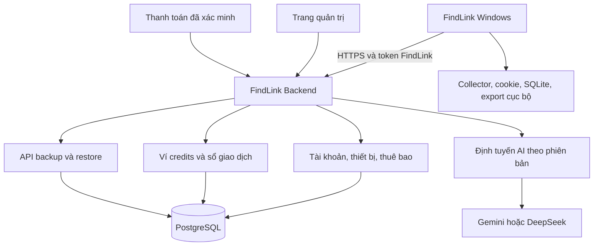

# FindLink — kế hoạch phân phối và quản lý thuê bao lần đầu

Ngày nghiên cứu: 10/11/2026, Asia/Bangkok. Nhánh: `findlink-publish-1st`, tạo trước khi nghiên cứu, từ `bac9399` trên baseline FindLink hiện tại. Trạng thái: đề xuất kiến trúc và thương mại; chưa triển khai backend, đổi model, mở bán hoặc phát hành bản mới.

Người dùng đã xác nhận khách hàng ưu tiên là **doanh nghiệp nhỏ và agency**. Mục tiêu là **lãi 10–100 triệu VND trên mỗi tài khoản khách hàng mỗi năm, trước thuế**, sau chi phí AI, hạ tầng, hỗ trợ và bán hàng. Một tài khoản thương mại có thể có nhiều người dùng được cấp ghế; không nhân lợi nhuận trong bảng với số ghế.

## 1. Quyết định đề xuất

1. Giữ thu thập Facebook/Threads, cookie, SQLite, dữ liệu làm việc và export trên máy khách. Thêm **FindLink Backend** làm nơi xác thực tài khoản, quản lý thuê bao, ví credits, định tuyến AI và sao lưu.
2. Khách trả phí nhận quyền sử dụng FindLink qua tài khoản. **Không cấp Gemini/DeepSeek API key của chủ sản phẩm xuống máy khách.** Desktop nhận token FindLink có thể thu hồi; provider key chỉ tồn tại trên server.
3. Giữ quy đổi **1 USD = 1.000 credits**. Tách sổ chi phí provider với sổ credits của khách; lợi nhuận chủ yếu đến từ phí thuê phần mềm năm. Không gọi doanh thu credits bán ngang giá vốn là lợi nhuận.
4. Cấp tối đa **100 credits dùng thử một lần**, ưu tiên 20 credits cho khách chưa đăng nhập và mở thêm 80 khi xác minh tài khoản. Người đăng ký trực tiếp có thể nhận đủ 100; chuyển từ guest sang account không được nhận lại 100.
5. Trial nên dùng API trả phí do FindLink tài trợ, giới hạn tối đa 0,10 USD AI được cấp cho khách. “Miễn phí cho khách hàng” không bắt buộc dùng free tier của provider. Free tier chỉ dùng khi loại dữ liệu và điều khoản phù hợp.
6. Thử nghiệm ba gói thuê năm **Starter 23 triệu, Agency 70 triệu, Scale 235 triệu VND/tài khoản**, chưa gồm thuế gián thu nếu có. Đây là giá đề xuất từ mô hình chi phí và mục tiêu lợi nhuận, chưa phải bằng chứng thị trường sẽ mua.
7. Phát hành Starter trước. Agency/Scale chỉ bán những quyền lợi đã có thật; quản trị nhiều ghế, hỗ trợ doanh nghiệp và tích hợp cần các đợt phát triển tiếp theo.

## 2. Khoảng cách từ mã hiện tại

| Thành phần hiện tại | Bằng chứng | Thay đổi cần làm |
|---|---|---|
| Desktop lấy `DATABASE_URL`, kết nối PostgreSQL trực tiếp | `src/main/index.ts:45–49`; `src/infrastructure/projects/postgres.ts:37`; [đặc tả database](specs/project-database-v1.md) | Chuyển kết nối DB sang backend; desktop chỉ dùng API đã xác thực. Đặc tả hiện tại đã giới hạn cách này cho môi trường tin cậy. |
| Đăng ký/đăng nhập và backup đã có | `src/infrastructure/projects/postgres.ts`; `src/infrastructure/projects/workspace.ts` | Tái dùng dữ liệu/ID, chuyển ranh giới xác thực sang server; thêm xác minh, khôi phục, revoke và giới hạn thử đăng nhập. |
| Key Gemini và gọi provider nằm trên desktop | `src/infrastructure/llm/gemini-gateway.ts`; `src/main/index.ts` | Thêm `RemoteModelGateway`, giữ provider adapter trên server. |
| Có cổng `ModelGateway.generateJson()` | `src/application/ports/model-gateway.ts:58` | Là điểm thay adapter; không cần viết lại collector. |
| Có `ProjectBackupStore` | `src/infrastructure/projects/postgres.ts:14` | Thêm `HttpProjectBackupStore`; DB adapter chỉ có trên server của bản managed. |
| Spend ledger máy dùng integer nanodollar, reservation và held | `src/infrastructure/llm/durable-spend.ts` | Giữ lịch sử nguyên vẹn; thêm account wallet server có tính nguyên tử trên nhiều máy. |
| Model đang bị ràng buộc theo Gemini | `src/infrastructure/llm/campaign-model-gateway.ts`; `durable-spend.ts` | DeepSeek cần adapter, kiểm tra schema, usage, chất lượng và phiên bản; chưa phải đổi tên model là xong. |
| Chỉ build Windows portable, chưa có updater | `package.json` | Thêm signed NSIS installer và update channel; portable giữ đường cập nhật thủ công. |

Chưa có ví credits thương mại, thanh toán, entitlement thuê bao, remote-config service hoặc auto updater trong baseline đã kiểm tra. Các “subscription” của discovery lịch sử không phải thuê bao trả tiền.

## 3. Quản lý từ xa

Bắt đầu bằng **một backend TypeScript dạng module**, một PostgreSQL, worker tác vụ bền vững và kho secrets. Chưa cần chia microservices. Backend dùng hàng đợi/outbox trong DB ở pilot; bổ sung hệ thống queue riêng khi đo thấy cần. Mỗi môi trường development/staging/production có secrets và dữ liệu riêng.

Trang quản trị cần: tìm tài khoản; gói và ngày hết hạn; ghế/thiết bị; số dư và credits đang giữ; grant/refund có lý do; revoke token; phiên bản model/giá; tổng spend thực tế; lỗi và request đang chờ đối soát; bản desktop được hỗ trợ. Mọi thay đổi ảnh hưởng tiền hoặc quyền truy cập có actor, thời điểm, trước/sau và audit log. Quản trị dùng MFA và quyền tối thiểu.

Server quyết định model/provider, mục đích yêu cầu, giới hạn input/output, ngân sách, bảng giá và feature flags. Client không được gửi URL provider tùy ý hoặc tự khai giá, số dư, token usage để server tin theo. Các endpoint AI chỉ phục vụ tác vụ FindLink được định nghĩa; không mở một proxy AI tổng quát bằng credits trial.

“Quản lý từ xa” ở đợt đầu là quản lý **dịch vụ và quyền sử dụng**, không phải điều khiển chuột/bàn phím hay shell máy khách. Nếu sau này cần giao run từ dashboard: máy khách phải online, người dùng bật nhận việc, lệnh có phạm vi/expiry/ID chống lặp, và vẫn có nút dừng tại máy. Máy tắt/ngủ không thể tiếp tục crawl bằng kiến trúc desktop này.

### Xác thực và quyền truy cập

- Nếu dùng OAuth/OIDC, đăng nhập bằng trình duyệt hệ thống với Authorization Code + PKCE; native app là public client, không giữ một shared client secret bí mật được. [RFC 8252](https://www.rfc-editor.org/info/rfc8252/)
- Access token ngắn hạn, ví dụ 10–15 phút; refresh token luân chuyển, lưu dạng hash phía server, revoke theo phiên/thiết bị. Đó là cấu hình đề xuất, không phải thời lượng bắt buộc của chuẩn.
- Refresh material trên Windows dùng secret store hiện có. DPAPI/safeStorage không chống ứng dụng khác chạy cùng user, vì vậy không dùng nó để “bảo vệ” provider key của chủ sản phẩm khỏi khách hàng. [Electron safeStorage](https://www.electronjs.org/docs/latest/api/safe-storage)
- Tenant/payer được suy ra từ phiên và membership đã xác minh; không tin `ownerId` do desktop gửi. Mỗi project, export backup, ledger và job phải kiểm quyền đối tượng. Vai trò agency: owner, admin, member, billing-viewer; một ví dùng chung cho tài khoản thương mại.
- Giới hạn thiết bị đồng thời dùng lease do server cấp; heartbeat không thay thế việc kiểm tra entitlement trước mỗi request AI. Sửa file local hoặc lùi đồng hồ không gia hạn được quyền cloud.
- Mất mạng/hết hạn vẫn xem và xuất dữ liệu đã lưu. AI và cloud writes mới cần server cấp quyền. Hết credits chỉ dừng AI; giữ raw, checkpoint và khả năng Resume. Việc thu tiếp vẫn phụ thuộc entitlement còn hiệu lực và giới hạn local đã cấu hình.

## 4. Credits và kế toán sử dụng

### Hợp đồng giá

**1 credit = 0,001 USD; 100 credits = 0,10 USD; 3 USD = 3.000 credits.** Ví dụ 1.000 bài tốn 3.000 rồi 1.000 credits khi đổi model chỉ là minh họa; không cam kết giá cố định trên 1.000 bài. Chi phí còn phụ thuộc planning, độ dài bài, số bài bị loại, cache, thinking và retry.

Chọn hợp đồng giá cho đợt đầu:

| Khoản | Cách tính đề xuất |
|---|---|
| AI sử dụng | Provider charge áp theo bảng giá được chốt cho request × 1.000 credits/USD. Ghi đủ cache/thinking và phí phụ nếu có. |
| Thuê phần mềm năm | Phí quyền sử dụng, cập nhật, số ghế, quota cloud và hỗ trợ; hóa đơn tách phần này khỏi pool credits tặng kèm. |
| Backup, export, local collection trong hạn mức | Đã bao gồm trong thuê bao; không tự suy diễn giá điện/RAM máy khách thành khoản trừ credits. OFF vẫn không gọi AI. |
| Cloud storage hoặc dịch vụ vượt hạn mức về sau | Chỉ trừ credits khi có rate card riêng công khai và khách bật/đồng ý. Không tự thêm phí ẩn để bù thiếu lợi nhuận. |

Như vậy mọi **phí sử dụng biến đổi** có thể hiển thị bằng credits, còn phí thuê năm có bản chất riêng. Nếu muốn cả phí thuê cũng thể hiện bằng credits, invoice có thể ghi giá USD dịch vụ quy đổi tại tỷ giá khóa cho đơn rồi nhân 1.000; đó là khoản thanh toán quyền thuê, **không biến toàn bộ tiền mua gói thành số dư AI**. Quyền lợi và pool AI phải hiển thị riêng để tránh nghĩa vụ chi phí vượt dự tính.

Hai sổ độc lập:

1. `provider_cost_ledger`: chi phí và usage thực tế của từng attempt, gồm cả retry/thất bại/chưa rõ. Các sửa đổi là bản ghi điều chỉnh.
2. `credit_ledger`: grant, reserve, settle, release, refund, expire và adjustment của khách; có liên kết tới request/attempt nhưng không sửa lịch sử tại chỗ.

Provider tặng quota miễn phí tạo cost thực bằng 0. Nếu vẫn trừ một mức credits tham chiếu thì phải gọi rõ đó là **giá dịch vụ**, không mô tả là giá vốn thực. Để giữ cách hiểu đơn giản, MVP dùng paid API tài trợ cho trial. Không bảo đảm free provider quota lâu dài để bán thuê bao.

### Độ chính xác và vòng đời giao dịch

Lưu số nguyên `microcredit`: 1 credit = 1.000.000 microcredits. Với tỷ lệ đã chọn, **1 nanodollar = 1 microcredit**, phù hợp độ chính xác ledger hiện có. DB dùng BIGINT; API truyền chuỗi số nguyên khi có nguy cơ vượt safe integer JavaScript. Không làm tròn lên 1 credit cho từng request; cộng chính xác và chỉ định dạng số hiển thị.

`available = grants + refunds − settled − active_holds − expired_unused` với các loại entry không bị đếm hai lần. Snapshot balance là giá trị chiếu có thể đối soát lại từ ledger.

Luồng một thao tác:

1. Client gửi `operation_id` ổn định và idempotency key. Server kiểm membership, entitlement, hạn mức ngày/run/tenant/platform và dữ liệu đầu vào.
2. Server chốt `route_version`, `tariff_version`, prompt/schema, max tokens và chi phí trần bảo thủ. Giữ credits bằng transaction + khóa hàng ví/serializable retry. Hai máy không cùng tiêu một số dư.
3. Sau khi reservation và job đã commit, worker claim và ghi dispatch intent bền vững trước HTTP; mỗi attempt có ID riêng. Lease hết hạn sau dispatch chuyển đối soát, không tự requeue gọi provider; fencing token ngăn worker cũ ghi trạng thái sau khi mất lease. Không giữ transaction DB mở khi chờ HTTP provider và không hứa provider xử lý đúng một lần nếu provider không hỗ trợ idempotency.
4. Khi có usage tin cậy: ghi provider cost, settle tiền khách được tính, nhả phần hold thừa; trả receipt bền vững. Kiểm debit không vượt mức đã giữ; mọi phần vượt ngoài hợp đồng/bound do hệ thống chịu và phát cảnh báo.
5. Timeout sau dispatch: chuyển `PENDING_RECONCILIATION`. Không đoán chi phí bằng 0, không tự nhả hold chỉ vì TTL và không gọi lại mù khi chưa biết provider đã xử lý hay chưa. Retry trạng thái/result theo operation ID; provider idempotency chỉ dùng nếu thực sự được hỗ trợ.
6. Cancellation không xóa chi phí đã phát sinh. Refund cho khách khi lỗi thuộc FindLink là entry riêng; provider ledger vẫn giữ giá vốn. Nếu phải giải phóng hold cho trải nghiệm khách khi chưa đối soát xong, ghi khoản dự phòng do FindLink chịu và tiếp tục đối soát.

Reservation thử lại cho lỗi kỹ thuật phải nằm trong cap server toàn hệ thống. Không tự động tính mọi internal retry cho khách; công bố chính sách, ví dụ lỗi kỹ thuật của FindLink được miễn/refund, đánh giá hợp lệ nhưng không có bài phù hợp vẫn có phí. Dự phòng 20% trong mô hình kinh tế dành cho phần giá vốn không thu lại này, tránh tính trùng retry đã debit khách.

Reuse assessment hợp lệ trong cùng project không tạo model call thì không debit AI mới. Cache và provenance phải xét nội dung/evidence, intent, recipe, provider/model/version và policy tương thích; không đổi nhãn model cũ sang model mới. Không chia sẻ raw nội dung/cache giữa tenant mặc định.

### Nạp thêm và thời hạn

- Pool bao gồm trong thuê bao cấp cho kỳ một năm, theo dõi grant riêng có `valid_from`/`expires_at`, không tự tái cấp khi cài lại hay thanh toán webhook lặp. Gia hạn sớm tạo grant cho kỳ tiếp theo, chỉ tiêu được khi kỳ đó bắt đầu; mua dùng ngay phải là top-up/upgrade được ghi rõ. Có cap tháng/ngày để kiểm soát tốc độ, không gọi cap tháng là số credits mới nếu tổng năm không đổi.
- Reservation phân bổ vào từng grant bucket, ưu tiên khoản sắp hết hạn. Hold hợp lệ trước expiry vẫn được settle cho request đã dispatch; release sau expiry không làm credits hết hạn sống lại. Expiry chỉ khóa phần chưa tiêu/chưa giữ; thao tác expire/settle/release phải idempotent để không tính giảm hai lần. Refund trả về bucket/thời hạn gốc; nếu muốn bù cho khách sau expiry thì cấp compensation grant mới có lý do và hạn riêng. Ghi receipt theo bucket để đối soát được trường hợp một request dùng nhiều nguồn credits.
- Trial hạn 14 ngày từ grant đầu, không chuyển nhượng/rút tiền. Credits đi kèm gói hết hạn theo kỳ đã thông báo. Credits mua thêm tách bucket, đề xuất dùng trong 12 tháng từ ngày mua, giữ nguyên số dư khi gói hết hạn và có thể tiếp tục dùng khi gia hạn trước ngày bucket hết hạn; điều kiện phải ghi rõ trước khi trả tiền.
- Nạp $10 giá vốn AI cho 10.000 credits mà chỉ thu đúng $10 sẽ âm sau phí thanh toán/tỷ giá/vận hành. Đề xuất hóa đơn riêng: $10 credits + phí dịch vụ/nạp được công bố, hoặc bán pack ở giá tổng đã công bố. Không âm thầm làm 1 credit đổi giá trị.
- Ví dụ số học: phí dịch vụ 25% tạo tổng $12,50 cho $10 face credits, còn $12,25 sau phí thanh toán 2%, chỉ dư $0,25 nếu giá vốn và overhead là $12. Đây không phải mức lời lớn; cần đo chi phí thật trước khi chốt rate card.
- Giới hạn account không thay thế cap nhà cung cấp/toàn hệ thống. Giữ explicit machine spending limits hiện hữu như guardrail phụ; mức được phép là mức chặt nhất giữa account, run, ngày, máy và cap nền tảng, có giải thích rõ trong UI.

## 5. Dùng thử 100 credits

| Trạng thái | Quyền lợi đề xuất |
|---|---|
| Chưa đăng nhập | Guest principal do server cấp; tối đa 20 credits, một project, một run hoạt động. |
| Đăng ký/xác minh sau guest | Nhận tối đa 80 credits bổ sung, giữ nguyên khoản đã dùng; tổng đã cấp tối đa 100. |
| Đăng ký trực tiếp, chưa nhận grant | Nhận 100 credits sau xác minh. |
| Hết trial/chưa mua | Xem/export kết quả đã có; AI mới bị dừng, có nút nâng cấp. Không mất project. |

Nếu ưu tiên trải nghiệm hoàn toàn không đăng nhập, có thể cấp đủ 100 ngay cho guest nhưng phải chấp nhận tỷ lệ lạm dụng cao hơn. Không thể bảo đảm “mỗi người đúng một lần” chỉ bằng EXE, registry hoặc fingerprint; cài lại, VM, máy khác và tài khoản mới có thể vượt biện pháp local.

Backend giữ campaign grant ID, device binding mềm và sự kiện claim account. Dùng IP/device/account velocity, xác minh email, thử thách chống bot khi rủi ro cao và giới hạn đồng thời; IP không phải danh tính vì nhiều khách dùng chung NAT. Tránh khóa vĩnh viễn chỉ vì fingerprint đổi. Giữ dữ liệu chống abuse tối thiểu, có thời hạn lưu.

Trial phải có **trần ngân sách toàn chương trình**, số grant/ngày và công tắc tạm dừng cấp mới. Ví dụ giả định FX 26.000: 100 credits được dùng hết tương đương 2.600 VND AI; 10.000 trial là 26 triệu VND, chưa tính overhead. Đây là bài toán dự toán, không mở một ngân sách chi tiêu thật.

100 credits không đồng nghĩa 100 bài hoặc bảo đảm một run hoàn tất. Probe planning lịch sử đã dùng khoảng 76,24 credits cho 10 calls, nhưng khác workload và không dự báo mức dùng của khách mới. UI phải cho xem đã dùng/còn lại, mức trần dự kiến, và dừng có lưu kết quả khi hết quota. Không bán quota bằng số bài “chất lượng” chưa kiểm chứng.

## 6. Đổi model từ xa và giới hạn của model free

Giá chính thức quan sát ngày nghiên cứu, USD/1 triệu token, không phải báo giá cố định tương lai:

| Model | Input không cache | Input cache | Output |
|---|---:|---:|---:|
| Gemini `gemini-3.1-flash-lite`, Standard | 0,25 | 0,025 | 1,50 |
| DeepSeek `deepseek-flash`, off-peak | 0,15 | 0,003 | 0,60 |
| DeepSeek `deepseek-flash`, peak | 0,30 | 0,006 | 1,20 |

Gemini tính output gồm thinking; cache còn phí lưu theo thời gian. DeepSeek Flash hiện ánh xạ tới `DeepSeek-V4.1-Flash-1017`; peak là 08–11h và 13–17h giờ Việt Nam thứ Hai–thứ Sáu, trừ ngày lễ Trung Quốc. [Google pricing](https://ai.google.dev/gemini-api/docs/pricing), [DeepSeek pricing](https://api-docs.deepseek.com/quick_start/pricing/)

Ví dụ cùng giả định 1 triệu token input không cache và 100.000 output: Gemini 0,40 USD; DeepSeek 0,21 USD ngoài peak nhưng 0,42 USD trong peak. Chưa đo tokenization, retry hoặc chất lượng FindLink giữa hai model, nên không kết luận DeepSeek luôn rẻ hơn hoặc giữ nguyên đầu ra.

Google free tier có thể dùng input/output để cải thiện sản phẩm và yêu cầu không gửi thông tin cá nhân, nhạy cảm hoặc bí mật. Vì FindLink xử lý bài social thực, paid trial có phạm vi kiểm soát rõ hơn. Paid service vẫn có điều kiện xử lý/lưu trữ dữ liệu; không đồng nghĩa không lưu gì. [Gemini API terms](https://ai.google.dev/gemini-api/terms)

Quota Gemini tính theo project, không phải số key; phát thêm key không tạo thêm quota. Không tìm thấy cam kết public về một lượng DeepSeek free API cố định, lâu dài cho mọi khách mới. Không đưa hạn mức miễn phí suy đoán vào kế hoạch doanh thu. [Gemini rate limits](https://ai.google.dev/gemini-api/docs/rate-limits), [DeepSeek balance API](https://api-docs.deepseek.com/api/get-user-balance/)

Google hướng dẫn giữ key ngoài client production; DeepSeek Open Platform cũng cấm chia sẻ/phơi key ở client. Vì vậy quyền paid account phải là token FindLink. [Google key guide](https://ai.google.dev/gemini-api/docs/api-key), [DeepSeek Open Platform terms](https://cdn.deepseek.com/policies/en-US/deepseek-open-platform-terms-of-service.html)

Khách có thể thấy một chế độ “AI tiêu chuẩn” và credits, không phải tự chọn provider. Tuy nhiên chính sách dữ liệu và lịch sử phải thể hiện trung thực nhà xử lý/model. Đổi provider không cần thao tác của khách nhưng không được che việc thay đổi xử lý dữ liệu; xác nhận các điều kiện dữ liệu API của DeepSeek trước production, không suy đoán nó có cam kết như paid Gemini.

Remote policy gồm route, capability, prompt/schema version, bảng giá có thời điểm hiệu lực, giới hạn token, timeout, allowed fallbacks, nhóm rollout và phiên bản client tối thiểu. Server chốt policy cho run/request; đổi mặc định áp vào run mới. Chuyển giữa run đang chạy chỉ ở checkpoint được ghi nhận và không vượt budget đã chấp thuận. Nếu provider tăng giá hoặc có peak tariff, hold dùng upper bound tương ứng và receipt ghi tariff thực; giữ nguyên bảng giá/usage của dữ liệu cũ.

Điều kiện mở route mới: bộ dữ liệu tiếng Việt cố định có nhãn độc lập; precision/recall từng mode, sai ads/off-topic, evidence grounding, JSON hợp lệ, tỷ lệ retry, latency và tổng giá vốn trên đầu ra được chấp nhận. Ưu tiên chất lượng đã thỏa thuận, sau đó mới tối ưu giá. Không coi test pass/HTTP 200 là tương đương chất lượng. Thử online cần một ngân sách mới được người dùng xác nhận; kế hoạch này không mở lại DEVELOPMENT đã đóng.

## 7. Gói thuê năm và lợi nhuận

Các quyền lợi dưới đây là **đề xuất sản phẩm cần triển khai**, chưa phải chức năng có sẵn để quảng cáo bán ngay. “Tài khoản” là khách hàng trả tiền; “ghế” là người dùng có tên, không phải chia sẻ một mật khẩu.

| | Starter | Agency | Scale |
|---|---:|---:|---:|
| Giá đề xuất/năm, triệu VND | **23** | **70** | **235** |
| AI credits bao gồm/năm | 50.000 | 200.000 | 1.000.000 |
| Trần giá vốn face credits, USD | 50 | 200 | 1.000 |
| Ghế người dùng | 1 | 3 | 10 |
| Thiết bị đăng ký / hoạt động đồng thời | 2 / 1 | 6 / 3 | 20 / 10 |
| Project hoạt động | 5 | 25 | 100 |
| Cloud backup bao gồm, đề xuất | 5 GB | 25 GB | 100 GB |
| Dịch vụ trong gói | Hướng dẫn ban đầu, hỗ trợ async | Phân quyền, ví chung, onboarding nhóm, hỗ trợ ưu tiên | Quản trị nhóm, báo cáo quản trị, onboarding và dịch vụ có phạm vi hợp đồng |
| Mục tiêu lãi tối thiểu dùng tính giá, triệu VND | 10 | 30 | 100 |

Không hứa số lead, khách mua hàng hoặc số bài tốt theo credits. Số bài, lượt chấp nhận model và cơ hội bán hàng thực tế là ba đại lượng khác nhau. Không bán “unlimited”; quota/hỗ trợ/integration phải có phạm vi. Scale không mặc định gồm hosting riêng hoặc tùy biến vô hạn; nhu cầu đó báo giá bổ sung theo chi phí thực.

Mô hình cơ sở tính **dùng hết credits**, FX giả định 26.000 VND/USD, phí thanh toán giả định 2%. Thêm 20% dự phòng AI ngoài phần debit khách, chi phí hạ tầng, hỗ trợ, bán hàng và phân bổ phát triển. Các đầu vào không phải báo giá ngân hàng/nhà thanh toán hay chi phí thực tế đã đo.

| Chi phí/lợi nhuận năm, triệu VND/tài khoản | Starter | Agency | Scale |
|---|---:|---:|---:|
| Provider theo credits + dự phòng 20% | 1,56 | 6,24 | 31,20 |
| Hạ tầng | 0,60 | 1,80 | 6,00 |
| Hỗ trợ | 2,00 | 6,00 | 18,00 |
| Bán hàng/thu hút khách (CAC) | 2,00 | 6,00 | 18,00 |
| Phân bổ phát triển/vận hành chung | 2,00 | 5,00 | 15,00 |
| Phí thanh toán | 0,46 | 1,40 | 4,70 |
| **Tổng chi phí cơ sở** | **8,62** | **26,44** | **92,90** |
| **Lợi nhuận trước thuế cơ sở** | **14,38** | **43,56** | **142,10** |
| **Lợi nhuận trước thuế kịch bản bất lợi** | **10,03** | **30,38** | **101,35** |

Kịch bản bất lợi: FX 28.000, hỗ trợ gấp đôi, CAC gấp đôi, phí thanh toán 3%, các giả định khác giữ nguyên. Không phải trường hợp xấu nhất: hoàn tiền, sự cố lớn hoặc thiếu khách để phân bổ chi phí cố định có thể làm lợi nhuận thấp hơn nữa.

`Lãi = doanh thu không gồm thuế gián thu − AI − overhead AI − hạ tầng − hỗ trợ − CAC − chi phí chung − phí thanh toán`.

`Giá tối thiểu = (lãi mục tiêu + chi phí không phụ thuộc giá bán) / (1 − tỷ lệ phí thanh toán)`.

Mức sàn theo kịch bản bất lợi lần lượt khoảng **22,970 / 69,609 / 233,609 triệu VND** (làm tròn bảo thủ theo nghìn đồng); chọn 23/70/235 cho đơn giản. Biên đệm trên kịch bản bất lợi vẫn nhỏ ở Starter/Agency; không giảm giá tùy hứng nếu vẫn giữ toàn bộ dịch vụ. Giá thấp hơn có thể khả thi khi đo được CAC/support thấp hơn, giảm quyền lợi hoặc chấp nhận mục tiêu lãi khác.

Điều cần kiểm chứng trước khi gọi là “tối ưu lợi nhuận”:

- Chưa có doanh số, conversion, renewal, mức sẵn lòng trả hoặc giờ hỗ trợ theo cohort. Mô hình chỉ cho thấy giá nào có thể đáp ứng mục tiêu khi giả định đúng.
- 235 triệu/năm cần giá trị kinh doanh, năng lực nhóm và dịch vụ tương ứng. Desktop hiện tại một mình chưa chứng minh được mức giá đó. Ưu tiên nhóm agency đã có quy trình khai thác kết quả và nhiều khách hàng.
- Giữ quy đổi theo giá vốn khiến model rẻ hơn giúp khách làm được nhiều việc với cùng credits. Khi khách dùng hết credits năm, nghĩa vụ USD tối đa của FindLink không giảm; không tính tiết kiệm model lần nữa vào lợi nhuận.
- Thu tiền năm trước giúp dòng tiền nhưng chưa biến toàn bộ thành lãi ngay. Theo dõi nghĩa vụ credits/hỗ trợ còn lại; không dùng số dư tiền mặt thay cho báo cáo lãi.
- Phân bổ phát triển phải kiểm lại bằng tổng chi phí cố định / số tài khoản trả tiền khả thi. Tại ít khách, các mức 2/5/15 triệu trong bảng có thể quá thấp.

Đề xuất pilot thương mại: 5–10 doanh nghiệp/agency phù hợp, demo trên workflow thực, đo giờ làm tiết kiệm, kết quả có ích do khách đánh giá, activation, tỷ lệ mua tại từng giá, support hours, credits sử dụng và refund. Đây là việc cần tổ chức ở giai đoạn sau; chưa gửi mời hay liên hệ khách trong nghiên cứu này. Chỉ điều chỉnh giá sau khi có cả chi phí phục vụ và dữ liệu mua thực; không tối ưu riêng biên lợi nhuận mà bỏ conversion/renewal.

Tính toán tái lập: [findlink-publish-economics-20261110.mjs](research/findlink-publish-economics-20261110.mjs). Chạy bằng Node, không gọi mạng/provider.

## 8. Nâng cấp, thanh toán và trạng thái thuê bao

1. Người dùng chọn gói; server tạo order có giá/tiền tệ/quyền lợi/credits/thời hạn bất biến tại thời điểm mua.
2. Thanh toán qua checkout/chuyển khoản. Với Việt Nam, payOS là một ứng viên có SDK backend và xác minh webhook; phí, hồ sơ merchant và hợp đồng cần xác nhận khi chọn nhà cung cấp. [payOS Node SDK](https://payos.vn/docs/sdks/back-end/node/)
3. Server xác minh chữ ký, mã đơn, số tiền, tiền tệ, trạng thái thực thu. Redirect “thành công” ở client không kích hoạt gói. Webhook lặp/sai thứ tự và webhook đến sau timeout phải xử lý idempotent.
4. Một transaction ghi payment, entitlement một năm, grant pool credits và outbox thông báo cho app. Unique provider transaction/order/fulfilment key ngăn cấp đôi.
5. App refresh entitlement, hiện gói mới và số dư. Không gửi provider key qua email hoặc IPC xuống renderer.

Các trạng thái tối thiểu: `TRIAL`, `PENDING_PAYMENT`, `ACTIVE`, `EXPIRED`, `SUSPENDED`, `REFUNDED`. Đề xuất kỳ năm theo ngày kỷ niệm do server tính UTC và hiển thị giờ người dùng; test năm nhuận, gia hạn sớm và cuối tháng. Renewal cộng kỳ phù hợp, không vô tình reset trial hoặc hoàn lại credits đã dùng.

Upgrade giữa kỳ cần order ghi rõ giá bù, số ngày còn lại và **credits bổ sung**, chỉ cấp chênh lệch đã mua; không cấp lại toàn bộ pool mới mà giữ cả pool cũ nếu bảng giá chưa dự toán điều đó. Downgrade thường áp kỳ tiếp theo. Refund/chargeback thu hồi quyền chưa thực hiện, ghi bút toán đối ứng và giữ export đã có; khoản AI không thể thu lại do FindLink chịu/đối soát, không xóa lịch sử để cân số.

Giai đoạn pilot có thể xác nhận chuyển khoản bằng admin có audit thay cho tích hợp nhiều cổng, nhưng chỉ kích hoạt sau xác minh thực nhận. Không xem ảnh chuyển khoản là nguồn xác nhận tiền cuối cùng.

## 9. Phân phối EXE và backup an toàn

- Dùng signed **NSIS installer** làm kênh chính; `electron-updater` với metadata/update hosting. Repo đang dùng electron-builder v26; tài liệu v26 xác nhận NSIS là Windows auto-update target. Không áp mặc định tính năng ký manifest của tài liệu v27 cho bản v26. [Auto update v26](https://www.electron.build/v26/docs/features/auto-update/)
- Windows signing identity chỉ có trong CI/kho secret; cấu hình build fail khi thiếu chữ ký cho bản public. Signing xác minh publisher/toàn vẹn, không bảo đảm SmartScreen biến mất ngay. Portable dùng download có xác minh và thay file thủ công; không hứa tự update portable bằng cấu hình hiện tại. [Code signing v26](https://www.electron.build/v26/docs/features/code-signing/)
- HTTPS update, checksum, kiểm chữ ký publisher, version/channel allowlist. Nếu muốn metadata được ký độc lập trên v26, thiết kế/kiểm chứng riêng hoặc nâng cấp toolchain có kiểm soát; không coi checksum là chữ ký xác thực manifest.
- Canary rồi mở rộng, ví dụ 5% → 25% → 100% sau khi theo dõi lỗi. Chỉ cài sau checkpoint và khi không ghi dữ liệu; bản sửa rollback phát bằng version cao hơn, không ghi đè một release đã tải.
- Giữ `appId = io.csd.desktop`, `%APPDATA%/csd-desktop`, browser partitions, `csd_backup`, `%USERPROFILE%/.csd/spending`. Giữ FindLink name và logo đã duyệt. Update không tự đổi đường dẫn dữ liệu theo tên thương mại.
- Không đóng gói `.env`, provider/DB credentials, session/cookie, raw exports hoặc diagnostic ZIP. Public managed build không có đường local provider tùy ý để vượt wallet; bản operator/BYOK nếu giữ thì là kênh riêng có hợp đồng riêng.
- Backup giữ dữ liệu working local, canonical posts, run memberships và hash/revision conflict hiện có; server tiếp nhận rồi lưu PostgreSQL theo đặc tả hiện hành. Trước khi dùng object storage cho file lớn cần thiết kế migration riêng, vẫn giữ canonical metadata trong PostgreSQL và khả năng restore kiểm chứng.
- V1 dùng một writer/project; không quảng cáo collaborative editing đồng thời. Dùng revision/conflict và lease; hai máy không ghi đè backup lẫn nhau. Cookie/phiên social không đi qua cloud backup. Hết gói không xóa dữ liệu khách; công bố thời hạn giữ backup và cho xuất trước mọi chính sách xóa về sau.

## 10. Schema và API tối thiểu

Schema mới nên additive, ví dụ namespace `findlink_control`, giữ schema `csd_backup` cùng UUID lịch sử. Migration lưu mapping `legacy_user_id → account_id` có xác thực, giữ foreign key `csd_backup.projects.owner_id → csd_backup.users.id`, thêm ACL project riêng. Không thay owner ID bằng account UUID hoặc tự đưa project riêng của thành viên vào kho chung agency. Backend kiểm cả membership lẫn ACL project; không tự gộp quyền sở hữu chỉ vì trùng username/email. Giữ ID project và password hash tương thích, xử lý reset riêng nếu cần. Bảng tối thiểu:

| Nhóm | Bảng/đối tượng chính |
|---|---|
| Danh tính | `accounts`, `memberships`, `devices`, `refresh_sessions`, `guest_claims` |
| Thương mại | `plans`, `plan_versions`, `orders`, `payments`, `subscriptions`, `entitlements` |
| Credits | `wallets`, `credit_grants`, `credit_ledger`, `reservations`, `usage_receipts` |
| AI | `model_routes`, `tariff_versions`, `ai_operations`, `provider_attempts`, `provider_cost_ledger` |
| Vận hành | `trial_grants`, `trial_campaign_caps`, `outbox`, `audit_events`, `release_channels` |

Các unique key quan trọng: payment transaction, fulfilment/order, tenant+operation ID, reservation settlement, grant campaign+eligible principal. Reconciliation có owner và retry policy, không chỉ cron xóa pending.

API đề xuất: `/auth/*`, `/guest/claim`, `/me/entitlements`, `/wallet`, `/usage`, `/runs/authorize`, `/ai/operations`, `/ai/operations/:id`, `/projects/*/backup`, `/projects/*/restore`, `/billing/orders`, `/billing/webhooks/:provider`, `/releases`, `/admin/*`. Không cần public endpoint cho client trực tiếp “settle” số tiền tự tính; server/worker thực hiện nghiệp vụ đó.

## 11. Trình tự phát triển và tiêu chí hoàn thành

Ước lượng dưới đây là phạm vi lập kế hoạch cho một lập trình viên quen repo, chưa phải lịch cam kết. Có thể chồng lấp một số phần, nhưng wallet/auth là phụ thuộc trước AI managed. Tổng đường kỹ thuật khoảng 5–7 tuần, sau đó pilot có kiểm soát; phạm vi nhiều ghế/Scale có thể kéo dài thêm.

| Chặng | Phạm vi | Tiêu chí ra khỏi chặng |
|---|---|---|
| P0, 1–2 ngày | Chốt hợp đồng credits/trial/điều khoản model, threat model, API/schema | Có spec versioned, migration map, ngân sách vận hành dự kiến; không gọi paid model. |
| P1, 5–8 ngày | Backend auth/tenant/device và HTTP backup adapter | Không có DB secret trong desktop; tenant isolation, restore/revision conflict và migration ID pass. |
| P2, 5–7 ngày | Wallet/grants/holds/ledger/outbox/reconciliation | Kiểm thử concurrency, crash, duplicate, unknown usage; số dư đối soát được; không overspend. |
| P3, 3–5 ngày | RemoteModelGateway + Gemini adapter và remote policy | Contract cũ được giữ, OFF zero-call, UI hiển thị receipt/credits, gateway chỉ nhận tác vụ cho phép. |
| P4, 5–8 ngày | Guest trial, thanh toán, entitlement và admin tối thiểu | Không cấp trial/payment đôi; revoke/expiry có hiệu lực; bảo toàn dữ liệu và audit. |
| P5, 3–5 ngày | Signed installer/update, secret scan, backup/recovery release | Clean install/update/recovery trên dữ liệu cách ly, migration không mất lịch sử, signing xác minh được. |
| Pilot, khoảng 2 tuần theo mức sử dụng | Nhóm khách nhỏ, đo chi phí và độ hữu ích | Có chi phí/activation/support thực; chỉ mở rộng khi số liệu đáp ứng mục tiêu. |
| Sau MVP | DeepSeek adapter, A/B chất lượng; membership/Agency; Scale | Mỗi route/gói qua gate riêng, không bán tính năng chưa hoàn tất. |

Không cần chặn MVP vào việc có hai provider. Hoàn tất server/Gemini trước; route abstraction giúp thêm DeepSeek sau mà không phân phối key. Nếu scope thương mại yêu cầu Agency ngay, đưa membership, quyền project và nhiều thiết bị vào trước pilot và cập nhật ước lượng.

Kiểm thử bắt buộc bằng mocks/local trước release:

- Sửa balance local, xóa app data, lùi clock, giả `ownerId`, dùng token revoke không tạo được credit/quyền cloud.
- Hai thiết bị gửi 100 request đồng thời không chi vượt grant; hai worker không dispatch cùng attempt; idempotency không trừ hai lần.
- Crash trước dispatch, trong provider HTTP, sau provider thành công trước settle và sau settle trước trả client đều có đường khôi phục; usage không rõ không thành zero.
- Webhook giả, lặp, sai amount/currency, đến muộn và refund không cấp entitlement/credits sai. Gia hạn sớm không mở ngay credits kỳ sau; hold qua thời điểm grant hết hạn không làm số dư âm hoặc hồi sinh credits khi settle/release/refund.
- Trial guest → login, đăng ký lại trên cùng principal, nhiều thiết bị claim đồng thời không tạo grant trùng; không tuyên bố chặn được mọi danh tính giả.
- Thay bảng giá/route giữa run không viết lại provenance; giữ bằng chứng lịch sử nhưng ngừng tái sử dụng cache khi không còn tương thích với intent, policy hoặc model; meter thinking/cache/tool fees đúng adapter.
- Hết credits/mất server không làm mất raw/export hoặc checkpoint; resume không chạy lại phần đã settle.
- Không gửi raw diagnostic/secrets trong logs; lỗi transport chỉ dùng code allowlist. Không làm lại chẩn đoán nguyên nhân từ message/URL/headers.
- Preserve bốn mode và slider mới, ba bước UI, offscreen collection, explicit login window, single-window fallback/memory guard hiện có.
- Fresh install/update/uninstall/reinstall, account migration, hai máy restore, lỗi version/hash/path traversal đều kiểm với dữ liệu cách ly. Full regression tại checkpoint tích hợp, không chạy paid API để thay thế unit/integration tests.

## 12. Ranh giới của công việc lần này

Đã nghiên cứu mã và tài liệu chính thức, lập thiết kế, tính các kịch bản và lưu công thức tái lập. Chưa có thay đổi runtime, backend/publication, API call trả phí, thao tác billing hoặc liên hệ khách hàng. Các ngân sách DEVELOPMENT lịch sử vẫn đóng; không reset ledger, không tái khởi động live E2E/email heartbeat.

Quyết định tiếp theo để triển khai là chốt hợp đồng giá và phạm vi Starter MVP trong tài liệu này, rồi thực hiện P0–P1 trên nhánh phát triển với dữ liệu cách ly. Thiết kế cho phép điều khiển provider và thu hồi quyền từ server; không thể bảo đảm EXE không bao giờ bị sửa hoặc ngăn sao chép mọi tính năng local.
