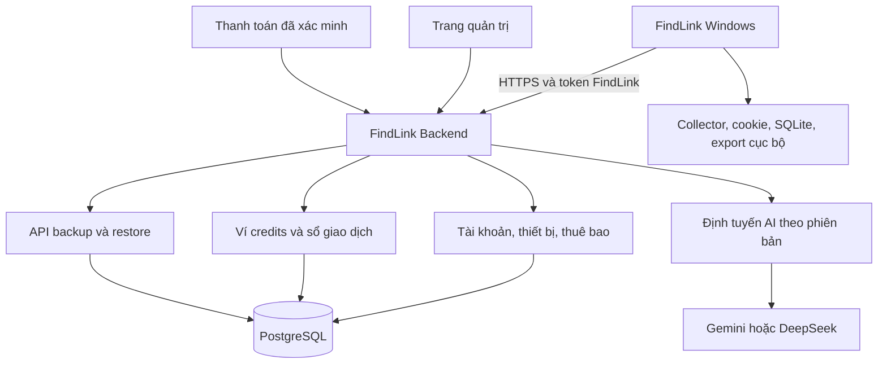

# FindLink — kế hoạch phân phối và quản lý thuê bao lần đầu

Nghiên cứu ngày 10/11/2026, múi giờ Asia/Bangkok. Nhánh `findlink-publish-1st` được tạo từ `bac9399` trước khi nghiên cứu. Mục 12 ghi kết quả kiểm thử Starter và trạng thái triển khai.

Cập nhật 11/11/2026 theo yêu cầu người dùng: hết trial phải khóa cả thu thập và lọc, vẫn xem/export dữ liệu cũ; bổ sung chống tạo nhiều tài khoản lấy credits tài trợ. Luồng cấp trial ở mục 5 thay thế đề xuất tự cấp 20 credits cho guest và 100 credits chỉ sau xác minh tài khoản trước đây.

Người dùng đã xác nhận khách hàng ưu tiên là **doanh nghiệp nhỏ và agency**. Mục tiêu là **lãi 10–100 triệu VND trên mỗi tài khoản khách hàng mỗi năm, trước thuế**, sau chi phí AI, hạ tầng, hỗ trợ và bán hàng. Một tài khoản thương mại có thể có nhiều người dùng được cấp ghế; không nhân lợi nhuận trong bảng với số ghế.

## 1. Quyết định đề xuất

1. Giữ thu thập Facebook/Threads, cookie, SQLite, dữ liệu làm việc và export trên máy khách. Thêm **FindLink Backend** làm nơi xác thực tài khoản, quản lý thuê bao, ví credits, định tuyến AI và sao lưu.
2. Khách trả phí nhận quyền sử dụng FindLink qua tài khoản. Mỗi tài khoản Starter dùng một khóa riêng cho từng nhà cung cấp đã cấu hình. Khóa chung Gemini của FindLink dành cho trial. Desktop nhận token FindLink có thể thu hồi. Khóa nhà cung cấp chỉ lưu trên server.
3. Giữ quy đổi **1 USD = 1.000 credits**. Tách sổ chi phí provider với sổ credits của khách; lợi nhuận chủ yếu đến từ phí thuê phần mềm năm. Không gọi doanh thu credits bán ngang giá vốn là lợi nhuận.
4. Cấp tối đa **100 credits dùng thử một lần cho một chủ thể đủ điều kiện**, không phải cho mỗi tài khoản mới. Pilot dùng mã mời một lần gắn với khách được duyệt; guest chỉ xem demo không phát sinh API. Khi mở đăng ký công khai, cấp 20 credits sau xác minh và kiểm tra chống abuse, thêm tối đa 80 sau bước xác minh tăng cường. Tạo tài khoản, project, workspace hoặc cài lại không tự mở trial mới.
5. Trial nên dùng API trả phí do FindLink tài trợ, giới hạn tối đa 0,10 USD AI được cấp cho khách. “Miễn phí cho khách hàng” không bắt buộc dùng free tier của provider. Free tier chỉ dùng khi loại dữ liệu và điều khoản phù hợp.
6. Thử nghiệm ba gói thuê năm **Starter 23 triệu, Agency 70 triệu, Scale 235 triệu VND/tài khoản**, chưa gồm thuế gián thu nếu có. Đây là giá đề xuất từ mô hình chi phí và mục tiêu lợi nhuận, chưa phải bằng chứng thị trường sẽ mua.
7. Phát hành Starter trước. Agency/Scale chỉ bán những quyền lợi đã có thật; quản trị nhiều ghế, hỗ trợ doanh nghiệp và tích hợp cần các đợt phát triển tiếp theo.
8. **Trial hết hạn/hết quota khóa cả thu thập lẫn lọc, bao gồm chế độ OFF, Start, Resume và lọc lại dữ liệu cũ.** Giữ quyền xem, tìm kiếm/sắp xếp cục bộ và export dữ liệu đã lưu; không cần trả tiền để lấy lại dữ liệu của mình.
9. Chống abuse bằng nhiều tín hiệu, xét duyệt và hạn mức cấp grant; giới hạn tổn thất bằng trần chi tiêu thực tế phía server cho AI, xác minh và các dịch vụ tính phí khác. Không có cấu hình ngân sách hợp lệ thì không bật trial tài trợ. Các con số dự toán trong kế hoạch không phải ngân sách chi tiêu được cấp phép.

## 2. Khoảng cách từ baseline trước triển khai

| Thành phần hiện tại | Bằng chứng | Thay đổi cần làm |
|---|---|---|
| Desktop lấy `DATABASE_URL`, kết nối PostgreSQL trực tiếp | `src/main/index.ts:45–49`; `src/infrastructure/projects/postgres.ts:37`; [đặc tả database](specs/project-database-v1.md) | Chuyển kết nối DB sang backend; desktop chỉ dùng API đã xác thực. Đặc tả hiện tại đã giới hạn cách này cho môi trường tin cậy. |
| Đăng ký/đăng nhập và backup đã có | `src/infrastructure/projects/postgres.ts`; `src/infrastructure/projects/workspace.ts` | Tái dùng dữ liệu/ID, chuyển ranh giới xác thực sang server; thêm xác minh, khôi phục, revoke và giới hạn thử đăng nhập. |
| Key Gemini và gọi provider nằm trên desktop | `src/infrastructure/llm/gemini-gateway.ts`; `src/main/index.ts` | Thêm `RemoteModelGateway`, giữ provider adapter trên server. |
| Có cổng `ModelGateway.generateJson()` | `src/application/ports/model-gateway.ts:58` | Là điểm thay adapter; không cần viết lại collector. |
| Có `ProjectBackupStore` | `src/infrastructure/projects/postgres.ts:14` | Thêm `HttpProjectBackupStore`; DB adapter chỉ có trên server của bản managed. |
| Spend ledger máy dùng integer nanodollar, reservation và held | `src/infrastructure/llm/durable-spend.ts` | Giữ lịch sử nguyên vẹn; thêm account wallet server có tính nguyên tử trên nhiều máy. |
| Model đang bị ràng buộc theo Gemini | `src/infrastructure/llm/campaign-model-gateway.ts`; `durable-spend.ts` | DeepSeek cần adapter, kiểm tra schema, usage, chất lượng và phiên bản; chưa phải đổi tên model là xong. |
| Chỉ build Windows portable, chưa có updater | `package.json` | Thêm signed NSIS installer và update channel; portable giữ đường cập nhật thủ công. |

Chưa có ví credits thương mại, thanh toán, entitlement thuê bao, remote-config service hoặc auto updater trong baseline đã kiểm tra. Các “subscription” của discovery lịch sử không phải thuê bao trả tiền.

## 3. Quản lý từ xa

Bắt đầu bằng **một backend TypeScript dạng module**, một PostgreSQL, worker tác vụ bền vững và kho secrets. Chưa cần chia microservices. Backend dùng hàng đợi/outbox trong DB ở pilot; bổ sung hệ thống queue riêng khi đo thấy cần. Mỗi môi trường development/staging/production có secrets và dữ liệu riêng.

Trang quản trị cần: tìm tài khoản; gói và ngày hết hạn; ghế/thiết bị; số dư và credits đang giữ; grant/refund có lý do; revoke token; phiên bản model/giá; tổng spend thực tế; lỗi và request đang chờ đối soát; bản desktop được hỗ trợ. Thêm quản lý mã mời, lịch sử nhận trial, hàng đợi xét duyệt/chặn nhầm, nghĩa vụ credits đã cấp, ngân sách tài trợ còn lại và công tắc dừng cấp mới/dừng tác vụ trial. Mọi thay đổi ảnh hưởng tiền hoặc quyền truy cập có actor, thời điểm, trước/sau và audit log. Quản trị dùng MFA và quyền tối thiểu.

Server quyết định model/provider, mục đích yêu cầu, giới hạn input/output, ngân sách, bảng giá và feature flags. Client không được gửi URL provider tùy ý hoặc tự khai giá, số dư, token usage để server tin theo. Các endpoint AI chỉ phục vụ tác vụ FindLink được định nghĩa; không mở một proxy AI tổng quát bằng credits trial.

“Quản lý từ xa” ở đợt đầu là quản lý **dịch vụ và quyền sử dụng**, không phải điều khiển chuột/bàn phím hay shell máy khách. Nếu sau này cần giao run từ dashboard: máy khách phải online, người dùng bật nhận việc, lệnh có phạm vi/expiry/ID chống lặp, và vẫn có nút dừng tại máy. Máy tắt/ngủ không thể tiếp tục crawl bằng kiến trúc desktop này.

### Xác thực và quyền truy cập

- Nếu dùng OAuth/OIDC, đăng nhập bằng trình duyệt hệ thống với Authorization Code + PKCE; native app là public client, không giữ một shared client secret bí mật được. [RFC 8252](https://www.rfc-editor.org/info/rfc8252/)
- Access token ngắn hạn, ví dụ 10–15 phút; refresh token luân chuyển, lưu dạng hash phía server, revoke theo phiên/thiết bị. Đó là cấu hình đề xuất, không phải thời lượng bắt buộc của chuẩn.
- Refresh material trên Windows dùng secret store hiện có. DPAPI/safeStorage không chống ứng dụng khác chạy cùng user, vì vậy không dùng nó để “bảo vệ” provider key của chủ sản phẩm khỏi khách hàng. [Electron safeStorage](https://www.electronjs.org/docs/latest/api/safe-storage)
- Tenant/payer được suy ra từ phiên và membership đã xác minh; không tin `ownerId` do desktop gửi. Mỗi project, export backup, ledger và job phải kiểm quyền đối tượng. Vai trò agency: owner, admin, member, billing-viewer; một ví dùng chung cho tài khoản thương mại.
- Giới hạn thiết bị đồng thời dùng lease do server cấp; heartbeat không thay thế việc kiểm tra entitlement trước mỗi request AI. Sửa file local hoặc lùi đồng hồ không gia hạn được quyền cloud.
- Mất mạng/hết hạn vẫn xem và xuất dữ liệu đã lưu. AI và cloud writes mới cần server cấp quyền. **Gói trả phí còn hạn** hết credits chỉ dừng AI; việc thu tiếp phụ thuộc entitlement và giới hạn local. **Trial hết quota/hết hạn** dừng cả thu thập và lọc theo hợp đồng dưới đây. Giữ raw/checkpoint; Resume chỉ chạy khi server cấp quyền trở lại.

### Khóa thu thập và lọc khi hết trial

Entitlement gồm các quyền riêng: `collect`, `plan`, `assess`, `view_saved`, `export_saved`; không dùng số dư ví làm toàn bộ giấy phép sử dụng. Trial mặc định đề xuất có thời hạn 14 ngày từ kích hoạt đầu tiên, tổng tối đa 100 credits và tối đa 1.000 bài gốc mới thu được trên toàn trial. Hạn raw là tham số sản phẩm cần hiển thị trước khi bắt đầu, không phải cam kết về số bài phù hợp hoặc kết quả bán hàng. Nó cộng dồn qua project/run, không reset khi đổi tài khoản liên kết hoặc tạo lại project.

Trial kết thúc khi hết thời hạn, dùng hết mức tài trợ đã mở đầy đủ, hoặc chạm quota thu thập; sự kiện nào đến trước áp dụng trước. Giai đoạn 20 credits đã hết nhưng chưa qua bước mở 80 còn lại chuyển `TRIAL_VERIFY_REQUIRED`, khóa việc mới cho đến khi đủ điều kiện, không tự cấp thêm. Credits chỉ đang bị giữ/chờ đối soát chuyển `TRIAL_CREDITS_HELD`, tạm dừng việc mới khi không đủ available; không ghi nhầm thành đã tiêu hết. Xác minh bổ sung không khởi động lại mốc 14 ngày.

| Trạng thái | Thu thập mới, kể cả OFF | Planning/lọc mới/lọc lại | Xem và export dữ liệu đã lưu |
|---|---|---|---|
| Trial còn hiệu lực và quota | Có, trong hạn mức | Có, khi đủ credits và quyền server | Có |
| Trial cần xác minh, xét duyệt hoặc không còn credits khả dụng do hold | Tạm khóa | Tạm khóa | Có |
| Trial hết hạn/hết quota/bị thu hồi | Khóa | Khóa | Có |
| Gói trả phí còn hạn, hết credits | Có nếu quyền thu thập còn hiệu lực | Tạm dừng đến khi có credits | Có |
| Gói trả phí hết hạn | Khóa | Khóa | Có |
| Server không liên lạc được | Không bắt đầu mới; run hiện tại dừng khi lease hết hạn | Không gửi thêm request AI | Có với dữ liệu local |

“Export dữ liệu cũ” gồm raw, kết quả lọc đã lưu và lịch sử; không ngầm khởi động assessment, planning hoặc crawl để tạo export. Tìm kiếm/lọc hiển thị/sắp xếp bằng trường đã lưu vẫn được dùng. Cloud read/restore vẫn cần đăng nhập và ACL đúng chủ sở hữu, nhưng hết trial không tự tước quyền đọc dữ liệu còn trong thời hạn lưu; export local không phụ thuộc server hay số dư. Không xóa, mã hóa lại hoặc giữ dữ liệu làm điều kiện nâng cấp.

Luồng cấp quyền chạy đề xuất:

1. Trước Start, Resume, chuẩn bị/tiếp tục planning, lọc lại hoặc khởi động worker nền, desktop xin **run lease** từ server. Lease gắn với account/trial subject, device key, project/run, các action được phép, policy version, revocation epoch và expiry; không tái dùng lease của run/máy khác.
2. Bản desktop chính thức gia hạn mỗi 60 giây; TTL đề xuất tối đa 120 giây, có jitter để tránh dồn request. Server kiểm lại entitlement, giới hạn đồng thời và trial state mỗi lần cấp/gia hạn. Desktop kiểm chữ ký, ràng buộc và thời lượng bằng mốc server kết hợp đồng hồ monotonic; mở lại app hoặc thức dậy sau sleep phải xác thực online, không khôi phục lease chỉ từ file/đồng hồ hệ thống.
3. Thu hồi quyền đã biết có hiệu lực ngay đối với việc mới; khi mất mạng, thời gian chạy thêm của collector chính thức bị chặn bởi lease còn lại, tối đa TTL kể từ lần xác thực cuối. Mỗi lần mở cửa sổ, bắt đầu batch/scroll và xếp việc mới đều kiểm quyền; kiểm tra chỉ ở nút Start là không đủ.
4. Khi trial kết thúc, ngừng nhận việc mới, hủy queue chưa dispatch, báo dừng cho collector/pipeline, lưu raw/checkpoint rồi đóng cửa sổ thu thập. Request đã gửi có thể hoàn tất/được tính phí dù đã gửi cancel; vẫn lưu kết quả và đối soát reservation, không retry sau khi bị khóa. Nút Stop và đường lưu dữ liệu luôn hoạt động.
5. Backend kiểm entitlement **mỗi yêu cầu AI và ngay trước dispatch**, độc lập với lease/UI. Queue cũ, thay mode OFF, gọi IPC trực tiếp, import dữ liệu để lọc lại hoặc đổi project không vượt được quyền. Nâng cấp thành công làm mới entitlement rồi cho Resume, giữ run/checkpoint cũ.

Điểm tích hợp hiện có: `src/main/index.ts` cho các IPC `csd:campaign:prepare`, `csd:campaign:continue`, `csd:retained:start`, `csd:start`, `csd:resume`; `src/application/production-service.ts` cho start/resume/stop; `src/application/query-collector.ts` và `src/application/opportunity-pipeline.ts` cho admission/vòng lặp/worker. Thêm `EntitlementService` và `RunLeaseGuard` dùng chung ở tầng application và worker; gateway server là ranh giới chặn chi phí AI. Production build phải rà soát mọi đường collector/diagnostic khác, không để một lệnh nội bộ né kiểm quyền. Nguyên tắc kiểm tra quyền mỗi request có trong [OWASP Authorization Cheat Sheet](https://cheatsheetseries.owasp.org/cheatsheets/Authorization_Cheat_Sheet.html).

Trạng thái dừng cần phân biệt `TRIAL_EXPIRED`, `TRIAL_EXHAUSTED`, `TRIAL_VERIFY_REQUIRED`, `TRIAL_REVIEW_REQUIRED`, `TRIAL_CREDITS_HELD`, `TRIAL_FUNDING_PAUSED` và `ENTITLEMENT_UNAVAILABLE`. Thông báo chỉ rõ bước phù hợp: xác minh, chờ đối soát, xin xét duyệt, kết nối lại hoặc nâng cấp; giữ nút Xem dữ liệu và Export. Không báo trial hết hạn khi chỉ lỗi mạng hoặc hết quỹ tài trợ của FindLink.

Collector và bộ đếm raw vẫn chạy trên máy khách. Lease/giới hạn raw bảo vệ hành vi của bản chính thức, không chứng minh nội dung telemetry do một EXE đã bị sửa gửi lên là đúng. Không hứa chống bẻ khóa local tuyệt đối; backend phải chặn mọi AI/backup tính phí không có quyền kể cả khi kiểm tra local bị bỏ qua. Chữ ký ứng dụng hoặc fingerprint không biến desktop thành môi trường đáng tin cậy.

## 4. Credits và kế toán sử dụng

### Hợp đồng giá

**1 credit = 0,001 USD; 100 credits = 0,10 USD; 3 USD = 3.000 credits.** Ví dụ 1.000 bài tốn 3.000 rồi 1.000 credits khi đổi model chỉ là minh họa; không cam kết giá cố định trên 1.000 bài. Chi phí còn phụ thuộc planning, độ dài bài, số bài bị loại, cache, thinking và retry.

Chọn hợp đồng giá cho đợt đầu:

| Khoản | Cách tính đề xuất |
|---|---|
| AI sử dụng | Provider charge áp theo bảng giá được chốt cho request × 1.000 credits/USD. Ghi đủ cache/thinking và phí phụ nếu có. |
| Thuê phần mềm năm | Phí quyền sử dụng, cập nhật, số ghế, quota cloud và hỗ trợ; hóa đơn tách phần này khỏi pool credits tặng kèm. |
| Backup, export, local collection trong hạn mức | Đã bao gồm theo quyền của gói; không tự suy diễn giá điện/RAM máy khách thành khoản trừ credits. OFF không gọi AI nhưng vẫn cần quyền thu thập. Xem/export dữ liệu đã lưu không bị khóa khi hết trial. |
| Cloud storage hoặc dịch vụ vượt hạn mức về sau | Chỉ trừ credits khi có rate card riêng công khai và khách bật/đồng ý. Không tự thêm phí ẩn để bù thiếu lợi nhuận. |

Như vậy mọi **phí sử dụng biến đổi** có thể hiển thị bằng credits, còn phí thuê năm có bản chất riêng. Nếu muốn cả phí thuê cũng thể hiện bằng credits, invoice có thể ghi giá USD dịch vụ quy đổi tại tỷ giá khóa cho đơn rồi nhân 1.000; đó là khoản thanh toán quyền thuê, **không biến toàn bộ tiền mua gói thành số dư AI**. Quyền lợi và pool AI phải hiển thị riêng để tránh nghĩa vụ chi phí vượt dự tính.

Hai sổ độc lập:

1. `provider_cost_ledger`: chi phí và usage thực tế của từng attempt, gồm cả retry/thất bại/chưa rõ. Các sửa đổi là bản ghi điều chỉnh.
2. `credit_ledger`: grant, reserve, settle, release, refund, expire và adjustment của khách; có liên kết tới request/attempt nhưng không sửa lịch sử tại chỗ.

Provider tặng quota miễn phí tạo cost thực bằng 0. Nếu vẫn trừ một mức credits tham chiếu thì phải gọi rõ đó là **giá dịch vụ**, không mô tả là giá vốn thực. Để giữ cách hiểu đơn giản, MVP dùng paid API tài trợ cho trial. Không bảo đảm free provider quota lâu dài để bán thuê bao.

### Độ chính xác và vòng đời giao dịch

Lưu số nguyên `microcredit`: 1 credit = 1.000.000 microcredits. Với tỷ lệ đã chọn, **1 nanodollar = 1 microcredit**, phù hợp độ chính xác ledger hiện có. DB dùng BIGINT; API truyền chuỗi số nguyên khi có nguy cơ vượt safe integer JavaScript. Không làm tròn lên 1 credit cho từng request; cộng chính xác và chỉ định dạng số hiển thị.

`available = grants + refunds − settled − active_holds − expired_unused` với các loại entry không bị đếm hai lần. Snapshot balance là giá trị chiếu có thể đối soát lại từ ledger.

Luồng một thao tác:

1. Client gửi `operation_id` ổn định và idempotency key. Server kiểm membership, entitlement, hạn mức ngày/run/tenant/platform và dữ liệu đầu vào.
2. Server chốt `route_version`, `tariff_version`, prompt/schema, max tokens và chi phí trần bảo thủ. Giữ credits bằng transaction + khóa hàng ví/serializable retry. Hai máy không cùng tiêu một số dư.
3. Sau khi reservation và job đã commit, worker claim và ghi dispatch intent bền vững trước HTTP; mỗi attempt có ID riêng. Lease hết hạn sau dispatch chuyển đối soát, không tự requeue gọi provider; fencing token ngăn worker cũ ghi trạng thái sau khi mất lease. Không giữ transaction DB mở khi chờ HTTP provider và không hứa provider xử lý đúng một lần nếu provider không hỗ trợ idempotency.
4. Khi có usage tin cậy: ghi provider cost, settle tiền khách được tính, nhả phần hold thừa; trả receipt bền vững. Kiểm debit không vượt mức đã giữ; mọi phần vượt ngoài hợp đồng/bound do hệ thống chịu và phát cảnh báo.
5. Timeout sau dispatch: chuyển `PENDING_RECONCILIATION`. Không đoán chi phí bằng 0, không tự nhả hold chỉ vì TTL và không gọi lại mù khi chưa biết provider đã xử lý hay chưa. Retry trạng thái/result theo operation ID; provider idempotency chỉ dùng nếu thực sự được hỗ trợ.
6. Cancellation không xóa chi phí đã phát sinh. Refund cho khách khi lỗi thuộc FindLink là entry riêng; provider ledger vẫn giữ giá vốn. Nếu phải giải phóng hold cho trải nghiệm khách khi chưa đối soát xong, ghi khoản dự phòng do FindLink chịu và tiếp tục đối soát.

Reservation thử lại cho lỗi kỹ thuật phải nằm trong cap server toàn hệ thống. Không tự động tính mọi internal retry cho khách; công bố chính sách, ví dụ lỗi kỹ thuật của FindLink được miễn/refund, đánh giá hợp lệ nhưng không có bài phù hợp vẫn có phí. Dự phòng 20% trong mô hình kinh tế dành cho phần giá vốn không thu lại này, tránh tính trùng retry đã debit khách.

Reuse assessment hợp lệ trong cùng project không tạo model call thì không debit AI mới, nhưng bắt đầu một run/đánh giá mới vẫn phải có entitlement; không dùng cache để né khóa trial. Đọc/export assessment đã lưu luôn được giữ theo quyền sở hữu dữ liệu. Cache và provenance phải xét nội dung/evidence, intent, recipe, provider/model/version và policy tương thích; không đổi nhãn model cũ sang model mới. Không chia sẻ raw nội dung/cache giữa tenant mặc định.

### Nạp thêm và thời hạn

- Pool bao gồm trong thuê bao cấp cho kỳ một năm, theo dõi grant riêng có `valid_from`/`expires_at`, không tự tái cấp khi cài lại hay thanh toán webhook lặp. Gia hạn sớm tạo grant cho kỳ tiếp theo, chỉ tiêu được khi kỳ đó bắt đầu; mua dùng ngay phải là top-up/upgrade được ghi rõ. Có cap tháng/ngày để kiểm soát tốc độ, không gọi cap tháng là số credits mới nếu tổng năm không đổi.
- Reservation phân bổ vào từng grant bucket, ưu tiên khoản sắp hết hạn. Hold hợp lệ trước expiry vẫn được settle cho request đã dispatch; release sau expiry không làm credits hết hạn sống lại. Expiry chỉ khóa phần chưa tiêu/chưa giữ; thao tác expire/settle/release phải idempotent để không tính giảm hai lần. Refund trả về bucket/thời hạn gốc; nếu muốn bù cho khách sau expiry thì cấp compensation grant mới có lý do và hạn riêng. Ghi receipt theo bucket để đối soát được trường hợp một request dùng nhiều nguồn credits.
- Trial hạn 14 ngày từ grant đầu, không chuyển nhượng/rút tiền. Credits đi kèm gói hết hạn theo kỳ đã thông báo. Credits mua thêm tách bucket, đề xuất dùng trong 12 tháng từ ngày mua, giữ nguyên số dư khi gói hết hạn và có thể tiếp tục dùng khi gia hạn trước ngày bucket hết hạn; điều kiện phải ghi rõ trước khi trả tiền.
- Nạp $10 giá vốn AI cho 10.000 credits mà chỉ thu đúng $10 sẽ âm sau phí thanh toán/tỷ giá/vận hành. Đề xuất hóa đơn riêng: $10 credits + phí dịch vụ/nạp được công bố, hoặc bán pack ở giá tổng đã công bố. Không âm thầm làm 1 credit đổi giá trị.
- Ví dụ số học: phí dịch vụ 25% tạo tổng $12,50 cho $10 face credits, còn $12,25 sau phí thanh toán 2%, chỉ dư $0,25 nếu giá vốn và overhead là $12. Đây không phải mức lời lớn; cần đo chi phí thật trước khi chốt rate card.
- Giới hạn account không thay thế cap nhà cung cấp/toàn hệ thống. Giữ explicit machine spending limits hiện hữu như guardrail phụ; mức được phép là mức chặt nhất giữa account, run, ngày, máy và cap nền tảng, có giải thích rõ trong UI.

## 5. Dùng thử 100 credits và chống tạo nhiều tài khoản

Mục tiêu là giảm cấp trùng/lạm dụng và chặn chi phí vượt quỹ tài trợ, không hứa nhận diện đúng mọi người thật. Email, số điện thoại và thiết bị đều có thể thay đổi hoặc dùng chung. Tạo tài khoản hàng loạt là một nhóm abuse riêng được mô tả trong [OWASP OAT-019 Account Creation](https://owasp.org/www-project-automated-threats-to-web-applications/assets/oats/EN/OAT-019_Account_Creation.html).

### Luồng mặc định cho pilot và khi mở đăng ký công khai

**Pilot dùng mã mời một lần, chưa bật cấp credits tự động đại trà.** Admin duyệt khách phù hợp, cấp invitation có hạn dùng, gắn với email đã xác minh/tài khoản đích, và ghi nguồn tài trợ. Không dùng một mã khuyến mại chung có thể nhận lại trên vô số tài khoản. Mời thêm thành viên vào một tài khoản agency không tạo một quỹ trial mới.

| Trường hợp | Quyền lợi và điều kiện cấp |
|---|---|
| Chưa đăng nhập/chưa đủ xác minh | Xem demo bằng dữ liệu mẫu và dữ liệu cũ; không cấp credits, không crawl/lọc thật bằng tài trợ. Không gọi provider trong demo. |
| Pilot: email đã xác minh + mã mời riêng hợp lệ + kiểm tra đủ điều kiện | Cấp tối đa 100 credits một lần, một project, một thiết bị/một run hoạt động. Mã mời không bỏ qua chống cấp trùng hoặc ngân sách. |
| Public sau pilot: email đã xác minh + chống bot + đánh giá rủi ro chấp nhận | Mở 20 credits đầu; chưa cấp toàn bộ 100 chỉ vì tạo tài khoản. |
| Public: hoàn tất bước tăng cường | Mở thêm tối đa 80 khi xác minh số điện thoại chưa dùng nhận trial trong chương trình hoặc có mã mời/xét duyệt thủ công thay thế; các kiểm tra rủi ro và ngân sách vẫn áp dụng. |
| Có liên kết rõ với trial đã nhận | Cho tiếp tục tài khoản/trial cũ nếu còn quyền; không cấp lại. Không tự chuyển dữ liệu hoặc tiết lộ tài khoản liên quan. |
| Nghi ngờ hoặc chặn nhầm | Tạm dừng cấp/tác vụ trial, có đường xét duyệt. Xem/export dữ liệu cũ của chính người dùng vẫn mở. |
| Hết trial/chưa mua | Khóa cả thu thập và lọc theo mục 3, giữ dữ liệu và cho nâng cấp. |

Luồng public 20 + 80 thay thế phương án 20 credits vô danh. Trước khi phát hành phải ghi rõ điều kiện mở đủ 100 trong giao diện; không quảng cáo 100 được cấp vô điều kiện. Có thể dùng mã mời để bỏ bước SMS khi đã xét duyệt khách doanh nghiệp, tránh chi phí xác minh cao hơn phần trial. Chưa đăng nhập vẫn có thể trải nghiệm demo; thử thật yêu cầu tài khoản. Không bật lại anonymous credits chỉ để giảm số bước nếu chưa có đánh giá chi phí abuse.

### Nhận diện lần cấp trial trên server

1. Tạo `trial_subject` cho người/đơn vị hưởng ưu đãi đã được hệ thống liên kết, tách khỏi `account_id`. `trial_program_key` ổn định, ví dụ `FINDLINK_INTRO_TRIAL`; đổi policy/campaign version không tạo quyền nhận lại. Account mới, đổi email, project, thiết bị, cài lại hoặc xóa tài khoản không tự reset lịch sử cấp trong thời gian lưu dấu chống abuse đã công bố.
2. Dùng nhiều tín hiệu: account và lịch sử grant, ID đăng nhập liên kết đã xác thực (`issuer` + `subject`), email/số điện thoại đã chứng minh quyền sở hữu, device key và dấu thiết bị, tốc độ đăng ký/claim, IP/dải mạng và hành vi sử dụng. Email verification hoặc CAPTCHA chỉ là một lớp, không chứng minh một người chưa từng dùng trial.
3. Cùng định danh xác thực mạnh đã nhận trial hoặc cùng invitation đã redeem thì không cấp lần hai. Khớp IP, VPN, tên miền doanh nghiệp hoặc dấu thiết bị đơn lẻ chỉ tăng mức rủi ro/đưa vào xét duyệt; không tự kết luận hai người là một hay khóa toàn công ty. Không tự gộp dữ liệu/ACL các tài khoản chỉ vì bị đánh dấu liên quan.
4. Device key tạo tại cài đặt và lưu bằng secret store Windows; fingerprint bổ sung chỉ là tín hiệu có thể giả mạo, không phải bằng chứng phần cứng không thể thay đổi. Không lấy cookie, mật khẩu Facebook/Threads hoặc nội dung bài đăng làm vật chứng danh tính chống abuse.
5. Claim chạy bằng transaction với unique constraint cho `(trial_program_key, trial_subject_id, grant_stage)` và các định danh/invitation đủ điều kiện đã liên kết. Hai tài khoản claim đồng thời cùng một định danh phải tranh chấp cùng hàng eligibility/khóa, không chỉ unique theo account. Ghi trạng thái claim và grant có idempotency key; lỗi mạng/retry trả receipt cũ, không cấp lại.
6. Không chỉ chuẩn hóa email để suy ra người thật: alias và nhiều hộp thư vẫn tồn tại. Chỉ chuẩn hóa theo quy tắc của provider đã xác định, không tự xóa dấu chấm/đuôi `+` cho mọi domain. Đổi số điện thoại không xóa dấu lần cấp cũ; số dùng chung/tái cấp có đường xét duyệt có audit, không tạo vĩnh viễn một lệnh cấm người mới.

Tín hiệu đủ mạnh để từ chối cấp trùng và tín hiệu chỉ để xét duyệt phải được ghi trong `trial_policy_version`. Giữ reason code phục vụ hỗ trợ, không trả thông tin tài khoản khác hoặc toàn bộ luật phát hiện cho client. Admin override phải có lý do, hạn mức riêng trong cùng ngân sách và không sửa/xóa ledger cũ.

### Chống bot và bảo vệ chính luồng xác minh

- Thử thách chống bot chạy trong trang xác thực qua trình duyệt hệ thống; backend xác minh token, action/hostname và binding với phiên claim. Ví dụ Turnstile yêu cầu Siteverify phía server, token có thời hạn ngắn; phát hiện replay có độ trễ lan truyền nên vẫn phải có nonce/idempotency và unique claim của FindLink. CAPTCHA thành công không tự cấp credits. [Cloudflare Turnstile server validation](https://developers.cloudflare.com/turnstile/get-started/server-side-validation/)
- Rate limit nhiều chiều và theo cửa sổ thời gian cho signup, gửi email, gửi OTP, kiểm OTP, claim, xin lease và gọi AI: account, định danh đã xác minh, thiết bị, IP và toàn hệ thống. Thêm cooldown/backoff, giới hạn burst và một run hoạt động/trial subject. IP chung không được là điều kiện duy nhất từ chối một người hợp lệ; client không được tự khai IP hay reset bộ đếm.
- Kiểm rủi ro và rate limit trước khi gửi SMS/email tính phí. Nếu dùng OTP: giới hạn số lần gửi và đoán mã, tăng khoảng chờ, chỉ mở quốc gia/kênh thực sự hỗ trợ, không tự chuyển sang voice call đắt hơn. OTP/số điện thoại có thể được thuê hoặc mua, nên không thay thế giới hạn chi phí. Luồng OTP còn có thể bị lợi dụng để tạo phí SMS; [Twilio hướng dẫn chống pumping](https://www.twilio.com/docs/verify/preventing-toll-fraud) khuyến nghị rate limits và kiểm soát kênh/quốc gia.
- Khi nhà cung cấp xác minh lỗi hoặc risk service không sẵn sàng: không tự bỏ bước để cấp grant. Cho chờ hoặc xét duyệt bằng mã mời; không làm mất dữ liệu cũ, không khóa phần trả phí chỉ vì hệ thống trial đang lỗi.
- Giai đoạn public nên mở theo đợt nhỏ, giữ một phần quỹ cho mã mời/khách đã duyệt. Người dùng có thể vượt các tín hiệu bằng nhiều danh tính thật; mã mời/xét duyệt làm tăng chi phí abuse và cap ở dưới chặn chi vượt mức, không bảo đảm kẻ xấu không thể chiếm dụng một phần quỹ trial.

### Trần ngân sách tài trợ và công tắc ngắt

Chỉ hạn chế “mỗi tài khoản 100 credits” không bảo vệ quỹ khi có hàng nghìn tài khoản. Server cần hai lớp ngân sách độc lập; mọi worker/replica/provider đều đi qua cùng bộ điều phối trong DB:

| Lớp | Quy tắc |
|---|---|
| Quyền nhận ưu đãi | Trần số subject mới/ngày và tổng chương trình; hạn mức mỗi đợt/mã mời; `credits_spent_gross + credits_committed_unspent ≤ grant_cap`. Khi kích hoạt public 20 + 80, dự trù cả 100; 80 chưa xác minh chưa được tiêu. Hủy/hết hạn chỉ giải phóng phần cam kết chưa dùng, không làm khoản đã tiêu biến mất. |
| Giá vốn thực tế | Cap USD AI theo ngày và tổng chương trình: `cost_measured + cost_held + next_upper_bound ≤ cap`. Mỗi attempt, retry, sửa lỗi và request khách được refund đều phải giữ ngân sách trước dispatch. Không chỉ đếm credits đã debit cho khách. |
| Xác minh và dịch vụ phụ | Cap riêng cho SMS/email/lookup/anti-abuse có tính phí, đồng thời cùng AI chịu cap gộp `sponsor_total_usd`. Giữ mức trần trước khi gửi; không dùng ước lượng 0 cho kết quả chưa biết. Chi phí này cộng vào CAC khi đánh giá lại giá gói. |
| Hạ tầng | Rate limit, giới hạn payload/input/output, concurrency, timeout, số job/batch, dung lượng backup/egress và thời hạn lưu trial; theo dõi hóa đơn cloud riêng. Cap AI không phải cam kết chặn mọi chi phí hạ tầng/DDoS. |

Giới hạn và reservation cập nhật nguyên tử cùng grant/job phù hợp; retry/đổi provider/đổi ngày không reset tổng chương trình. Cap ngày dùng ngày dispatch theo UTC của server: job đã giữ tiền nhưng chưa dispatch qua ngày phải kiểm/chuyển phần giữ vào bucket ngày hiện hành một cách nguyên tử trước khi gọi provider, không nhân đôi hay nhả phần giữ tổng chương trình. Request đã dispatch nhưng chưa biết usage giữ nguyên hold ở ngày dispatch và tổng chương trình đến khi đối soát; không chạy lại sau nửa đêm để né hold. Giá vốn thực không giảm chỉ vì refund credits cho khách. Budget được chia quỹ trial và quỹ khách trả phí; pool trial không được vay tự động từ pool paid hoặc kích hoạt nạp tiền tự động.

Nếu không cấu hình đủ `grant_cap`, cap chi phí AI/ngày/tổng, `sponsor_total_usd`, cap dịch vụ xác minh và hạn mức request, `funded_trial_enabled=false`. Pilot không dùng dịch vụ xác minh trả phí thì đặt cap tương ứng bằng 0 và tắt integration đó. Giá/bound không xác định thì không dispatch dịch vụ tính phí. Dashboard cảnh báo trước ngưỡng, nhưng **kiểm tra trước dispatch** mới là cơ chế chặn chi; cảnh báo hoặc dashboard provider không thay thế nó. Việc giới hạn tài nguyên và chi dịch vụ bên thứ ba được đề cập trong [OWASP API4 Unrestricted Resource Consumption](https://owasp.org/API-Security/editions/2023/en/0xa4-unrestricted-resource-consumption/).

Hai công tắc riêng: `pause_new_trial_grants` ngừng cấp mới nhưng vẫn phục vụ grant còn hiệu lực trong ngân sách đã dành; `pause_trial_execution` tạm dừng cả tác vụ trial chưa dispatch khi có sự cố/nguy cơ vượt chi, trả `TRIAL_FUNDING_PAUSED`. Mọi request đã dispatch vẫn được lưu/đối soát. Công tắc trial không ảnh hưởng việc xem/export dữ liệu hoặc quyền paid còn hiệu lực. Muốn tăng cap phải là thay đổi quản trị có audit, không tự tăng khi nhiều signup.

Ví dụ giả định FX 26.000: 100 credits dùng hết tương đương 2.600 VND AI; 10.000 trial là 26 triệu VND **chưa** gồm retry miễn phí cho khách, SMS và hạ tầng. Đây chỉ là lý do cần giới hạn quỹ, không phải phê duyệt số tiền nào. Với cấp theo mã mời và ngân sách đã cấu hình, số tiền tài trợ qua gateway nằm trong các bound đã giữ; tạo nhiều tài khoản không tự mở rộng ngân sách đó. Quỹ trial hữu hạn vẫn có thể bị chiếm dụng, vì vậy cap tài chính phải đi cùng kiểm tra đủ điều kiện và rollout theo đợt.

### Dữ liệu chống abuse và trải nghiệm khách hợp lệ

Lưu tối thiểu các định danh cần chống cấp trùng dưới dạng HMAC có secret phía server và key version; giá trị hash vẫn là dữ liệu có thể liên kết, không gọi là đã ẩn danh hoàn toàn. Email/điện thoại phục vụ đăng nhập/xác minh nếu cần giữ phải được hạn chế quyền và bảo vệ riêng; không ghi OTP/token/raw fingerprint vào log. IP và sự kiện chi tiết có thời hạn lưu ngắn được cấu hình; marker đã nhận trial có thời hạn theo chương trình và chính sách dữ liệu được công bố, không giữ vô hạn mặc định. Xóa account không đồng nghĩa mở ưu đãi mới trong thời gian marker được giữ hợp lệ; sau khi marker bị xóa, không hứa nhận diện lại vĩnh viễn.

Khách dùng chung mạng văn phòng, máy được cấp lại, đổi thiết bị hoặc không nhận được SMS có lựa chọn xét duyệt/mã mời. Trạng thái cần xét duyệt chỉ chặn ưu đãi/tác vụ trial, không phá tài khoản, thu hồi quyền paid hợp lệ hay làm mất dữ liệu. Ngoại lệ cấp thêm phải là grant có hạn và nguồn ngân sách rõ ràng; không reset lịch sử để “sửa” chặn nhầm.

Theo dõi số grant, chi phí measured/held, chi phí mỗi trial và mỗi khách chuyển paid, tỷ lệ bị chặn rồi được mở lại, giờ hỗ trợ xét duyệt, OTP gửi/thành công và lượng chi bất thường. Pilot dùng dữ liệu này để quyết định có mở public 20 + 80 hay tiếp tục mã mời; không đánh đổi một khoản AI 0,10 USD bằng xác minh/hỗ trợ đắt hơn mà không đo.

100 credits không đồng nghĩa 100 bài hoặc bảo đảm một run hoàn tất. Probe planning lịch sử đã dùng khoảng 76,24 credits cho 10 calls, nhưng khác workload và không dự báo mức dùng của khách mới. UI cho xem đã dùng/đang giữ/còn lại, hạn ngày và quota raw; dừng có lưu kết quả khi hết trial. Không bán quota bằng số bài “chất lượng” chưa kiểm chứng.

## 6. Đổi model từ xa và giới hạn của model free

Giá chính thức quan sát ngày nghiên cứu, USD/1 triệu token, không phải báo giá cố định tương lai:

| Model | Input không cache | Input cache | Output |
|---|---:|---:|---:|
| Gemini `gemini-3.1-flash-lite`, Standard | 0,25 | 0,025 | 1,50 |
| DeepSeek `deepseek-flash`, off-peak | 0,15 | 0,003 | 0,60 |
| DeepSeek `deepseek-flash`, peak | 0,30 | 0,006 | 1,20 |

Gemini tính output gồm thinking; cache còn phí lưu theo thời gian. DeepSeek Flash hiện ánh xạ tới `DeepSeek-V4.1-Flash-1017`; peak là 08–11h và 13–17h giờ Việt Nam thứ Hai–thứ Sáu, trừ ngày lễ Trung Quốc. [Google pricing](https://ai.google.dev/gemini-api/docs/pricing), [DeepSeek pricing](https://api-docs.deepseek.com/quick_start/pricing/)

Ví dụ cùng giả định 1 triệu token input không cache và 100.000 output: Gemini 0,40 USD; DeepSeek 0,21 USD ngoài peak nhưng 0,42 USD trong peak. Chưa đo tokenization, retry hoặc chất lượng FindLink giữa hai model, nên không kết luận DeepSeek luôn rẻ hơn hoặc giữ nguyên đầu ra.

Google free tier có thể dùng input/output để cải thiện sản phẩm và yêu cầu không gửi thông tin cá nhân, nhạy cảm hoặc bí mật. Vì FindLink xử lý bài social thực, paid trial có phạm vi kiểm soát rõ hơn. Paid service vẫn có điều kiện xử lý/lưu trữ dữ liệu; không đồng nghĩa không lưu gì. [Gemini API terms](https://ai.google.dev/gemini-api/terms)

Quota Gemini tính theo project, không phải số key; phát thêm key không tạo thêm quota. Không tìm thấy cam kết public về một lượng DeepSeek free API cố định, lâu dài cho mọi khách mới. Không đưa hạn mức miễn phí suy đoán vào kế hoạch doanh thu. [Gemini rate limits](https://ai.google.dev/gemini-api/docs/rate-limits), [DeepSeek balance API](https://api-docs.deepseek.com/api/get-user-balance/)

Google hướng dẫn giữ key ngoài client production; DeepSeek Open Platform cũng cấm chia sẻ/phơi key ở client. Vì vậy quyền paid account phải là token FindLink. [Google key guide](https://ai.google.dev/gemini-api/docs/api-key), [DeepSeek Open Platform terms](https://cdn.deepseek.com/policies/en-US/deepseek-open-platform-terms-of-service.html)

Khách có thể thấy một chế độ “AI tiêu chuẩn” và credits, không phải tự chọn provider. Tuy nhiên chính sách dữ liệu và lịch sử phải thể hiện trung thực nhà xử lý/model. Đổi provider không cần thao tác của khách nhưng không được che việc thay đổi xử lý dữ liệu; xác nhận các điều kiện dữ liệu API của DeepSeek trước production, không suy đoán nó có cam kết như paid Gemini.

Remote policy gồm route, capability, prompt/schema version, bảng giá có thời điểm hiệu lực, giới hạn token, timeout, allowed fallbacks, nhóm rollout và phiên bản client tối thiểu. Server chốt policy cho run/request; đổi mặc định áp vào run mới. Chuyển giữa run đang chạy chỉ ở checkpoint được ghi nhận và không vượt budget đã chấp thuận. Nếu provider tăng giá hoặc có peak tariff, hold dùng upper bound tương ứng và receipt ghi tariff thực; giữ nguyên bảng giá/usage của dữ liệu cũ.

Điều kiện mở route mới: bộ dữ liệu tiếng Việt cố định có nhãn độc lập; precision/recall từng mode, sai ads/off-topic, evidence grounding, JSON hợp lệ, tỷ lệ retry, latency và tổng giá vốn trên đầu ra được chấp nhận. Ưu tiên chất lượng đã thỏa thuận, sau đó mới tối ưu giá. Không coi test pass/HTTP 200 là tương đương chất lượng. Thử online cần một ngân sách mới được người dùng xác nhận; kế hoạch này không mở lại DEVELOPMENT đã đóng.

## 7. Gói thuê năm và lợi nhuận

Các quyền lợi dưới đây là **đề xuất sản phẩm cần triển khai**, chưa phải chức năng có sẵn để quảng cáo bán ngay. “Tài khoản” là khách hàng trả tiền; “ghế” là người dùng có tên, không phải chia sẻ một mật khẩu.

| | Starter | Agency | Scale |
|---|---:|---:|---:|
| Giá đề xuất/năm, triệu VND | **23** | **70** | **235** |
| AI credits bao gồm/năm | 50.000 | 200.000 | 1.000.000 |
| Trần giá vốn face credits, USD | 50 | 200 | 1.000 |
| Ghế người dùng | 1 | 3 | 10 |
| Thiết bị đăng ký / hoạt động đồng thời | 2 / 1 | 6 / 3 | 20 / 10 |
| Project hoạt động | 5 | 25 | 100 |
| Cloud backup bao gồm, đề xuất | 5 GB | 25 GB | 100 GB |
| Dịch vụ trong gói | Hướng dẫn ban đầu, hỗ trợ async | Phân quyền, ví chung, onboarding nhóm, hỗ trợ ưu tiên | Quản trị nhóm, báo cáo quản trị, onboarding và dịch vụ có phạm vi hợp đồng |
| Mục tiêu lãi tối thiểu dùng tính giá, triệu VND | 10 | 30 | 100 |

Không hứa số lead, khách mua hàng hoặc số bài tốt theo credits. Số bài, lượt chấp nhận model và cơ hội bán hàng thực tế là ba đại lượng khác nhau. Không bán “unlimited”; quota/hỗ trợ/integration phải có phạm vi. Scale không mặc định gồm hosting riêng hoặc tùy biến vô hạn; nhu cầu đó báo giá bổ sung theo chi phí thực.

Mô hình cơ sở tính **dùng hết credits**, FX giả định 26.000 VND/USD, phí thanh toán giả định 2%. Thêm 20% dự phòng AI ngoài phần debit khách, chi phí hạ tầng, hỗ trợ, bán hàng và phân bổ phát triển. Các đầu vào không phải báo giá ngân hàng/nhà thanh toán hay chi phí thực tế đã đo.

| Chi phí/lợi nhuận năm, triệu VND/tài khoản | Starter | Agency | Scale |
|---|---:|---:|---:|
| Provider theo credits + dự phòng 20% | 1,56 | 6,24 | 31,20 |
| Hạ tầng | 0,60 | 1,80 | 6,00 |
| Hỗ trợ | 2,00 | 6,00 | 18,00 |
| Bán hàng/thu hút khách (CAC) | 2,00 | 6,00 | 18,00 |
| Phân bổ phát triển/vận hành chung | 2,00 | 5,00 | 15,00 |
| Phí thanh toán | 0,46 | 1,40 | 4,70 |
| **Tổng chi phí cơ sở** | **8,62** | **26,44** | **92,90** |
| **Lợi nhuận trước thuế cơ sở** | **14,38** | **43,56** | **142,10** |
| **Lợi nhuận trước thuế kịch bản bất lợi** | **10,03** | **30,38** | **101,35** |

Kịch bản bất lợi: FX 28.000, hỗ trợ gấp đôi, CAC gấp đôi, phí thanh toán 3%, các giả định khác giữ nguyên. Không phải trường hợp xấu nhất: hoàn tiền, sự cố lớn hoặc thiếu khách để phân bổ chi phí cố định có thể làm lợi nhuận thấp hơn nữa.

`Lãi = doanh thu không gồm thuế gián thu − AI − overhead AI − hạ tầng − hỗ trợ − CAC − chi phí chung − phí thanh toán`.

`Giá tối thiểu = (lãi mục tiêu + chi phí không phụ thuộc giá bán) / (1 − tỷ lệ phí thanh toán)`.

Mức sàn theo kịch bản bất lợi lần lượt khoảng **22,970 / 69,609 / 233,609 triệu VND** (làm tròn bảo thủ theo nghìn đồng); chọn 23/70/235 cho đơn giản. Biên đệm trên kịch bản bất lợi vẫn nhỏ ở Starter/Agency; không giảm giá tùy hứng nếu vẫn giữ toàn bộ dịch vụ. Giá thấp hơn có thể khả thi khi đo được CAC/support thấp hơn, giảm quyền lợi hoặc chấp nhận mục tiêu lãi khác.

Điều cần kiểm chứng trước khi gọi là “tối ưu lợi nhuận”:

- Chưa có doanh số, conversion, renewal, mức sẵn lòng trả hoặc giờ hỗ trợ theo cohort. Mô hình chỉ cho thấy giá nào có thể đáp ứng mục tiêu khi giả định đúng.
- 235 triệu/năm cần giá trị kinh doanh, năng lực nhóm và dịch vụ tương ứng. Desktop hiện tại một mình chưa chứng minh được mức giá đó. Ưu tiên nhóm agency đã có quy trình khai thác kết quả và nhiều khách hàng.
- Giữ quy đổi theo giá vốn khiến model rẻ hơn giúp khách làm được nhiều việc với cùng credits. Khi khách dùng hết credits năm, nghĩa vụ USD tối đa của FindLink không giảm; không tính tiết kiệm model lần nữa vào lợi nhuận.
- Thu tiền năm trước giúp dòng tiền nhưng chưa biến toàn bộ thành lãi ngay. Theo dõi nghĩa vụ credits/hỗ trợ còn lại; không dùng số dư tiền mặt thay cho báo cáo lãi.
- Phân bổ phát triển phải kiểm lại bằng tổng chi phí cố định / số tài khoản trả tiền khả thi. Tại ít khách, các mức 2/5/15 triệu trong bảng có thể quá thấp.

Đề xuất pilot thương mại: 5–10 doanh nghiệp/agency phù hợp, demo trên workflow thực, đo giờ làm tiết kiệm, kết quả có ích do khách đánh giá, activation, tỷ lệ mua tại từng giá, support hours, credits sử dụng và refund. Đây là việc cần tổ chức ở giai đoạn sau; chưa gửi mời hay liên hệ khách trong nghiên cứu này. Chỉ điều chỉnh giá sau khi có cả chi phí phục vụ và dữ liệu mua thực; không tối ưu riêng biên lợi nhuận mà bỏ conversion/renewal.

Tính toán tái lập: [findlink-publish-economics-20261110.mjs](research/findlink-publish-economics-20261110.mjs). Chạy bằng Node, không gọi mạng/provider.

## 8. Nâng cấp, thanh toán và trạng thái thuê bao

1. Người dùng chọn gói; server tạo order có giá/tiền tệ/quyền lợi/credits/thời hạn bất biến tại thời điểm mua.
2. Thanh toán qua checkout/chuyển khoản. Với Việt Nam, FindLink sẽ dùng **SePay** cho thanh toán chuyển khoản. Backend xác thực webhook bằng HMAC-SHA256 trước khi đối soát giao dịch. [Tài liệu webhook SePay](https://developer.sepay.vn/vi/sepay-webhooks/xac-thuc)
3. Server xác minh chữ ký, mã đơn, số tiền, tiền tệ, trạng thái thực thu. Redirect “thành công” ở client không kích hoạt gói. Webhook lặp/sai thứ tự và webhook đến sau timeout phải xử lý idempotent.
4. Một transaction ghi payment, entitlement một năm, grant pool credits và outbox thông báo cho app. Unique provider transaction/order/fulfilment key ngăn cấp đôi.
5. App refresh entitlement, hiện gói mới và số dư. Không gửi provider key qua email hoặc IPC xuống renderer.

Các trạng thái thương mại tối thiểu: `TRIAL`, `PENDING_PAYMENT`, `ACTIVE`, `EXPIRED`, `SUSPENDED`, `REFUNDED`; trial có trạng thái đủ điều kiện/quota riêng theo mục 3 và 5. Đề xuất kỳ năm theo ngày kỷ niệm do server tính UTC và hiển thị giờ người dùng; test năm nhuận, gia hạn sớm và cuối tháng. Renewal cộng kỳ phù hợp, không vô tình reset trial hoặc hoàn lại credits đã dùng. Nâng cấp kích hoạt entitlement paid sau thanh toán đã xác minh, không tự cấp thêm trial; lỗi/chặn chương trình trial không tước quyền paid hợp lệ.

Upgrade giữa kỳ cần order ghi rõ giá bù, số ngày còn lại và **credits bổ sung**, chỉ cấp chênh lệch đã mua; không cấp lại toàn bộ pool mới mà giữ cả pool cũ nếu bảng giá chưa dự toán điều đó. Downgrade thường áp kỳ tiếp theo. Refund/chargeback thu hồi quyền chưa thực hiện, ghi bút toán đối ứng và giữ export đã có; khoản AI không thể thu lại do FindLink chịu/đối soát, không xóa lịch sử để cân số.

Giai đoạn pilot có thể xác nhận chuyển khoản bằng admin có audit thay cho tích hợp nhiều cổng, nhưng chỉ kích hoạt sau xác minh thực nhận. Không xem ảnh chuyển khoản là nguồn xác nhận tiền cuối cùng.

## 9. Phân phối EXE và backup an toàn

- Dùng signed **NSIS installer** làm kênh chính; `electron-updater` với metadata/update hosting. Repo đang dùng electron-builder v26; tài liệu v26 xác nhận NSIS là Windows auto-update target. Không áp mặc định tính năng ký manifest của tài liệu v27 cho bản v26. [Auto update v26](https://www.electron.build/v26/docs/features/auto-update/)
- Windows signing identity chỉ có trong CI/kho secret; cấu hình build fail khi thiếu chữ ký cho bản public. Signing xác minh publisher/toàn vẹn, không bảo đảm SmartScreen biến mất ngay. Portable dùng download có xác minh và thay file thủ công; không hứa tự update portable bằng cấu hình hiện tại. [Code signing v26](https://www.electron.build/v26/docs/features/code-signing/)
- HTTPS update, checksum, kiểm chữ ký publisher, version/channel allowlist. Nếu muốn metadata được ký độc lập trên v26, thiết kế/kiểm chứng riêng hoặc nâng cấp toolchain có kiểm soát; không coi checksum là chữ ký xác thực manifest.
- Canary rồi mở rộng, ví dụ 5% → 25% → 100% sau khi theo dõi lỗi. Chỉ cài sau checkpoint và khi không ghi dữ liệu; bản sửa rollback phát bằng version cao hơn, không ghi đè một release đã tải.
- Giữ `appId = io.csd.desktop`, `%APPDATA%/csd-desktop`, browser partitions, `csd_backup`, `%USERPROFILE%/.csd/spending`. Giữ FindLink name và logo đã duyệt. Update không tự đổi đường dẫn dữ liệu theo tên thương mại.
- Không đóng gói `.env`, provider/DB credentials, session/cookie, raw exports hoặc diagnostic ZIP. Public managed build không có đường local provider tùy ý để vượt wallet; bản operator/BYOK nếu giữ thì là kênh riêng có hợp đồng riêng.
- Backup giữ dữ liệu working local, canonical posts, run memberships và hash/revision conflict hiện có; server tiếp nhận rồi lưu PostgreSQL theo đặc tả hiện hành. Trước khi dùng object storage cho file lớn cần thiết kế migration riêng, vẫn giữ canonical metadata trong PostgreSQL và khả năng restore kiểm chứng.
- V1 dùng một writer/project; không quảng cáo collaborative editing đồng thời. Dùng revision/conflict và lease; hai máy không ghi đè backup lẫn nhau. Cookie/phiên social không đi qua cloud backup. Hết gói không xóa dữ liệu khách; công bố thời hạn giữ backup và cho xuất trước mọi chính sách xóa về sau.

## 10. Schema và API tối thiểu

Schema mới nên additive, ví dụ namespace `findlink_control`, giữ schema `csd_backup` cùng UUID lịch sử. Migration lưu mapping `legacy_user_id → account_id` có xác thực, giữ foreign key `csd_backup.projects.owner_id → csd_backup.users.id`, thêm ACL project riêng. Không thay owner ID bằng account UUID hoặc tự đưa project riêng của thành viên vào kho chung agency. Backend kiểm cả membership lẫn ACL project; không tự gộp quyền sở hữu chỉ vì trùng username/email. Giữ ID project và password hash tương thích, xử lý reset riêng nếu cần. Bảng tối thiểu:

| Nhóm | Bảng/đối tượng chính |
|---|---|
| Danh tính | `accounts`, `memberships`, `devices`, `refresh_sessions`, `guest_claims` |
| Thương mại | `plans`, `plan_versions`, `orders`, `payments`, `subscriptions`, `entitlements` |
| Credits | `wallets`, `credit_grants`, `credit_ledger`, `reservations`, `usage_receipts` |
| AI | `model_routes`, `tariff_versions`, `ai_operations`, `provider_attempts`, `provider_cost_ledger` |
| Trial và chống abuse | `trial_subjects`, `trial_identity_links`, `trial_eligibility_claims`, `trial_invitations`, `trial_grants`, `trial_usage`, `trial_review_cases`, `trial_policy_versions` |
| Quyền chạy và ngân sách tài trợ | `run_leases`, `trial_campaign_caps`, `sponsor_cost_reservations`, `verification_attempts`, `abuse_rate_counters` |
| Vận hành | `outbox`, `audit_events`, `release_channels` |

Các unique key quan trọng: payment transaction, fulfilment/order, tenant+operation ID, reservation settlement, `trial_program_key+trial_subject_id+grant_stage`, định danh đủ điều kiện đã liên kết và invitation redemption. Eligibility/subject được server suy ra, không nhận ID tự khai để cấp grant. `trial_usage` cộng dồn thời hạn, credits và raw của subject; `run_leases` ghi scope/expiry/revocation; sponsor reservations liên kết operation/attempt với bucket ngân sách kể cả khi không debit khách. Reconciliation có owner và retry policy, không chỉ cron xóa pending.

API đề xuất: `/auth/*`, `/guest/claim`, `/me/entitlements`, `/wallet`, `/usage`, `/trial/eligibility`, `/trial/activate`, `/trial/verify`, `/runs/authorize`, `/runs/:id/lease/renew`, `/ai/operations`, `/ai/operations/:id`, `/projects/*/backup`, `/projects/*/restore`, `/billing/orders`, `/billing/webhooks/:provider`, `/releases`, `/admin/*`. `/guest/claim` chỉ nhận quyền sở hữu project guest, không tự cấp credits. Claim/verify/renew đều kiểm auth, scope, idempotency và rate limit trên server. Không cần public endpoint cho client trực tiếp “settle” số tiền tự tính; server/worker thực hiện nghiệp vụ đó.

## 11. Trình tự phát triển và tiêu chí hoàn thành

Ước lượng dưới đây là phạm vi lập kế hoạch cho một lập trình viên quen repo, chưa phải lịch cam kết. Có thể chồng lấp một số phần, nhưng wallet/auth là phụ thuộc trước AI managed. Sau bổ sung khóa trial, lease và ngân sách chống abuse, dự trù khoảng 6–8 tuần cho MVP trial theo mã mời, rồi pilot có kiểm soát. Mở public 20 + 80/OTP và phạm vi nhiều ghế/Scale cần ước lượng riêng theo kết quả pilot, không tự coi nằm hết trong mốc này.

| Chặng | Phạm vi | Tiêu chí ra khỏi chặng |
|---|---|---|
| P0, 1–2 ngày | Chốt hợp đồng credits/trial/điều khoản model, threat model, API/schema | Có spec versioned, migration map, ngân sách vận hành dự kiến; không gọi paid model. |
| P1, 6–9 ngày | Backend auth/tenant/device, run lease/entitlement và HTTP backup adapter | Không có DB secret trong desktop; tenant isolation, restore/revision conflict, migration ID và giới hạn lease pass. |
| P2, 6–8 ngày | Wallet/grants/holds/ledger/outbox/reconciliation và sponsor budgets | Kiểm thử concurrency, crash, duplicate, unknown usage; không chi vượt wallet hoặc quỹ tài trợ dù retry/refund. |
| P3, 3–5 ngày | RemoteModelGateway + Gemini adapter và remote policy | Contract cũ được giữ, OFF zero-call, UI hiển thị receipt/credits, gateway chỉ nhận tác vụ cho phép. |
| P4, 7–10 ngày | Demo guest, trial theo mã mời, eligibility/rate limits, thanh toán và admin xét duyệt | Không cấp trial/payment đôi; hết trial khóa collect/plan/assess kể cả OFF; export cũ luôn hoạt động; công tắc và cap tài trợ có hiệu lực. |
| P5, 3–5 ngày | Signed installer/update, secret scan, backup/recovery release | Clean install/update/recovery trên dữ liệu cách ly, migration không mất lịch sử, signing xác minh được. |
| Pilot, khoảng 2 tuần theo mức sử dụng | Nhóm khách nhỏ, đo chi phí và độ hữu ích | Có chi phí/activation/support thực; chỉ mở rộng khi số liệu đáp ứng mục tiêu. |
| Sau MVP | Public trial 20 + 80/OTP nếu kinh tế phù hợp, đo chất lượng DeepSeek, membership/Agency và Scale | Public trial qua abuse/OTP/budget tests và đo chặn nhầm trước khi mở. Từng model và gói qua kiểm thử riêng. |

Không cần chặn MVP vào việc có hai provider. Hoàn tất server/Gemini trước; route abstraction giúp thêm DeepSeek sau mà không phân phối key. Nếu scope thương mại yêu cầu Agency ngay, đưa membership, quyền project và nhiều thiết bị vào trước pilot và cập nhật ước lượng.

Kiểm thử bắt buộc bằng mocks/local trước release:

- Sửa balance local, xóa app data, lùi clock, giả `ownerId`, dùng token revoke không tạo được credit/quyền cloud.
- Hai thiết bị gửi 100 request đồng thời không chi vượt grant; hai worker không dispatch cùng attempt; idempotency không trừ hai lần.
- Crash trước dispatch, trong provider HTTP, sau provider thành công trước settle và sau settle trước trả client đều có đường khôi phục; usage không rõ không thành zero.
- Webhook giả, lặp, sai amount/currency, đến muộn và refund không cấp entitlement/credits sai. Gia hạn sớm không mở ngay credits kỳ sau; hold qua thời điểm grant hết hạn không làm số dư âm hoặc hồi sinh credits khi settle/release/refund.
- Guest/demo và guest → login không gọi model/cấp grant tự động. Một invitation hoặc định danh đủ điều kiện được claim đồng thời từ nhiều account/replica chỉ tạo một grant đúng stage. Đổi policy version, account/email, project hoặc cài lại không reset subject đã liên kết; dấu yếu chưa đủ liên kết đi vào xét duyệt.
- Public 20 credits hết chuyển yêu cầu xác minh; bước 80 không được mở hai lần và không gia hạn 14 ngày. Available bằng 0 vì hold không bị ghi thành tiêu hết; settle/release sau lỗi đối soát đúng cả wallet và sponsor cap.
- Hết hạn, hết đủ credits hoặc chạm quota raw trong lúc chạy đều chặn thu thập và lọc, kể cả OFF, Resume, retained/import/reclassification, worker nền và gọi IPC trực tiếp. Tác vụ đã dispatch vẫn lưu/đối soát; không tạo retry sau khi bị khóa.
- Lease bị replay sang run/device khác, hết hạn, lùi đồng hồ, sleep/restart và mất server không cho phép chạy vô thời hạn. Backend từ chối AI mới ngay khi thu hồi quyền; collector bản chính thức ngừng admission khi lease hết hạn trong bound đã định, lưu checkpoint và dừng an toàn.
- Trial bị khóa hoặc server offline vẫn xem/search/sort/export raw và kết quả cũ mà không gọi model/collector; restore cloud vẫn kiểm auth/ACL, không đòi trả tiền chỉ vì trial hết. Upgrade hợp lệ Resume đúng checkpoint; paid còn hạn hết credits chỉ dừng AI theo quyền gói.
- Challenge giả/hết hạn/replay/gửi đồng thời, OTP brute-force/resend, signup nhiều IP hoặc nhiều account không vượt nonce/claim/rate/budget guard. Cùng NAT, đổi máy và số điện thoại tái cấp có đường xét duyệt, không rò dữ liệu tài khoản liên quan hoặc mất quyền export.
- Cấp grant và AI/retry/OTP đồng thời qua nhiều worker/provider không vượt cap; không cấu hình budget thì funded trial tắt. Hold qua ngày, unknown usage, miễn phí/refund cho khách không làm mất giá vốn. Risk/verification service lỗi không dẫn đến tự cấp grant.
- `pause_new_trial_grants` và `pause_trial_execution` có hành vi khác nhau; cả hai không chặn export cũ hoặc tác vụ paid hợp lệ. Cố tạo thêm account không mở rộng pool trial hay tự bật nạp ngân sách; admin override được ghi audit và vẫn nằm trong cap.
- Thay bảng giá/route giữa run không viết lại provenance; giữ bằng chứng lịch sử nhưng ngừng tái sử dụng cache khi không còn tương thích với intent, policy hoặc model; meter thinking/cache/tool fees đúng adapter.
- Hết credits/mất server không làm mất raw/export hoặc checkpoint; resume không chạy lại phần đã settle.
- Không gửi raw diagnostic/secrets trong logs; lỗi transport chỉ dùng code allowlist. Không làm lại chẩn đoán nguyên nhân từ message/URL/headers.
- Preserve bốn mode và slider mới, ba bước UI, offscreen collection, explicit login window, single-window fallback/memory guard hiện có.
- Fresh install/update/uninstall/reinstall, account migration, hai máy restore, lỗi version/hash/path traversal đều kiểm với dữ liệu cách ly. Full regression tại checkpoint tích hợp, không chạy paid API để thay thế unit/integration tests.

## 12. Kết quả triển khai Starter MVP

Chạy `npm run starter:preview` trên Windows để mở **FindLink Starter — Bản thử** và **Quản trị FindLink Starter — Bản thử**. Bản thử dùng PostgreSQL riêng, tự kích hoạt tài khoản mẫu có 100 credits và mô phỏng AI cùng SePay. Số dư nằm trong khu vực Projects. Nút **Gói dịch vụ** mở danh sách gói, đăng ký, kích hoạt trial, mua, gia hạn, nạp và lịch sử credits. [Cách tự kiểm tra](../README.md#mở-thử-starter-trên-máy-này)

| Phần của kế hoạch | Chức năng đã có |
|---|---|
| Quản lý từ xa | Tài khoản, mã mời, thiết bị, quyền chạy ngắn hạn và công tắc ngừng AI/trial. Trang quản trị xem được tài khoản, số dư, đơn và hạn gói. |
| Credits và AI | Backend đọc khóa trial từ biến máy chủ. Quản trị gán khóa Starter theo tài khoản và nhà cung cấp. Hai gói có thể dùng model và biểu giá riêng cho lượt mới. Lượt đang có giữ model và biểu giá đã cấp. Ví giữ và trừ credits theo usage với tỷ lệ 1 USD = 1.000 credits. |
| Trial | Mã mời theo email và dùng một lần, xét duyệt thiết bị hoặc bản cài Windows đã nhận trial, cap tổng. Tối đa 100 credits, 14 ngày, 1.000 bài gốc. Hết quyền khóa thu thập, lọc và Resume. Vẫn xem và export kết quả cũ. |
| Starter | Giá cố định 23.000.000 ₫/năm và 50.000 credits. Webhook SePay xác thực trước khi cấp gói. Hỗ trợ gia hạn, nạp thêm theo giá cấu hình, đối soát và ghi nhận hoàn tiền. |
| Sao lưu và đóng gói | Migration `findlink_control` phiên bản 2 thêm dấu cài đặt Windows. Backup mới gửi cấu hình, prompt, preset và JSON kết quả. Có bộ cài QA và quy trình build Windows có chữ ký. |

Kiểm thử trên PostgreSQL cách ly đã xác minh khóa trial, chống cấp trùng, giao dịch SePay mô phỏng, đổi model, giữ biểu giá của lượt cũ, khôi phục bản sao lưu và export dữ liệu đã lưu. Kiểm thử giao diện qua **Gói dịch vụ** kích hoạt 100 credits, ghi phí AI mô phỏng, mua Starter nhận 50.000 credits rồi nạp đến 60.000 credits.

Khi kích hoạt trial, ứng dụng Windows gửi một dấu đã băm của bản cài đặt và backend lưu HMAC trong 90 ngày. Mã mời khác trên cùng bản Windows có thể phải xét duyệt dù đã xóa AppData của FindLink. Dấu này có thể thay đổi hoặc bị giả mạo. Việc đổi khóa thiết bị không xóa hồ sơ đang chờ hoặc đã từ chối. Phê duyệt gắn với thiết bị đã xem xét và vẫn chịu giới hạn cấp trial. Migration 2 đã được kiểm thử trên PostgreSQL cách ly. Webhook SePay báo tiền tệ khác VND bị chặn ở cả cấp gói tự động và đối soát thủ công.

Migration 3 bổ sung kho khóa AI Starter mã hóa, một khóa riêng theo tài khoản và nhà cung cấp. Quản trị có thể gán, thay hoặc thu hồi khóa. Khách đã thanh toán thấy thông báo chờ khi chưa có khóa. Kiểm thử với hai tài khoản Starter xác nhận mỗi tài khoản gọi bằng khóa của mình, khóa trial bị từ chối khi gán cho Starter và thu hồi khóa chặn yêu cầu đang chờ gửi. Trial và Starter có thể đổi biểu giá độc lập.

Ngày 12/11/2026, 1.123 kiểm thử hồi quy, kiểm thử backend trên PostgreSQL cách ly và kiểm thử main/preload/renderer trong bộ cài QA 0.5.1 đã qua. Backend khởi động được với `NODE_ENV=production` trong môi trường cách ly. Bản QA kết nối địa chỉ staging và chưa ký Authenticode.

Quy trình phát hành kiểm chữ ký Authenticode của ứng dụng và installer cùng publisher trong `app-update.yml`. Desktop kiểm lại chữ ký trước khi hiện và cài bản cập nhật. Bộ build lưu đúng ba tệp phân phối vào thư mục theo phiên bản. `npm run verify:starter-feed` kiểm tra metadata, checksum và Range trên HTTPS. Kiểm thử với Caddy cách ly xác nhận tải theo khoảng byte và phát hiện installer bị thay đổi. Bộ xác minh trên Windows nhận tệp có chữ ký hợp lệ, từ chối publisher sai và bộ cài QA chưa ký. Bản QA 0.5.2 cùng 1.125 kiểm thử hồi quy đã qua. [Cách chuẩn bị và kiểm tra feed Windows](../deploy/README.md#5-phát-hành-windows)

Sau thay đổi chống lạm dụng trial, 1.126 kiểm thử hồi quy, tích hợp PostgreSQL cách ly, luồng Starter mô phỏng trên Windows và kiểm thử bản đóng gói QA 0.5.3 đã qua. Bản QA chưa ký và cấu hình địa chỉ staging.

Ngày 12/11/2026, Railway đã triển khai commit `a3a0cbc` từ nhánh `findlink-publish-1st` lên staging và production. Đặt `PORT=9070` đã khắc phục healthcheck. Cả hai môi trường trả HTTP 200 tại `/healthz`, có migration `findlink_control` phiên bản 2 và dùng database, khóa cấp quyền riêng. Kiểm tra production xác nhận tài khoản backup hiện có được giữ và đăng nhập quản trị bằng TOTP thành công. [Staging](https://findlink-api-staging.up.railway.app/healthz) · [Production](https://findlink-api-production.up.railway.app/healthz)

SePay Test Mode đã gửi webhook HMAC-SHA256 thật từ nhà cung cấp tới staging. Tài khoản thử nhận 50.000 credits khi mua Starter và 60.000 sau khi nạp. Phát lại webhook nạp giữ đúng một khoản nạp. Migration 2 giữ số dư 60.000 và giao dịch gia hạn nối kỳ mới đúng ngày. Bộ lọc SePay gửi giao dịch có mã `FL` và bỏ qua giao dịch thử thiếu mã.

SePay Live đã bật webhook production cho các giao dịch tiền vào có mã `FL` từ tài khoản ACB đã duyệt. Khoản chuyển thử thật vào ACB ngày 12/11/2026 được SePay ghi nhận lúc 12:05. Webhook nhận HTTP 201 và giao dịch vào PostgreSQL với trạng thái `REVIEW`, lý do `ORDER_CODE_UNMATCHED`. Mã thử không gắn đơn hàng. Số gói và số credits được cấp đều bằng 0. Nút **Gửi thử** của SePay trước đó trả HTTP 403 với payload mẫu.

Commit `88fd428` đã triển khai migration 3 trên staging và production. Kiểm tra production giữ tài khoản backup và giao dịch thử, staging giữ các đơn đã áp dụng và kỳ gia hạn. Kiểm thử 1.126 bài offline, PostgreSQL cách ly, giao diện thử và gói Windows QA 0.5.4 đều qua. Production đã đọc được `FINDLINK_TRIAL_GEMINI_API_KEY`. AI và cấp trial vẫn tạm dừng trong lúc chốt ngân sách. Giá gói nạp production, danh tính ký Windows và kiểm thử cài mới/cập nhật từ feed phát hành còn chờ. Đăng ký public 20 + 80, Agency và Scale thuộc chặng sau. [Hướng dẫn quản trị và triển khai](../deploy/README.md)
