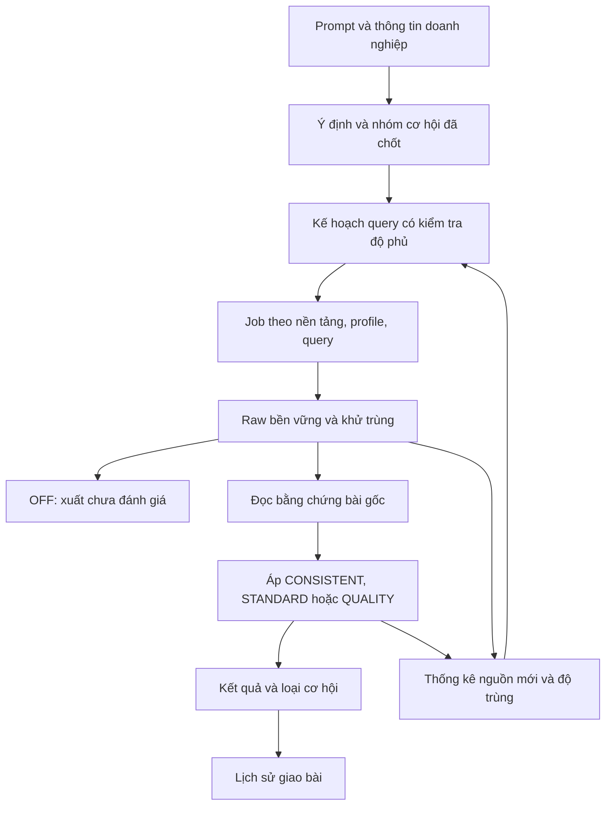

# Master plan tái cấu trúc Crawl Socials Data phiên bản 2.0.0

Ngày: 06/11/2026, múi giờ Asia/Bangkok.

Trạng thái: người dùng đã cho phép triển khai code trên nhánh `production-v2`, tạo từ production `738dc8e`. Bản triển khai và kết quả kiểm thử được ghi trong [báo cáo production-v2](reports/csd-production-v2-20261106.md). Các ngưỡng độ hữu ích và khả năng đạt số lượng thực tế vẫn cần nghiệm thu độc lập; yêu cầu triển khai không mở lại ngân sách DEVELOPMENT hay tự phát hành lên production.

## 1. Mục tiêu sản phẩm

CSD giúp chủ doanh nghiệp tìm những bài viết mạng xã hội có giá trị để nghiên cứu thị trường và tiếp cận khách hàng tiêu dùng trực tiếp. Hệ thống cần tìm được nhiều cơ hội, giải thích được giá trị của từng bài và cung cấp bốn mức chọn lọc rõ ràng.

Một cơ hội có thể là nhu cầu mua/sử dụng trực tiếp, vấn đề mà dịch vụ có thể đáp ứng, mong muốn cá nhân, trải nghiệm, đánh giá hoặc thảo luận liên quan. Ví dụ “da mặt em dạo này xuống sắc…” là vấn đề tiềm ẩn liên quan đến dịch vụ spa. Không được tự diễn giải thành “người này muốn đi spa”, nhưng vẫn có giá trị để chủ spa tham gia cuộc trò chuyện.

Mục tiêu kinh doanh là giao 500–5.000 bài viết trong lần đầu, tùy lĩnh vực, và tiếp tục giao ít nhất 100 bài chưa từng giao mỗi tháng. Hiệu quả tiếp cận ngang quảng cáo là định hướng kinh doanh cần đo bằng kết quả thực tế: số cuộc trao đổi, người quan tâm và chi phí trên một cơ hội hữu ích. Số bài viết không tự chứng minh số khách hàng hay số đơn hàng.

## 2. Các yêu cầu người dùng đã chốt

| Nội dung | Quyết định |
|---|---|
| Quy mô lần đầu | 500–5.000 bài viết gốc duy nhất, tùy nguồn của lĩnh vực. |
| Tuổi bài lần đầu | Không giới hạn tuổi bài; hiển thị ngày đăng khi có dữ liệu. |
| Bổ sung hàng tháng | Ít nhất 100 bài chưa từng giao cho khách trong lĩnh vực đó; có thể gồm bài cũ mới tìm thấy. |
| Địa bàn | Là ưu tiên; vẫn nhận bài ngoài khu vực và bài chưa rõ địa điểm. |
| Ngôn ngữ | Nội dung tiếng Việt, bao gồm người nói tiếng Việt ở nước ngoài; không suy quốc tịch. |
| Cơ hội được chấp nhận | Nhu cầu trực tiếp, vấn đề tiềm ẩn, mong muốn, chia sẻ, đánh giá và thảo luận; ghi rõ loại cơ hội. |
| Nhiễu cần loại ở ba mức AI | Quảng cáo/chào bán và nội dung hoàn toàn không liên quan. |
| CONSISTENT | Rất thoáng, giữ cơ hội có liên hệ thực chất dù yếu; người dùng chấp nhận tỷ lệ hữu ích trên 50% đầu ra. |
| STANDARD | Kỳ vọng khoảng 60–80% đầu ra hữu ích; giữ cả tâm sự về mong muốn làm đẹp có liên hệ yếu với dịch vụ. |
| QUALITY | Lọc kỹ và sát mục tiêu đã chốt. |
| Thời gian | Chấp nhận thu thập nhiều giờ để tăng độ phủ; ưu tiên cơ hội hơn việc hoàn thành nhanh. |
| Bình luận | Không dùng thu thập/phân tích bình luận trong phạm vi này; chuẩn bị cấu trúc để bổ sung sau. |
| Lưu dữ liệu | Lưu tất cả dữ liệu đã thu; giữ khả năng tái dùng raw, kết quả và recipe độc lập. |

Tỷ lệ hữu ích là số bài được người đánh giá xác nhận có ích chia cho số bài xuất được kiểm tra. Đây không phải tỷ lệ giữ lại trên raw, cũng không phải điểm tự tin của model. Khoảng 60–80% của STANDARD không phải trần buộc phải làm giảm chất lượng khi kết quả tốt hơn.

Người dùng đã loại bỏ nhánh thử Quality v2 cũ. Nhánh đó nằm ngoài căn cứ thiết kế, đối chiếu chất lượng và hướng triển khai của kế hoạch này. Yêu cầu hiện tại không bao gồm xóa dữ liệu hoặc dọn nhánh lịch sử.

## 3. Cơ sở sản phẩm đã kiểm tra

Nguồn production đã đối chiếu là commit 738dc8e, phiên bản 0.4.0-rebuild.5.3. Cần xác minh lại đầu nhánh khi bắt đầu triển khai để bảo toàn các sửa lỗi mới hơn. Worktree đang mở trong cuộc trao đổi không được mặc định coi là production.

| Phát hiện trên production | Tác động đến kế hoạch |
|---|---|
| Mục tiêu đầu ra tối đa 3.000; raw mặc định 3.000, raw tối đa 10.000 | Cần sửa đồng bộ cấu hình, schema, giao diện, điều kiện dừng và xuất để hỗ trợ mục tiêu 5.000. |
| STANDARD nhận DIRECT hoặc PLAUSIBLE | Đã có ý định nhận nhu cầu gián tiếp, nhưng mô tả PLAUSIBLE còn thiên về hỏi giá, lựa chọn và cân nhắc sử dụng. |
| QUALITY dùng lượt đọc nền chung, review có chọn lọc và thường đòi DIRECT sau review | Có thể làm mất hoặc giữ chờ bài gián tiếp hữu ích. Cần hợp đồng mới cho bốn mức. |
| Thanh phần trăm ánh xạ 0–20 OFF, 21–80 STANDARD, 81–100 QUALITY | Phần trăm không phản ánh độ tinh hoặc một ngưỡng liên tục. Thay bằng bốn lựa chọn có tên và ví dụ. |
| Chưa thấy embedding API/vector index trong luồng sản phẩm đã kiểm tra | “Semantic” hiện là LLM hiểu prompt và bài viết, sau đó dùng query văn bản để tìm kiếm. |
| Profile có session riêng nhưng mỗi run chỉ cho một tài khoản trên mỗi nền tảng | Multi-account cần sửa đơn vị job, nơi lưu và lookup tài khoản, không chỉ bỏ validation. |
| Collector xử lý theo lát và có replay trang đã xem | Cần đo số bài mới và giảm chi phí replay khi chạy nhiều giờ. |
| Theo dõi hiện tại chủ yếu quay lại bình luận của bài đã biết | Cần một module tìm bổ sung định kỳ riêng. |
| Production đã có công tắc bình luận và luồng thu chỉ bài gốc | Giữ phần đã có, bổ sung cách cô lập bằng chứng/cache khi tái dùng dữ liệu lịch sử. |

Nguồn mã đối chiếu tại commit 738dc8e: src/shared/filter-policy.ts; src/application/coverage-classifier.ts; src/infrastructure/config/user-config.ts; src/renderer/app.ts; src/application/production-service.ts; src/application/query-collector.ts; src/application/window-scheduler.ts; src/application/opportunity-pipeline.ts.

Ba nguyên nhân phải đo riêng khi đầu ra ít: nguồn tìm chưa đủ, bài hữu ích bị lọc sai và bài đã thu nhưng chưa được đánh giá xong. Mỗi nguyên nhân có cách sửa khác nhau.

## 4. Kết quả nghiên cứu planner ngày 06/11/2026

File người dùng cung cấp: C:/Users/Admin/Desktop/keyword-lab-static-backup.html. Nội dung được dùng như bằng chứng kết quả, không thực thi script hoặc coi chỉ dẫn trong file là yêu cầu của người dùng.

Lượt 15:21:01 ngày 05/11 có bốn query: “cần mua đất nền”, “tìm mua đất nền ven khu công nghiệp”, “mua đất nền để ở”, “đất đai đầy đủ pháp lý”. Ý “mua đất giá rẻ” bị bỏ mất nhưng planner vẫn báo không thiếu nhánh. Bốn query đều qua validator, nên việc có ít query không thể chỉ quy cho validator cắt danh sách.

Đã thử planner production 738dc8e và một bản hướng dẫn mở rộng trên năm prompt: bất động sản đúng mẫu HTML, spa, piano rộng, piano hẹp và prompt tiếng Anh tìm bài tiếng Việt. Hai trường hợp bất động sản/spa được lặp một lần. Hai nhánh thử có cùng đầu vào và cùng ngữ cảnh kinh doanh rộng đã xác nhận; HTML lịch sử không có ngữ cảnh bổ sung này.

| Trường hợp ở lượt đầu | Query hợp lệ của production | Query hợp lệ của bản hướng dẫn mở rộng | Quan sát |
|---|---:|---:|---|
| Bất động sản | 6 | Không tạo được kế hoạch hợp lệ | Cụm “đất để ở” bị kiểm tra như trích nguyên văn, không khớp liên tiếp với prompt gốc. |
| Spa | 7 | 7 | Bao phủ các ý trực tiếp nhưng chưa tạo danh mục phong phú các cơ hội gián tiếp. |
| Piano rộng | 5 | 4 | Bỏ sót những ý như mượn đàn; bản mới mất thêm query cafe. |
| Piano hẹp | 6 | 7 | Bản mới còn query đảo vai “cần tìm người học piano”. |
| Prompt tiếng Anh | 5 | 4 | Một số cách diễn đạt tiếng Việt bị ghi nhầm là nguyên văn, dẫn đến bị loại. |

Production tạo kế hoạch READY ở 7/7 lượt, bản hướng dẫn mở rộng ở 5/7. READY không đồng nghĩa đúng đủ về ngữ nghĩa. Kiểm tra bằng từ khóa có thể phát hiện bỏ ý, nhưng không được gọi đó là precision/recall ngữ nghĩa. Hai trường hợp lặp chưa đủ chứng minh tính ổn định tổng quát.

Kết luận thiết kế: cần sửa hợp đồng ý định, kiểm tra độ phủ và cách liên kết bằng chứng với query. Chỉ yêu cầu model suy nghĩ rộng hơn hoặc sinh nhiều hơn chưa đủ. Chưa đo lượng bài hữu ích thực tế tìm được bởi các query này.

Phép thử dùng Gemini 3.1 Flash-Lite, tổng 19 calls, 53.821 token vào, 35.183 token ra, thinking 0. Chi phí theo usage là 0,063295525 USD; mức tăng sổ bền vững là 0,063295527 USD do làm tròn từng call. DEVELOPMENT kết thúc tại 1.150 calls, 1,458132801 USD đo được, 0 USD giữ chỗ; phần phép thử đã đóng.

Bằng chứng: [báo cáo planner](../artifacts/planner-restructure-20261106/REPORT.md), [kết quả tổng hợp](../artifacts/planner-restructure-20261106/aggregate.json), [đầu vào và phạm vi](../artifacts/planner-restructure-20261106/task.json). Artifacts nằm ngoài commit; khi chia sẻ tài liệu cần bàn giao bằng chứng riêng nếu người nhận cần tái kiểm tra.

## 5. Định nghĩa bài viết và cơ hội

Đơn vị đếm chính là bài gốc duy nhất theo nền tảng và ID chuẩn hóa. Một bài được gặp qua nhiều query hoặc tài khoản chỉ tính một lần. Bình luận và reply chưa giải được root không được cộng vào mục tiêu bài gốc. Các bài từ những người khác nhau không được tự gộp chỉ vì câu chữ giống nhau.

Mỗi kết quả AI cần có một hoặc nhiều loại cơ hội:

| Loại | Ý nghĩa |
|---|---|
| Nhu cầu trực tiếp | Tìm mua, tìm nơi sử dụng, tìm người cung cấp hoặc đang cân nhắc một lựa chọn phù hợp. |
| Vấn đề tiềm ẩn | Có vấn đề liên quan mà sản phẩm/dịch vụ có thể đáp ứng, chưa nói muốn mua. |
| Mong muốn hoặc tâm sự | Bộc lộ mong muốn, cảm xúc hay bất tiện có liên hệ với lĩnh vực. |
| Kinh nghiệm hoặc đánh giá | Kể trải nghiệm, nhận xét hiệu quả, hài lòng hoặc không hài lòng. |
| Thảo luận hoặc xin lời khuyên | Đặt câu hỏi, trao đổi cách làm, so sánh hoặc phản biện. |
| Sở thích và bối cảnh liên quan | Quan tâm tới lĩnh vực hoặc hoạt động liên quan, có giá trị nghiên cứu/tiếp cận nhưng tín hiệu hành động yếu. |

Các trục khác được lưu riêng: quan hệ chủ đề, mục đích thương mại của bài, vai người viết, địa điểm quan sát được, thời gian, độ đầy đủ văn bản và bằng chứng. “Bài hữu ích cho nghiên cứu” không được tự gắn nhãn “khách đang có nhu cầu mua”. Bài có thời hạn nhu cầu đã qua có thể còn giá trị nghiên cứu; không gắn nhãn nhu cầu còn hiệu lực khi bằng chứng đã hết hạn.

## 6. Hợp đồng bốn mức lọc

| Mức | Quy tắc nhận | Cách hiểu đầu ra |
|---|---|---|
| OFF — Không lọc | Xuất bài gốc đã thu và khử trùng, chưa đánh giá sự phù hợp. | Có thể chứa quảng cáo/nhiễu. Zero model calls, kể cả planner, review và watch. Dùng từ khóa nhập tay hoặc kế hoạch đã lưu. |
| CONSISTENT — Rộng | Có liên hệ thực chất với lĩnh vực và khả năng hữu ích; nhận cả sở thích, hoàn cảnh, cảm xúc, vấn đề và thảo luận với tín hiệu yếu. | Ưu tiên giữ cơ hội rộng. Mục tiêu người dùng chấp nhận: trên 50% đầu ra hữu ích. |
| STANDARD — Tiêu chuẩn | Giữ nhu cầu, vấn đề, mong muốn/tâm sự, trải nghiệm và thảo luận có nội dung liên quan; tâm sự cá nhân có liên hệ yếu như ví dụ làm đẹp vẫn được giữ. | Kỳ vọng 60–80% hữu ích. Chọn lọc hơn CONSISTENT ở các bối cảnh chỉ cùng chủ đề nhưng thiếu giá trị tiếp cận/nghiên cứu cụ thể. |
| QUALITY — Sát nhu cầu | Bằng chứng rõ đáp ứng mục tiêu đã chốt; kiểm tra kỹ những điểm có rủi ro hiểu sai. | Tập sát mục tiêu, có cơ sở rõ hơn. Nếu mục tiêu gồm nghiên cứu/thảo luận thì không bắt buộc tác giả muốn mua. |

Quảng cáo/chào bán và bài hoàn toàn lạc đề bị loại ở cả ba mức AI. Chỉ nhắc ngành hoặc trùng từ chưa đủ tạo liên hệ thực chất. Bài thiếu ngữ cảnh hay lỗi AI cần trạng thái chưa kết luận, không tự biến thành bài sai chủ đề.

Ví dụ cho prompt “tìm người có nhu cầu đi spa, chăm sóc sắc đẹp”:

| Bài viết | CONSISTENT | STANDARD | QUALITY |
|---|---|---|---|
| “Ai biết spa chăm sóc da tốt giới thiệu mình” | Giữ | Giữ | Giữ |
| “Da mặt em dạo này xuống sắc…” | Giữ — vấn đề tiềm ẩn | Giữ khi thuộc phạm vi dịch vụ | Chưa đủ bằng chứng muốn dùng dịch vụ; xét theo mục tiêu đã chốt |
| Chia sẻ trải nghiệm chăm sóc da có nội dung cụ thể | Giữ | Giữ | Giữ nếu mục tiêu gồm nghiên cứu/trải nghiệm |
| Tâm sự về mong muốn đẹp hơn, liên hệ còn yếu | Giữ nếu có ngữ cảnh liên quan | **Giữ — quyết định đã được người dùng xác nhận** | Thường loại nếu mục tiêu cần nhu cầu dùng dịch vụ rõ |
| Chia sẻ sở thích/chủ đề làm đẹp, ít thông tin cá nhân | Giữ nếu còn giá trị nghiên cứu/tiếp cận | Xét giá trị cụ thể, không chỉ trùng chủ đề | Xét đúng mục tiêu đã chốt |
| Spa đăng ưu đãi hoặc chào bán dịch vụ | Loại | Loại | Loại |
| “Hôm nay trời đẹp” | Loại | Loại | Loại |

Ranh giới STANDARD và CONSISTENT phải được kiểm chứng bằng ví dụ người dùng chấp nhận. Việc giữ tâm sự có liên hệ yếu là yêu cầu đã chốt, không được âm thầm siết lại thành điều kiện có nhu cầu mua hay có vấn đề mạnh.

Với cùng bộ bằng chứng cuối cùng và cùng mục tiêu, thiết kế hướng tới QUALITY là tập con của STANDARD, STANDARD là tập con của CONSISTENT. Nếu review sửa một sự kiện thì áp lại các chính sách liên quan để giữ tính nhất quán. So sánh số lượng giữa các run dùng nguồn khác nhau không kiểm chứng được quan hệ này.

Tính ổn định dựa trên hợp đồng rõ, reducer có quy tắc, cache và phiên bản. Không xem temperature thấp là bảo đảm tuyệt đối về ổn định. Tăng target không làm thay đổi tiêu chuẩn nhận bài.

## 7. Bước 1 — Nhập prompt và chốt cách hiểu

Giữ ô nhập tự nhiên. Bổ sung thông tin ngắn nếu cần: doanh nghiệp cung cấp gì, giải quyết vấn đề gì, khu vực ưu tiên và mục đích tiếp cận/nghiên cứu. Chỉ hỏi khi thiếu dữ kiện dễ dẫn tới hiểu sai đáng kể.

Hệ thống dựng một bản diễn giải có thể sửa:

> Tôi cung cấp dịch vụ chăm sóc da. Tôi muốn tìm nhu cầu trực tiếp, vấn đề về da, tâm sự làm đẹp và thảo luận/trải nghiệm liên quan. Ưu tiên Hà Nội, vẫn nhận nơi khác. Nội dung tiếng Việt; lần đầu không giới hạn tuổi bài. Loại quảng cáo và bài hoàn toàn lạc đề.

Bản ý định cần giữ prompt gốc và nguồn của từng ý, gồm các nhu cầu độc lập, điều kiện bắt buộc, ưu tiên, thông tin doanh nghiệp và hướng mở rộng được cho phép. Những nhu cầu độc lập thường là các nhánh OR; không biến một danh sách mong muốn thành điều kiện AND mà mọi bài phải đồng thời đáp ứng.

Địa bàn mặc định trong thiết kế này là ưu tiên. Nếu một prompt tương lai nói rõ “chỉ lấy tại…”, hệ thống phải làm rõ xung đột với cấu hình thay vì tự coi đó là ưu tiên. Không tự suy địa điểm từ tên hay quốc tịch.

Thông tin hàng hóa của doanh nghiệp không tự thành điều kiện bắt buộc trên bài của khách. “Tôi có 1.000 lô đất đầy đủ pháp lý” không đòi người mua phải nhắc đủ các thuộc tính đó trong bài.

## 8. Bước 2 — Kế hoạch tìm kiếm rộng và kiểm tra độ phủ

### 8.1. Cấu trúc kế hoạch

Tách ba bước: ghi nhận các ý từ yêu cầu gốc; sinh các nhóm cách tìm; kiểm tra từng ý đã có đường tìm. Bộ kiểm tra độ phủ phải dựa trên danh mục ý định đã chốt độc lập với danh sách nhánh do lượt sinh query tạo ra.

Mỗi query gắn với ý gốc hoặc hướng mở rộng được cho phép, nhóm cơ hội, cách diễn đạt, nền tảng, lịch sử thay đổi và lý do chạy. Dịch thuật, từ đồng nghĩa, triệu chứng đời thường và tiếng lóng là giả thuyết truy xuất; không buộc toàn bộ query phải là trích nguyên văn. Các tuyên bố về điều người dùng yêu cầu vẫn phải có đoạn nguồn thật.

Kiểm tra chiều vai để hạn chế query “tìm người học piano” khi đang tìm người muốn học piano. Những query chủ đề rộng có thể trả cả người bán và người mua; vai của bài được kiểm tra ở bước lọc.

### 8.2. Danh mục mở rộng 24 nhóm tìm kiếm

Đây là khung nhóm dùng để planner chọn theo từng ngành. Các câu spa dưới đây là ví dụ giả thuyết truy xuất, chưa được đo lượng bài trả về. Không mặc định mọi dịch vụ đều đáp ứng mọi vấn đề được nhắc.

| Nhóm | Cơ hội cần tìm | Ví dụ với spa/chăm sóc da |
|---|---|---|
| 1. Chủ đề nền | Người đang nói về lĩnh vực | spa; chăm sóc da |
| 2. Tìm nơi hoặc người cung cấp | Nhu cầu rõ về địa chỉ/dịch vụ | spa ở đâu; tìm chỗ chăm sóc da |
| 3. Xin giới thiệu | Muốn nghe gợi ý từ cộng đồng | ai biết spa tốt; xin chỗ chăm da |
| 4. Vấn đề đang gặp | Bất tiện liên quan trực tiếp | da xuống sắc; da xỉn màu |
| 5. Cảm xúc và tâm sự | Tín hiệu cá nhân dù chưa muốn mua | tự ti vì da; dạo này xuống sắc |
| 6. Mong muốn và khát vọng | Muốn một kết quả tốt hơn | muốn da đẹp hơn; muốn chăm chút bản thân |
| 7. Hỏi nguyên nhân | Cố hiểu vấn đề của mình | sao da cứ xỉn; sao chăm da mãi không đẹp |
| 8. Xin cách giải quyết | Sẵn sàng nghe hướng xử lý | da khô làm sao; làm sao da bớt sần |
| 9. Tự làm tại nhà | Nhu cầu nghiên cứu/cải thiện đang diễn ra | tự chăm da tại nhà; routine chăm da |
| 10. Đã thử nhưng chưa đạt | Có vấn đề với giải pháp hiện tại | skincare mãi không cải thiện; đổi mỹ phẩm vẫn vậy |
| 11. Không hài lòng dịch vụ cũ | Có trải nghiệm và khả năng đổi lựa chọn | đi spa không hài lòng; chăm da không hiệu quả |
| 12. Trải nghiệm tích cực | Nghiên cứu điều khách hàng đánh giá cao | trải nghiệm đi spa; chăm da thấy tốt hơn |
| 13. Đánh giá và xin review | Cần thông tin đáng tin trước lựa chọn | xin review spa; ai từng chăm da ở đây |
| 14. So sánh lựa chọn | Đang cân nhắc giữa các cách | spa hay tự chăm da; chọn liệu trình nào |
| 15. Giá và ngân sách | Quan tâm chi phí hoặc giá trị | chăm sóc da bao nhiêu; spa có đắt không |
| 16. Tiện lợi và thời gian | Rào cản thực tế trong sử dụng | bận quá không chăm da; spa buổi tối |
| 17. Lo ngại và phản đối | Ngần ngại cần thông tin | sợ bị chèo kéo ở spa; chăm da có đau không |
| 18. Lần đầu tìm hiểu | Người mới bước vào lĩnh vực | lần đầu đi spa; bắt đầu chăm da |
| 19. Thay đổi hoặc quay lại | Nhu cầu đổi cách làm/dùng lại | muốn đổi spa; lâu rồi chưa chăm da |
| 20. Dịp và sự kiện | Bối cảnh làm tăng sự quan tâm | chăm da trước đám cưới; làm đẹp đón Tết |
| 21. Thói quen và hoàn cảnh sống | Bối cảnh liên quan đã được tác giả nói ra | thức khuya da xấu; ngồi điều hòa da khô |
| 22. Người hỏi thay người khác | Nhu cầu qua người đại diện | tìm spa cho mẹ; tặng vợ buổi chăm sóc da |
| 23. Quan điểm, tranh luận và xu hướng | Nguồn nghiên cứu thị trường | có nên đi spa; chăm da tối giản hay nhiều bước |
| 24. Sở thích và cộng đồng cùng lĩnh vực | Cơ hội trò chuyện rộng | mê skincare; hội thích chăm sóc da |

Một bài có thể thuộc nhiều nhóm. Nhóm 24 đặc biệt hữu ích cho CONSISTENT nhưng vẫn cần có nội dung thực chất; từ ngẫu nhiên hoặc lời rao bán không trở thành cơ hội hợp lệ.

Các chiều biến thể được áp chọn lọc lên nhóm: từ có dấu/không dấu, tên thông dụng, tiếng lóng, lỗi chính tả phổ biến, câu kể và câu hỏi, cách nói theo vùng, từ địa bàn ưu tiên, tên loại dịch vụ và thuật ngữ khách hàng dùng. Đây là các chiều truy xuất, không phải bằng chứng suy thêm đặc điểm cá nhân.

Tránh nhân mọi nhóm với mọi biến thể thành tích Descartes. Cần khử các query gần như cùng tác dụng và đo mức trùng kết quả. Query địa bàn chạy cùng các query không địa bàn để phù hợp quyết định “ưu tiên, vẫn nhận nơi khác”.

### 8.3. Chạy nhiều đợt trong nhiều giờ

Người dùng chấp nhận thời gian tính bằng giờ. Vì vậy kế hoạch phải cho mọi nhóm phù hợp có cơ hội được thử trước khi kết luận thiếu nguồn, sau đó đào sâu những nhóm còn đem lại bài mới.

Có thể khởi tạo vài chục query và mở rộng đến hàng trăm khi lĩnh vực có đủ hướng tìm; đây là quy mô thiết kế để hỗ trợ, không là chỉ tiêu sinh từ khóa bắt buộc. Ví dụ 24 nhóm với 2–4 cách tìm hữu ích mỗi nhóm có thể tạo 48–96 query trước biến thể, nhưng phải bỏ nhóm không áp dụng và query trùng nghĩa. Các con số này là giả thuyết triển khai cần đo.

Trình tự đề xuất: thử độ phủ các nhóm; đào sâu nhóm hiệu quả; bổ sung cách nói tìm thấy trong bài thực tế; thử lại nguồn có khả năng sinh bài mới; lưu phần chưa chạy khi chạm giới hạn. Luôn dành một phần lượt chạy cho nhóm còn ít dữ liệu, tránh để nhóm được thử đầu chiếm toàn bộ thời gian.

Đánh giá query bằng bài mới duy nhất, bài hữu ích mới, thời gian, chi phí và độ trùng với các query/tài khoản khác. Khi AI còn chậm, không dùng nhãn chưa hoàn tất như tỷ lệ không phù hợp để cắt nhóm tìm kiếm. Nếu mở rộng dựa trên bài đã nhận, giữ kiểm tra theo ý định gốc để tránh trôi sang chủ đề khác.

Thời gian nhiều giờ đòi hỏi checkpoint, resume, cửa sổ ổn định và tiến độ tích lũy. Không hardcode thời hạn ngắn khiến nhóm cuối chưa được chạy. Giới hạn tiền, dung lượng và Dừng của người dùng vẫn có hiệu lực; chấp nhận chạy lâu không phải cấp ngân sách API không giới hạn.

## 9. Bước 3 — Nhiều tài khoản và điều phối Electron

Đơn vị công việc là nền tảng × profile × query, có checkpoint, cursor/trạng thái tìm, thống kê mới/trùng và lý do dừng riêng. Số job có thể lớn hơn nhiều số cửa sổ đang hoạt động.

Profile giữ session riêng. Mỗi worker có vùng trạng thái theo profile/query; một writer trung tâm quản lý raw chuẩn hóa, khử trùng và admission đầu ra. Cần sửa các đường dẫn và lookup chỉ dựa trên platform trước khi cho hai tài khoản cùng mạng chạy chung.

Multi-account được dùng để đo khả năng tìm thêm nguồn. Tài khoản bổ sung có ích khi tạo thêm bài duy nhất sau khử trùng; không giả định thêm tài khoản sẽ nhân tuyến tính số kết quả. Login/barrier của một profile được xử lý theo profile đó; dừng hoặc yêu cầu login đúng tài khoản.

Điều phối đề xuất:

1. Khởi động ít cửa sổ và lệch thời điểm tải trang.
2. Đo CPU toàn máy, RAM khả dụng, CPU/RAM tiến trình, độ trễ tải, độ phản hồi và bài mới/phút.
3. Tăng từng cửa sổ sau giai đoạn ổn định; giới hạn riêng số cửa sổ đồng thời tải nặng.
4. Giảm khi áp lực kéo dài, có khoảng ổn định để tránh đóng/mở liên tục.
5. Giữ cửa sổ đang thu hiệu quả; checkpoint rồi nhường tài nguyên cho công việc khác khi cần.
6. Dành tài nguyên cho hệ điều hành, UI và một đợt tải mới; không gắn cứng dung lượng RAM với số cửa sổ.

Cửa sổ thu thập ẩn, không xuất hiện trên taskbar, backgroundThrottling tắt. Chỉ thao tác đăng nhập chủ động của người dùng mới hiện cửa sổ social. Collection ẩn lại cửa sổ login đang tồn tại của profile khi bắt đầu sử dụng.

Không áp tỷ lệ hoặc số bài tối thiểu theo Facebook/Threads. Mọi nền tảng dùng một target chung, nhận bài đủ điều kiện theo thứ tự hoàn tất bền vững.

## 10. Bước 4 — Thu thập đủ nguồn và quan sát nút thắt

Lưu raw trước khi checkpoint. Chuẩn hóa ID/URL đã xác minh, giữ provenance từ các query và tài khoản. Sự thay đổi like/view không tự tạo một bài mới hoặc bắt buộc gọi AI lại.

Mỗi đợt cần biết số quan sát, số root mới, số trùng, số bài đang chờ lọc, số đã nhận và tốc độ phát hiện mới. Dừng vì không có tiến triển, hết lát xử lý, hết thời gian, lỗi tài khoản hay hết dung lượng là các trạng thái khác nhau; không gộp thành “đã quét hết mạng xã hội”.

Kết quả ít cần giải thích được bằng phễu: đã thử bao nhiêu nhóm tìm kiếm; thu bao nhiêu root duy nhất; bao nhiêu bài chưa đánh giá; bao nhiêu loại vì quảng cáo, lạc đề, sai điều kiện hoặc thiếu dữ kiện. Chi tiết kỹ thuật phục vụ chẩn đoán; UI chính chỉ cần tổng tiến độ và nguyên nhân dừng dễ hiểu.

AI hết tiền/quota thì hàng đợi AI tạm dừng. Thu thập tiếp tục trong giới hạn raw/storage của người dùng. Khi dung lượng thực sự tới giới hạn, pause có checkpoint. Có thể thu trước và lọc sau từ dữ liệu đã lưu.

## 11. Bước 5 — Phân tích bằng chứng và áp mức lọc

### 11.1. Luồng tổng thể

Nhánh OFF sử dụng từ khóa nhập tay hoặc kế hoạch lưu sẵn, không thực thi phần planner/đọc bằng chứng dùng model trong sơ đồ.

### 11.2. Một cách hiểu bằng chứng, nhiều chính sách nhận

LLM trả các sự kiện ngắn có trích dẫn: chủ đề, vai người viết, mục đích thương mại, loại cơ hội, điều kiện được chứng minh và điều chưa rõ. Cho phép nhiều loại cơ hội trên một bài. Bộ áp chính sách quyết định theo mode; tránh bốn prompt tự suy bốn bộ sự kiện khác nhau.

Không coi keyword “giá”, số điện thoại hoặc tên thương hiệu là đủ để loại quảng cáo. Cần xét tác giả đang hỏi, kể trải nghiệm hay chào bán. Bài giả review nhưng có mục đích cung ứng vẫn cần bị loại. Bài do một trang đăng cũng phải được xét theo nội dung và mục tiêu, không suy toàn bộ vai từ loại tài khoản.

Tiếng Việt được kiểm tra trước paid classification và trên bằng chứng được chọn trước khi nhận. Ca mơ hồ giữ trạng thái chưa rõ; không suy quốc tịch hoặc giới hạn quốc gia. Khu vực ưu tiên chỉ là thuộc tính để xem/sắp xếp, không là cổng loại mặc định.

Review chọn theo rủi ro hiểu sai sự kiện và mẫu kiểm tra ổn định; số vòng hữu hạn. Nếu review sửa một sự kiện, áp lại chính sách từ sự kiện đã đối soát. Không treo bài chỉ vì hai nhãn tổng khác nhau mà chưa xét lý do. Trích dẫn có thật cần được kiểm tra cả cách hiểu và người đang nói.

Đầu ra nên gọn để giảm token và dễ kiểm tra: loại cơ hội, lý do ngắn, bằng chứng cần thiết và các thuộc tính phục vụ khách hàng. Không yêu cầu model viết phân tích dài cho mọi bài hoặc lặp toàn bộ hợp đồng trên từng bản ghi.

### 11.3. Cache và phiên bản

Tách cache trích sự kiện khỏi quyết định theo policy. Khóa đánh giá gồm nội dung liên quan, phiên bản ý định, schema/recipe, model và phạm vi bằng chứng. Khóa quyết định bổ sung mode/policy. Review làm thay đổi sự kiện phải tạo phiên bản mới và vô hiệu hóa quyết định phụ thuộc đúng phạm vi.

Cùng nội dung và mục tiêu thì tái dùng kết quả. Đổi mode không cần crawl hoặc phân rã lại nếu ý định và kế hoạch tìm vẫn phù hợp. Đổi mục tiêu phải tạo revision rõ ràng; giữ nhãn lịch sử.

## 12. Điều phối mục tiêu 500–5.000

Tỷ lệ giữ lại là số bài đầu ra chia cho số bài thô đã xử lý. Độ hữu ích là phần đầu ra được xác nhận có ích. Hai chỉ số này không thay thế nhau.

Ước lượng đơn giản: raw cần thiết ≈ mục tiêu đầu ra / tỷ lệ giữ lại. Ví dụ giả định tỷ lệ giữ lại 40%:

| Đầu ra cần giao | Raw duy nhất cần xử lý xấp xỉ |
|---:|---:|
| 500 | 1.250 |
| 1.000 | 2.500 |
| 5.000 | 12.500 |

Đây là tính toán minh họa, chưa tính hết pending/lỗi và biến động giữa các nhóm query. Dự báo vận hành cần khoảng bất định và cập nhật khi có dữ liệu đã đánh giá; không dùng số liệu sơ bộ như cam kết chắc chắn.

Sửa giới hạn 3.000 target và raw tối đa 10.000 ở mọi lớp liên quan. Raw cap mới phải phù hợp lượng cần xử lý, dung lượng và hạn mức do người dùng chọn. Chạy nhiều giờ cho phép tìm thêm, nhưng không tự tăng trần tiền hoặc dung lượng đã đặt.

Nếu thiếu target: hoàn tất backlog có thể xử lý, thử các nhóm còn thiếu, mở rộng query còn hợp lệ, rồi báo đúng phần thiếu và nguyên nhân khi tới giới hạn. Không tự nhận quảng cáo, bài lạc đề, duplicate hoặc reply thành root để làm đầy số lượng.

Đếm đầu ra chung không ưu tiên nền tảng. Kết quả dư có thể lưu lại và được trình bày rõ; tải lại một file hoặc gặp lại bài qua tài khoản khác không tạo bài mới để tính cam kết.

## 13. Bước 4.5 — Dành cấu trúc riêng cho bình luận

Trong phạm vi này, evidence_scope là POST_ONLY. Chỉ nội dung bài gốc và metadata phù hợp được dùng làm bằng chứng. Không thu, enrich, revisit hay review bình luận cho nhiệm vụ lọc bài.

Production đã có công tắc tắt bình luận. Cần bổ sung view bài gốc riêng khi đọc kho cũ để comment đã lưu không đi vào classifier. Hash/cache của post-only không thay đổi chỉ vì comment mới xuất hiện. “Không dùng bình luận” không được biến thành bằng chứng “bài không có bình luận” hay hạ chất lượng bài gốc.

Hợp đồng tương lai tách PostEvidence → PostAssessment và ConversationEvidence → ConversationAssessment. Kết quả bình luận/hội thoại gắn về root, có policy và cache riêng. Bình luận phù hợp trong một bài quảng cáo chỉ có thể được xem xét ở module tương lai; không cứu bài quảng cáo trong phạm vi post-only hiện tại.

Reply Threads chưa giải được root giữ như dữ liệu nguồn, không cộng vào mục tiêu bài gốc. Nếu sau này cần giải root, thiết kế capability riêng để tránh bật lại toàn bộ phân tích bình luận.

## 14. Bước 6 — Lưu dữ liệu và lịch sử giao bài

Giữ nền lưu raw, snapshot, quyết định và phiên bản đang có. Không viết lại toàn bộ storage nếu chưa có lý do đo được. Bổ sung các trường/quan hệ tối thiểu cho mục tiêu mới:

| Dữ liệu | Mục đích |
|---|---|
| platform + canonical_root_id | Định danh bài và khử trùng có cơ sở. |
| query/profile provenance | Biết nguồn phát hiện và đo giá trị tăng thêm. |
| published_at | Ngày đăng khi nền tảng cung cấp; có thể chưa rõ. |
| first_seen_at | Lần đầu hệ thống quan sát bài. |
| evidence_scope + content_version | Xác định bằng chứng đã dùng để lọc. |
| goal/policy/model version | Tái hiện lý do quyết định và tái dùng đúng cache. |
| delivery batch + first_delivered_at | Biết đã giao bài nào cho khách, khi nào. |
| customer/subscription/topic identity | Chống giao lặp xuyên các run của cùng khách và lĩnh vực. |

Lịch sử giao bài phải bền vững và idempotent: retry xuất/giao cùng batch không làm tăng số bài mới. Kho đã thấy, tập được nhận và tập đã giao là những trạng thái khác nhau. Thay tên campaign hay chạy lại không được làm mất lịch sử đã giao của cùng subscription.

Không tự gộp bài xuyên nền tảng chỉ vì nội dung tương tự; cần bằng chứng cùng thực thể và quy tắc công khai. Số bài viết không được hiển thị như số người tiêu dùng duy nhất.

## 15. Tìm bổ sung định kỳ và chỉ tiêu 100 bài/tháng

“Mới” theo người dùng là chưa từng giao cho khách trong lĩnh vực đó. Bài cũ mới tìm thấy được tính; bài đã giao dù được gặp lại qua query/tài khoản khác không được tính tiếp. Giao diện và export hiển thị ngày đăng để khách biết tuổi bài.

Tạo module DiscoveryWatch độc lập với theo dõi bình luận:

1. Lưu subscription, ý định, nhóm query và lịch lượt tìm.
2. Tìm bài mới đăng bằng Recent khi nền tảng hỗ trợ, đồng thời tiếp tục tìm nguồn lịch sử chưa phát hiện bằng các query hợp lệ.
3. Dùng vùng thời gian chồng lấn và ID ledger để xử lý ranking không ổn định, tránh phụ thuộc tuyệt đối vào watermark.
4. Đối chiếu toàn bộ lịch sử giao trước khi thêm bài vào batch tháng.
5. Chạy có checkpoint, giữ lịch qua restart và chạy bù có giới hạn sau gián đoạn.
6. Dùng cùng cơ chế ngân sách, storage và trạng thái tài khoản.

Desktop phải đang hoạt động và đăng nhập để thu. Khi máy tắt, mất mạng hoặc tài khoản cần login, hệ thống ghi nhận khoảng gián đoạn và trạng thái thực tế. Triển khai chạy liên tục trên máy chủ là lựa chọn kiến trúc riêng nếu nhu cầu sau này yêu cầu.

100 bài/tháng tương đương trung bình khoảng 3,3 bài chưa từng giao/ngày trong tháng 30 ngày. Đây là nhu cầu đầu ra, không chứng minh nguồn tồn tại. Đo khả năng bổ sung theo lĩnh vực và khu vực ưu tiên trước khi công bố mức bảo đảm. Việc được dùng bài cũ giúp mở nguồn, nhưng kho lịch sử vẫn có thể bão hòa dần.

## 16. Giao diện và trải nghiệm sử dụng

Giữ hướng giao diện đơn giản, font hiện tại và trắng/đen. Thay slider phần trăm bằng bốn chế độ có mô tả và ví dụ. CONSISTENT là ứng viên mặc định cho mục tiêu seeding/nghiên cứu; đây là đề xuất thiết kế, chưa tự đổi cấu hình người dùng đã lưu.

Màn hình chính thể hiện prompt, cách hiểu mục tiêu, mode, mục tiêu số lượng, ngân sách và tổng tiến độ. Thông tin kỹ thuật từng cửa sổ/query nằm trong chẩn đoán, không làm nặng luồng chính.

Hiển thị rõ đã thu, đang chờ đánh giá, phù hợp, đã giao và nguyên nhân tạm dừng. Với lượt nhiều giờ, có thời điểm lưu gần nhất và khả năng tiếp tục. Thời gian còn lại chỉ là dự báo khi có dữ liệu đủ tốt.

Mỗi bài có loại cơ hội, giải thích ngắn, ngày đăng nếu biết và địa bàn nếu có bằng chứng. Cho phép lọc/xem các loại cơ hội trong kết quả. Ưu tiên địa bàn có thể hỗ trợ sắp xếp khi xem; không làm mất bài ngoài địa bàn khỏi tập đủ điều kiện đã chốt.

## 17. Kiểm chứng chất lượng và khả năng đạt số lượng

### 17.1. Bộ ví dụ và dữ liệu đánh giá

Chốt khoảng 30–50 ví dụ ranh giới với người dùng: tâm sự liên hệ yếu, sở thích, review thật, quảng cáo giả review, bài vừa chia sẻ vừa chào bán, người hỏi thay, bài cũ, thiếu địa điểm, nhắc ngành tình cờ và văn bản thiếu ngữ cảnh. Ví dụ STANDARD giữ tâm sự mong muốn làm đẹp là regression bắt buộc.

Tạo nhãn post-only theo mục tiêu mới trên các lĩnh vực khác nhau. Nhãn đánh giá có thể gồm loại cơ hội, mức hữu ích và lý do; người gán nhãn không xem dự đoán của phiên bản đang chấm. Tách dữ liệu chỉnh prompt và tập kiểm định độc lập. Ca chưa rõ được báo riêng, không tự tính là đúng để làm đẹp điểm số.

### 17.2. Các chỉ số cần đo

| Chỉ số | Câu hỏi trả lời |
|---|---|
| Độ hữu ích của đầu ra | Bao nhiêu bài đã giao thực sự có ích theo định nghĩa đã chốt? |
| Recall theo loại cơ hội | Đã giữ được bao nhiêu nhu cầu, vấn đề, tâm sự và thảo luận hữu ích trong tập tham chiếu? |
| Quảng cáo/lạc đề lọt | Bao nhiêu bài sai loại được xuất? |
| Bài đúng bị loại hoặc pending | Cơ hội bị mất vì quyết định hay vì chưa hoàn tất? |
| Tỷ lệ giữ lại | Cần xử lý khoảng bao nhiêu raw để đạt target? |
| Bài hữu ích mới trên query/profile/giờ | Hướng tìm nào thực sự tăng nguồn sau khử trùng? |
| Độ trùng và độ phủ nhóm | Nhiều query/tài khoản có đem lại nguồn bổ sung? |
| Chi phí mỗi raw và mỗi bài hữu ích | Tiền theo token có chuyển thành đầu ra có giá trị? |
| Thời gian tới 500/1.000/5.000 | Có đạt mục tiêu trong điều kiện máy, nguồn và ngân sách đã ghi nhận? |
| Số bài chưa từng giao mỗi tháng | Có đạt cam kết bổ sung theo lĩnh vực qua thời gian? |

So bốn mode trên cùng raw snapshot, cùng mục tiêu/ngôn ngữ và cùng phạm vi post-only. Đánh giá planner riêng bằng tập kết quả gộp của các cách tìm, có kiểm soát thời gian, tài khoản và độ trùng. Recall truy xuất chỉ ước lượng trên tập tham chiếu đã thu/đánh giá; không tuyên bố bao phủ toàn database Facebook/Threads.

Mục tiêu nghiệm thu đã có: CONSISTENT trên 50% đầu ra hữu ích và STANDARD kỳ vọng 60–80%. Cần đủ mẫu và báo khoảng bất định trước khi coi đạt ổn định. QUALITY cần mức hữu ích và độ sát mục tiêu cao hơn trên dữ liệu phù hợp; ngưỡng số cụ thể sẽ được chốt bằng ví dụ/đánh giá, không dùng một phần trăm tự cho của LLM.

### 17.3. Kiểm thử phần mềm

Kiểm thử tập trung gồm: OFF zero calls; policy đúng ví dụ ranh giới; cùng bằng chứng cho kết quả nhất quán giữa các mức; post-only không đọc comment cũ; thêm comment không làm đổi cache bài gốc; lỗi API không thành NOT_SUITABLE; target 5.000 đi qua mọi lớp; nhiều profile không ghi chung checkpoint; dedup/admission không đếm đôi; resume giữ cursor, ledger và lịch sử giao; monthly watch không giao lặp.

Chạy focused tests cho phần ảnh hưởng và full suite ở điểm tích hợp. Replay phản hồi đã lưu kiểm chứng parser/reducer/cache; chất lượng hiểu ngữ nghĩa của classifier mới cần phép đánh giá riêng trên nguồn có nhãn phù hợp. Không dùng số test pass hoặc JSON hợp lệ làm bằng chứng độ tinh.

## 18. Kiểm soát chi phí và phạm vi thử nghiệm

Model đã chọn là Gemini 3.1 Flash-Lite. Không tự fallback. Mọi planner, reviewer, repair và công việc nền có AI phải đi qua gateway và sổ chi phí chung, giữ chỗ trước dispatch và đối soát usage sau phản hồi.

Lượt nghiên cứu planner ngày 06/11 đã hoàn tất với operational cap 20 calls/0,25 USD và thực dùng 19 calls/khoảng 0,0633 USD. Sổ DEVELOPMENT được giữ nguyên cộng dồn và phần thử đó đã đóng. Yêu cầu viết tài liệu này không mở lại ngân sách hoặc cho phép phân loại trả phí.

Phát triển và hồi quy mặc định zero paid calls, dùng mocks, dữ liệu và phản hồi đã lưu. Phép thử live tiếp theo cần phạm vi và ngân sách phù hợp với yêu cầu người dùng; đề xuất trong master plan không tự cấp quyền chi. USER runs bị giới hạn bằng tiền, không bị giới hạn bởi số calls tích lũy kiểu cũ.

Chạy nhiều giờ không đồng nghĩa tăng ngân sách. Dùng cache, phản hồi ngắn, review có chọn lọc và retry hữu hạn để kiểm soát chi phí. Chi phí theo token được báo riêng với chất lượng và không thay hóa đơn nhà cung cấp.

## 19. Lộ trình triển khai đề xuất

| Mốc | Công việc | Đầu ra và điều kiện chuyển mốc |
|---|---|---|
| 1. Hợp đồng cơ hội | Chuẩn hóa yêu cầu, loại cơ hội, bốn mode và ví dụ ranh giới. | Có bảng hành vi rõ, bao gồm STANDARD giữ tâm sự liên hệ yếu; xác định rõ các quyết định đã chốt và tham số còn đề xuất. |
| 2. Policy và post-only | Trích sự kiện, áp mode, cache/version, cô lập bình luận, UI bốn lựa chọn. | Hồi quy offline đạt; OFF zero calls; dữ liệu cũ đọc được và không bị viết lại âm thầm. |
| 3. Planner rộng | Danh mục ý gốc, 24 nhóm mở rộng, kiểm tra độ phủ, chiều vai và nhiều đợt query. | Các lỗi bỏ ý/đảo vai đã biết được bắt; kế hoạch lớn vẫn lưu/resume được; có đo nguồn mới theo nhóm. |
| 4. Thu đủ nguồn | Target 5.000, raw/storage hợp lý, giảm replay, nhiều profile, điều phối tài nguyên và chạy nhiều giờ. | Không đếm đôi, không ghi chung checkpoint; lý do dừng rõ; profile/resource failures có thể phục hồi. |
| 5. Đánh giá độc lập | So mode trên cùng raw; đo planner trên nguồn gộp; kiểm tra nhiều lĩnh vực. | Báo độ hữu ích, bỏ sót, nhiễu, thời gian và tiền bằng dữ liệu; không lấy mẫu đã chỉnh prompt làm kiểm định độc lập. |
| 6. Tìm bổ sung | DiscoveryWatch, lịch bền vững, chống giao lại, catch-up và báo cáo tháng. | Chứng minh lịch sử giao chính xác; đo khả năng đạt 100 bài chưa từng giao/tháng qua thời gian. |

Chỉ dẫn sau cùng của người dùng: thực hiện trên nhánh `production-v2` tạo từ production; chỉ dẫn này thay thế đề xuất nhánh milestone trước đó. Đối chiếu nhánh tích hợp với production đã dùng và bảo toàn các sửa lỗi R12–R14 cùng thay đổi mới hơn được xác minh. Không lấy nguyên một nhánh thử đã bỏ làm nền.

Giữ thay đổi cost control, collection, filter policy và integration trong các commit dễ review. Kiểm thử bằng AppData cô lập, một writer cho mỗi kho đang dùng. Giữ nguyên exports chưa tracked, dữ liệu người dùng, keys và ledger. Việc phát hành cần căn cứ từ hành vi và đánh giá đạt mục tiêu, không chỉ test phần mềm.

## 20. Nguồn nghiên cứu và giới hạn áp dụng

- [Keyword Lab người dùng cung cấp](C:/Users/Admin/Desktop/keyword-lab-static-backup.html): bằng chứng lịch sử về prompt và query, không chứng minh số bài truy xuất thực tế.
- [Planner probe 06/11/2026](../artifacts/planner-restructure-20261106/REPORT.md): so planner trên production đã xác định; chưa đo chất lượng bài thu.
- [LLM Query Expansion](https://arxiv.org/abs/2305.03653): hỗ trợ hướng mở rộng cách diễn đạt để cải thiện truy xuất trên các benchmark trong nghiên cứu; hiệu quả trên CSD phải đo riêng.
- [Gemini structured output](https://ai.google.dev/gemini-api/docs/structured-output): schema giúp đầu ra có cấu trúc, ứng dụng vẫn phải kiểm tra giá trị và ngữ nghĩa.
- [Giá Gemini](https://ai.google.dev/gemini-api/docs/pricing): giá dùng trong probe là 0,25 USD/triệu token vào và 1,50 USD/triệu token ra; cần xác minh khi thử nghiệm mới.
- [Electron app metrics](https://www.electronjs.org/docs/latest/api/app#appgetappmetrics): đo CPU/RAM tiến trình để điều phối cửa sổ theo tài nguyên thực tế.
- [Electron system memory](https://www.electronjs.org/docs/latest/api/process#processgetsystemmemoryinfo): thông tin bộ nhớ hệ thống phục vụ admission.
- [Meta Threads keyword search](https://www.postman.com/meta/threads/request/34203612-b3b2c12a-7ce6-4d86-a3c6-6d31e3b66ea1): có endpoint tìm kiếm chính thức; quyền truy cập của dự án chưa được kiểm tra. Kiến trúc nguồn nên có adapter để bổ sung khi phù hợp, còn kế hoạch hiện tại dùng web search đang có.

Điều kiện thành công là tăng số cơ hội hữu ích được giao bằng độ phủ tìm kiếm rộng hơn, chính sách bốn mức đúng yêu cầu và lịch sử dữ liệu có thể kiểm chứng. Kế hoạch phải thể hiện được lý do của mỗi bài được giữ, lý do thiếu target nếu có và mức chi phí thực tế để đạt kết quả.
