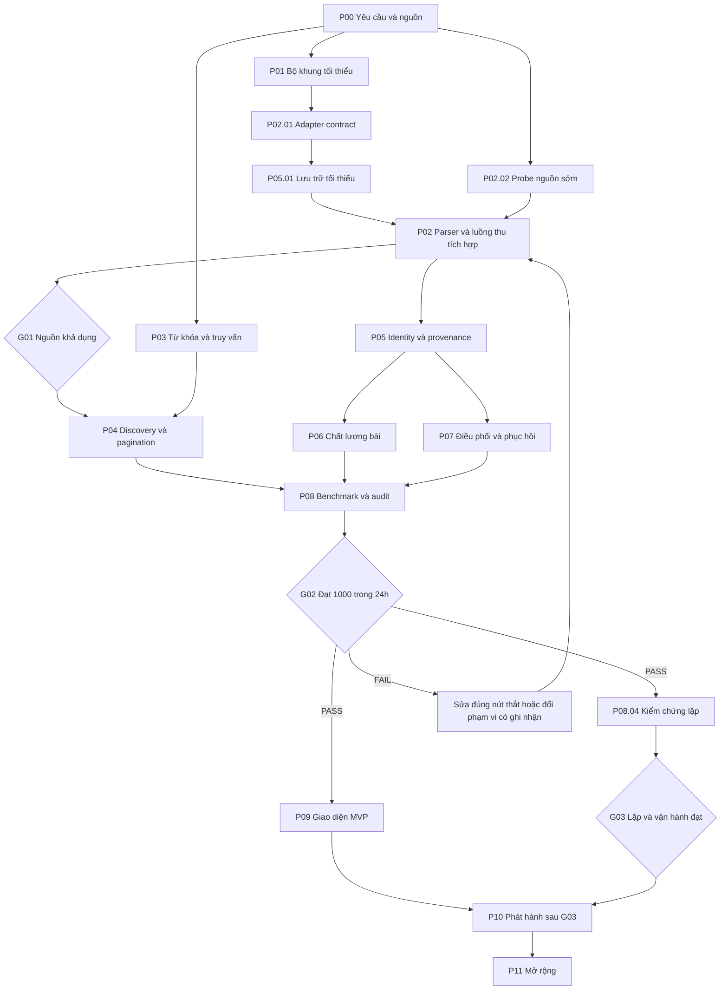

# CSD Master Plan

## Hiện hành 2.0 — sản phẩm dùng thật, 29/10/2026

**Nhánh được người dùng chọn: `codex/csd-production`.** Đọc [ADR-021](decisions/ADR-021-production-branch.md) trước khi triển khai. Quyết định này thay mọi chỉ dẫn thử nghiệm mâu thuẫn ở phần lưu trữ bên dưới. Không cần quay lại xin người dùng chọn nhánh hoặc xin mở UI production.

| Phạm vi | Trạng thái hiện hành |
| --- | --- |
| Nền sản phẩm | Electron Windows, Facebook + Threads; tiếp tục kết quả bộ thu hiện có |
| Cấu hình | Keywords do người dùng nhập, Save on Blur, mục tiêu riêng mỗi mạng (người dùng xác nhận) |
| Tài khoản | Đăng nhập trực tiếp, phiên persistent, tick nguồn chỉ khi có phiên; không hứa chống thu hồi phiên |
| UI | Dark/hacker/monospace; TikTok, Instagram, X, Reddit chỉ badge mờ |
| Thu và xuất | JSON thật, Stop giữ dữ liệu, Excel hai sheet theo ảnh tham chiếu |
| Data mẫu/chế độ thử | Đã bỏ khỏi entrypoint/gói sản phẩm; fixtures developer không đóng gói |
| Quyền điều phối | Các dispatch/worker/automation 1.x kết thúc; không tự khởi động lại |

| Task | Owner | Trạng thái | Đầu ra / xác minh |
| --- | --- | --- | --- |
| PROD-01 UI + cấu hình + tài khoản | Agent chính + renderer | DONE | Native UI/blur/restart + 800px PASS; bridge production, persistent config |
| PROD-02 Ghép bộ thu thật | Agent chính + collectors | DONE | 14 lifecycle + 17 service/config tests PASS; chưa chạy thêm LIVE |
| PROD-03 Excel | Agent exporter | DONE | Hai sheet, header/filter/freeze/ID text, 4 roundtrip tests PASS |
| PROD-04 Chọn nhánh + bàn giao | Agent chính | DONE | ADR-021, README, master plan, báo cáo kiểm chứng; tài liệu cũ có nhãn lịch sử |

Kết quả kiểm chứng cuối được ghi tại [production-upgrade-2026-10-29.md](evidence/production-upgrade-2026-10-29.md). Không gán PASS cho benchmark chất lượng nội dung chỉ vì UI/collector build thành công. Agent tiếp theo sửa sản phẩm hiện hành trên nhánh đã chọn và cập nhật bảng này.

---

# Lưu trữ kế hoạch 1.58 — chỉ tham khảo lịch sử

Toàn bộ trạng thái, bảng dispatch/gate và hạn chế PoC dưới đây thuộc các lượt cũ. Không dùng chúng để thay phần Hiện hành 2.0 phía trên.
# CSD Master Plan

> **Threads đã đạt mục tiêu lấy dữ liệu, 29/10/2026:** 1.004 post có ID/permalink không trùng từ sáu keyword, 900 post từ continuation; Stop/resume/export và phiên/cửa sổ riêng Facebook/Threads. User hoãn đánh giá nội dung. [Kết quả](evidence/threads-collector-result-2026-10-29.md), [ADR-020](decisions/ADR-020-threads-collector.md). Mọi collector đã dừng; gate Facebook giữ nguyên.

> **Collector tiếp nối đã nghiệm thu mức sử dụng được, 28/10/2026.** Theo [ADR-019](decisions/ADR-019-automatic-facebook-collector.md): 1.156 link mới duy nhất, 1.155 PUBLIC; export 447 PAGE/703 GROUP/3 PROFILE/3 UNKNOWN. Có browser continuation, Stop/resume/dedup/export. Tích hợp main, giữ nhánh; không còn LIVE/worker/automation chạy. **Chưa PASS benchmark 1.000 bài hợp lệ/24h**: relevance/kiểm tổng hợp chưa phủ toàn tập. Xem [báo cáo tiếp nối](evidence/collector-continuation-result.md).

> CSD = Crawl Socials Data. Đây là bản đồ triển khai và nguồn trạng thái công việc duy nhất cho các AI Agent làm việc trong dự án.

| Thuộc tính | Giá trị |
| --- | --- |
| Phiên bản kế hoạch | 1.58 |
| Ngày cập nhật | 2026-10-29, múi giờ Asia/Bangkok |
| Workspace | `C:/OwnProject/crawl-socials` |
| Nền tảng bắt buộc của bản đầu | Facebook |
| Mục tiêu đã xác nhận | Tối thiểu 1.000 bài quán cà phê không trùng trong ≤24 giờ; có đủ ba loại nguồn công khai, được lấy bài cũ; ưu tiên Hà Nội, nhận địa phương khác |
| Hiện trạng sản phẩm | Collector CLI tự chạy đã lưu 1.156 link mới; scale-c riêng đạt 1.001 bài mới/~12 phút. Có ba loại nguồn qua audit, JSONL/JSON, stop/resume/dedup. Code `fe1754a`; [báo cáo](evidence/collector-continuation-result.md). Chưa đạt 1.000 bài benchmark đã kiểm chất lượng |
| Hiện trạng tài liệu | P00.01–P00.04 đã nghiệm thu; protocol/checker đạt 51 tests sau sửa R04. ADR-009 chốt caps/data policy của thử nhỏ; session, điều kiện route và host live còn cần kiểm |
| Điểm bắt đầu triển khai | Collector được tích hợp main, mọi run đã dừng. Đọc [báo cáo tiếp nối](evidence/collector-continuation-result.md), README CLI và dataset ngoài repo. Bước tiếp: relevance/coverage/validation; không chạy dispatch/runtime cũ |
| Gate gần nhất cần đánh giá | `G00` — đủ điều kiện thử nguồn dữ liệu thật |
| Nguồn trạng thái task | Bảng điều phối trong mục 5; không duy trì một backlog trạng thái cạnh tranh |
| Hướng nguồn đang theo đuổi | Giữ CSD/Electron; kiểm chứng nguồn sớm; nhà cung cấp bên ngoài chưa được chọn. Đọc [ADR-008](C:/OwnProject/crawl-socials/.brain/decisions/ADR-008-direction-and-source-validation.md) trước khi làm P00.02/P02 hoặc đề xuất đổi route |

## 1. Cách Agent dùng bản đồ này

### 1.1 Khi bắt đầu một phiên làm việc

1. Đọc bảng hiện trạng ở trên, các yêu cầu ở mục 2 và bảng điều phối ở mục 5.
2. Kiểm tra workspace thực tế, các hướng dẫn repository hiện hành và thay đổi chưa hoàn tất. Đường dẫn dự kiến trong kế hoạch không phải bằng chứng file đã tồn tại.
3. Đọc chi tiết task định nhận, các task phụ thuộc, gate và quyết định kiến trúc liên quan.
4. Chọn một task `READY`, hoặc chuyển một task `PLANNED` sang `READY` khi có bằng chứng mọi phụ thuộc đã đạt.
5. Ghi owner và phạm vi file sẽ sửa vào đúng dòng task trước khi triển khai. Không tự nhận task đã có owner khác.
6. Thực hiện, kiểm tra các điều kiện nghiệm thu, lưu bằng chứng cần thiết và bàn giao.
7. Cập nhật bảng điều phối và gate có liên quan. Nếu đường đi thay đổi, cập nhật kế hoạch thay vì để Agent sau phải suy ra từ chat.

Kế hoạch là tài liệu sống. Yêu cầu mới của người dùng được ưu tiên; khi chúng thay đổi phạm vi hay tiêu chí nghiệm thu, ghi rõ thay đổi và phiên bản áp dụng. Không cần xin lại xác nhận cho quyết định triển khai thông thường đã nằm trong phạm vi được giao. Việc tạo tài liệu này chưa đồng nghĩa các phase xây ứng dụng đã được thực hiện.

### 1.2 Trạng thái công việc

| Trạng thái | Ý nghĩa và điều kiện |
| --- | --- |
| `PLANNED` | Đã xác định việc; chưa sẵn sàng do phụ thuộc hoặc đầu vào chưa hoàn tất |
| `READY` | Phụ thuộc đã đạt, có đủ đầu vào và chưa có owner |
| `IN_PROGRESS` | Đã có một owner, phạm vi sửa rõ ràng và bước tiếp cụ thể |
| `BLOCKED` | Đã gặp trở ngại thực tế; ghi bằng chứng, ảnh hưởng và điều kiện gỡ |
| `DONE` | Đầu ra tồn tại, các điều kiện nghiệm thu của task được kiểm chứng |
| `DEFERRED` | Đưa ra ngoài phạm vi triển khai hiện tại; ghi lý do và điều kiện xem xét lại |

`BLOCKED` của một task không dừng các task độc lập. `DEFERRED` không phải hoàn thành. Không đánh dấu `DONE` chỉ vì có code, đã chạy một demo hoặc đã viết kế hoạch.

Gate có trạng thái riêng: `NOT_EVALUATED`, `PASS`, `FAIL`. Task “thực hiện benchmark và lập báo cáo” có thể `DONE` trong khi gate tương ứng là `FAIL`. Gate thất bại không được tự chuyển thành đạt khi các task trong phase đã xong.

### 1.3 Phối hợp nhiều Agent

- Một Agent điều phối duy nhất ghi bảng trạng thái và kết luận gate trong mỗi đợt làm việc. Agent triển khai gửi kết quả để điều phối tích hợp. Nếu chỉ có một Agent, Agent đó kiêm điều phối.
- Owner sửa đúng phạm vi đã nhận. Các file schema, adapter contract, package manifest và migration đang dùng chung cần owner tích hợp duy nhất.
- Có thể đọc toàn bộ workspace; không ghi đè, reset hoặc xóa phần việc chưa hoàn tất của Agent khác.
- Muốn thay đổi contract chung, phối hợp với owner trước và cập nhật bên sử dụng trong cùng đợt tích hợp. Đây là phối hợp nội bộ, không mặc nhiên là một yêu cầu duyệt mới từ người dùng.
- Không chiếm task chỉ vì owner lâu chưa cập nhật. Kiểm tra Agent còn hoạt động và tình trạng file trước khi chuyển giao.
- Khi kết thúc lượt mà task chưa xong, ghi bước tiếp cụ thể và bàn giao ownership; tránh để trạng thái `IN_PROGRESS` nhưng không ai chịu trách nhiệm.

### 1.4 Vai trò của thư mục `.brain`

Chỉ tạo tài liệu hỗ trợ khi có thông tin thực tế cần lưu. Cấu trúc dự kiến:

```text
.brain/
  README.md                 Điểm vào và quy tắc lưu thông tin
  master_plan.md            Kế hoạch và trạng thái task hiện hành
  decisions/ADR-xxx.md      Quyết định có tác động lâu dài
  specs/                   Hợp đồng sản phẩm, adapter, dữ liệu, benchmark
  evidence/                Báo cáo kiểm chứng và số liệu đã làm sạch
  handoffs/                Bàn giao giữa các phiên khi cần
```

Không tạo thêm `status.md`, `todo.md` hoặc danh sách công việc có trạng thái riêng. Handoff và evidence là ghi nhận lịch sử; trạng thái hiện hành vẫn ở master plan. Không lưu cookie, access token, mật khẩu, profile trình duyệt, dữ liệu bài thô chứa thông tin cá nhân hoặc bản xuất 1.000 bài vào `.brain`. Dữ liệu vận hành nằm trong thư mục dữ liệu ứng dụng, có chính sách lưu/xóa; `.brain` chỉ lưu tham chiếu, manifest đã làm sạch, hash và báo cáo tổng hợp cần thiết.

## 2. Hợp đồng sản phẩm và giới hạn cam kết

### 2.1 Những yêu cầu đã được người dùng xác nhận

| ID | Yêu cầu |
| --- | --- |
| R01 | Tên sản phẩm là CSD, viết đầy đủ Crawl Socials Data |
| R02 | Đầu vào là một tập từ khóa về một chủ đề |
| R03 | Facebook là nền tảng bắt buộc ở bản đầu |
| R04 | Mục tiêu là thu thập tối thiểu 1.000 bài viết không trùng, đúng chủ đề trong tối đa 24 giờ chạy |
| R05 | Được lấy bài đã đăng từ trước; không yêu cầu tất cả được đăng trong 24 giờ gần nhất |
| R06 | Bài toán ban đầu quan tâm bài công khai, bài trong nhóm công khai và bài từ Pages |
| R07 | `.brain/master_plan.md` là bản đồ chi tiết để AI Agents triển khai và tiếp nối công việc |
| R08 | Hướng mở rộng sau MVP: thu bài từ các nhóm mà tài khoản Facebook của người dùng đã tham gia, gồm công khai và riêng tư; hỗ trợ nhiều tài khoản với phiên Electron riêng |
| R09 | Workload nghiệm thu là quán cà phê: tìm quán, review, địa điểm đi coffee/hẹn hò, cafe Hà Nội, Tiny Cafe và thương hiệu khác, sự kiện tại quán |
| R10 | Lấy bài công khai từ Page, nhóm và trang cá nhân; phải có kết quả từ cả ba và báo số lượng riêng, không chia quota tỷ lệ |
| R11 | Ưu tiên Hà Nội, không giới hạn chỉ Hà Nội |
| R12 | Cho phép mở rộng từ khóa liên quan trong cùng chủ đề |
| R13 | Thu càng nhanh/càng nhiều bài hợp lệ càng tốt trong giới hạn chạy; 1.000 là mức tối thiểu, không là trần kết quả |

R09–R13 được người dùng chốt trong phiên P00.01 ngày 2026-10-27; cấu hình tại [campaign.coffee.json](specs/campaign.coffee.json), quy tắc tại [product contract 1.0.0](specs/product_contract.md). R10 được biểu diễn bằng minimum = 1 cho mỗi loại nguồn, chỉ là điều kiện có mặt, không là quota tỷ lệ; Pages-only không đủ nghiệm thu. Không biến R04 thành cam kết mỗi ngày tiếp theo tìm thêm 1.000 bài chưa từng lấy.

### 2.2 Quyết định thiết kế ban đầu

Các mục dưới đây là hướng triển khai được đề xuất từ thẩm định, có thể điều chỉnh bằng bằng chứng và ADR; không trình bày như yêu cầu người dùng đã xác nhận:

- Desktop Windows x64, Electron 44.7.0; tái triển khai có chọn lọc pattern hạ tầng HotMatch theo [ADR-001](decisions/ADR-001-runtime-and-reuse.md), không copy toàn bộ dự án hoặc dữ liệu.
- Ưu tiên TypeScript cho domain/contracts mới; tái sử dụng JavaScript hiện có khi hợp lý, không dành một phase riêng chỉ để chuyển toàn bộ HotMatch sang TypeScript.
- SQLite qua `node:sqlite` cho dữ liệu/hàng đợi bền vững cục bộ; probe Node/Electron đã đạt, đóng gói/recovery/performance sản phẩm còn phải kiểm ở task tương ứng.
- Bản đầu tập trung bài viết, permalink và nội dung đủ đánh giá chủ đề. Không cần tải media, toàn bộ bình luận hay danh sách người tương tác để đạt R04.
- Có giao diện/debug console tối thiểu để vận hành PoC; giao diện sản phẩm đầy đủ sau gate chứng minh 1.000 bài.
- Dùng các nguồn phù hợp quyền truy cập và mục đích sử dụng. Khả năng xem nội dung công khai không được mặc định thành quyền tự động thu thập không giới hạn.
- Không lấy việc “không bao giờ bị phát hiện” làm tiêu chí kiến trúc. Hệ thống phải nhận diện giới hạn, báo nguyên nhân và dừng/thử lại phù hợp.

### 2.3 Những gì không nằm trong cam kết bản đầu

- Thu thập toàn bộ Facebook hoặc chứng minh recall trên toàn mạng xã hội.
- Đảm bảo đủ 1.000 bài với mọi tên thương hiệu hiếm hoặc điều kiện lọc quá hẹp.
- Nội dung nhóm riêng tư thuộc nhánh mở rộng P11.04–P11.08, chưa nằm trong nghiệm thu MVP công khai. Dữ liệu ngoài quyền truy cập vẫn nằm ngoài phạm vi ở mọi phiên bản.
- Đảm bảo 1.000 bài vừa được đăng trong ngày, hoặc 1.000 bài mới so với toàn lịch sử mỗi ngày.
- Hệ thống nhiều máy, hạ tầng phân tán, hàng chục tài khoản và proxy để mở rộng công suất trước khi có benchmark.
- Tự động đăng bài, bình luận, nhắn tin, tương tác hoặc giải CAPTCHA để tiếp tục thu thập.
- Các nền tảng khác trước khi Facebook đạt phạm vi MVP đã thống nhất.

### 2.4 Điểm cần chốt trong P00

| ID | Câu hỏi hoặc biến còn mở | Task xử lý | Quy tắc trong lúc chưa chốt |
| --- | --- | --- | --- |
| O01 | Đã chốt: cả Page, nhóm công khai và cá nhân công khai đều phải có kết quả | P00.01 | Minimum = 1 mỗi loại chỉ biểu diễn presence; không quota tỷ lệ, báo số lượng riêng theo R10 |
| O02 | Đã chốt: workload quán cà phê, ưu tiên Hà Nội nhưng nhận nơi khác, mở rộng liên quan | P00.01 | Dùng campaign.coffee.json và rubric coffee-intent-v1; ví dụ Đà Nẵng chỉ minh họa schema |
| O03 | Đã rõ hiện trạng: account cá nhân thường, chưa có app/API grant/chấp thuận automation riêng; browser Electron là route nghiên cứu UNKNOWN | P00.02 / P00.04 / P02.02 | LIVE v18 REOPEN_MATCH cho một public-group context/snippet; chưa có nguồn AVAILABLE hoặc benchmark, chưa chứng minh năng lực1.000bài. [Matrix](specs/source_access_matrix.md) tách phiên/capability/quyền/product fit; giữ unknown trong campaign, không quay lại hỏi grant cho diagnostic được phép |
| O04 | Mức chi phí và phút can thiệp thủ công của sản phẩm/benchmark vẫn mở | P00.04 / P08.01 | Lead chốt caps thử nhỏ tại [ADR-009](decisions/ADR-009-source-probe-operational-limits.md): 0 chi phí ngoài, 10 phút operator; đây không phải yêu cầu người dùng cho benchmark |
| O05 | Policy kỹ thuật contract 1.0.0: không trùng identity/alias | P00.01 | Share có ID riêng phải đúng intent/loại bài; copy khác ID giữ riêng, gắn similarity. Chưa có yêu cầu gộp theo ngữ nghĩa; đổi cách tính phải version/decision mới |
| O06 | Data policy sản phẩm/benchmark vẫn mở | P00.04 / P08.01 | [ADR-009](decisions/ADR-009-source-probe-operational-limits.md) giới hạn probe local-only, tối đa 7 ngày, JSONL + summary; không tự áp thành policy thương mại |

Agent chủ động hoàn thành phần không phụ thuộc các câu trả lời này. Chỉ hỏi phần còn thiếu khi nó thực sự chặn task hoặc làm thay đổi kết luận nghiệm thu.

### 2.5 Hướng mở rộng nhóm đã tham gia và nhiều tài khoản

R08 được triển khai tại P11.04–P11.08 sau MVP. Đây là chế độ `JOINED_GROUPS`, tách khỏi chế độ khám phá công khai `PUBLIC_DISCOVERY`. Mỗi campaign chọn các tài khoản do người dùng quản lý, chọn nhóm đã tham gia và thu bài theo chủ đề từ những nhóm tài khoản thực sự đọc được.

- Có thể dùng một tài khoản trước, sau đó nhiều tài khoản để bao phủ các tập nhóm khác nhau. Nhiều tài khoản không tự bảo đảm tăng công suất tuyến tính.
- Nhóm riêng tư không đồng nghĩa mọi thành viên nhìn thấy mọi bài. Kiểm tra quyền đọc thực tế của từng tài khoản tại lúc chạy; membership không thay cho access check hoặc điều kiện sử dụng dữ liệu.
- Không tự tham gia nhóm, không vượt kiểm soát truy cập và không lấy danh sách thành viên để mở rộng phạm vi. Nhóm được chọn rõ ràng; dữ liệu bài là mục tiêu.
- Bài nhóm riêng tư không được tính vào chỉ tiêu 1.000 bài công khai của G02. Chế độ mở rộng có contract/version và benchmark riêng ở G05; không tự đặt yêu cầu 1.000 bài cho từng tài khoản.
- Các file contract/schema/campaign hiện có của P00 vẫn áp dụng phạm vi công khai. Khi triển khai nhánh này, tạo version/migration mới; không thêm `PRIVATE_GROUP` vào schema MVP chỉ để bỏ qua quy tắc `NON_PUBLIC_SOURCE`.

Chuẩn bị ranh giới ngay trong P01.02, P02.01, P04.01, P05 và P07: profile ID ổn định, job gắn profile, source có visibility/access context và provenance giữ tài khoản đã quan sát. MVP chỉ cần điền giá trị cho phiên hiện dùng và nguồn công khai; giao diện quản lý nhiều tài khoản, đồng bộ nhóm và crawler nhóm riêng tư được làm ở P11.

Electron hỗ trợ các session theo partition, giúp tách môi trường đăng nhập giữa tài khoản; khả năng đọc và quyền thu thập vẫn phải xác minh theo nguồn. [Electron Session](https://www.electronjs.org/docs/latest/api/session#sessionfrompartitionpartition-options), [Meta về thu thập tự động](https://about.fb.com/news/2021/04/how-we-combat-scraping/amp/).

## 3. Tiêu chí đếm và benchmark dùng xuyên suốt dự án

### 3.1 Một bài được tính là hợp lệ khi

1. Là một bài Facebook cụ thể, không phải URL Page/Group/search hoặc một bình luận.
2. Có định danh đủ chắc để loại trùng: post ID hoặc permalink đã xác minh với alias được xử lý.
3. Đúng chủ đề, địa phương nếu có và loại nội dung của campaign.
4. Thuộc phạm vi nguồn đã chốt; loại nguồn chưa xác định không được cộng vào chỉ tiêu nguồn bắt buộc.
5. Có dữ liệu và bằng chứng đủ để xác minh bài; trạng thái chưa đủ thông tin phải là `UNVERIFIED`.
6. Có observation `LIVE` được ghi bền vững trong run trước cutoff; không phải fixture, replay, import hoặc bản ghi cache được nạp để tăng bộ đếm.

`source_type` mô tả bối cảnh xuất bản: Page, public Group hoặc personal timeline. `author_type` là trường khác; một Page đăng trong Group không được phân loại chỉ bằng loại tác giả. Nếu một bài được quan sát từ nhiều đường tìm kiếm, nó vẫn chỉ được tính một lần trong tổng. Lưu nhiều observations để giữ nguồn gốc tìm thấy.

### 3.2 Định nghĩa thời gian

- `published_at`: thời điểm bài được đăng nếu nguồn cung cấp; có thể null khi campaign không yêu cầu lọc theo ngày.
- `observed_at`: thời điểm CSD nhận được bằng chứng về bài trong một lượt thu thập.
- `first_discovered_at`: lần đầu bản cài CSD biết bài đó; không thay thế `published_at`.
- `started_at`: lúc người dùng/runner bắt đầu campaign, không phải lúc nhận response đầu tiên.
- `deadline_at = started_at + 24 giờ` cho benchmark mục tiêu.
- Pause, retry, re-login, máy ngủ, mất mạng và restart sau Start đều tính vào 24 giờ; restart không reset deadline.
- Lưu timestamp chuẩn UTC và hiển thị theo múi giờ cấu hình. Kiểm tra thay đổi đồng hồ hệ điều hành; sai lệch đáng kể phải được ghi nhận, không tạo thêm thời gian benchmark.

### 3.3 Quy trình benchmark bắt buộc

1. Đóng băng manifest trước Start: keyword/intent, phạm vi nguồn, minimum theo nguồn, chính sách mở rộng query, cách tính unique, tiêu chí relevance, seeds và xuất xứ seeds, ngân sách, code/config/parser/rule version.
2. Đăng nhập ban đầu có thể là bước thiết lập, nhưng phải ghi rõ. Không nạp trước tập bài để giả lập discovery.
3. Bắt đầu từ từ khóa và loại seed mà sản phẩm thực sự cho phép người dùng cung cấp. Query expansion thích ứng được phép theo chính sách đã đóng băng; không đổi ý nghĩa chủ đề giữa run.
4. Lưu sự kiện, dữ liệu, nguồn truy vấn và các thao tác tay. Cấu hình không bí mật phải đủ để tái hiện.
5. Dừng sớm nếu đủ điều kiện hoặc đóng băng tập đã thu ở cutoff. Sau restart quá deadline, chỉ kết thúc/kiểm toán run cũ, không tiếp tục bổ sung bài.
6. Tạo snapshot có hash, membership và phiên bản nội dung/bằng chứng tại cutoff. Kiểm toán sau cutoff được phép xác minh/loại bỏ trên tập này; không thêm bài mới để bù bài bị loại. Có thể mở lại permalink để kiểm tra, nhưng observations mới lưu riêng và không được lấp các trường mà contract yêu cầu phải thu trong 24 giờ.
7. Chỉ PASS mốc 1.000 khi ít nhất 1.000 bài khác nhau trong tập đóng băng đã được xác minh đạt chuẩn. Kiểm một mẫu rồi nhân tỷ lệ chính xác không thay thế điều kiện này.
8. Tách thời gian kiểm toán thủ công sau run khỏi thời gian thu thập và thời gian can thiệp trong run. Phân biệt sản lượng có người rà soát với mức tự vận hành của sản phẩm.

Một cold run bắt đầu không có bản ghi bài được nhập vào đầu ra. Một warm run có thể kiểm tra khả năng phục vụ kết quả đã có nhưng không thay thế benchmark discovery. Các lần thử độc lập có thể tìm lại cùng bài lịch sử; phải ghi rõ overlap, không mô tả chúng thành số bài mới mỗi ngày.

### 3.4 Số liệu bắt buộc

| Metric | Định nghĩa và mục đích |
| --- | --- |
| `raw_observations` | Số lần quan sát; gồm trùng từ query/retry |
| `unique_posts_in_run` | Số bài khác định danh trong run, trước đánh giá đúng chủ đề |
| `verified_valid_unique_posts` | Số bài đồng thời đáp ứng mọi điều kiện nghiệm thu |
| `unverified_posts` | Chưa đủ bằng chứng; không cộng vào số hợp lệ |
| `new_to_campaign` | Bài chưa có ở các run trước của campaign |
| `new_to_global_history` | Bài chưa có trong toàn lịch sử bản cài |
| `duplicate_observations` | Quan sát không làm tăng unique; báo cả số và mẫu số |
| `rejected_by_reason` | Sai chủ đề, sai nguồn, link không đủ xác minh và các lý do khác |
| `marginal_valid_yield` | Số bài hợp lệ mới tăng thêm theo giờ/query/nguồn |
| `access_events` | Rate limit, cần đăng nhập, access denied, challenge và thời gian ảnh hưởng |
| `operator_minutes` | Thời gian người vận hành can thiệp trong run; audit sau run ghi riêng |
| `cost_per_1000_valid` | Chi phí ghi nhận / số hợp lệ × 1.000; khi số hợp lệ bằng 0 thì N/A |

Không coi lượt request thành lượt bài. Không cộng lại unique của từng nguồn để tính tổng vì các nguồn có thể trùng nhau. Không ngoại suy tốc độ vài phút đầu thành công suất 24 giờ. Giới hạn dừng vì ít bài mới là biện pháp vận hành, không chứng minh đã tìm hết Facebook.

## 4. Bản đồ phase và đường triển khai

Các phase là nhóm bài toán, không phải một waterfall bắt buộc hoàn thành từng nhóm theo số thứ tự. Phụ thuộc thực tế nằm ở bảng task. Chỉ xây mức tối thiểu của từng lớp để tiếp xúc dữ liệu thật sớm, rồi bổ sung theo bằng chứng.

| Phase | Bài toán lớn | Đầu ra chính |
| --- | --- | --- |
| P00 | Yêu cầu, nguồn và thiết kế phép kiểm chứng | Hợp đồng campaign, ma trận nguồn, lựa chọn tái sử dụng, ngân sách thử |
| P01 | Bộ khung CSD và môi trường trình duyệt | Ứng dụng độc lập, session/tab host, observer lifecycle |
| P02 | Khả năng truy cập và adapter Facebook | Contract adapter, thử nguồn thật, parser, một luồng thu hoàn chỉnh nhỏ |
| P03 | Hiểu từ khóa và lập kế hoạch truy vấn | Campaign intent, query expansion, planner theo capability |
| P04 | Khám phá bài và nguồn ở quy mô mục tiêu | Seed discovery, pagination, chia truy vấn phù hợp, đo saturation |
| P05 | Chuẩn hóa, lưu trữ và loại trùng | SQLite, identity/alias, provenance, export có thể kiểm toán |
| P06 | Đánh giá liên quan và xác minh bài | Quy tắc relevance, kiểm tra link/nguồn, hàng đợi audit |
| P07 | Điều phối, khôi phục và quan sát vận hành | Queue, lease, retry, deadline, metrics và xử lý gián đoạn |
| P08 | Chứng minh mục tiêu 1.000 bài trong 24 giờ | Manifest, benchmark thật, audit, đánh giá lặp và quyết định MVP |
| P09 | Trải nghiệm sử dụng MVP | Tạo campaign, vận hành, xem kết quả và xuất dữ liệu |
| P10 | Chất lượng phát hành và vận hành lâu dài | Regression, đóng gói Windows, backup/migration, runbook |
| P11 | Mở rộng có điều kiện | Nền tảng mới, bài mới xuyên nhiều ngày, tăng quy mô sau profiling |
| Nhánh P11.04–P11.08 | Nhóm đã tham gia và nhiều tài khoản Facebook | Inventory theo tài khoản, thu nhóm công khai/riêng tư, phân công job và benchmark G05 |



Đường thử nguồn sớm: `P00 → P02.02`, bằng probe tối thiểu độc lập với framework CSD. Song song xây đường tích hợp: `P01 tối thiểu → P02.01 + P05.01 → P05.02/P05.03/P05.04 + P02.03 → P02.04`. Probe cung cấp mẫu thật cho nhánh tích hợp; không đợi xong SQLite hay observer lifecycle đầy đủ mới kiểm tra nguồn. Kết quả tích hợp cần là một từ khóa → một nguồn → nhiều trang nếu hỗ trợ → bài được chuẩn hóa → loại trùng → export, trước khi xây giao diện đầy đủ.

Sau contract chung, có thể phân công song song nhánh query/planner, nhánh storage/identity, nhánh rubric chất lượng và nhánh scheduler. Adapter Facebook thật vẫn là phụ thuộc cần giải quyết sớm; không để toàn bộ nhóm xây framework trong khi chưa biết nguồn có dùng được không.

## 5. Bảng điều phối hiện hành

Đây là nơi duy nhất ghi trạng thái và owner của task. `—` nghĩa là chưa có owner hoặc chưa có bằng chứng; không có nghĩa đã đạt. Các đầu ra chi tiết ở mục 8 là yêu cầu tương lai.

| Task | Trạng thái | Owner | Phụ thuộc bắt buộc | Phạm vi ghi / bằng chứng / bước tiếp |
| --- | --- | --- | --- | --- |
| P00.01 | DONE | Codex /root | — | [Contract/schema/workload](specs/product_contract.md), campaign.coffee.json; người dùng chốt chủ đề/cả ba nguồn/ưu tiên Hà Nội; 44 kiểm tra cấu hình/liên kết đạt; O03/O04/O06 để P00.02/P00.04. [Bằng chứng](evidence/p00-validation-2026-10-27.md) |
| P00.02 | DONE | Codex /root | P00.01 | [Source matrix](specs/source_access_matrix.md), [ADR-002](decisions/ADR-002-facebook-source-route.md), [source evidence](evidence/p00-source-access-2026-10-27.json); hiện trạng do người dùng xác nhận, áp dụng ADR-008. Browser UNKNOWN, API chưa có grant, vendor chưa chọn; chưa có route AVAILABLE, không suy DONE thành gate PASS |
| P00.03 | DONE | Codex /root | — | [ADR-001](decisions/ADR-001-runtime-and-reuse.md), [inventory](specs/hotmatch_reuse_inventory.md), hash 20 file HotMatch và probe SQLite trên Node/Electron main đạt; không copy source/dữ liệu HotMatch. [Bằng chứng](evidence/p00-validation-2026-10-27.md) |
| P00.04 | DONE | CSD adapter agent | P00.01, P00.02 | [Lead nghiệm thu vòng 2](evidence/lead-p00-protocol-review-2026-10-27.md): R04/route binding đã sửa; 51/51 tests, syntax PASS, 7 hashes khớp. Protocol/template/checker đạt; caps probe tại ADR-009, chưa live/PASS G00 |
| P01.01 | DONE | Codex /root | P00.01, P00.03 | [README](../README.md), package/lock/build/source/fixture/harness; type checks, 8 unit + 44 contract checks đạt; smoke Electron 2 lượt đóng/relaunch sạch, build win-unpacked/audit ASAR đạt. [Evidence](evidence/p01-bootstrap-validation-2026-10-27.md); chưa kiểm executable đóng gói/live Facebook |
| P01.02 | DONE | CSD agent | P01.01 | [Lead nghiệm thu](evidence/lead-p01-session-review-2026-10-27.md): R01 đã sửa; 35 unit tích hợp + 44 contract, session smoke 3 process/13 nhóm kiểm, bootstrap 2 lượt, manifest 30/30 khớp. Profile/session/secrets đạt offline; chưa có Facebook session live |
| P01.03 | DONE | CSD agent | P01.02 | [Lead nghiệm thu](evidence/lead-p01-observer-review-2026-10-27.md): 53 unit + 44 contract, Electron 9 nhóm/10 captures, replay 3 captures, session/bootstrap regression đạt; 23 hashes khớp. Không Facebook live |
| P02.01 | DONE | CSD adapter agent | P00.02, P01.01 | [Lead nghiệm thu](evidence/lead-p02-review-2026-10-27.md): R02/R03 đã sửa, compile + 21 contract tests + npm run check/44 ca P00 đạt; 10 hashes khớp. Fake FIXTURE, cursor SAME_INSTANCE; không có nguồn live |
| P02.02 | DONE | Codex /root; đã bàn giao | P00.04 + P01.02; user cấp phạm vi mới theo ADR-019 | [Báo cáo collector](evidence/collector-continuation-result.md): 1.156 bài mới thật, continuation cùng query, source audit, lỗi/lifecycle/giới hạn rõ. CLI dùng được và hồi quy phù hợp; DONE cho thử nguồn, không suy thành G02/permission PASS |
| P02.03 | PLANNED | — | P02.02, P05.02 | Đã có parser search thực trong collector CLI và skipped reasons; còn general adapter/schema drift integration. Không đánh dấu toàn task từ parser riêng |
| P02.04 | PLANNED | — | P02.03, P05.03, P05.04 | CLI đã chứng minh lưu/continuation/dedup/export; [evidence](evidence/collector-continuation-result.md). Còn đánh giá G01 và tích hợp contract chung |
| P03.01 | DONE | CSD adapter subagent | P00.01, P01.01 | [Lead nghiệm thu sau R05](evidence/lead-p03-intent-review-2026-10-27.md): compile riêng/16 tests đạt, 9 hashes khớp; alias chỉ map ký tự tiếng Việt, giữ Greek/Cyrillic. Model explicit, chưa classifier/expansion |
| P03.02 | DONE | CSD adapter subagent | P03.01 | [Lead nghiệm thu](evidence/lead-p03-expansion-review-2026-10-27.md): compile riêng/34tests (18expansion+16intent)/4hashes đạt; đã sửa lỗi place sát cap làm hỏng fallback. Module thuần bounded/provenance/dedup; chưa execution hoặc yield nguồn |
| P03.03 | DONE | CSD adapter subagent | P03.02, P02.01 | [Lead nghiệm thu](evidence/lead-p03-planner-review-2026-10-27.md): compile riêng/57tests(18planner+18expansion+21adapter)/4hashes đạt. Plan templates chưa bind run, không execution, budgets/lineage/capability rõ; P02.02 không phụ thuộc LIVE_VERIFIED của planner |
| P04.01 | PLANNED | — | G01, P03.03 | Source registry và seed discovery |
| P04.02 | PLANNED | — | P04.01, P05.03 | Pagination và query filters |
| P04.03 | PLANNED | — | P04.02, P07.01 | Điều phối frontier và ưu tiên nguồn |
| P04.04 | PLANNED | — | P04.03, P06.02 | Đo yield, saturation và mở rộng nguồn có giới hạn |
| P05.01 | READY | — | P01.01, P02.01 | Đủ dependency sau nghiệm thu P02.01; chưa nhận triển khai, ưu tiên P00.04/source probe trước khi mở rộng hạ tầng |
| P05.02 | PLANNED | — | P05.01, P02.02 | Chuẩn hóa record/URL/thời gian |
| P05.03 | PLANNED | — | P05.02 | Identity, aliases và dedup |
| P05.04 | PLANNED | — | P05.03 | Provenance, snapshot và export tối thiểu |
| P06.01 | READY | — | P00.04, P03.01 | Đã có nguồn thật và mẫu diagnostic 36 bài, 28 ACCEPT/4 REJECT/4 UNVERIFIED theo scope mới; cần review rubric/tập mẫu độc lập, không ngoại suy thành 1.000 bài hợp lệ. Không khởi động worker cũ |
| P06.02 | PLANNED | — | P06.01, P05.03 | Rules/classifier và lý do quyết định |
| P06.03 | PLANNED | — | P06.02, P05.04, P02.03 | Xác minh permalink/nguồn và audit queue |
| P07.01 | PLANNED | — | P05.03, P02.01 | Durable queue, transaction, identity integration và leases |
| P07.02 | PLANNED | — | P07.01, P01.02 | Retry/backoff, concurrency và session health |
| P07.03 | PLANNED | — | P07.02, P01.03 | Pause/resume/cancel/deadline và recovery |
| P07.04 | PLANNED | — | P07.03, P05.04 | Metrics, cost, logs và control panel tối thiểu |
| P08.01 | PLANNED | — | G01, P04.04, P05.04, P06.03, P07.04 | Freeze manifest và dry run |
| P08.02 | PLANNED | — | P08.01 | Benchmark mục tiêu thật và snapshot cutoff |
| P08.03 | PLANNED | — | P08.02 | Audit và kết luận G02 |
| P08.04 | PLANNED | — | G02 | Kiểm chứng lặp, chi phí và kết luận G03 |
| P09.01 | PLANNED | — | G02 | Luồng tạo campaign và review phạm vi |
| P09.02 | PLANNED | — | P09.01, P07.04 | Điều khiển run và can thiệp phiên |
| P09.03 | PLANNED | — | P09.02, P05.04, P06.03 | Kết quả, bộ lọc, provenance và export UI |
| P09.04 | PLANNED | — | P09.03 | UAT toàn luồng và chỉnh trải nghiệm |
| P10.01 | PLANNED | — | G03, P09.04 | Regression, soak, backup và migration |
| P10.02 | PLANNED | — | P10.01 | Build Windows và kiểm tra bản phát hành |
| P10.03 | PLANNED | — | P10.02 | Runbook, support và kết luận G04 |
| P11.01 | DEFERRED | — | G04 | Đánh giá ưu tiên mở rộng từ nhu cầu thật |
| P11.02 | PLANNED | — | P11.01; thử Threads được user giao riêng trước G04 | Thử nghiệm lấy dữ liệu hoàn tất ở P11.02.T; tích hợp adapter/capability/gate sản phẩm đầy đủ còn ngoài phạm vi phiên này |
| P11.02.T | DONE | Codex /root; đã bàn giao | User giao trực tiếp 2026-10-29, ADR-020 | [1.004 post Threads](evidence/threads-collector-result-2026-10-29.md), sáu keyword, dedup, 900 continuation, Stop/resume/export; mỗi cửa sổ một platform, session riêng; 410 tests/14 native checks. User chưa yêu cầu đánh giá nội dung. Mọi run đã dừng |
| P11.03 | DEFERRED | — | P11.01 | Incremental collection hoặc scale theo mục tiêu mới |
| P11.04 | DEFERRED | — | P11.01 | Contract JOINED_GROUPS, tài khoản và quyền đọc nhóm |
| P11.05 | DEFERRED | — | P11.04 | Account/group inventory và kiểm tra membership/access |
| P11.06 | DEFERRED | — | P11.05 | Adapter thu bài theo nhóm và điều phối nhiều tài khoản |
| P11.07 | DEFERRED | — | P11.06 | Dữ liệu, dedup, UI và export theo phạm vi truy cập |
| P11.08 | DEFERRED | — | P11.07 | Benchmark nhóm đã tham gia và kết luận G05 |

## 6. Gate quyết định

| Gate | Trạng thái | Đầu vào | Điều kiện PASS | Bằng chứng hiện tại |
| --- | --- | --- | --- | --- |
| G00 | NOT_EVALUATED | P00.01, P00.02, P00.04 | Phạm vi thử rõ; có ít nhất một nguồn phù hợp điều kiện truy cập; phép đo/ngân sách/stop conditions sẵn sàng | User đã cấp phạm vi collector hữu hạn theo ADR-019; capability nguồn có dữ liệu thật. Permission Meta vẫn UNKNOWN, không coi user authorization là Meta grant |
| G01 | NOT_EVALUATED | P02.04 | Có mẫu bài thật được xác minh, có bằng chứng continuation/điểm dừng và luồng lưu/loại trùng hoạt động | Đã có CLI/1.156 link, continuation, 58 prefix match, source audit, stop/resume/export; chưa nghiệm thu đầy đủ contract/gate chung. Xem báo cáo tiếp nối |
| G02 | NOT_EVALUATED | P08.03 | Ít nhất 1.000 bài hợp lệ trong tập thu ≤24h, đúng cơ cấu nguồn đã chốt và đủ bằng chứng audit | Scale-c 1.001 ứng viên mới/~12 phút; chất lượng chưa kiểm hết, noise thực, không là 1.000 benchmark ACCEPT |
| G03 | NOT_EVALUATED | P08.04 | Đạt protocol lặp đã chốt, chi phí/can thiệp đạt giới hạn, không có lỗi dữ liệu nghiêm trọng chưa xử lý | Chưa có |
| G04 | NOT_EVALUATED | P10.03 | Bản MVP cài/chạy/nâng cấp/phục hồi được, UAT và runbook đạt trong phạm vi đã chứng minh | Chưa có |
| G05 | NOT_EVALUATED | P11.08 | Chế độ JOINED_GROUPS đạt contract riêng, mẫu thật từ nhóm riêng tư nếu công bố hỗ trợ, cách ly quyền giữa tài khoản và benchmark nhiều tài khoản đạt | Chưa có |

G00/G01 chỉ chứng minh nguồn và luồng kỹ thuật cụ thể, không thay G02. Nếu mục tiêu Groups chưa được đáp ứng nhưng Pages hoạt động, ghi rõ thành công của Pages; không PASS G02 cho một contract yêu cầu Groups. Nếu đổi contract, giữ lại kết quả thất bại cũ và tạo phiên bản/run mới. Không dùng trạng thái “PASS một phần” để mở khóa phần phụ thuộc gate đầy đủ.

Khi gate FAIL: phân loại nguyên nhân thành thiếu nguồn cung, truy cập, discovery, extraction, identity/chất lượng, throughput, chi phí hoặc vận hành; mở task khắc phục ở phase tương ứng. Không tiếp tục phần sản phẩm phụ thuộc gate chỉ vì đã dành nhiều thời gian cho dự án.

## 7. Kiến trúc đích và các invariant

### 7.1 Các lớp trách nhiệm

```text
Renderer UI / CLI benchmark
        │ IPC đã kiểm tra payload
Application services: campaign, run, export, review
        │
Domain: intent → query plan → discovery jobs
        │
Scheduler + adapter capability registry
        ├── Facebook API adapter được cấp quyền
        ├── Facebook browser adapter trong phạm vi phù hợp
        └── Web search adapter bổ sung nếu được chọn
        │
Candidates → normalization → identity/dedup → validation
        │
SQLite + observations + checkpoints + evidence/snapshots
        │
Metrics / export / audit report

Electron host: sessions, views, network observer, OS integration
Secret storage: tách khỏi domain records và log
```

Renderer không được có quyền tùy ý gọi Node hoặc đọc secrets. Adapter không trực tiếp sửa UI hay tự thay mục tiêu campaign. Scheduler không suy đoán trường mà adapter không cung cấp. Classifier không tự đổi keyword intent. Export không thay cách tính valid count.

### 7.2 Cấu trúc source dự kiến

Cấu trúc source đã được chốt ở [ADR-001](decisions/ADR-001-runtime-and-reuse.md); P01.01 đã bootstrap phần main/preload/renderer/domain/application cùng config infrastructure và fixture/tests. Các module đích chưa dùng chưa được dựng sẵn. Application có `ports/` để domain/application không phụ thuộc implementation Electron/SQLite:

```text
src/
  main/                  Electron bootstrap, IPC, application lifecycle
  preload/               Bridge hẹp cho UI
  renderer/              Giao diện CSD
  domain/                Campaign, post, query, source, decisions
  application/           Use cases, run orchestration, review, export; ports/ cho hạ tầng
  adapters/
    contracts/           Capability, inputs, batch result, errors
    facebook/            Luồng API/browser tách biệt
    web-search/          Nguồn bổ sung, chỉ thêm khi có ích
  infrastructure/
    browser/             Session, views, observer lifecycle
    persistence/         SQLite repositories, migrations, transactions
    scheduling/          Queue, leases, budgets, retry
    secrets/             Credential/session protection
    telemetry/           Events, metrics, redaction
tests/
  fixtures/              Dữ liệu giả hoặc được làm sạch
  contract/              Adapter và invariants dữ liệu
  integration/           Queue/storage/recovery
  e2e/                   Luồng vận hành local
scripts/                 Benchmark runner, build, diagnostics
```

Không yêu cầu giữ cấu trúc này nếu thử nghiệm chỉ ra cách đơn giản hơn. Mọi thay đổi phải giữ ranh giới trách nhiệm và không làm adapter khóa cứng các lớp còn lại vào Facebook.

### 7.3 Các contract tối thiểu

| Contract | Nội dung bắt buộc |
| --- | --- |
| `CampaignSpec` | ID/version; keywords/intent/exclusions; locale; allowed historical window; source requirements; target; deadline; budgets; policy mở rộng truy vấn |
| `AdapterCapabilities` | Source types; chế độ search; filters được hỗ trợ; pagination; auth; trường có thể đọc; version; khả năng xác minh URL/checkpoint |
| `QueryPlan` | Query ID; query gốc/cha; lý do sinh; adapter/source; filters; priority; budget; policy version |
| `CollectionJob` | Run/query/source/adapter; trạng thái; attempt; lease; next eligible time; checkpoint version; deadline và budget còn lại |
| `PageResult` | Candidates; thời điểm quan sát; checkpoint tiếp; continuation status; error code; evidence reference đã làm sạch; capture mode |
| `PostCandidate` | Platform; post ID dạng string nếu có; URL; text/snippet; source context; published/observed time; query provenance; parser version; capture mode |
| `ValidationDecision` | ACCEPT/REJECT/UNVERIFIED; reason codes; rule/model version; người/cơ chế kiểm tra; thời điểm; quyết định trước nếu thay thế |
| `RunSnapshot` | Spec/config/code version; cutoff; membership; immutable record/evidence versions và hashes; validation references; audit outcome |

Để hỗ trợ R08 sau này, contract phải có đường mở rộng cho `collection_scope`, `profile_id`, `account_id` nội bộ, `group_id`, `visibility_at_observation`, `access_context_id` và `allowed_account_ids`. Profile là vùng lưu phiên, account là danh tính đăng nhập thực; nếu đổi account trong cùng profile, kiểm tra lại binding, membership và checkpoint. Không coi tên profile là bằng chứng đang đăng nhập đúng account. `CampaignSpec` và snapshot giữ tập account/group đã chọn; job giữ account/profile cụ thể; observation giữ bối cảnh truy cập. Ở MVP, không bật mode riêng tư hay đổi enum nguồn của contract P00; schema version mới được thiết kế tại P11.04.

Opaque cursor chỉ được giữ trong data store có bảo vệ khi cần, không đưa vào log/evidence công khai. Không lưu token, cookie hoặc URL có chữ ký trong contract được xuất ra `.brain`.

`capture_mode = LIVE | FIXTURE | REPLAY | IMPORT | CACHE` do ingestion host gắn theo adapter/run thực thi, không lấy từ nội dung bài. Chỉ observations LIVE được đưa vào benchmark G02; fixture hoặc replay có post ID/permalink thật vẫn không được tính. Một request thật tới nguồn có cache phía nhà cung cấp vẫn là LIVE; quy tắc CACHE ở đây áp dụng việc dùng lại bản ghi trong CSD mà không thu qua nguồn trong run đó.

### 7.4 Mô hình dữ liệu

Tách ít nhất các khái niệm: `campaigns`, `runs`, `queries`, `sources`, `jobs`, `posts`, `post_aliases`, `observations`, `validation_decisions`, `run_snapshots`, `run_snapshot_members`, `run_events`. Có thể tạo từng bảng theo migration khi task cần, không xây mọi abstraction ngay từ đầu.

- `posts`: định danh chuẩn toàn bộ dữ liệu cục bộ; ID nền tảng luôn là string, không ép vào JavaScript number.
- `observations`: nhiều lần tìm thấy một bài qua query/source/run khác nhau; giữ provenance sau dedup, capture mode và thời điểm persist. Phiên bản nội dung/bằng chứng dùng cho audit không bị sửa đè.
- `post_aliases`: nhiều URL hoặc định danh tạm về cùng bài; merge có kiểm soát và lịch sử.
- `validation_decisions`: gắn với campaign/rule version và bằng chứng cụ thể. Một bài đúng campaign A không tự đúng campaign B.
- `run_snapshot_members`: khóa membership cùng phiên bản record/nội dung/bằng chứng và hash ở cutoff. Thay đổi `posts`, hydrate nội dung hoặc quyết định hiện hành về sau không được âm thầm sửa snapshot. Observations sau cutoff lưu riêng, không dùng để hoàn thiện phần dữ liệu bắt buộc còn thiếu trong run cũ.
- `jobs`: trạng thái/lease/cursor đủ để tiếp tục sau restart; lỗi được lưu riêng với điểm dừng bình thường.

Nhánh JOINED_GROUPS bổ sung `accounts`, `account_group_access` và access context theo campaign. Cùng một group có thể đọc được bằng account A nhưng không bằng B; membership, khả năng đọc và visibility là ba thuộc tính riêng, có `last_checked_at`. Dedup có thể chia sẻ định danh bài, nhưng nội dung, observations, truy vấn và export phải giữ phạm vi truy cập; không được dùng cache/dedup để làm lộ bài riêng tư ngoài tập account/group đã chọn. Không tạo toàn bộ bảng mở rộng trước P11 nếu MVP chưa cần.

### 7.5 Invariant bắt buộc

1. Lưu batch dữ liệu và checkpoint tương ứng trong một transaction; không advance cursor trước khi dữ liệu được persist thành công.
2. Thực thi có thể at-least-once; persistence phải idempotent. Không cần hứa exactly-once.
3. Lease có owner, expiry và token/version chống worker cũ ghi checkpoint sau khi đã mất quyền sở hữu.
4. Một browser session không nhận hai job điều khiển điều hướng cùng lúc. Concurrency khởi đầu nhỏ và tăng sau profiling.
5. Lỗi truy cập, challenge, lỗi schema và hết kết quả là các trạng thái khác nhau; không trả `[]` rồi coi thành công cho mọi lỗi.
6. Replay hoặc retry cùng batch không làm tăng unique count; alias không tạo thêm bài.
7. URL normalization chỉ bỏ tham số tracking đã biết; không xóa `story_fbid`, `id` hay thành phần định danh cần thiết.
8. Nội dung giống nhau khác post ID không tự gộp; nếu contract cần loại bản sao thì dùng quy tắc riêng, có version và thống kê.
9. Deadline và run ID không đổi sau pause/restart. Dữ liệu đến hoặc persist muộn sau cutoff không được thêm vào tập nghiệm thu; snapshot khóa cả phiên bản bằng chứng, không chỉ ID bài.
10. Không giữ raw response hoặc log vô hạn. Redact credentials tại điểm tạo log; bằng chứng parser dùng dữ liệu giả/làm sạch tối thiểu.
11. Mọi kết quả “đã đạt” phải truy ra tập bài, manifest và quyết định kiểm tra; counters trên UI không là bằng chứng duy nhất.
12. Một adapter hoặc bộ keyword đạt không tự mở rộng cam kết sang adapter, loại nguồn hay bộ keyword khác.
13. Fixture/replay/import/cache không được chuyển nhãn thành LIVE để chạy benchmark; chế độ benchmark từ chối các adapter/observations không đủ provenance.
14. Job nhóm đã tham gia chỉ chạy bằng account được chọn và đã xác minh đọc được nhóm; thay account không được mang nguyên cursor/token của account cũ sang phiên mới.
15. Post identity dùng chung không cấp quyền đọc nội dung riêng tư. Campaign chỉ chọn account B không được lấy bài riêng tư chỉ quan sát qua account A từ cache, search index nội bộ hoặc export.

## 8. Chi tiết thực hiện từng phase

Mỗi mục `Pxx.yy` là một phase nhỏ có thể giao cho Agent. Nếu quá lớn cho một lượt, điều phối tách thêm `.T01`, `.T02` vào bảng điều phối, giữ nguyên ID cha. Trạng thái và owner chỉ ghi ở mục 5.

### P00 — Yêu cầu, nguồn và phép kiểm chứng

Mục tiêu: chuyển yêu cầu kinh doanh thành một phép thử có thể kết luận rõ. P00 không yêu cầu thiết kế mọi tính năng tương lai.

#### P00.01 — Hợp đồng campaign và nguồn nghiệm thu

- Ghi R01–R07 thành campaign schema và acceptance contract; phân biệt yêu cầu đã xác nhận với giả định thiết kế.
- Chọn workload nghiệm thu thực tế; chốt keyword/intent, nguồn bắt buộc, minimum theo nguồn, quy tắc bài chia sẻ/copy và dữ liệu bắt buộc.
- Ghi riêng các unknown; hỏi phần thiếu cần thiết, không yêu cầu xác nhận lại những mục người dùng đã trả lời.
- **Đầu ra:** `.brain/specs/product_contract.md` và ví dụ campaign không chứa dữ liệu tài khoản.
- **Nghiệm thu:** hai Agent có thể áp dụng cùng contract để quyết định một bài có được tính hay không; các unknown chặn benchmark được đánh dấu rõ.

#### P00.02 — Ma trận nguồn và đường truy cập

- Áp dụng [ADR-008](C:/OwnProject/crawl-socials/.brain/decisions/ADR-008-direction-and-source-validation.md). Người dùng đã xác nhận chỉ có account Facebook cá nhân, chưa có Meta API/chấp thuận automation riêng; không hỏi lại cùng thông tin. Tách tình trạng phiên, khả năng kỹ thuật, quyền/điều kiện nguồn và độ phù hợp sản phẩm; không coi Meta API là route bắt buộc mặc định.
- Phân loại nguồn Facebook thành Page, public Group và personal timeline; phân loại đường lấy dữ liệu thành API, browser và search bổ sung.
- Xác minh capability, quyền hiện có, phạm vi được dùng, giới hạn/quota, lịch sử bài có thể tiếp cận và thông tin chưa biết. Kiểm tra tài liệu hiện hành khi bắt đầu triển khai adapter.
- Ghi trạng thái từng route: `AVAILABLE`, `PENDING`, `UNAVAILABLE`, `UNKNOWN`; không suy quyền của route này cho route khác.
- Chọn route thử đầu tiên có cơ sở; không bắt buộc xây tất cả route nếu một route chưa khả dụng hoặc không phục vụ nguồn bắt buộc.
- **Đầu ra:** `.brain/specs/source_access_matrix.md`, route ưu tiên và điều kiện thử.
- **Nghiệm thu:** biết cụ thể sẽ thử nguồn nào bằng cơ chế nào; route chưa có quyền không bị mô tả như nguồn sẵn sàng. Task có thể DONE khi matrix/bằng chứng/giới hạn đã đầy đủ dù một route chưa sẵn sàng; G00 chỉ PASS khi điều kiện thử route cụ thể đạt. Thiếu Meta API không tự chứng minh browser bất khả thi, và browser đọc được không tự chứng minh quyền thu tự động.

#### P00.03 — Tái sử dụng HotMatch và chốt ranh giới kiến trúc

- Kiểm tra phiên bản mã nguồn thực, hướng dẫn repo và quyền tái sử dụng; xác định module giữ, sửa hoặc bỏ theo ma trận mục 10.2.
- Chọn cấu trúc source, tooling, runtime, cách tích hợp SQLite và đóng gói dự kiến. Kiểm tra tương thích ABI/native dependency nếu có.
- Chọn app ID, namespace dữ liệu và thư mục profile mới; xác định điểm loại bỏ phụ thuộc account/game/prediction/domain của HotMatch.
- **Đầu ra:** `.brain/decisions/ADR-001-runtime-and-reuse.md`, danh mục tái sử dụng và phạm vi source mới.
- **Nghiệm thu:** có sơ đồ module cùng lý do chọn; không cần copy cả dự án hoặc dữ liệu HotMatch để bootstrap CSD.

#### P00.04 — Protocol thử nghiệm, ngân sách và điều kiện dừng

- Chuyển mục 3 thành benchmark manifest có version; định nghĩa cold/warm run, cutoff, audit và báo cáo cost/operator time.
- Chốt giới hạn chi phí, số request, thời gian, dung lượng và can thiệp cho từng run; không tự mua dịch vụ khi chưa có ngân sách được giao.
- Định nghĩa điều kiện dừng: deadline, ngân sách hết, không còn kết quả theo bằng chứng, lỗi truy cập chưa giải quyết hoặc chất lượng không đủ.
- **Đầu ra:** `.brain/specs/benchmark_protocol.md`, manifest template và kết luận G00.
- **Nghiệm thu:** không còn cách hợp lệ để reset đồng hồ, đếm cache hoặc đổi phạm vi giữa run nhằm đạt mốc. Nếu G00 chưa đạt, công việc offline không phụ thuộc nguồn vẫn tiếp tục được.

### P01 — Bộ khung desktop và môi trường trình duyệt

Mục tiêu: tạo CSD độc lập, chỉ mang theo hạ tầng cần cho luồng thu nhỏ. Không xây dashboard sản phẩm đầy đủ ở phase này.

#### P01.01 — Bootstrap CSD độc lập

- Tạo package, entrypoint, cấu hình build tối thiểu và scripts start/check/test dựa trên ADR-001.
- Tách lớp main/preload/renderer cùng domain/application; tên CSD, app ID và user-data path độc lập.
- Thiết lập fixture/local harness; không lấy bài thật hoặc profile thật làm dữ liệu mặc định trong repository.
- **Đầu ra:** ứng dụng mở được, repository có cách chạy được ghi lại, bản smoke test trên máy phát triển.
- **Nghiệm thu:** khởi động/dừng sạch; không đọc/ghi thư mục dữ liệu HotMatch; code scaffold không đòi tài khoản MXH để chạy kiểm tra offline.

#### P01.02 — Session, tab và bảo vệ thông tin phiên

- Tái sử dụng có chọn lọc partition/session/view lifecycle; UI điều khiển chỉ truy cập qua IPC đã kiểm tra payload.
- Gán profile ID ổn định và chừa binding tới account đã đăng nhập; job phải biết profile đang dùng. Chuẩn bị cho nhiều tài khoản ở P11, không xây account pool hoặc đồng bộ nhóm ngay trong MVP.
- Tách trang ứng dụng và nội dung website; xác định policy navigation/new-window, giới hạn nội dung IPC và quyền tải nội dung ngoài.
- Chọn cơ chế bảo vệ credentials/session trên Windows; không sao chép snapshot cookie JSON nguyên trạng từ HotMatch. Cấu hình proxy chỉ khi route cần.
- **Đầu ra:** browser host với tạo/mở/đóng phiên và khả năng đăng nhập do người dùng thực hiện; secrets nằm ngoài log/DB nghiệp vụ.
- **Nghiệm thu:** hai phiên thử không trộn cookie/storage; restart giữ phiên theo thiết kế; đóng tab giải phóng tài nguyên; test không chứa credentials thật.

#### P01.03 — Observer lifecycle và bộ điều khiển thử nghiệm

- Thiết kế attach/detach, response events và giới hạn buffer/time cho observer; xử lý tab reload, đóng tab, DevTools detach và tab bị suspend.
- Tách capture transport khỏi parser nghiệp vụ; cho phép fixture replay mà không mở Facebook.
- Tạo debug console/CLI tối thiểu để chạy một query, quan sát trạng thái và xuất kết quả đã làm sạch.
- **Đầu ra:** observer host có lifecycle rõ, fixture server/replay và báo cáo smoke test.
- **Nghiệm thu:** bắt được response hợp lệ trong fixture; sự kiện detach hoặc body không đọc được sinh lỗi quan sát được; không báo thành công giả với mảng rỗng.

### P02 — Đường dữ liệu và adapter Facebook

Mục tiêu: tiếp xúc nguồn thật sớm, xác nhận Facebook trả dữ liệu gì và ở đâu luồng bị giới hạn. Không dùng tên thư viện hoặc kết quả nghiên cứu thay cho live evidence.

#### P02.01 — Contract adapter và capability registry

- Định nghĩa các contract ở mục 7.3, các reason code và trạng thái continuation.
- Tách capability tìm bài công khai và tìm bài trong nhóm của account; không suy một capability thành capability còn lại. Access context đi cùng job/observation, không lấy session mặc định tùy ý.
- Tách interface khởi tạo/xác thực, tìm nguồn, tìm bài, lấy batch, xác minh permalink và dừng; capability nào không có phải khai báo rõ.
- Tạo fake adapter mô phỏng nhiều trang, trang trùng, rate limit, login required, cursor lỗi và schema drift.
- **Đầu ra:** shared types/contract, fake adapter và contract tests.
- **Nghiệm thu:** planner/scheduler có thể dùng fake adapter mà không biết Electron; unsupported filter bị từ chối rõ, không bị bỏ qua âm thầm.

#### P02.02 — Thử nguồn Facebook có giới hạn

**Cập nhật 28/10 theo chỉ thị trực tiếp mới:** ADR-019 và báo cáo collector tiếp nối thay phạm vi probe cũ dưới đây cho đợt collector đã nghiệm thu. User cho phép collector LIVE hữu hạn, không yêu cầu Meta grant mới để thực hiện công việc đã giao; permission nền tảng vẫn UNKNOWN và không tự nâng gate.

- **Bước chuẩn bị offline:** sau P00.04 và P01.02, làm runbook/route assessment/preflight và tích hợp host tối thiểu. Bước này không mở nguồn thật, không làm G00 PASS. Phạm vi hiện tại ở [handoff](handoffs/p02-source-probe-preparation-2026-10-27.md), caps thử nhỏ theo [ADR-009](decisions/ADR-009-source-probe-operational-limits.md).
- **Bước khám phá kỹ thuật hẹp:** [ADR-010](decisions/ADR-010-bounded-source-diagnostic.md) cho phép DOM diagnostic trước G00 sau review code; tiếp tới tối đa 5 public candidates khi có schema/publicity evidence. Đây là ngoại lệ có giới hạn, không quyền nguồn ALLOWED hoặc benchmark. [Dispatch và ownership](handoffs/lead-p02-dom-diagnostic-dispatch-2026-10-27.md).
- **Bước collector/benchmark live:** vẫn cần G00; toàn task chỉ DONE khi có báo cáo thử nguồn và giới hạn thực tế, không từ gói chuẩn bị offline.

- Với route đã sẵn sàng theo G00, dùng probe tối thiểu để chạy truy vấn nhỏ từ campaign thật; quan sát loại kết quả, trường dữ liệu, khả năng continuation và điểm dừng. Probe không phụ thuộc SQLite, fake adapter hoặc observer lifecycle đầy đủ.
- API route có thể dùng một công cụ/script chẩn đoán nhỏ. Browser route cần host thử tối thiểu với dữ liệu phiên độc lập và redaction; có thể dùng phần phù hợp của P01 nếu đã sẵn sàng. Không mở/copy dữ liệu phiên HotMatch để rút ngắn phép thử.
- Nếu có API Pages phù hợp, thử đúng quyền đã cấp. Nếu chọn browser route, chỉ quan sát luồng nằm trong phạm vi truy cập và mục đích đã xác lập.
- Ghi số bài ứng viên, lỗi và can thiệp; dữ liệu mẫu phục vụ parser phải được làm sạch hoặc thay bằng fixture tổng hợp.
- Không tối ưu concurrency, thay tài khoản hàng loạt hay làm giao diện phức tạp ở bước này.
- **Đầu ra:** báo cáo thử nguồn, route/version, mẫu schema đã làm sạch và giới hạn thực tế. Probe là bằng chứng khám phá kỹ thuật; code tích hợp CSD và G01 vẫn cần các task phía sau.
- **Nghiệm thu:** phân biệt được dữ liệu bài, dữ liệu nguồn và response lỗi; có bằng chứng route hoạt động hoặc kết luận cụ thể vì sao không hoạt động. Task có thể DONE dù route không khả thi.

#### P02.03 — Parser Facebook và xử lý thay đổi schema

- Nhận diện đúng response/operation liên quan thay vì parse mọi request có chữ GraphQL; xử lý GET/POST, MIME và dạng body thực sự quan sát được.
- Trích post ID, permalink, text/snippet, thời gian, source context và provenance; giữ missing/null thay vì suy đoán trường chưa có.
- Xử lý partial/multi-part body nếu route thực tế cần; giới hạn memory; phát hiện tỷ lệ parse lỗi hoặc mất trường quan trọng.
- Tạo fixtures cho bài thường, bài chia sẻ, nhiều alias, thiếu text, response lỗi và schema không nhận diện.
- **Đầu ra:** parser có version, bộ fixtures đã làm sạch và báo cáo coverage theo các dạng đã quan sát.
- **Nghiệm thu:** parse đúng fixtures; body lạ sinh `PARSE_FAILED` hoặc record chưa xác minh; parser không âm thầm loại toàn bộ batch rồi trả exhausted.

#### P02.04 — Luồng thu nhỏ hoàn chỉnh và G01

- Nối một query thật qua adapter → normalization → identity → storage → export tối thiểu.
- Lấy mẫu khoảng 20–100 bài để kiểm tra năng lực route, ưu tiên đủ nhiều để thấy trùng và continuation. Đây là kích thước thử đề xuất, không phải chỉ tiêu người dùng.
- Chứng minh đi tiếp quá trang đầu khi route hỗ trợ; khi không có continuation, ghi rõ cách xác định điểm dừng và giới hạn đối với mục tiêu 1.000.
- Kiểm tra mẫu bài, permalink và loại nguồn; báo riêng phần nào mới có ở Pages, Groups hoặc cá nhân.
- **Đầu ra:** `.brain/evidence/` chứa báo cáo G01, tham chiếu dataset ngoài `.brain`, code version và cách tái hiện.
- **Nghiệm thu:** G01 chỉ PASS khi có luồng thật phù hợp để tiếp tục PoC. Kết quả vài chục bài tuyệt đối không được mô tả là đã đạt 1.000 bài/24h.

### P03 — Từ khóa, ý định và kế hoạch truy vấn

Mục tiêu: tăng khả năng tìm thấy bài mà vẫn giữ đúng nhu cầu ban đầu. LLM hoặc autocomplete là tùy chọn hỗ trợ, không là dependency bắt buộc của MVP.

#### P03.01 — Chuẩn hóa đầu vào và mô tả intent

- Xử lý Unicode, khoảng trắng, viết hoa và biến thể dấu tiếng Việt; lưu nguyên văn đầu vào để có thể giải thích.
- Tách keyword, exact phrase, tên thương hiệu, địa phương, intent và điều kiện loại trừ.
- Không mặc định loại tuyển dụng/sang nhượng/review tiêu cực nếu campaign vẫn cần các loại đó.
- **Đầu ra:** domain model cho intent, cấu hình campaign và examples rõ ràng.
- **Nghiệm thu:** cùng input tạo representation ổn định; exact brand không bị mở rộng thành mọi quán cà phê; điều kiện âm không loại bài chỉ vì từ phủ định xuất hiện trong ngữ cảnh khác.

#### P03.02 — Query expansion có kiểm soát

- Sinh biến thể từ đồng nghĩa, cách viết, địa danh và intent trong phạm vi đã chọn; lưu query cha, lý do và strategy version.
- Loại query trùng; đặt giới hạn số query và độ sâu mở rộng; có thể tắt từng chiến lược.
- Nếu dùng dịch vụ gợi ý/LLM, ghi chi phí, fallback và version; dữ liệu đầu vào bên ngoài chỉ là dữ liệu, không được sửa instructions hoặc cấu hình hệ thống.
- **Đầu ra:** bộ sinh query có provenance và bộ ví dụ kiểm tra scope drift.
- **Nghiệm thu:** các query sinh ra giải thích được; khi LLM/service không sẵn sàng vẫn chạy được query gốc; không thêm nghĩa xa chủ đề chỉ để tăng số bài.

#### P03.03 — Planner theo capability và ngân sách

- Chuyển query thành jobs hợp khả năng adapter; chỉ dùng filter thời gian/địa phương nếu adapter thực sự hỗ trợ.
- Ưu tiên query gốc và biến thể có lý do; ước lượng chi phí theo đơn vị thực của nguồn, không đồng nhất request với post.
- Đặt task budget, global run budget và trace từ query đến job; lưu query plan đã freeze cùng run manifest.
- **Đầu ra:** planner có thể chạy với fake adapter và sinh lịch công việc bounded.
- **Nghiệm thu:** unsupported capability tạo quyết định rõ; kế hoạch không vượt giới hạn cấu hình; cùng manifest tái tạo được policy và query ban đầu.

### P04 — Khám phá bài, nguồn và phân trang

Mục tiêu: tìm đủ bài ứng viên trong nguồn truy cập được, đo hiệu quả thật của từng chiến lược. Source discovery và post discovery phải được phân biệt.

#### P04.01 — Source registry và seed discovery

- Nhận seed do người dùng cung cấp và seed tìm được từ các route đã được chọn; chuẩn hóa source ID/type và lưu xuất xứ.
- Giữ visibility và bối cảnh profile/account đã kiểm tra nguồn. Danh sách nhóm đã tham gia của từng account được bổ sung tại P11.05, không coi source registry hiện tại là danh sách nhóm đầy đủ.
- Phân biệt URL bài với URL nguồn. Seed Pages Search hoặc web search không được đếm thành bài.
- Ghi source access status, relevance, lần kiểm tra gần nhất và lý do ưu tiên; giới hạn số nguồn sẽ mở rộng.
- **Đầu ra:** source registry và luồng tạo post-search jobs từ nguồn.
- **Nghiệm thu:** mỗi seed truy được nguồn gốc; nguồn không tiếp cận được có trạng thái riêng; không nhập sẵn kho post URL để thay discovery.

#### P04.02 — Pagination, cursor và bộ lọc

- Dùng continuation thực của adapter, theo dõi cursor lặp, page không có bài mới và partial response.
- Chia query theo thời gian hoặc thuộc tính chỉ khi route hỗ trợ và campaign cho phép; ghi rõ các phân đoạn có thể trùng.
- Phân biệt `EXHAUSTED`, `NO_NEW_RESULTS`, `RATE_LIMITED`, `LOGIN_REQUIRED`, `ACCESS_DENIED`, `PARSE_FAILED` và `NETWORK_FAILED`.
- **Đầu ra:** luồng phân trang có checkpoint và các fixture kiểm tra điểm dừng.
- **Nghiệm thu:** cursor lặp không gây vòng vô hạn; lỗi truy cập không biến thành exhausted; replay batch không tăng unique; dữ liệu được lưu trước khi cursor tiến.

#### P04.03 — Discovery frontier và ưu tiên công việc

- Đưa query/source jobs vào durable queue, áp dụng giới hạn theo nguồn và toàn run.
- Ưu tiên dựa trên số bài mới thực thu, độ liên quan, chi phí và tình trạng nguồn; giữ mức thăm dò để tránh chỉ lặp một nguồn lớn.
- Theo dõi job gốc và job sinh thêm; không tạo frontier không giới hạn khi mỗi bài lại sinh nguồn mới.
- **Đầu ra:** frontier/scheduler integration và policy có version.
- **Nghiệm thu:** nguồn bị giới hạn được lùi lịch phù hợp; các nguồn độc lập còn khả dụng tiếp tục được; tổng request/time budget được thi hành.

#### P04.04 — Yield, saturation và mở rộng có giới hạn

- Đo bài hợp lệ mới theo query/nguồn/thời gian; tạo cumulative yield và phân tích overlap.
- Thử có kiểm soát các chiến lược thêm seed, biến thể keyword hoặc phân đoạn; so sánh với query gốc trong cùng phạm vi.
- Nếu dùng hashtag/nguồn liên quan từ bài đã thấy, giữ provenance, giới hạn độ sâu và kiểm tra drift; không tự mở sang danh sách người tương tác.
- **Đầu ra:** báo cáo chiến lược discovery và ngưỡng dừng đã cấu hình.
- **Nghiệm thu:** giải thích được vì sao tiếp tục/dừng một nhánh; không tuyên bố toàn chủ đề đã hết bài chỉ vì yield thấp ở một route.

### P05 — Dữ liệu, định danh và lưu trữ

Mục tiêu: mọi bài được đếm đúng một lần, truy được nguồn gốc và không mất tiến độ khi gián đoạn. P05.01 được làm sớm trước luồng CSD tích hợp; probe nguồn độc lập P02.02 có thể chạy trước đó. Phần còn lại hoàn thiện dần theo mẫu thật.

#### P05.01 — Schema và persistence tối thiểu

- Thiết kế migrations cho run/query/job/post/observation cần ở luồng đầu; đặt schema version và ràng buộc dữ liệu.
- Chọn chế độ truy cập SQLite, transaction và cơ chế serialize writes phù hợp Electron; kiểm tra thư viện trên runtime đã chọn.
- Viết repositories tối thiểu và fixture round-trip; không đặt SQLite hoặc I/O nặng trực tiếp trong renderer.
- **Đầu ra:** DB tạo mới được, migrations đầu tiên và persistence cho fake adapter.
- **Nghiệm thu:** giữ đúng ID dạng string, Unicode tiếng Việt và timestamp; lỗi transaction không tạo trạng thái nửa vời; DB tồn tại sau restart.

#### P05.02 — Chuẩn hóa record và URL

- Chuẩn hóa platform/source/author context; tách published/observed/discovered time; lưu chất lượng và độ đầy đủ của trường.
- Canonicalize URL theo các dạng đã quan sát, giữ thành phần định danh; xử lý redirect/shortlink trong phạm vi route và budget cho phép.
- Giữ record chưa đủ dữ kiện trong khu vực candidate/unverified; không tự tạo ngày đăng, tác giả hay post ID.
- **Đầu ra:** normalized record schema, URL resolver và fixtures về alias/query parameters.
- **Nghiệm thu:** không làm hỏng permalink chứa `story_fbid`/`id`; null không bị biến thành giá trị giả; phân biệt post với source/comment URL.

#### P05.03 — Identity, alias và dedup

- Thiết lập khóa canonical theo platform/post ID, cùng mapping alias URL và định danh tạm.
- Thiết kế merge khi sau này tìm được post ID của URL đã lưu; giữ observations, validation references và audit trail.
- Phân biệt identity duplicate với nội dung giống nhau khác ID; áp dụng contract về bản chia sẻ/copy nếu có.
- **Đầu ra:** identity resolver, unique constraints và thống kê duplicate.
- **Nghiệm thu:** nhập cùng batch nhiều lần, nhiều query hoặc nhiều URL alias không làm tăng số bài duy nhất; merge không làm mất provenance; ID dài không bị mất chính xác.

#### P05.04 — Provenance, snapshot và export tối thiểu

- Gắn bài với query/source/run/adapter/parser version và quyết định chất lượng theo version.
- Xây export CSV/JSON tối thiểu cho PoC, manifest và snapshot membership cùng phiên bản record/bằng chứng bất biến; tách dữ liệu bài khỏi báo cáo nội bộ.
- Xử lý Unicode, ký tự xuống dòng và nguy cơ spreadsheet formula injection khi xuất CSV; không xuất secrets hoặc trường không cần thiết.
- **Đầu ra:** evidence bundle tham chiếu dữ liệu thực, snapshot hash và công cụ tính lại số liệu.
- **Nghiệm thu:** tính lại được raw/unique và xuất đúng các validation decisions đã có; thay đổi DB hiện tại không âm thầm thay snapshot trước đó. Task này xây cơ chế lưu/xuất, chưa chứng minh số bài hợp lệ trên nguồn thật; việc đó thuộc P06.03/P08.03.

### P06 — Độ liên quan và xác minh kết quả

Mục tiêu: biến tập bài ứng viên thành tập có giá trị cho nhu cầu của người dùng. Không dùng tổng raw records làm chỉ tiêu chất lượng.

#### P06.01 — Rubric và bộ bài gán nhãn

- Viết hướng dẫn ACCEPT/REJECT/UNVERIFIED từ contract campaign; đưa ví dụ đúng chủ đề, sai chủ đề và thiếu bằng chứng.
- Lập bộ mẫu có cả trường hợp khó: trùng tên quán, địa điểm khác, chỉ nhắc từ khóa ngẫu nhiên, hỏi đáp, quảng cáo, tuyển dụng và bài chỉ có ảnh.
- Nếu đánh giá model, tách tập điều chỉnh và tập đánh giá; giữ version bộ nhãn. Nhãn không được đổi theo hướng giúp benchmark đạt đủ số.
- **Đầu ra:** rubric, bộ ví dụ đã làm sạch và schema reason codes.
- **Nghiệm thu:** các trường hợp mơ hồ có hướng xử lý rõ; chưa đọc đủ nội dung thì UNVERIFIED; người rà soát có thể giải thích từng nhãn bằng rubric.

#### P06.02 — Bộ lọc và quyết định có giải thích

- Áp dụng rules cho điều kiện chắc chắn; chỉ thêm semantic model/LLM khi cần và có ngân sách.
- Lưu rule/model/prompt version, điểm số nếu có và reason code; không dùng điểm similarity như xác suất đúng nếu chưa được hiệu chỉnh.
- Khi dịch vụ/model lỗi, trả trạng thái cần xem lại hoặc fallback đã định; không tự chấp nhận tất cả.
- Nội dung bài và snippet là dữ liệu không đáng tin cậy: chúng không được đổi cấu hình, gọi tool hoặc điều khiển Agent qua prompt.
- **Đầu ra:** classifier service, decision history và báo cáo lỗi theo loại.
- **Nghiệm thu:** cùng rule version có hành vi giải thích được; quyết định campaign A không áp sang B; không dùng keyword matching đơn thuần để tuyên bố mọi bài đều đúng intent.

#### P06.03 — Xác minh permalink, source context và audit queue

- Xác minh URL trỏ đến đúng bài; phân biệt bị xóa, không còn quyền truy cập, cần đăng nhập và lỗi mạng tạm thời.
- Dùng bằng chứng source context để kiểm tra loại nguồn, không chỉ author; ghi thời điểm và bối cảnh xác minh.
- Đưa bài chưa chắc vào audit queue; cho phép review/reject/accept có lịch sử, không sửa âm thầm các bản audit trước.
- **Đầu ra:** verifier, review queue tối thiểu và báo cáo tập bài đủ điều kiện đếm.
- **Nghiệm thu:** tính lại được valid count từ decisions và evidence; bài không xác minh được không cộng vào valid count; audit có thể giảm số hợp lệ. Sau cutoff, review không bổ sung membership hoặc hydrate trường bắt buộc còn thiếu trong snapshot.

### P07 — Điều phối và vận hành có thể phục hồi

Mục tiêu: chạy có giới hạn, dừng đúng lúc và khôi phục nhất quán. Mức tự vận hành phải đo được, không che thời gian can thiệp thủ công.

#### P07.01 — Durable queue, lease và transaction

- Thiết kế trạng thái job, attempt, next eligible time, checkpoint và ownership; phục hồi jobs dang dở sau crash.
- Claim/renew/release lease theo transaction và fencing token/version để worker hết lease không ghi đè tiến độ mới.
- Ghi batch observations, identity updates cần thiết và cursor trong transaction thống nhất; retry thao tác idempotent.
- **Đầu ra:** queue local bền vững, worker loop và kiểm tra lỗi có chủ đích.
- **Nghiệm thu:** hai worker không sở hữu cùng một job; crash giữa insert và advance cursor không mất bài hay nhân đôi; stale worker không commit checkpoint.

#### P07.02 — Retry, giới hạn tài nguyên và tình trạng phiên

- Retry lỗi mạng tạm thời với số lần/độ trễ có giới hạn; tôn trọng retry-after/quota của route khi có.
- Phân biệt lỗi cần người xử lý, lỗi không được phép, lỗi schema và lỗi hết ngân sách; không retry mọi lỗi theo một vòng lặp chung.
- Khởi đầu một luồng browser collection cho mỗi session; đặt giới hạn CPU/RAM/tab/request phù hợp máy thực và benchmark trước khi tăng.
- Job phải gắn với profile/account phù hợp; không tự dùng session khác khi phiên đó lỗi. Cơ chế phân công nhiều tài khoản ở P11.06 cần kiểm tra quyền, giới hạn nguồn và binding trước khi chuyển việc.
- Nếu dùng lite mode, so sánh tính đúng của luồng khi bật/tắt; không coi tỷ lệ tiết kiệm giả định là kết quả.
- **Đầu ra:** retry/resource policy và session health state machine.
- **Nghiệm thu:** rate limit không tạo retry storm; session có challenge được dừng và hiển thị lý do; không đổi tài khoản để giả rằng hạn chế đã được giải quyết.

#### P07.03 — Pause, resume, cancel, deadline và recovery

- Định nghĩa rõ pause không nhận job mới, xử lý batch đang chạy, cancel không tiếp tục retry và resume giữ run ID/deadline.
- Xử lý mất mạng, sleep/wake, đóng app, crash, tab suspend và debugger detach; checkpoint đủ để tiếp tục hoặc báo cần bắt đầu lại phần việc cụ thể.
- Tại cutoff, ngừng thu và đóng băng tập đã persist; batch đến muộn được ghi là late nếu cần chẩn đoán, không nhập vào membership nghiệm thu.
- Kiểm tra clock rollback và thay đổi timezone; log bất thường thời gian có thể làm benchmark không hợp lệ.
- **Đầu ra:** run lifecycle và bộ kiểm tra restart/deadline.
- **Nghiệm thu:** pause/restart không cấp thêm 24 giờ; crash không làm mất tiến độ đã commit; run đã hết hạn không tự mở lại; cancel thực sự dừng công việc nền.

#### P07.04 — Metrics, chi phí và bảng điều khiển tối thiểu

- Tạo structured events có run/job/query/source ID và error code; redact secrets tại điểm ghi.
- Hiển thị riêng raw/unique/valid/unverified, elapsed/deadline, nguồn đang chạy, lỗi, ngân sách và phút can thiệp.
- Thu số liệu ở mục 3.4, loại trừ double-count khi retry; áp dụng giới hạn dung lượng và vòng đời log.
- **Đầu ra:** control panel hoặc CLI phục vụ PoC, metrics export và support bundle đã làm sạch.
- **Nghiệm thu:** counter đối chiếu được với DB; lỗi nguồn hiện rõ; không cần xem cookie/raw response để chẩn đoán thông thường; mọi chi phí biết được gắn với run.

### P08 — Chứng minh 1.000 bài trong 24 giờ

Mục tiêu: đưa ra quyết định phát triển dựa trên dữ liệu thật. Phase này không được rút gọn thành unit test, fixture hoặc ngoại suy tốc độ.

#### P08.01 — Manifest và dry run trước nghiệm thu

- Chọn workload đã chốt; freeze code version, config, query policy, source mix, rubric, budget và operator-time limit.
- Kiểm tra bắt đầu từ input thật; ghi tình trạng đăng nhập/khởi tạo trước run và cache policy.
- Chạy dry run nhỏ để kiểm counters, snapshot, không trùng, deadline và đường dẫn evidence; dry run không cộng vào run nghiệm thu.
- **Đầu ra:** manifest bất biến có ID/hash và báo cáo readiness.
- **Nghiệm thu:** dataset run chính không có bài dry run được nhập để tăng số; biết rõ cách kết thúc, audit và tái tính; chưa chốt source mix thì chưa bắt đầu benchmark đầy đủ.

#### P08.02 — Chạy benchmark thật

- Bắt đầu run và tính wall time ngay; thu cả progress, lỗi, query expansion, nguồn mới và can thiệp.
- Chạy đến đủ điều kiện dừng hoặc cutoff; không tăng deadline, đổi rule hay thay loại nguồn để làm kết quả đẹp hơn.
- Tạo snapshot membership cùng manifest/events/metrics; lưu dataset vận hành ngoài `.brain`, chỉ lưu báo cáo và tham chiếu đã làm sạch trong đó.
- **Đầu ra:** dataset đóng băng và báo cáo thực thi, kể cả khi thiếu 1.000 bài hoặc bị chặn.
- **Nghiệm thu task:** run kết thúc có lý do, bằng chứng nhất quán và không còn worker thu ngoài deadline. Đây chưa phải kết luận PASS G02.

#### P08.03 — Audit và quyết định G02

- Kiểm tra định danh, permalink, relevance và nguồn của tập dùng để đếm; ghi audit decisions theo version.
- Tính lại valid unique từ snapshot, so với source minimum và toàn bộ contract. Nếu loại bài làm số dưới 1.000 thì FAIL.
- Phân tích thời gian đến mốc, yield từng nguồn, duplicate rate, lỗi, cost và operator/audit time; chỉ ra nút thắt nếu thất bại.
- **Đầu ra:** báo cáo G02 với PASS/FAIL, phạm vi đã chứng minh và task sửa nếu cần.
- **Nghiệm thu task:** người khác tính lại được kết luận từ evidence. G02 chỉ PASS theo điều kiện mục 6; không hạ tiêu chí sau khi đã thấy kết quả.

#### P08.04 — Độ lặp lại và hiệu quả vận hành

- Trước các lần tiếp theo, chốt protocol lặp. Đề xuất ban đầu: tổng ba lần đạt, gồm lần đầu và hai lần độc lập tiếp theo, bao phủ ít nhất hai bộ keyword đại diện nếu có đủ nguồn cung.
- Tách cold discovery, warm/cache và overlap với lịch sử. Mỗi run có deadline/manifest riêng; không dùng lại output làm input để chứng minh discovery.
- Đánh giá giới hạn chi phí/can thiệp đã chốt, lỗi hồi phục và xu hướng bão hòa; không biến ba lần đạt thành cam kết cho mọi keyword.
- **Đầu ra:** báo cáo lặp và G03; ngưỡng cuối cùng phải được ghi trong protocol trước khi chạy.
- **Nghiệm thu:** G03 chỉ PASS khi đạt protocol và giới hạn vận hành. Nếu keyword hẹp thiếu nguồn, kết luận phạm vi phù hợp thay vì tự đổi định nghĩa chủ đề.

### P09 — Trải nghiệm sử dụng MVP

Mục tiêu: người dùng vận hành phạm vi đã chứng minh mà không sửa code hay database. Bản debug tối thiểu ở P01/P07 không thay UAT sản phẩm.

#### P09.01 — Tạo campaign và review phạm vi

- Thiết kế luồng nhập keywords, intent, địa phương, source types, lịch sử bài, mục tiêu và ngân sách.
- Cho xem query expansion/seed policy và điều chỉnh trước Start; giải thích khả năng nguồn bằng ngôn ngữ sản phẩm.
- Phân biệt mục tiêu kỳ vọng với kết quả đảm bảo; không hiển thị cam kết toàn Facebook hoặc source chưa được hỗ trợ.
- **Đầu ra:** campaign editor, validation và bản tóm tắt trước run.
- **Nghiệm thu:** input sai được giải thích rõ; campaign hẹp không bị tự mở rộng; cấu hình lưu đúng manifest khi bắt đầu.

#### P09.02 — Vận hành run và xử lý cần can thiệp

- Hiển thị progress thực: valid/target, thời gian còn lại, trạng thái nguồn và lý do tạm dừng.
- Kết nối pause/resume/cancel tới state machine; mở đúng phiên khi cần người dùng đăng nhập/xử lý phù hợp.
- Không yêu cầu người dùng hiểu CDP, GraphQL hay cursor để quyết định bước tiếp; phần diagnostics nằm riêng.
- **Đầu ra:** run dashboard và luồng lỗi/can thiệp.
- **Nghiệm thu:** thao tác UI không tạo duplicate jobs; lỗi không bị trình bày như “không có bài”; resume giữ deadline; người dùng biết vì sao mục tiêu chưa đạt.

#### P09.03 — Kết quả, provenance và xuất dữ liệu

- Hiển thị danh sách bài, source context, đoạn nội dung, thời gian nếu biết, trạng thái xác minh và lý do liên quan.
- Cho lọc theo nguồn/query/trạng thái, mở permalink và xuất CSV/JSON trong phạm vi dữ liệu được phép dùng.
- Tách kết quả đã xác minh với candidates/unverified; xuất kèm metadata về run và phạm vi để tránh hiểu nhầm độ bao phủ.
- **Đầu ra:** results/review/export UI, lịch sử run.
- **Nghiệm thu:** bộ đếm nhất quán với dữ liệu xuất; Unicode không lỗi; không rò credentials; thao tác xem/lọc không sửa snapshot benchmark.

#### P09.04 — UAT toàn luồng

- Chạy kịch bản tạo campaign → chuẩn bị phiên → Start → pause/resume → review → export → mở lại lịch sử.
- Thử cả ít kết quả, không có nguồn, cần đăng nhập, mất mạng, hủy run và một run thành công trong phạm vi đã kiểm chứng.
- Ghi lỗi theo mức ảnh hưởng; xử lý lỗi làm người dùng mất dữ liệu, hiểu nhầm kết quả hoặc không hoàn tất công việc trước.
- **Đầu ra:** UAT checklist, kết quả và các vấn đề còn lại.
- **Nghiệm thu:** người sử dụng không phải sửa file cấu hình/DB cho luồng chuẩn; không có lỗi nghiêm trọng về số đếm, deadline, quyền dữ liệu hoặc mất tiến độ.

### P10 — Chất lượng phát hành và vận hành lâu dài

Mục tiêu: đóng gói phạm vi MVP đã chứng minh thành bản dùng được trên Windows, có khả năng chẩn đoán và phục hồi.

#### P10.01 — Regression, soak và dữ liệu qua nâng cấp

- Chạy các bài kiểm tra có giá trị với adapter fixtures, identity, queue, deadline, UI critical flows và lỗi từng gặp.
- Thử chạy kéo dài phù hợp workload để đo RAM, log growth, tab leakage và DB contention; đo trước khi tối ưu.
- Thiết kế và kiểm tra backup/restore, migration và recovery khi nâng cấp thất bại; rollback app phải tính tương thích schema.
- **Đầu ra:** regression/soak report và chiến lược migration/restore đã thử.
- **Nghiệm thu:** không còn lỗi mất/trộn dữ liệu hoặc tăng số đếm sai; backup khôi phục được; không tuyên bố rollback thành công chỉ bằng cài binary cũ.

#### P10.02 — Đóng gói Windows

- Chọn portable/installer theo nhu cầu; build từ dependency lock, quản lý native SQLite dependency nếu dùng.
- Kiểm tra bản cài mới ở môi trường sạch, đường dẫn có khoảng trắng/Unicode, quyền ghi dữ liệu và khởi động lại.
- Kiểm tra package không chứa dữ liệu tài khoản, dataset thật, log hoặc thư mục phát triển; ký mã nếu kênh phân phối yêu cầu.
- **Đầu ra:** release candidate, build manifest và installation smoke report.
- **Nghiệm thu:** bản đóng gói chạy được ngoài dev environment; version/runtime ghi rõ; đường dữ liệu tách HotMatch; build không mang theo secrets.

#### P10.03 — Runbook, hỗ trợ và G04

- Viết hướng dẫn thiết lập nguồn, tạo campaign, hiểu số liệu, xử lý đăng nhập/rate limit/schema lỗi và xuất dữ liệu.
- Lập quy trình cập nhật adapter, lưu/xóa dữ liệu, backup và gửi support bundle đã làm sạch.
- Tổng hợp giới hạn sản phẩm, bộ keyword/nguồn đã kiểm chứng, lỗi còn lại và điều kiện phát hành.
- **Đầu ra:** user guide, operator runbook, release notes và kết luận G04.
- **Nghiệm thu:** có thể vận hành và chẩn đoán các lỗi phổ biến bằng hướng dẫn; G04 chỉ PASS sau G03 và các kiểm tra release, không dựa riêng vào build thành công.

### P11 — Mở rộng sau MVP

Mục tiêu: mở rộng theo nhu cầu và số liệu vận hành, không tăng phạm vi chỉ vì kiến trúc có chỗ cắm adapter.

#### P11.01 — Đánh giá nhu cầu mở rộng

- Xác định nhu cầu thật: thêm nguồn Facebook, nền tảng khác, chạy lặp, đồng bộ nhiều máy hay tăng công suất.
- So sánh giá trị với chi phí, quyền dữ liệu, quota và công sức bảo trì; ghi giả định cần thử.
- **Đầu ra:** ADR lựa chọn mở rộng và contract mục tiêu mới.
- **Nghiệm thu:** có ưu tiên rõ và phép đo riêng; không thay mục tiêu MVP cũ bằng mục tiêu mới không được ghi nhận.

#### P11.02 — Connector nền tảng mới

**Phạm vi thử riêng P11.02.T, 29/10/2026:** user chọn Threads và yêu cầu 1.000 post từ sáu keyword, chỉ lấy data. Đã thu 1.004 post theo [evidence](evidence/threads-collector-result-2026-10-29.md); không chờ Facebook G04 cho thử này. Phần product adapter/capability/gate dưới đây còn là phạm vi tiếp theo, không phải điều kiện thêm cho nhiệm vụ đã được user thu hẹp.

- Thẩm định tài liệu chính thức hiện hành của nền tảng được chọn: search, lịch sử, quyền, phí, quota và hạn chế sử dụng.
- Tận dụng contract chung nhưng khai báo capability riêng; triển khai mẫu nhỏ, normalization/identity, parser fixtures và benchmark riêng.
- Các lựa chọn như Threads, YouTube, X, TikTok hoặc Reddit chỉ là ứng viên; lựa chọn cuối cùng phụ thuộc nhu cầu và đường dữ liệu thực tế.
- **Đầu ra:** adapter mới, capability matrix và bộ gate riêng theo nguyên tắc G00–G03.
- **Nghiệm thu:** không kế thừa ngầm cam kết Facebook; tổng multi-platform vẫn loại trùng đúng từng platform và giải thích phạm vi.

#### P11.03 — Thu thập gia tăng hoặc tăng quy mô

- Nếu cần bài chưa từng lấy mỗi ngày, định nghĩa lookback, watermark, lịch chạy, late-arriving posts và dedup xuyên run.
- Nếu cần throughput cao hơn, profiling CPU/RAM/DB/network trước khi tăng concurrency hoặc chuyển queue ra nhiều máy.
- Chỉ thêm Redis, worker service hoặc hạ tầng phân tán khi số liệu chỉ ra bottleneck và lợi ích rõ.
- **Đầu ra:** thiết kế incremental/scale và benchmark theo contract mới.
- **Nghiệm thu:** `new_to_global_history` được chứng minh nếu là yêu cầu mới; tính đúng, quyền dữ liệu và khả năng phục hồi không bị đánh đổi để tăng raw throughput.

#### P11.04 — Contract cho nhóm đã tham gia và nhiều tài khoản

- Thiết lập mode JOINED_GROUPS: danh sách account do người dùng quản lý, các group được chọn, chủ đề/từ khóa, khoảng lịch sử, giới hạn và mục tiêu riêng của run.
- Giữ PUBLIC_DISCOVERY làm mode riêng. Thiết kế contract/schema version mới cho nhóm riêng tư, không sửa ngược manifest hoặc số liệu G02 đã đóng băng.
- Phân biệt account được phép dùng, đã là thành viên, đọc được nội dung cụ thể và điều kiện thu thập/lưu/xuất phù hợp. Không giả định chỉ cần membership là được tự động thu mọi dữ liệu trong nhóm.
- Chọn route sau kiểm chứng hiện hành; không thiết kế trên Groups API cũ hoặc hứa trước mọi nhóm đều tìm được đầy đủ bài lịch sử.
- Xác định cách lưu, ai được xem/xuất nội dung riêng tư và xử lý khi account rời nhóm/mất quyền; secrets vẫn tách khỏi DB bài và `.brain`.
- **Đầu ra:** `.brain/specs/joined_groups_contract.md`, migration design và ADR-007 về tài khoản, nhóm và access scope.
- **Nghiệm thu:** xác định được một job được dùng account nào, đọc group nào, dữ liệu nào được tính/xuất; nhánh mới không làm đổi nghiệm thu công khai của MVP.

#### P11.05 — Inventory tài khoản và nhóm đã tham gia

- Cho người dùng đăng nhập các account vào profile/partition riêng; kiểm tra binding account–profile và trạng thái phiên, không sao chép cookie giữa tài khoản.
- Xây bảng quan hệ account–group gồm group ID/URL, visibility, membership, khả năng đọc, lần kiểm tra gần nhất và xuất xứ thông tin. Chỉ lưu thông tin thành viên của chính account đang dùng, không lập danh sách thành viên nhóm.
- Hỗ trợ khám phá danh sách nhóm qua route thực sự khả dụng hoặc nhập URL nhóm rồi kiểm tra bằng account đã chọn. Nếu chưa chứng minh liệt kê đầy đủ thì ghi rõ inventory chưa đầy đủ, không hứa đã thấy mọi nhóm tài khoản tham gia.
- Cho chọn tập nhóm cần thu; không tự tham gia nhóm. `PENDING`, `NOT_MEMBER`, `ACCESS_DENIED`, `LOGIN_REQUIRED` và `UNKNOWN` không bị coi là `READABLE`.
- **Đầu ra:** account/group registry, màn hình chọn nguồn, đồng bộ và kiểm tra lại quyền.
- **Nghiệm thu:** cùng group có thể có trạng thái khác nhau trên hai account; khi đổi account trong profile, inventory/binding cũ không bị dùng nhầm; nhóm chưa xác minh không tự được lên lịch.

#### P11.06 — Thu bài trong nhóm và điều phối nhiều tài khoản

- Triển khai tìm theo từ khóa trong group nếu route hỗ trợ. Nếu cần đọc feed rồi lọc, khai báo capability, giới hạn lịch sử và ngân sách riêng; không coi tìm kiếm group và feed là hai phép thu có độ bao phủ giống nhau.
- Phân công mỗi job cho một account có quyền đọc group đó trong tập đã chọn; khóa điều hướng theo session và khóa công việc theo run/group/query để tránh quét trùng cùng lúc ngoài chủ đích.
- Khởi đầu một worker/account, concurrency toàn máy thấp; đo RAM, độ ổn định và yield trước khi tăng. Giới hạn request áp dụng theo account, nguồn và run, không chỉ từng tab.
- Checkpoint gắn với adapter, account, group và query. Nếu cần chuyển job sang account khác đã được phép, xác minh access rồi tạo luồng/cursor phù hợp và loại trùng kết quả; không chuyển token/cursor của phiên cũ một cách mù quáng.
- Khi account cần đăng nhập hoặc gặp giới hạn, đánh dấu/dừng phù hợp; account khác có thể tiếp tục công việc độc lập đã được phân công. Không dùng chuyển tài khoản để bỏ qua hạn chế truy cập hoặc rate limit của nguồn.
- **Đầu ra:** joined-group adapter, account-aware scheduler, checkpoint và metrics theo account/group.
- **Nghiệm thu:** một account chỉ nhận job đọc được; restart tiếp tục đúng account; overlap nhóm giữa account không làm tăng số unique hoặc tạo vòng quét vô hạn; chạy nhiều account không bị coi là mặc nhiên nhanh hơn.

#### P11.07 — Dữ liệu riêng tư, dedup và luồng sử dụng

- Lưu visibility tại thời điểm quan sát, group/account/access context và provenance; visibility hiện tại của group không được ghi đè bằng chứng cũ.
- Dùng post ID để loại trùng trong tập account/group được phép của campaign. Giữ observations theo account; định danh dùng chung không làm nội dung riêng tư xuất hiện trong campaign chỉ chọn account không có quyền.
- Áp dụng scope ở cả truy vấn DB, tìm kiếm nội bộ, counters, audit, cache và export. Campaign công khai không được lấy bài riêng tư để đủ chỉ tiêu.
- UI hiển thị nhóm, visibility, account đã đọc và tình trạng quyền. Export dữ liệu riêng tư là lựa chọn rõ ràng trong campaign phù hợp; không lẫn vào export công khai mặc định hoặc support bundle.
- Kiểm tra lại khi mất quyền/rời nhóm: dừng jobs liên quan, cập nhật access và áp dụng chính sách hiển thị/lưu/xóa đã chốt; không tự chuyển sang account khác chưa kiểm tra.
- **Đầu ra:** migrations, truy vấn theo access scope, UI/export và chính sách vòng đời dữ liệu.
- **Nghiệm thu:** campaign chỉ chọn B không thấy nội dung riêng tư chỉ lấy được qua A; campaign chọn cả hai chỉ thấy tập được phép; bài trùng qua hai account chỉ được đếm một lần trong tổng; backup/log/export không làm mất ranh giới scope.

#### P11.08 — Benchmark nhánh nhóm đã tham gia và G05

- Chốt manifest riêng với account/group IDs nội bộ, public/private mix, keyword, target, deadline, cost và mức can thiệp. Không tự áp 1.000 bài/24h cho mỗi account hoặc dùng bài riêng tư để đổi kết quả G02.
- Thử một account trước; nếu công bố nhiều tài khoản, kiểm tra ít nhất hai account với nhóm chung và nhóm chỉ một account có quyền. Dùng fixtures cho trường hợp âm khi cần, nhưng kết luận nguồn riêng tư hoạt động phải có mẫu LIVE phù hợp.
- Kiểm tra group/account overlap, không nhìn thấy dữ liệu ngoài scope, mất quyền, đổi account trong profile, login expiry, pause/restart, cursor binding và giới hạn nguồn.
- Áp dụng nguyên tắc cutoff/snapshot/audit hiện có, thêm access scope vào snapshot. Đánh giá tổng unique bằng hợp tập bài được phép, không cộng cơ học counters của từng account.
- **Đầu ra:** báo cáo G05, dataset được bảo vệ, ngưỡng đã chốt, số liệu theo group/account và giới hạn hỗ trợ thực tế.
- **Nghiệm thu:** G05 chỉ PASS khi đạt target của contract mới, có bằng chứng nguồn riêng tư nếu tuyên bố hỗ trợ, kiểm tra cách ly scope đạt và chi phí/can thiệp nằm trong giới hạn. Nếu chỉ nhóm công khai hoặc một account hoạt động, kết luận đúng phạm vi đó và chưa PASS toàn bộ nhánh nhiều account/riêng tư.

## 9. Kiểm thử, bằng chứng và bàn giao

### 9.1 Ma trận kiểm chứng trọng yếu

Chọn kiểm tra theo rủi ro và hành vi cần bảo vệ. Không tạo test chỉ phản chiếu từng hàm hoặc chạy lại toàn bộ bộ kiểm tra khi không có thay đổi liên quan. Tests offline giúp bảo vệ tính đúng; chúng không chứng minh có đủ nguồn bài thật.

| Trường hợp | Bằng chứng cần có | Task chịu trách nhiệm |
| --- | --- | --- |
| Cùng bài qua nhiều URL/query | Unique không tăng, provenance vẫn đủ | P05.03 |
| ID lớn và Unicode tiếng Việt | Round-trip giữ nguyên dữ liệu | P05.01 |
| URL cần query parameters để nhận diện | Canonical URL vẫn trỏ đúng bài | P05.02 |
| Hai bài khác ID có nội dung giống nhau | Không gộp sai; nhãn copy theo contract | P05.03, P06.01 |
| Cursor lặp hoặc trang toàn bài đã thấy | Dừng/giới hạn đúng policy, không vòng vô hạn | P04.02 |
| HTTP thành công nhưng response là lỗi/schema lạ | Không coi là batch thành công/hết kết quả | P02.03 |
| Crash giữa persist và checkpoint | Không mất dữ liệu đã commit, không đếm trùng | P07.01 |
| Lease hết hạn khi worker cũ còn chạy | Worker cũ không ghi đè cursor/state | P07.01 |
| Pause/sleep/restart và clock thay đổi | Deadline không reset; sự kiện bất thường được ghi | P07.03 |
| Batch đến sau cutoff | Không được thêm vào membership nghiệm thu | P07.03, P08.02 |
| Hydrate nội dung sau cutoff | Snapshot giữ record/evidence version cũ; không tăng valid bằng dữ liệu thu muộn | P05.04, P08.03 |
| Replay có post ID/permalink thật | Capture mode loại khỏi benchmark dù link mở được | P02.01, P08.01 |
| Bị hạn chế truy cập hoặc cần đăng nhập | Trạng thái rõ, retry bounded, không che lỗi | P07.02 |
| Audit loại nhiều bài sau run | G02 tính lại đúng, không bù bài mới | P08.03 |
| Pages-only trong contract yêu cầu Groups | G02 không PASS chỉ nhờ tổng số lượng | P08.03 |
| Export/diagnostics | Không rò secrets, đúng Unicode và số đếm | P05.04, P07.04 |
| Nâng cấp lỗi hoặc restore backup | Khôi phục được app/data tương thích | P10.01 |
| Nhóm riêng tư chỉ account A đọc được | Job/campaign chọn B không lấy dữ liệu của A qua cache, index hoặc export | P11.05–P11.08 |
| Hai account cùng tham gia một group | Tổng unique không tăng sai, provenance theo account vẫn đủ | P11.06–P11.08 |
| Account rời nhóm, hết phiên hoặc đổi danh tính trong profile | Cập nhật access; không dùng inventory/cursor của account cũ | P11.05, P11.06 |
| Bài riêng tư nằm cạnh bài công khai trong DB | PUBLIC_DISCOVERY và G02 vẫn loại dữ liệu ngoài phạm vi | P11.07, P11.08 |

### 9.2 Mức bằng chứng

| Mức | Chứng minh được | Không chứng minh được |
| --- | --- | --- |
| Fixture/unit | Parser, rule và edge case đã mô hình hóa | Website hiện còn trả schema đó hay không |
| Integration local | Transaction, queue, recovery và phối hợp module | Nguồn cung bài Facebook |
| Live smoke giới hạn | Route truy cập được và đọc được một mẫu tại thời điểm thử | Mục tiêu 1.000 hoặc độ ổn định nhiều ngày |
| Benchmark mục tiêu | Kết quả 1.000/24h trong phạm vi đã freeze | Mọi keyword, mọi nguồn hoặc toàn Facebook |
| Repeated runs/soak | Độ lặp và hành vi trong các lần thử đã ghi | Cam kết vĩnh viễn trước thay đổi của nền tảng |

Kết luận phải dùng đúng mức bằng chứng. Bảng nguồn/quota trong tài liệu chính thức không phải số liệu sản lượng thực. Benchmark giả lập timer không được gọi là một lần chạy Facebook 24 giờ.

### 9.3 Nội dung một evidence bundle

- Run/task ID và mục tiêu kiểm tra.
- Code version: commit SHA nếu có Git; nếu chưa có thì manifest/hash của source đang dùng.
- Runtime, phiên bản adapter/parser/rule, hệ điều hành và cấu hình máy cần thiết cho đánh giá.
- Config không bí mật, source mix, query policy, seed provenance và manifest hash.
- `started_at`, `deadline_at`, thời điểm dừng, elapsed wall time và lý do dừng.
- Vị trí dataset được bảo vệ ngoài `.brain`, snapshot hash, số liệu có thể tái tính và audit decisions.
- Raw/unique/valid/unverified, source breakdown, novel-to-history, chi phí và thời gian can thiệp/audit.
- Các lỗi, thay đổi môi trường và phần chưa kiểm chứng có ảnh hưởng kết luận.
- PASS/FAIL cho đúng gate, phạm vi được chứng minh và task tiếp theo.

File trong `.brain/evidence/` chỉ chứa bản tóm tắt đã làm sạch. Không đưa full dataset, danh tính người dùng MXH hoặc secrets vào repository chỉ để thuận tiện review. Nếu quyền nguồn yêu cầu hạn chế lưu/xuất, thiết kế evidence phải tuân theo phạm vi đó; không cần dữ liệu thừa để chứng minh số liệu.

### 9.4 Mẫu bàn giao giữa Agent

```text
Task ID:
Kết quả công việc: hoàn thành / còn dở / blocked
File và hành vi đã thay đổi:
Đầu ra nghiệm thu:
Cách kiểm tra và kết quả:
Bằng chứng đã lưu:
Chưa kiểm chứng và ảnh hưởng:
Gate liên quan và kết quả: không áp dụng / chưa đánh giá / PASS / FAIL
Vấn đề còn lại:
Bước tiếp cụ thể:
Phạm vi file đã trả hoặc cần chuyển owner:
```

Chỉ tạo file handoff khi cần lưu qua phiên hoặc có nội dung không phù hợp đặt vào bảng task. Không viết “tiếp tục phần còn lại” mà không chỉ rõ file/task và hành vi đang thiếu.

### 9.5 Quy tắc cập nhật kế hoạch

1. Giữ ID task/gate đã sử dụng. Khi tách task, thêm ID con và ghi quan hệ; không đánh số lại toàn bộ.
2. Cập nhật dependency và đầu ra khi kiến trúc thay đổi; kiểm tra không tạo vòng phụ thuộc.
3. Trạng thái DONE phải kèm bằng chứng hoặc tham chiếu thay đổi/test report đủ kiểm chứng.
4. Gate PASS phải kèm run/evidence cụ thể và phiên bản contract. PASS theo contract cũ không tự áp dụng cho contract mới.
5. Thay đổi mục tiêu, source mix bắt buộc, semantics unique hoặc định nghĩa thời gian cần decision record và version mới.
6. Cập nhật phần hiện trạng và điểm bắt đầu nếu đường triển khai thay đổi; bảng task vẫn là nguồn trạng thái duy nhất.
7. Không xóa bằng chứng FAIL hoặc sửa lịch sử benchmark để khớp kết quả mới.

## 10. Rủi ro, ngân sách và lịch sử quyết định

### 10.1 Sổ rủi ro ban đầu

| ID | Rủi ro | Dấu hiệu cần theo dõi | Cách xử lý và task |
| --- | --- | --- | --- |
| K01 | Không có route phù hợp cho nguồn bắt buộc | Quyền pending/unavailable, live smoke không tiếp cận được | Xử lý nguồn trước, ghi giới hạn ở P00.02/P02.02; không lấy Pages thay Groups mà không sửa contract |
| K02 | Không đủ bài phù hợp hoặc discovery bão hòa | Yield mới giảm, overlap cao, keyword hẹp | Đo theo nguồn/query ở P04.04; thu hẹp cam kết hoặc tìm nguồn khác theo contract |
| K03 | Trang/API thay đổi schema hoặc hành vi | Parse failures tăng, thiếu ID/URL, cursor bất thường | Version adapter, fixtures, telemetry và quy trình sửa ở P02.03/P10.03 |
| K04 | Identity sai làm tăng/giảm số unique | Alias thành hai bài, ID bị ép number, merge mất provenance | Invariants và fixtures P05.01–P05.03 |
| K05 | Relevance thấp hoặc thay đổi nghĩa chủ đề | Nhiều quảng cáo/sai địa phương, expansion drift | Rubric/decision history P03/P06, audit thật P08.03 |
| K06 | Session hoặc dữ liệu nhạy cảm bị ghi vào log | Token trong exception, snapshot cookie JSON | Tách secret storage, redaction và package audit P01.02/P07.04/P10.02 |
| K07 | Mất tiến độ hoặc worker chạy trùng | Crash/restart, lease timeout, tab suspend | Transaction, fencing, recovery tests P07 |
| K08 | Công suất nhìn tốt nhưng tốn nhiều thao tác tay | Login/challenge liên tục, audit lớn | Đo operator/audit time riêng, đánh giá G03 theo giới hạn đã chốt |
| K09 | Xây nhiều hạ tầng trước khi biết nguồn có ích | Nhiều module nhưng chưa có mẫu thật | Đường tối thiểu P02.04 và gate G01; giới hạn PoC theo mục 10.3 |
| K10 | Thư viện/API/quota/license không còn như nghiên cứu | Endpoint/giá/quyền thay đổi, package không tương thích | Xác minh primary docs khi chọn adapter và trước release; không pin theo lời khuyên cũ |
| K11 | Kết quả benchmark bị thổi phồng | Cache/input có sẵn, reset clock, thêm bài sau cutoff | Manifest/snapshot bất biến, protocol mục 3 và audit P08 |
| K12 | Bản đóng gói khác môi trường dev | Native dependency lỗi, đường dẫn không ghi được | Kiểm tra bản Windows sạch P10.02 |
| K13 | Trộn quyền/dữ liệu giữa account khi thu nhóm riêng tư | Cache toàn cục, export mặc định hoặc cursor không gắn account | Account/group access mapping, scope-aware queries và negative tests P11.04–P11.08 |
| K14 | Inventory nhóm hoặc quyền đọc bị cũ | Rời nhóm, đổi visibility, profile đăng nhập account khác | Kiểm tra binding/access khi phân công và resume; báo mức đầy đủ của inventory ở P11.05/P11.06 |

### 10.2 Ma trận tái sử dụng HotMatch

Các vị trí dưới đây đã được nhận diện trong thẩm định. P00.03 đã audit source thực và ghi [inventory chi tiết](specs/hotmatch_reuse_inventory.md) cùng [hash từng file](evidence/p00-hotmatch-source-manifest.json); quyết định tái triển khai pattern theo ADR-001, chưa copy code nguyên văn. Task sau kiểm lại phiên bản/quyền trước khi copy source nếu có nhu cầu. Tái sử dụng không bao gồm dữ liệu tài khoản hoặc bộ nhớ phiên đang dùng.

| Thành phần | Hướng xử lý | Lưu ý tích hợp |
| --- | --- | --- |
| `profiles.js`, `manager.js` | Tái sử dụng cách tổ chức session/partition | Đổi namespace dữ liệu, bỏ giả định tài khoản nghiệp vụ HotMatch |
| `browser-tabs.js`, `browser-navigation.js` | Tách browser host dùng chung | Job đang chạy cần được phối hợp với suspend/destroy view; không giả định giữ nguyên DOM |
| `platform.js` | Tái sử dụng ý tưởng khóa thay đổi mạng và session fetch | Tách accountUid/domain/identity nghiệp vụ; fetch không tự thực thi JS của website |
| `proxy-bridge.js`, `proxies.js`, `health-scheduler.js` | Chỉ đưa phần cần thiết khi route dùng proxy | Health của proxy không chứng minh tài khoản hoặc nguồn truy cập được |
| `lite.js` | Tái sử dụng có kiểm tra luồng | Đo ảnh hưởng tính đúng; không hứa sẵn phần trăm tiết kiệm |
| `page-account-observer.js` | Tái sử dụng lifecycle/cách đọc response | Parser hiện tại không phải Facebook; cần contract, schema và error handling mới |
| `session-cookies.js`, `store.js` | Xem lại cơ chế lưu | Không bê nguyên snapshot cookie plain JSON vào sản phẩm mới |
| `coordinator.js` và scheduler | Tham khảo cách giới hạn concurrency | Queue CSD phải lưu job/cursor/deadline bền vững và bảo đảm idempotency |
| Match/prediction/game/account-specific modules | Không đưa vào CSD nếu không có nhu cầu cụ thể | Tránh kéo phụ thuộc nghiệp vụ cũ vào adapter mới |

Nguồn tham chiếu: [mã HotMatch](C:/OwnProject/hotmatch-desktop) và [báo cáo thẩm định](C:/OwnProject/crawl-socials/feasibility-review-2026-10-27.md). Không dùng con số “đã hoàn thành 70%” để ước lượng phần việc còn lại.

### 10.3 Mốc đầu tư và timebox đề xuất

Đây là giới hạn kiểm chứng ban đầu, không phải lời hứa thời gian hoàn thành sản phẩm. Ghi ngày thực tế khi nhận task và cập nhật dự báo sau khi có dữ liệu.

| Mốc | Timebox đề xuất | Quyết định tại mốc |
| --- | --- | --- |
| Xác lập nguồn và thử tiếp cận đầu tiên | Ưu tiên 1–2 ngày công đầu | Có route đáng tiếp tục hay bị chặn bởi quyền/nguồn/phạm vi? |
| Prototype đủ chạy thử mục tiêu | Khoảng 5–7 ngày công tích lũy ban đầu | Đánh giá công sức còn lại sau G01; không cắt nghiệm thu để giữ ước lượng |
| Benchmark đầu tiên | Tối đa 24h wall time cho run; audit tính riêng | PASS/FAIL G02 bằng dữ liệu thật |
| Lặp để kiểm chứng | Theo protocol P08.04, từng run tối đa 24h | Đánh giá G03 và phạm vi có thể vận hành |
| UI/đóng gói | Ước lượng lại sau G02 và số liệu P08 | Tránh cam kết trước khi biết chi phí adapter và thao tác tay |

Thời gian chờ xét duyệt quyền/API hoặc câu trả lời quyết định phạm vi được ghi riêng, không gộp thành công lập trình. Nhiều Agent có thể giảm thời gian ở nhánh độc lập nhưng không loại bỏ phụ thuộc nguồn thật và thời gian của benchmark.

Nếu chưa có route phù hợp sau thử nguồn, không dành toàn bộ timebox còn lại để xây màn hình. Ghi lý do, đề xuất thay nguồn/phạm vi hoặc dừng nhánh không khả thi; tiếp tục chỉ những phần có giá trị độc lập.

### 10.4 Quyết định cần lưu bằng ADR

ADR-001 đã được lập/kiểm tra ở P00.03 và áp dụng trong bootstrap P01.01; ADR-002 ghi route dự kiến ở P00.02, chưa phải live evidence; ADR-008 giữ hướng triển khai. Các mã còn lại là danh mục dự kiến; trạng thái theo bảng điều phối và bằng chứng thực tế:

| ADR | Chủ đề | Task tạo |
| --- | --- | --- |
| ADR-001 | [Runtime, cấu trúc source và tái sử dụng HotMatch](decisions/ADR-001-runtime-and-reuse.md) | P00.03 |
| ADR-002 | [Route Facebook dự kiến và phạm vi nguồn công khai](decisions/ADR-002-facebook-source-route.md) | P00.02; P02.04 bổ sung quyết định theo bằng chứng live về sau |
| ADR-003 | Identity, alias và cách tính bài chia sẻ/copy | P05.03 |
| ADR-004 | Benchmark contract và thay đổi tiêu chí nếu có | P00.04/P08.01 |
| ADR-005 | Kết luận khả thi và phạm vi MVP sau benchmark | P08.03/P08.04 |
| ADR-006 | Phân phối, lưu dữ liệu và migration | P10.01/P10.02 |
| ADR-007 | JOINED_GROUPS, nhiều tài khoản và quyền dữ liệu nhóm riêng tư | P11.04 |
| ADR-008 | [Giữ hướng triển khai hiện tại, vai trò Meta API/vendor và cách kiểm chứng nguồn](C:/OwnProject/crawl-socials/.brain/decisions/ADR-008-direction-and-source-validation.md) | Điều phối theo yêu cầu người dùng ngày 2026-10-27; tham chiếu cho P00.02/P01.01/P02, không thay đổi owner/task status |
| ADR-019 | [Collector tự động theo phạm vi tiếp tục](decisions/ADR-019-automatic-facebook-collector.md) | User cho phép collector hữu hạn vượt caps cũ; JSON nhúng + browser continuation, dữ liệu bền vững và nghiệm thu bằng LIVE evidence |

Mẫu ADR: bối cảnh → quyết định → phương án đã cân nhắc → hệ quả → bằng chứng → điều kiện xem xét lại. Không tạo ADR cho mọi thay đổi nhỏ. Quyết định bị thay thế giữ lại và liên kết đến bản thay thế.

### 10.5 Lịch sử kế hoạch

| Ngày | Phiên bản | Thay đổi |
| --- | --- | --- |
| 2026-10-29 | 1.58 | User mở thử Threads trước G04 và hoãn kiểm nội dung. P11.02.T hoàn tất 1.004 post/900 continuation; cửa sổ và session theo platform, Stop/resume/export. Không đổi gate Facebook hoặc phục hồi worker cũ |
| 2026-10-28 | 1.57 | Collector CLI dùng được, 1.156 bài mới/1.155 PUBLIC, source audit có PROFILE, continuation cùng query, stop/resume/export. Tích hợp main, giữ nhánh; G02 chưa PASS vì audit chất lượng chưa phủ 1.000 bài. Không phục hồi worker/automation cũ |
| 2026-10-27 | 1.14 | User nhắc ưu tiên duy nhất sửa login. Lead nhận v2 (10 tests/16 hashes), restart giữ profile, xác minh3XHR instagram.com bị chặn. Giao fix Instagram/fbsbx dependency với ownedFacebookcontext, subagent review read-only. Chưa claim hết trắng/session success |
| 2026-10-27 | 1.15 | Nghiệm thu login: sửa Instagram/fbsbx rồi reCAPTCHA Enterprise theo domain/path/context; lead15tests/4fixture và109build/12fix hashes. Restart giữ profile, user xác nhận đã vào Facebook. Còn source probe, mọi gate chưa đổi; không hỏi lại login/grant hoặc tự đóng phiên |
| 2026-10-27 | 1.16 | Giao lượt sau login: CSD agent đối chiếu readiness/code và sửa runbook stale để chốt lát cắt source nhỏ nhất; subagent triển khai P03.02 giới hạn độc lập, build output riêng. Giữ phiên thực, chưa thu hoặc nâng gate |
| 2026-10-27 | 1.17 | Lead nhận readiness sau đối chiếu source/3hashes; P02.02 BLOCKED chờ khảo sát Posts do user và disposition route, chưa có driver nguồn. Đã hỏi đúng một thao tác mới, không lặp login/API. Chọn phạm vi thử đầu nhỏ hơn ADR-009, P03.02 tiếp tục độc lập, không thêm framework |
| 2026-10-27 | 1.18 | Lead đọc ảnh bộ lọc; user xác nhận tìm cafe Hà Nội có bài, ảnh chỉ tập trung sidebar. Gỡ thiếu bằng chứng UI, không suy zero results/sai entity hoặc đủ source mix. Automated route/driver/schema chưa đạt; không nâng gate hoặc hỏi lại khảo sát |
| 2026-10-27 | 1.19 | Nhận P03.02 sau sửa lỗi long-place, compile/34tests/4hashes đạt. Giao P03.03 một module planner theo capability/budget với output riêng; chỉ subagent triển khai, CSD agent idle. G00/source blocker giữ nguyên, không tác động phiên hoặc xây scheduler/SQLite/UI |
| 2026-10-27 | 1.20 | Nhận P03.03 sau review code/compile/57tests/4hashes. Hai worker đã trả việc; không còn triển khai chủ động. P02.02 còn source disposition/driver/schema, P04 cầnG01, P05READY chưa giao để không xây sâu offline. Không hỏi lại UI/login/API, không nâng gate hoặc động phiên |
| 2026-10-27 | 1.21 | User yêu cầu tìm nguyên nhân và khắc phục. Lead xác định production driver=null và vòng chờ do điều phối; ADR-010 cho diagnostic DOM nhỏ trước G00, giữ permission UNKNOWN/gates. Giao chat triển khai đường quan sát schema thật, subagent review độc lập; không tiếp tục xây framework để lấp blocker |
| 2026-10-27 | 1.22 | Nhận/nạp diagnostic đầu sau15tests/3native/11owned+121build hashes; login giữ qua restart. Quan sát search thật dùng exact /search/top có Page/post, preflight UNSUPPORTED_ROUTE/actions0. ADR-010 bổ sung TOP_MIXED cho metadata, giao main sửa hẹp và subagent review; chưa gọi script DOM/chưa candidate/gate |
| 2026-10-27 | 1.23 | Nhận mixed support sau17tests/3native/10owned+121build hashes. Run thật dom-30acf846… đọc1action,23ms, NO_MATCH/2500cap/post-like2, chưa candidate. Giao root/ancestor diagnostic sửa heuristic theo evidence thật; không kết luận nguồn cạn, không gatePASS |
| 2026-10-27 | 1.24 | Nhận root v2 sau23tests/3native/10owned+121build hashes và sửa self-match nav/aside.2read thật scanCOMPLETE, không cap; public filter đã áp dụng, article1/publichint1/post-like0 sau lọc. Giao trích≤5public candidates, giải boundary/permalink/missing fields; không coi article count là valid posts. Runtime1632/source2362756, gate giữ |
| 2026-10-27 | 1.25 | Review bắt và sửa negative-label sau body + contact split-node. Lead39tests/6native/13owned+129build hashes đạt; nạp cùng profile, chạy candidate thật19ms:54nodes/7children/NO_HEADER7/candidates0. Giao sửa boundary/root và metadata giải thích rejection; giữ runtime26904/source3476960, không continuation/gatePASS |
| 2026-10-27 | 1.26 | R-C3 deep wrapper được sửa, reviewer12/12 và lead44/44tests/9native/14owned+129build hashes đạt. Shared dist boundaryv2 sẵn sàng nhưng activation bị Computer Use input guard; root26904 vẫn v1, không kill/instance mới. Lead giữ bước nạp/read tiếp, workers idle/completed chờ evidence; gate giữ |
| 2026-10-27 | 1.27 | Nạp boundary v2 qua lifecycle, giữ profile; LIVE30ms/380nodes/7boundaries vẫn0candidates, NO_HEADER6 + AMBIGUOUS1. Fallback đã xem1article,2message markers/2outsideHeaderDepth. Lưu summary/hash; giao CSD agent kiểm boxless wrapper/marker nesting/header cluster, subagent review độc lập khi code-ready. Runtime22308/main2494008/source4787124; không continuation hoặc gatePASS |
| 2026-10-27 | 1.28 | V3 layout/header đạt49leadtests/17reviewertests/12native/15owned+129build hashes. Nạp theo lifecycle giữprofile; LIVE32ms dừng UNSUPPORTED_OVERLAY/visited0/candidates0 dù UI córesults. Giao sửa guard walkable có thể nhận empty/boxless ARIA region thành overlay; reviewer repro/negativeguards. Runtime9532/main3084798/source1511160; không xác nhận nguyên nhânDOMFB hoặc nânggate |
| 2026-10-27 | 1.29 | R-O1–4 đã đóng; v4 đạt62leadtests/28reviewertests/3nativeoverlay saufix/16owned+129frozen. Nạp qua lifecycle cùngprofile vào2460/main1511526; chưa mởsource/read do selectedwindow bị appkhác che sauactivate. Lead giữ bước mởsource/1read tiếp; workersidle/completed chờevidence, khônggiànhfocuslặp hoặcPASSgate |
| 2026-10-27 | 1.30 | LIVE v4 đã đọc nguồn: CLEAR/1151 nodes/7 boundaries/69 ms/0 candidates. NO_TEMPORAL 3, NO_HEADER 4. Giao CSD agent sửa temporal/header và subagent baseline/review; giữ runtime 2460/source 6492758 cùng profile, 1/3 starts, không lặp v4 hoặc PASS gate |
| 2026-10-28 | 1.31 | V5 sửa 5 temporal gaps/R-T1; reviewer 37/39 PASS, lead tái hiện R-T2 thiếu tail/R-T3 mất whitespace và giao owner sửa trước activation. Native temporal lead 3/3 PASS, 16 owned hashes khớp snapshot trước fix. Chưa LIVE v5, giữ runtime/profile và gates |
| 2026-10-28 | 1.32 | V5 sau fix đạt74lead/39reviewer/3native; 17owned/129frozen khớp. Nạp qua lifecycle vào6680/main2557138 cùngprofile; chưa source/LIVE do input guard và capture app khác. Lead giữ bước1read tiếp, workers chờ evidence; không giành focus lặp hoặc PASS gate |
| 2026-10-28 | 1.33 | User nhường input; lead chạy LIVE v5: CLEAR/2108 nodes/60ms/0 candidates, temporal textLimits2/ancestorLimits4. Giao sửa thu temporal theo scope đã biết và headerTextNodes96 trong96chars/global2500; reviewer độc lập. Runtime6680/source724678 giữ1/3starts; chưa benchmark/continuation |
| 2026-10-28 | 1.34 | V6 nghiệm thu54candidate+3native tests,12owned/129frozen hashes; nạp cùng profile và chạy LIVE61ms/1089nodes/0candidates. CharLimits2/textNodeLimits2 dẫn tới task text visibility/native geometry, không tăng caps; chưa khẳng định source cause. CSD agent triển khai, csd_adapter review; runtime20188/source6361794 giữ1/3starts. Gate/benchmark giữ nguyên |
| 2026-10-28 | 1.35 | V7 code đạt62candidate+3native tests; R-V1 đóng,14owned/129frozen hashes. LIVE34ms/2500steps/1boundary/0candidates, zeroArea57/unknown61/clipChecks0; giao clip scope/known traversal và reason counters, không nâng caps. Runtime3084/source3476476,1/3starts. Gate/permission/benchmark giữ nguyên |
| 2026-10-28 | 1.36 | V8 owner bàn giao frozen, báo13unit+6native PASS; lead kiểm14hashes khớp và giao reviewer nghiệm thu độc lập. Main idle, reviewer làm việc; runtime vẫnv7. Theo số task P00–P10:11/40DONE=27,5%, không là phần trăm nguồn/benchmark; verified0/1000. |
| 2026-10-28 | 1.37 | V8 lead nghiệm thu65candidate+3native tests,14owned/129frozen hashes; LIVE1970steps/55ms/0samples, ancestorUnknown0 và no cap. Còn6clip/33partial unknown; giao local-incomplete stop fix + diagnostic geometry. Runtime22544/source459796 giữ1/3starts, gates không đổi. |
| 2026-10-28 | 1.38 | V9 nghiệm thu71candidate+3native,13owned/129frozen; LIVE2015steps/7boundaries/53ms/0samples, local skip hoạt động/fallback COMPLETE. ADR-011 ghi quyền account và qua đêm; ADR-012 cho candidate thiếu temporal với public/header/singlebody proof theo UNBOUNDED. Giao v10 hai worker; runtime27448/source4598721/3starts. Gate không đổi. |
| 2026-10-28 | 1.39 | V10/R-F1 nghiệm thu65reviewer/80lead+3native,12owned/129frozen. LIVE2360steps/7boundaries/58ms/0samples, clipUnknown0; một boundary heading/public/body/textUnknown0 còn NO_HEADER_CLUSTER. Giao structural header tree + independent baseline, giữ proof/caps. Runtime11256/source1576380,1/3starts; gates giữ nguyên. |
| 2026-10-28 | 1.40 | V11/R-H3 nghiệm thu88lead/71reviewer+3native,13owned/129frozen. LIVE0samples/2500steps/10bounds/56ms; publicClustertrue cho một boundary cóbody, còn2OTHERpartials. ADR-013 cho omit auxiliary khôngoutput, giữ criticalproof/negative; giao v12. Runtime26476/source2688090,1/3starts/gates không đổi. |
| 2026-10-28 | 1.41 | V12 nghiệm thu97lead/79reviewer+3native,15owned/129frozen. LIVE0samples/2500steps/7bounds/53ms; hai feed heading/body nhưng public0, main article bịcap. AX thấy exact Nhóm công khai còn thiếu whitelist; giao v13 và reviewer baseline, không suy mappingDOM chưa đo. Runtime24084/source2819162,1/3starts; permission/benchmark/gates không đổi. |
| 2026-10-28 | 1.42 | V13 nghiệm thu102lead/84reviewer+3native,14owned/129frozen. LIVE lần đầu có2snippets/1997steps/57ms, không cap/barrier; cả2truncated/identitynull. Lead mở đúng một timestamp quaUI, thấy single-post group route và body đầy hơn trong post dialog. ADR-014/dispatch v14 đọc current-post context, không continuation/benchmark. Runtime25524/source1052524,1/3starts; valid0/gates giữ nguyên. |
| 2026-10-28 | 1.43 | V14 nghiệm thu120lead/92reviewer+6native,15owned/129frozen; LIVE post-context dừng TIME_LIMIT trước barrier candidate đầu tiên,1574ms/visited0/0samples. Giao native workload/stage timings và tối ưu security predicate, không tăng cap hoặc bỏ guards. Runtime25552/source2230372,1/3starts. V13 có2snippet thật nhưng valid0; gates giữ nguyên. |
| 2026-10-28 | 1.44 | V15 tối ưu XPath được lead/reviewer nghiệm thu; LIVE202ms đọc1sample nhóm công khai +1context hint, không cap. Body206chars đã redact, chưa identity/source/permalink verified; không cộng các lượt thành unique. ADR-015 và dispatch đối chiếu observed route; reviewer audit mẫu thật rồi review. Runtime19880/source21238024,1/3starts, valid0/gates giữ nguyên. |
| 2026-10-28 | 1.45 | V16 nghiệm thu138 lead/36 reviewer + mỗi bên5native; LIVE verifier dừng ROUTE_CHANGED trong read. URL cuối exact anchor, một hậu kiểm độc lập sau UI ổn định đọc body/context/quality khớp; không sửa lịch sử thành REOPEN_MATCH. Giao event trace/handling, giữ budget/guards. Runtime10544/source1246228,3/3starts; v15 relevance audit ACCEPT riêng, valid0/gates không đổi. |
| 2026-10-28 | 1.46 | V17 nghiệm thu145 lead/45 reviewer tests, native cả hai bên PASS,23owned/131frozen khớp. LIVE anchor220ms; trace bắt SUBFRAME_HISTORY hủy main document dù main context không đổi,0fresh reads. Giao main sửa hai watcher và reviewer kiểm iframe thật; runtime20608/source5178426,2/3starts. Không quy sự kiện này cho v16; valid0/gates giữ nguyên. |
| 2026-10-28 | 1.47 | V18 nghiệm thu152 lead/50 reviewer tests, native PASS,21owned/131frozen khớp. LIVE REOPEN_MATCH: route/body/context/quality khớp qua một navigation và fresh read; iframe + exact-URL history NO_OP đúng. Giao tự mở một search timestamp đã bind header theo ADR-016 trước pilot5/continuation; không bịa URL từ href giữ chỗ. Runtime27512/source9109972,2/3starts,valid0/gates giữ nguyên. |
| 2026-10-28 | 1.48 | V19 nghiệm thu172lead/112reviewer checks,native PASS,31owned/135frozen khớp,2findings sửa xong. LIVE nhận2header nhưng NO_ELIGIBLE_TIMESTAMP,zero-click. Giao đo từng filter eligibility theo nguồn thật; runtime13252/source3539992,1/3starts. Không gọi lỗi code đã được chứng minh là Facebook chặn; valid0/gates giữ nguyên. |
| 2026-10-28 | 1.49 | V20 nghiệm thu 13 lead/26 reviewer checks và native PASS,27owned/135frozen khớp,R-SO3 đóng. LIVE51ms xác định4 HREF rejection,0visibility unknown. AX hai timestamp có fragment family `#?xxx` đang bị classifier loại; giao sửa hẹp. Runtime13492/source11337892,1/3starts,valid0/gates giữ nguyên. |
| 2026-10-28 | 1.50 | V21 nghiệm thu14 lead/30 reviewer checks, native PASS,27owned/135frozen khớp. LIVE60ms đã nhận2placeholder, dừng NEW_WINDOW2. Giao target category và preflight facts chỉ đọc để thấy các điều kiện còn lại; không suy popup/deny thật. Runtime22252/source4917500,1/3starts,valid0/gates giữ nguyên. |
| 2026-10-28 | 1.51 | Nghiệm thu R-PF1 rồi nạp v22. Ba LIVE: BLANK/media/viewport fail; toast kết nối gây overlay; sau scroll/đóng toast có OBSERVED_POST target ABSENT/viewport PASS, còn temporal/media,0click/read. Giao main unique observed header link + bounded media subtype, reviewer kiểm độc lập. Runtime26544/source2887068,3/3starts, không reset bản cũ; valid0/gates giữ nguyên. |
| 2026-10-28 | 1.52 | Review freeze observed header link:22lead tests/3native/39owned đạt, nhưng R-OH1 computed fill alpha0 vẫn được coi là visible SVG text. Main sửa hẹp, reviewer tái hiện và kiểm; chưa activation, runtimev22/profile/gates giữ nguyên. |
| 2026-10-28 | 1.53 | Đóng R-OH1/R-OH2, nạp v23 bảo toàn profile. Hai lượt LIVE chứng minh UI chuyển placeholder BLANK sang link bài ABSENT sau tương tác con trỏ; còn subtree UNSUPPORTED, 0 click/read. Giao first rejection reason/tag/attribute enums, chưa nới policy. Runtime 22288/source 5114108, 2/3 starts; valid 0/gates giữ nguyên. |
| 2026-10-28 | 1.54 | Nghiệm thu metadata v24 và thử nguồn thật: ATTR_NOT_ALLOWED/SPAN/ARIA_LABELLEDBY/D1 là failpoint ở cả preflight và actual guard. Giao hỗ trợ ARIA thụ động có giới hạn; chưa dereference, auto-hover hoặc thay action. Runtime 20884/source 4001400, 2/3 starts; valid 0/gates giữ nguyên. |
| 2026-10-28 | 1.55 | Nghiệm thu ARIA v25, LIVE qua D1 rồi dừng STYLE/D2. ADR-017 chọn nhánh exact observed GROUP_QUERY URL, tách identity proof khỏi timestamp decoration, giữ fixed binding/owner/route/budgets và một navigation/read. Main triển khai, reviewer kiểm riêng; runtime19440/source2098306,1/3starts. Chưa source success/valid/gate mới. |
| 2026-10-27 | 1.13 | Nhận diagnostics (5 tests/4 nhóm fixture/20 hashes), graceful restart giữ profile. Quan sát thật3XHR deny và1subframe sandbox deny; chưa có causal fix. Giao chat khoanh public destination, subagent chờ sau review. Giữ gate/session chưa hoàn tất |
| 2026-10-27 | 1.12 | Nhận R06 visible readiness (không claim fix root cause) và rubric P06.01 offline; P06.01 chờ mẫu thật. User đã thử login, source trắng logo Meta; lead xác minh marker two_step_verification, giao chat chẩn đoán và subagent review policy. SQLite chưa dispatch; giữ gate |
| 2026-10-27 | 1.11 | Lead nhận controller fixture: 89 unit/44 contract, probe/regression PASS, 31 hashes. Thử normal app gặp cửa sổ trắng, giao CSD agent R06 trước human login; subagent chuẩn bị rubric P06.01 phạm vi docs/synthetic. Giữ gate và live chưa chạy |
| 2026-10-27 | 1.10 | Lead nghiệm thu P03.01 sau R05: 16 tests, compile riêng, 9 hashes khớp. P03.02/P06.01 READY chưa giao; subagent review read-only writer/freeze của controller P02.02, lead review/integration riêng. Gate giữ nguyên |
| 2026-10-27 | 1.9 | Nghiệm thu P01.03: 53 unit/44 contract, smoke observer/session/bootstrap, replay, 23 hash khớp; nhận gói chuẩn bị P02.02 (6 hash khớp). Giao chat CSD agent controller probe offline và subagent P03.01 scope nhỏ, file/build riêng. Ghi điều kiện automated route chưa xác lập; không nâng gate |
| 2026-10-27 | 1.8 | Lead nghiệm thu P00.04 sau R04/route binding: 51 tests, syntax PASS, 7 hash khớp; ADR-009 chốt giới hạn probe trong quyền điều phối. Tách P02.02 chuẩn bị offline khỏi live cần G00; giao subagent chuẩn bị nguồn, chat CSD agent tiếp tục P01.03. Chưa nâng gate |
| 2026-10-27 | 1.7 | Lead nghiệm thu P01.02/R01: 35 unit tích hợp + 44 contract, session smoke 3 process/13 nhóm kiểm, bootstrap 2 lượt, 30 hash khớp. Giao CSD agent P01.03, adapter agent tiếp tục P00.04; chưa Facebook live và giữ nguyên gate |
| 2026-10-27 | 1.6 | Lead nghiệm thu P02.01 sau sửa R02/R03: 21 tests, type checks toàn dự án + 44 contract checks, manifest khớp. Chuyển adapter agent sang P00.04 để chuẩn bị source probe; P05.01 đủ dependency, chưa giao. P01.02 còn triển khai; giữ nguyên gate |
| 2026-10-27 | 1.5 | Lead review độc lập PASS bootstrap: type checks, 8 unit + 44 contract checks, 2 lượt smoke; ghi R01 historical range đảo chiều để sửa. Giao P01.02/P02.01 song song, owner/file scopes tách biệt; chưa đổi gate. Đính chính nghiên cứu: người dùng đã tìm Facebook posts |
| 2026-10-27 | 1.4 | Hoàn tất P00.02/P01.01: matrix hiện trạng browser UNKNOWN, API chưa có grant; CSD 0.1.0 offline, type checks/8 unit/44 contract tests, smoke Electron 2 lượt và build/audit ASAR đạt; áp dụng/giữ ADR-008, mở READY các task offline đủ dependency, G00 chưa đánh giá |
| 2026-10-27 | 1.3 | Ghi ADR-008: giữ Electron, không tự chuyển sang dịch vụ ngoài; ghi hiện trạng tài khoản người dùng và phân biệt capability/quyền/benchmark trong P00.02; giữ nguyên công việc và owner đang triển khai |
| 2026-10-27 | 1.2 | Hoàn tất P00.01/P00.03; ghi workload quán cà phê và R09–R13 theo trả lời người dùng; contract/schema 1.0.0, ADR-001/audit/probe; mở READY P00.02/P01.01, chưa đánh giá gate; giữ nguyên nhánh R08/P11/G05 của 1.1 |
| 2026-10-27 | 1.1 | Bổ sung yêu cầu mở rộng nhóm đã tham gia, công khai/riêng tư và nhiều account; thêm P11.04–P11.08/G05, chuẩn bị profile/access context từ các lớp nền; giữ riêng contract MVP công khai |
| 2026-10-27 | 1.0 | Tạo kế hoạch CSD từ nghiên cứu và yêu cầu đã xác nhận; đặt gate kiểm chứng Facebook trước MVP; triển khai app và benchmark chưa bắt đầu |

## 11. Tài liệu nền và cách cập nhật nghiên cứu

### 11.1 Tài liệu dự án

- [Nghiên cứu Facebook + TikTok, Apify và Crawlee ngày 27/10/2026](C:/OwnProject/crawl-socials/.brain/research/csd-facebook-tiktok-crawlee-2026-10-27.md): cập nhật lần thử Apify do người dùng báo cáo, kiểm tra mặc định Actor, kiến trúc kết hợp và spike Crawlee; đề xuất kỹ thuật chưa đổi task/gate. Mục 10 nêu dependency phải sửa nếu đưa TikTok vào trước G04.
- [Nghiên cứu sơ bộ ban đầu](C:/OwnProject/crawl-socials/crawl-socials-data-with-electron.txt): nguồn ý tưởng và giả thuyết; các khẳng định công suất/anti-detection chưa được coi là bằng chứng.
- [Thẩm định khả thi ngày 27/10/2026](C:/OwnProject/crawl-socials/feasibility-review-2026-10-27.md): kết quả đối chiếu nguồn chính thức, mã HotMatch và các giới hạn cần kiểm chứng.
- [Package HotMatch](C:/OwnProject/hotmatch-desktop/package.json): thông tin runtime/dependency thực tế ở thời điểm khảo sát; không mặc định CSD phải giữ nguyên mọi phiên bản.

### 11.2 Các nguồn chính thức cần kiểm tra khi triển khai

| Chủ đề | Nguồn | Cách dùng trong kế hoạch |
| --- | --- | --- |
| Groups API đã bị gỡ | [Meta Graph API changelog v19.0](https://developers.facebook.com/docs/graph-api/changelog/version19.0/) | Không thiết kế dự án mới dựa trên Groups API cũ |
| Public Page content | [Page Public Content Access](https://developers.facebook.com/docs/features-reference/page-public-content-access/) | Kiểm tra quyền và use case; không suy rộng ra mọi nguồn Facebook |
| Tìm Pages | [Pages Search](https://developers.facebook.com/docs/pages-api/search-pages/) | Phân biệt seed discovery với post keyword search |
| Meta Content Library | [Get access](https://developers.facebook.com/docs/content-library-and-api/get-access/) | Kiểm tra điều kiện nghiên cứu; không mặc định là nguồn thương mại |
| Thu thập tự động | [Meta How We Combat Scraping](https://about.fb.com/news/2021/04/how-we-combat-scraping/amp/) | Hiểu giới hạn vận hành và điều kiện truy cập |
| Session và fetch | [Electron Session](https://www.electronjs.org/docs/latest/api/session) | Kiểm tra behavior theo phiên bản runtime được chọn |
| Network observer | [Electron Debugger](https://www.electronjs.org/docs/latest/api/debugger) | Lifecycle, detach và khả năng quan sát |
| Nội dung web ngoài ứng dụng | [Electron Security](https://www.electronjs.org/docs/latest/tutorial/security) | Ranh giới renderer/preload/main và IPC |
| Hạn chế search index | [Google site operator](https://developers.google.com/search/docs/monitor-debug/search-operators/all-search-site) | Không dùng search results để hứa độ bao phủ toàn Facebook |
| SearXNG và lỗi engine | [SearXNG Search Settings](https://docs.searxng.org/admin/settings/settings_search.html) | Không coi metasearch là nguồn không có giới hạn |

Các nguồn trên đã được dùng trong đợt thẩm định 27/10/2026. API, quyền, quota, giá và thư viện có thể đổi; Agent kiểm tra lại primary documentation khi chọn route, thay dependency hoặc chuẩn bị release. Ghi thời điểm xác minh vào source matrix/ADR, không sửa lịch sử benchmark cũ bằng thông tin mới.

Kế hoạch chỉ được coi là hoàn tất ở mức sản phẩm khi các task thuộc phạm vi được chọn có bằng chứng hoàn thành và gate phát hành tương ứng PASS. Việc hoàn thành tài liệu master plan là bước chuẩn bị, không phải hoàn thành CSD.
