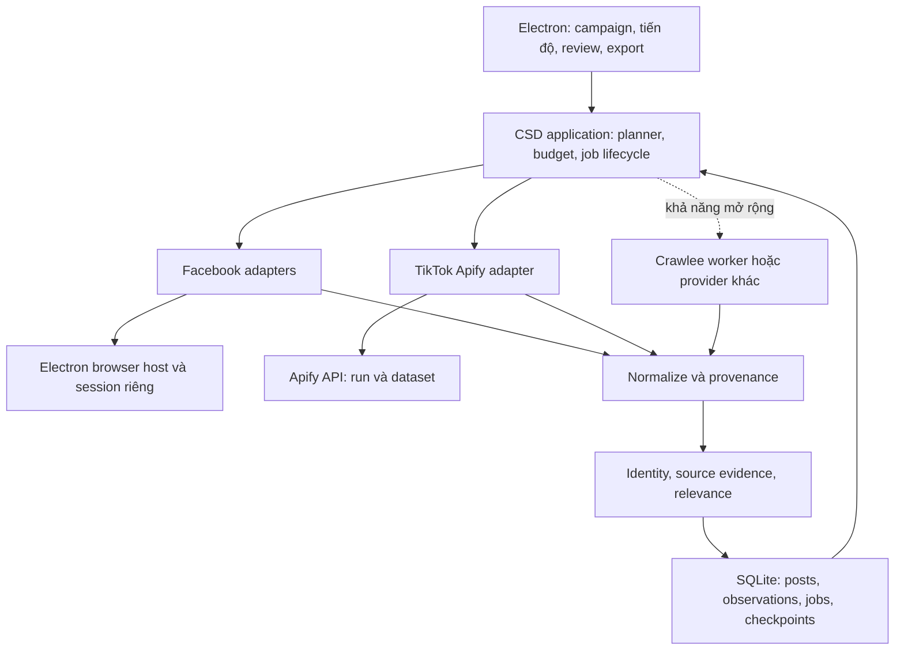

# CSD — Nghiên cứu kỹ thuật Facebook, TikTok, Apify và Crawlee

Ngày nghiên cứu: **27/10/2026**. Phạm vi: lựa chọn công nghệ, kiến trúc, khả năng thu dữ liệu và phép thử để quyết định triển khai. Theo yêu cầu mới nhất, **không phân tích định giá 5.000 USD**.

**Đính chính từ người dùng:** lần thử Facebook đã chọn tìm **posts**. Rút lại giả thuyết dùng nhầm `pages-google` để giải thích 8 kết quả; không yêu cầu người dùng xác nhận lại chế độ đó. Nguyên nhân yield thấp vẫn chưa được xác minh bằng run/log/dataset.

Đây là nghiên cứu và đề xuất kỹ thuật, chưa phải ADR chốt triển khai. [Master plan](C:/OwnProject/crawl-socials/.brain/master_plan.md) vẫn là nơi duy nhất quản lý task/owner/gate. Báo cáo không đổi trạng thái task, không tuyên bố CSD đã crawl được Facebook, không thay hợp đồng nghiệm thu hiện tại.

## 1. Kết luận để chọn hướng

**Nên theo đuổi CSD theo kiến trúc kết hợp: bộ thu Facebook do CSD kiểm soát + bộ thu TikTok qua Apify trước + lõi dữ liệu/điều phối chung. Crawlee là ứng viên hạ tầng để tái sử dụng, không phải một bộ Facebook/TikTok scraper hoàn chỉnh.**

Hướng này có cơ sở kỹ thuật và tận dụng được kết quả TikTok người dùng đã thử. Tuy nhiên, **chưa có bằng chứng CSD tự thu Facebook sẽ vượt Actor Apify, hoặc đạt 1.000 bài hợp lệ trong 24 giờ**. Điểm đó cần thử nguồn thật trước khi đầu tư sâu vào giao diện và vận hành quy mô lớn.

Ba quyết định đề xuất:

1. **Giữ Electron/TypeScript hiện có.** Xây năng lực riêng ở tìm nguồn, mở rộng truy vấn, chuẩn hóa và kiểm chứng bài. Chưa có lý do để chuyển toàn bộ sang Python hoặc thay bộ khung.
2. **TikTok dùng Apify làm connector đầu tiên để đối chiếu và tích hợp.** CSD phải sở hữu dữ liệu chuẩn hóa và tiến độ, để về sau thay Actor hoặc tự viết bộ thu mà không sửa toàn bộ sản phẩm.
3. **Facebook thử nhiều đường khám phá trong cùng một adapter family:** tìm posts theo keyword, tìm Page/nhóm phù hợp rồi lấy bài, và bổ sung permalink từ nguồn discovery khác. Chọn theo số bài mới hợp lệ thực thu, không mặc định native browser luôn tốt hơn vendor.

Thứ tự giải quyết: **đối chiếu run posts đã thử (khi có evidence) → chứng minh đường tìm Facebook → tích hợp luồng dữ liệu → kiểm chứng phục hồi → mở rộng tính năng**.

## 2. Những gì hiện đã biết và chưa biết

### 2.1 Phản hồi mới của người dùng

| Nội dung | Mức bằng chứng | Ý nghĩa đúng |
| --- | --- | --- |
| TikTok gần 500 kết quả, Facebook 8 kết quả | Người dùng báo cáo; chưa xem dataset/run | Có tín hiệu TikTok hữu dụng; chưa biết số bài duy nhất, đúng chủ đề, đủ trường |
| Tên công cụ: Facebook Search Scraper và TikTok Scraper | Tên hiển thị; chưa có `owner/actor-name` hoặc run ID | Chưa xác định duy nhất Actor, phiên bản hoặc nhà phát triển |
| Nhập keyword; TikTok thêm hashtag; Save & Run, không chỉnh đặc biệt | Người dùng xác nhận | Cần kiểm input thực đã lưu; không suy mặc định trên trang docs chính là input của run |
| Run không báo lỗi | Người dùng xác nhận | Không có lỗi được người dùng quan sát; chưa chứng minh không có giới hạn hoặc lỗi cục bộ trong log |
| Các từ khóa cafe, quán cafe, điểm hẹn cafe | Có từ khóa đối chiếu | Facebook và TikTok có tập nguồn/cách xếp hạng khác nhau; hai con số không phải phép đo cùng tập dữ liệu |

**Không kết luận “Facebook chỉ có 8 vì chống bot”.** Đây là một giả thuyết, bên cạnh giới hạn input, độ phủ, cách Actor phân trang, điều kiện nguồn và kết quả bị lọc. Chế độ tìm posts đã được người dùng xác nhận.

Thông tin này cập nhật bối cảnh lịch sử của [ADR-008](C:/OwnProject/crawl-socials/.brain/decisions/ADR-008-direction-and-source-validation.md) và [ADR-002](C:/OwnProject/crawl-socials/.brain/decisions/ADR-002-facebook-source-route.md): người dùng nay **đã thử Apify bên ngoài CSD**. Điều đó chưa đồng nghĩa CSD đã tích hợp vendor hoặc benchmark đã PASS.

### 2.2 Hiện trạng repository đã đọc trong đợt này

- `package.json`: CSD 0.1.0, TypeScript, Electron 44.7.0, Node phát triển dòng 24, Ajv; chưa có Crawlee hoặc Apify client trong dependency.
- P01.01 đã có bootstrap offline. Không còn ở trạng thái “chưa có source/package”.
- [ADR-001](C:/OwnProject/crawl-socials/.brain/decisions/ADR-001-runtime-and-reuse.md) đã chọn ports/adapters và `node:sqlite`; SQLite repositories và bộ thu thật còn là công việc tiếp theo.
- Contract hiện tại yêu cầu **ít nhất 1.000 bài Facebook công khai, không trùng identity, đúng chủ đề, trong ≤24 giờ**, được lấy bài cũ; phải có Page, nhóm công khai và trang cá nhân công khai. Không cộng TikTok vào chỉ tiêu Facebook.

Đợt nghiên cứu này đọc source/config và tài liệu công khai; **không đăng nhập Facebook/TikTok, không chạy Actor, không mua proxy, không đo công suất thực tế**.

## 3. Phát hiện quan trọng về lần thử Facebook

### 3.1 Người dùng đã xác nhận tìm posts

Input schema hiện hành của **`apify/facebook-search-scraper`** ghi:

| Trường | Tài liệu hiện ghi |
| --- | --- |
| `categories` | Danh sách từ khóa |
| `searchType` | Mặc định `pages-google`; có `pages`, `profiles`, `posts`, `reels` |
| `resultsLimit` | Giới hạn cho toàn run |

Đây chỉ là schema của một Actor cụ thể, không phải bằng chứng run của người dùng dùng mặc định. **Người dùng đã xác nhận chọn tìm posts; không dùng `pages-google` làm lời giải thích cho 8 kết quả.** Actor ID/build/log vẫn hữu ích để chẩn đoán yield, không để nghi ngờ lại xác nhận này. [Nguồn: Facebook Search Scraper input](https://apify.com/apify/facebook-search-scraper/input-schema).

Với **`clockworks/tiktok-scraper`**, input phân biệt `searchQueries`, `hashtags`, section tìm kiếm và `resultsPerPage` theo hashtag/profile/query. Schema công khai hiện ghi mặc định `resultsPerPage = 1`; kết quả gần 500 của người dùng là lý do càng phải đọc input của run, vì Actor, build, input mẫu hoặc cấu hình UI có thể khác. Không dùng mặc định docs để phủ nhận quan sát người dùng. [Nguồn: TikTok Scraper input](https://apify.com/clockworks/tiktok-scraper/input-schema).

### 3.2 Việc cần kiểm trước khi viết bộ thu thay thế

Lấy một gói thông tin đã bỏ secret từ hai run đang có:

- Actor ID đầy đủ, build ID/number, run ID, input JSON đã lưu, thời điểm chạy.
- Số dòng dataset và vài mẫu đầu/cuối; loại entity thực tế: Page, profile, post hay video.
- Trạng thái cuối, lý do dừng, warning, các query thành công/thất bại, giới hạn kết quả và giới hạn chi phí nếu có.
- Số ID duy nhất, số đúng chủ đề và tỷ lệ thiếu permalink/nội dung/thời gian/bối cảnh nguồn.

Đây là việc kiểm chứng phục vụ phát triển, không phải yêu cầu người dùng gửi mật khẩu/cookie. Nếu chưa có dữ liệu run, ghi `UNKNOWN`; không biến sự thiếu thông tin thành một giả thuyết chắc chắn.

Sau đó, nếu có cấu hình/run evidence và ngân sách thử đã xác lập, đối chiếu lần tìm posts hiện tại với một phép thử posts có giới hạn rõ về query, số kết quả và thời gian. Chỉ thay một yếu tố mỗi lần. Mức thử đề xuất: ba keyword ban đầu, tối đa 50 kết quả/query hoặc giới hạn tương đương Actor hỗ trợ; không coi mức thử này là giới hạn Facebook.

### 3.3 Tách discovery và extraction

Một Actor tìm được ít URL không chứng minh Actor lấy nội dung từ URL cũng yếu. Ngược lại, đọc được hàng nghìn bài từ các Page đã biết không chứng minh tìm được bài trên toàn Facebook.

Ví dụ `apify/facebook-posts-scraper` nhận các URL nguồn để lấy bài. Nó có thể dùng để đối chiếu bước lấy nội dung sau discovery, nhưng không tự thay bước tìm posts theo keyword. [Nguồn: Facebook Posts Scraper input](https://apify.com/apify/facebook-posts-scraper/input-schema).

Thiết kế CSD cần đo riêng:

```text
keyword → nguồn/permalink ứng viên → nội dung bài → bài hợp lệ → bài duy nhất
```

Mỗi mũi tên có thể là nút thắt. Chỉ tăng tốc browser ở bước giữa sẽ không giải quyết thiếu nguồn từ bước đầu.

## 4. Crawlee thực sự cung cấp những gì?

### 4.1 Phần đúng và phần cần sửa trong nhận định “100% mã nguồn mở”

**Crawlee là mã nguồn mở. Không có cơ sở để suy từ đó rằng tất cả công nghệ/code Actor Facebook và TikTok bán trên Apify đều công khai.** Tài liệu Apify nói source Actor mặc định bị ẩn; công khai source là một lựa chọn riêng của tác giả. Public Actor nghĩa là có thể sử dụng qua Store, chưa đồng nghĩa có source để tự host. [Nguồn: Publish Actor source code](https://docs.apify.com/actors/publishing/publish).

Repo Crawlee JavaScript dùng **Apache-2.0**. Có thể xây sản phẩm thương mại dựa trên thư viện này với việc thực hiện nghĩa vụ license/notice tương ứng; không có yêu cầu tổng quát phải công khai toàn bộ mã CSD chỉ vì dùng Crawlee. Phải kiểm riêng license của dependency và code thực sự đưa vào bản phát hành. License phần mềm không cấp thêm quyền thu thập dữ liệu nền tảng. [Nguồn: Crawlee LICENSE](https://raw.githubusercontent.com/apify/crawlee/master/LICENSE.md).

### 4.2 Bảng khả năng và giới hạn

| Thành phần | Crawlee có gì | CSD vẫn phải làm |
| --- | --- | --- |
| Queue | RequestQueue, khóa/nhận việc và định danh request | Định nghĩa job/query/source/cursor, checkpoint nghiệp vụ và phục hồi xuyên run |
| Lưu kết quả | Dataset/KeyValueStore, storage cục bộ | Identity bài, alias, transaction, lịch sử observation, quyền đọc, truy vấn và export |
| Browser | PlaywrightCrawler/PuppeteerCrawler và browser pool ở JS | Đăng nhập hợp lệ, navigation, đọc bài, chọn source, parser, xử lý thay đổi Facebook/TikTok |
| HTTP | Các crawler/client cho trang không cần render; Python có các extras riêng | Chọn transport đúng nguồn; không mặc định HTML tĩnh chứa feed động |
| Retry | Hỗ trợ thử lại request, concurrency và error handlers | Phân loại lỗi; tránh lặp vô hạn, nhân phí hoặc đếm trùng |
| Session/proxy | SessionPool và ProxyConfiguration | Nguồn proxy, chi phí, liên kết phiên, điều kiện nguồn và chính sách account |
| Fingerprint | Hỗ trợ trong các browser crawler tương ứng | Kiểm chứng tương thích thực; không có bảo đảm vượt mọi cơ chế chặn |
| Tìm bài Facebook/TikTok | Không phải bộ parser/search chuyên biệt sẵn cho CSD | Toàn bộ logic discovery, lọc nguồn, phân trang theo nền tảng và chuẩn hóa |

Nguồn cho queue/storage: [Request Storage](https://crawlee.dev/js/docs/guides/request-storage), [Result Storage](https://crawlee.dev/js/docs/guides/result-storage). Nguồn cho browser/runtime: [PlaywrightCrawler](https://crawlee.dev/js/api/playwright-crawler/class/PlaywrightCrawler), [Python setup/extras](https://crawlee.dev/python/docs/introduction/setting-up).

Crawlee cho phép dùng proxy tự có hoặc mua từ nhà cung cấp; thư viện không tặng một mạng proxy miễn phí. SessionPool là đối tượng quản lý phiên của crawler, không phải hệ thống Facebook accounts hoặc cam kết giữ phiên đăng nhập. [Proxy Management](https://crawlee.dev/js/docs/guides/proxy-management), [Session Management](https://crawlee.dev/js/docs/guides/session-management).

Tài liệu JS 3.18 mô tả fingerprint mặc định cho PlaywrightCrawler/PuppeteerCrawler. **Không suy tính năng đó tự áp vào Electron `webContents`, BasicCrawler, mọi HTTP client hoặc mọi phiên bản Python.** Cũng không suy “có fingerprint” thành “Facebook không phát hiện được”. [Nguồn: Avoid getting blocked](https://crawlee.dev/js/docs/guides/avoid-blocking).

### 4.3 JavaScript hay Python?

Đề xuất **TypeScript/Node cho lõi hiện tại**, vì CSD đã có Electron/TS, contract và tooling. Hai bản Crawlee có hệ sinh thái/tên lớp/transport khác nhau; Puppeteer, Cheerio và curl-impersonate không phải một gói tính năng đồng nhất ở cả hai ngôn ngữ. [Repo JavaScript](https://github.com/apify/crawlee), [Repo Python](https://github.com/apify/crawlee-python).

Python chỉ đáng bổ sung thành worker riêng khi một nhu cầu cụ thể có lợi ích đo được, ví dụ xử lý media hoặc thư viện chỉ có ở Python. Thêm hai runtime ngay từ đầu làm tăng công đóng gói, IPC, cập nhật và debug mà chưa chứng minh tăng độ phủ nguồn.

Khi thử Crawlee, pin phiên bản cụ thể. Tài liệu stable JS đã đọc hiển thị 3.18; tài liệu `/next/` và các bản prerelease có thể khác API. Chưa chọn phiên bản dependency cho CSD trong báo cáo này. [Nguồn: release history](https://github.com/apify/crawlee/releases).

## 5. Kiến trúc kết hợp đề xuất



Sơ đồ là kiến trúc đích; không mô tả các module đã được triển khai.

### 5.1 Phần CSD nên tự sở hữu

- Campaign và intent: tìm cái gì, địa phương nào, loại bài nào, phạm vi công khai hay joined groups.
- Query/source planner: biến thể từ khóa, ngân sách theo nguồn, lịch sử hiệu quả từng query.
- ID chuẩn, dedup, provenance, quyết định relevance và lý do loại bài.
- Trạng thái run/job, resume, deadline, chi phí và evidence phục vụ benchmark.
- Review/search/export và kết quả xuyên nền tảng có giải thích nguồn gốc.

Đây là phần tạo chất lượng ổn định cho sản phẩm. Đổi vendor không nên làm mất lịch sử; thay parser không nên làm hỏng campaign; browser đóng không nên làm mất tiến độ.

### 5.2 Không cắm PlaywrightCrawler trực tiếp vào Electron rồi coi đã xong

PlaywrightCrawler quản lý browser/page theo mô hình của nó. Electron sở hữu `webContents` và `session` theo mô hình khác. Playwright có hỗ trợ Electron ở mức **experimental**, nhưng điều đó không chứng minh Crawlee browser pool nhận trực tiếp mọi Electron view/partition hiện có. Đây là suy luận tích hợp cần kiểm bằng spike, không phải tuyên bố “không thể kết hợp”. [PlaywrightCrawler](https://crawlee.dev/js/api/playwright-crawler/class/PlaywrightCrawler), [Playwright Electron](https://playwright.dev/docs/api/class-electron).

Ba phương án:

| Phương án | Lợi ích | Đánh đổi / khuyến nghị |
| --- | --- | --- |
| A. Electron browser host + adapter CSD; chưa thêm Crawlee | Giữ luồng phiên hiện có; ít phần mới trong probe | **Ưu tiên thử Facebook trước**; tránh mất thời gian nối hai browser lifecycle khi chưa biết nguồn có yield |
| B. BasicCrawler làm lớp thực thi, handler gọi browser port của CSD | Tái sử dụng queue/retry/concurrency trong khi Electron giữ browser | Spike nhỏ; phải tắt/điều chỉnh cơ chế session không phù hợp và xác định rõ checkpoint owner |
| C. Electron làm UI, Crawlee + Playwright chạy worker riêng | Ranh giới worker rõ; thuận lợi triển khai crawler độc lập | Browser/profile riêng, thêm RAM/binary và quy trình đăng nhập; không chia sẻ tự động cookie/profile với Electron |

BasicCrawler yêu cầu người dùng tự triển khai việc tải trang và trích xuất, nên B có cơ sở thiết kế; thư viện không tự hoàn thành browser adapter. [Nguồn: BasicCrawler](https://crawlee.dev/js/api/basic-crawler/class/BasicCrawler).

Nếu chọn C, cần một chủ sở hữu duy nhất cho mỗi browser profile; không cho Electron và Playwright đồng thời mở cùng thư mục profile. Không đồng nhất “một process worker” với “một tài khoản mới”.

### 5.3 Queue và storage: tránh hai hệ thống cùng nhận là nguồn sự thật

Giữ SQLite của CSD làm nơi lưu trạng thái nghiệp vụ và dữ liệu chuẩn. Crawlee storage, nếu dùng, là storage của worker. Có thể tồn tại cả hai nếu **khác cấp độ**: CSD quản lý campaign/job; Crawlee quản lý request bên trong một job hữu hạn.

Phải chốt rõ:

1. Ai tạo job, ai giữ lease, ai được retry sau crash.
2. Một request hoàn tất chỉ sau khi batch observation và checkpoint đã được CSD commit.
3. Chạy lại cùng batch có idempotency key để không nhân observation hoặc số bài hợp lệ.
4. Cursor gắn query, source, route/version và access context; không tái dùng mù quáng khi đổi account.
5. Nếu worker không thể resume chính xác, cho phép replay phần hữu hạn và dedup; không quảng cáo exactly-once execution khi chưa có cơ chế bảo đảm.

`RequestQueue` chống lặp request không thay dedup bài. Cùng permalink có thể xuất hiện qua ba query; một URL search có thể trả nhiều trang/cursor. Khóa request/job phải phản ánh ngữ nghĩa đó, trong khi khóa post vẫn theo nền tảng và ID bài.

### 5.4 Contract adapter nên biểu diễn năng lực cụ thể

Ví dụ thiết kế, chưa phải interface đang có trong source:

```ts
type Capability =
  | 'KEYWORD_POST_SEARCH'
  | 'HASHTAG_VIDEO_SEARCH'
  | 'SOURCE_FEED'
  | 'POST_DETAIL';

type StopReason =
  | 'SOURCE_EXHAUSTED'
  | 'PROVIDER_LIMIT'
  | 'BUDGET_REACHED'
  | 'DEADLINE_REACHED'
  | 'NO_PROGRESS'
  | 'AUTH_REQUIRED'
  | 'ACCESS_DENIED'
  | 'CHALLENGE'
  | 'SCHEMA_CHANGED'
  | 'UNKNOWN';
```

Mỗi kết quả batch cần candidates, checkpoint, cảnh báo, lý do dừng và evidence reference. Một lần trả 0 bài phải phân biệt “nguồn kết thúc” với “parser hỏng” hoặc “chưa xác định”. Không trả thành công rỗng cho mọi exception.

Capability được khai báo riêng với mức đã kiểm chứng. Ví dụ hỗ trợ keyword search không tự suy hỗ trợ nhóm riêng tư, mọi địa phương, toàn bộ lịch sử hoặc mọi trường dữ liệu.

## 6. Làm Facebook tốt hơn bằng cách nào?

### 6.1 Hướng có triển vọng: nhiều đường discovery, một pipeline xác minh

**Đường A — Tìm posts theo keyword trên Facebook.** Đo phần dữ liệu thực sự xuất hiện với phiên đang dùng, khả năng lấy nhiều batch, ID/permalink và khả năng phân loại nguồn. Cần thử cả keyword rộng lẫn keyword diễn đạt ý định. Một truy vấn `cafe` không đại diện cho mọi nhu cầu tìm quán.

**Đường B — Từ keyword tìm nguồn, rồi lấy bài ở nguồn phù hợp.** Tìm Page/quán/nhóm công khai liên quan; xác minh nguồn; lấy một phần feed trong giới hạn đã đặt; lọc lại từng bài. Một Page quán có thể chứa nhiều bài liên quan nhưng cũng có nội dung không phù hợp. Không tính tất cả bài của nguồn chỉ vì nguồn có chữ cafe.

**Đường C — Bổ sung permalink/nguồn từ index hoặc provider.** Hữu ích khi tìm được URL mà đường A bỏ sót. Snippet chỉ tạo candidate; phải có đủ nội dung và bối cảnh để xác minh trước khi tính. Google ghi rõ `site:` không liệt kê đầy đủ mọi URL được lập chỉ mục, nên đây là nguồn bổ sung, không là thước đo toàn Facebook. [Nguồn: Google site operator](https://developers.google.com/search/docs/monitor-debug/search-operators/all-search-site).

**Đường D — Theo dõi nguồn đã chứng minh hữu ích ở các run sau.** Lưu source registry, query lineage và lịch sử yield. Hữu ích cho incremental collection sau này; không lấy dataset cũ gắn nhãn mới để vượt benchmark.

Không hứa cả bốn đường đều khả dụng. Mỗi đường cần được đo riêng theo Page/nhóm/cá nhân. Đặc biệt, feed Page dễ thu hơn cũng không thay được yêu cầu có bài cá nhân công khai.

### 6.2 Query planner bám ý định quán cà phê

Các nhóm truy vấn khởi tạo đề xuất, tương thích phạm vi coffee-intent-v1:

| Nhóm | Ví dụ |
| --- | --- |
| Biến thể cách viết | cà phê, cafe, café, coffee |
| Hỏi/gợi ý quán | quán cafe nào ngon, tìm quán cà phê, đi coffee ở đâu |
| Trải nghiệm/địa điểm | review quán cafe, cafe hẹn hò, quán cafe yên tĩnh |
| Địa phương | cafe Hà Nội; kết hợp quận/khu vực đã xác định |
| Venue/thương hiệu | Tiny Cafe và tên quán có bằng chứng rõ |
| Sự kiện tại quán | acoustic cafe, workshop tại quán cà phê |

Planner không tạo tích Descartes vô hạn giữa mọi từ khóa và địa điểm. Dùng một tập truy vấn giới hạn, lưu lý do mở rộng, rồi ưu tiên nhánh mang lại bài **mới và hợp lệ**. Luôn giữ đủ cơ hội thử những loại nguồn bắt buộc; nếu chỉ chọn nhánh nhiều kết quả nhất, Pages có thể chiếm toàn bộ ngân sách.

Chỉ số điều phối:

```text
yield theo nhánh = số bài hợp lệ mới đối với run / thời gian hoặc chi phí nhánh
novelty theo batch = số ID chưa có trong run / số candidate của batch
```

Nếu nhiều batch liên tiếp lặp ID, cursor không đổi hoặc không có bằng chứng tiến triển, dừng nhánh bằng `NO_PROGRESS` và thử nhánh khác trong ngân sách. Ngưỡng cụ thể phải được chọn từ probe và freeze trong protocol; không biến một con số tùy ý thành “giới hạn của Facebook”.

### 6.3 Extraction: quan sát phiên thật, parser có kiểm soát

Đề xuất lấy DOM đã render làm một nguồn và chỉ bổ sung dữ liệu phản hồi mạng thực sự quan sát được trong navigation hợp lệ khi cần. Cả hai cần parser version, fixture đã làm sạch và bằng chứng liên kết bài/nguồn.

Payload mạng nội bộ không phải API công khai có cam kết ổn định. Thấy một JSON response không chứng minh có thể phát lại request vô hạn hoặc phân trang mọi nguồn. Không lưu token/header nhạy cảm vào fixture/log. DOM cũng có rủi ro virtualized feed, text rút gọn, locale và giao diện thử nghiệm.

Không dùng LLM để đoán ID, URL, trạng thái công khai hoặc nội dung chưa thu được. LLM có thể hỗ trợ phân loại ý định từ dữ liệu hiện có; trường thiếu vẫn phải thiếu.

### 6.4 Electron và nhiều tài khoản giúp được đến đâu?

Electron hỗ trợ partition riêng; `persist:` giữ session qua các lần chạy. Đây là năng lực cô lập phiên, không tự tạo quyền truy cập hay tăng tuyến tính công suất. [Nguồn: Electron Session](https://www.electronjs.org/docs/latest/api/session#sessionfrompartitionpartition-options).

Đề xuất thử một phiên trước để biết nút thắt. Khi mở rộng nhiều account, account/group binding, quyền đọc, cursor và nội dung riêng tư phải được cô lập đúng; không dùng account rotation như cách mặc định tiếp tục sau challenge hoặc mất quyền. Nhánh joined groups/private groups vẫn theo P11.04–P11.08 với nghiệm thu riêng.

Facebook nêu rằng tự động thu dữ liệu khi chưa có sự cho phép của họ vi phạm điều khoản. Điều này cần được ghi đúng trong ma trận nguồn hiện có; việc nhìn thấy bài, dùng Crawlee hay thuê Apify không tự giải quyết điều kiện đó. Đây cũng không phải lý do kỹ thuật để tuyên bố Meta API có thể thay toàn bộ phạm vi yêu cầu. [Nguồn: Meta về scraping](https://about.fb.com/news/2021/04/how-we-combat-scraping/amp/).

## 7. TikTok qua Apify: tích hợp thành một connector có thể thay thế

### 7.1 Khởi đầu bằng kết quả hiện có

Trước hết dùng dataset hiện tại để xây mapper và kiểm chất lượng, gắn `IMPORT`. Điều đó kiểm được normalization, dedup, relevance, UI và export mà không cần chạy lại dịch vụ. Không gắn dataset cũ thành LIVE hoặc dùng nó để chứng minh tốc độ thu mới.

Sau khi biết Actor ID/build/input, chạy một live test có giới hạn của connector. Tách keyword search với hashtag search và ghi nguồn discovery của từng observation. Chỉ lấy video/post đúng yêu cầu; profile result là nguồn ứng viên, không phải bài.

Chưa cần tự viết TikTok scraper ngay: người dùng đã có tín hiệu đầu ra hữu ích, còn Facebook là rủi ro nguồn lớn hơn. Tự host TikTok chỉ nên được thử sau khi có mẫu đối chiếu và lý do cụ thể như hạn chế trường dữ liệu, độ ổn định hoặc yêu cầu vận hành.

### 7.2 Lifecycle run và phục hồi

Luồng đề xuất:

```text
validate campaign + Actor input
→ persist ý định submit
→ start Actor
→ persist run ID + build ID + dataset ID
→ theo dõi status và ngân sách
→ đọc dataset từng trang
→ normalize + commit batch/checkpoint
→ kiểm kết quả + đóng run với stop reason
```

Apify API có tham số chọn build, giới hạn tổng phí `maxTotalChargeUsd`, trả run/storage identifiers; dataset API hỗ trợ phân trang. CSD cần lưu các giá trị thực nhận thay vì chỉ hiện một nút “Run”. [Run Actor API](https://docs.apify.com/api/v2/actors-runs-post), [Dataset items API](https://docs.apify.com/api/v2/dataset-items-get).

Các quyết định triển khai:

- **Timeout khi submit là trạng thái chưa biết**, không tự đồng nghĩa “chưa tạo run”. Lưu `SUBMISSION_UNKNOWN`, đối soát run/input/thời điểm trước khi gửi lại. Chưa xác minh có bảo đảm idempotency phù hợp cho endpoint này; không tự bịa header rồi coi đã chống chạy trùng.
- Có run ID rồi thì restart CSD phải tiếp tục theo dõi run đó; không submit thêm chỉ vì UI vừa mở lại.
- Khi người dùng Stop, nếu remote run còn chạy phải yêu cầu abort và xác nhận; đóng cửa sổ local không tự dừng cloud run.
- Polling có backoff đủ cho desktop; webhook là lựa chọn khi có backend. Callback trùng hoặc đến sai thứ tự không được làm lùi state hoặc nhân số liệu.
- Đọc dataset gốc theo trang ổn định; nếu dùng transformation làm thay đổi số dòng thì không lấy số dòng sau transform làm offset nguồn. Checkpoint chỉ tiến sau transaction thành công.
- Tách remote execution success, import completeness và data-quality success. Remote `SUCCEEDED` nhưng CSD đọc thiếu trang vẫn chưa hoàn tất.
- Ghi chi phí/giới hạn để điều phối kỹ thuật; không hard-code cam kết chi phí hoặc “unlimited”. Không bật tự đổi provider có tính phí khi chưa có cấu hình cho phép.

Pin build để benchmark có thể giải thích. Build cũ cũng có thể ngừng hoạt động khi TikTok đổi; cần kiểm bản mới bằng fixture và một canary nhỏ trước khi cập nhật. Pin build giữ mã phiên bản, không đóng băng hành vi website. [Nguồn: Actor runs and builds](https://docs.apify.com/actors/running/runs-and-builds).

### 7.3 Secrets và dữ liệu gửi ra ngoài

Đề xuất bản desktop đầu tiên dùng **API key Apify của chính người dùng**. Giữ secret sau port ở main/worker, mã hóa bằng cơ chế hệ điều hành phù hợp runtime đã pin; UI chỉ nhận trạng thái kết nối. Không nhúng một master key dùng chung vào binary phát cho mọi khách hàng. Nếu sau này dịch vụ được quản lý tập trung, key ở backend với giới hạn theo tenant.

Tách renderer local của CSD khỏi trang mạng xã hội: tắt Node integration cho remote content, giữ context isolation/sandbox, IPC allowlist và validation. Safe storage không phải bảo vệ tuyệt đối trước chương trình chạy với cùng quyền người dùng. [Electron Security](https://www.electronjs.org/docs/latest/tutorial/security), [Electron safeStorage](https://www.electronjs.org/docs/latest/api/safe-storage).

Không tự chuyển cookie Facebook của Electron sang Actor cloud. Connector cần khai báo rõ dữ liệu gửi cho provider; nội dung nhóm riêng tư tương lai không tự đi theo pipeline cloud công khai.

## 8. Lõi dữ liệu quyết định CSD có đáng tin hay không

### 8.1 Tách bài, lần quan sát và ngữ cảnh truy cập

Mô hình đề xuất:

| Entity | Nội dung chính |
| --- | --- |
| `Post` | `platform + platform_post_id`, permalink chuẩn, loại nội dung |
| `Observation` | Phiên bản nội dung, thời điểm quan sát, source context, query, adapter/parser version, evidence ref |
| `CollectionRun` | Campaign snapshot, deadline, capture mode, trạng thái và metrics |
| `ProviderRun` | Actor ID/build/run/dataset, input hash, trạng thái và usage |
| `Source` | Page/group/profile/hashtag và bằng chứng phân loại |
| `AccessContext` | Profile/account nội bộ, phạm vi truy cập, visibility quan sát được |
| `Decision` | ACCEPT/REJECT/UNVERIFIED, lý do và rubric version |

Quy tắc thiết kế:

- ID nền tảng lưu **string** xuyên suốt. Không ép số dài sang JavaScript Number rồi mới chuyển lại string. Nếu upstream đã làm tròn ID thì record không đủ tin cậy; cần đối chiếu ID nguyên vẹn từ nguồn.
- Cùng bài Facebook từ CSD và Apify chỉ tính một lần; giữ nhiều observations để không mất provenance.
- Video TikTok đăng lại trên Facebook là hai bài thuộc hai nền tảng. Có thể gắn nhãn nội dung tương tự, không tự gộp thành một identity.
- Metrics như views/likes là snapshot theo thời điểm; thiếu là null, không phải 0. Không cộng gộp chỉ số khác nghĩa giữa hai nền tảng thành một thước đo giả.
- Bài do Page đăng trong group mang bối cảnh xuất bản group. Phân loại nguồn không chỉ nhìn loại tác giả.
- “Tài khoản đọc được” chưa đủ chứng minh “công khai”. Không đủ visibility/source evidence thì để UNVERIFIED đối với benchmark công khai.
- Không suy tài khoản hai nền tảng là cùng người chỉ từ display name. Liên kết venue/brand cũng cần bằng chứng.

### 8.2 Relevance tiếng Việt và media

Đầu tiên áp dụng rubric coffee-intent-v1 hiện có, normalization tiếng Việt và từ điển venue/brand có chứng cứ. Nếu cần LLM, chỉ phân loại tập khó, lưu model/prompt/rubric version, evidence span và trạng thái cần review. Đo bằng tập nhãn do người kiểm, không dùng chính đầu ra model làm ground truth.

TikTok thường thiếu nội dung đầy đủ trong caption. Có thể bổ sung subtitle/transcript/OCR khi nguồn hỗ trợ và cần cho xác minh; đây là năng lực riêng, có chi phí/tỷ lệ lỗi. Không tuyên bố hiểu được clip chỉ từ hashtag. Actor mô tả khả năng lấy metadata/media/subtitle, nhưng phải kiểm đầu ra thật của cấu hình được chọn. [Nguồn: TikTok Scraper](https://apify.com/clockworks/tiktok-scraper).

Bản đầu nên ưu tiên metadata, permalink và nội dung đủ đánh giá. Tải hàng loạt toàn bộ video không phải điều kiện bắt buộc để hoàn thành bài toán tìm bài, và làm tăng đáng kể dung lượng cùng thời gian xử lý.

### 8.3 Những tính năng kỹ thuật làm sản phẩm tốt hơn một màn hình bọc Actor

1. Tự tìm thêm nguồn phù hợp nhưng có query lineage và giới hạn rõ.
2. Hiển thị riêng candidate, unique, accepted, unverified, rejected và nguyên nhân thiếu dữ liệu.
3. Tìm lại bài, nguồn, sự kiện/quán từ lịch sử; mở permalink và xem lý do bài được chọn.
4. Resume sau crash/mất mạng, không chạy thêm cloud job ngoài ý muốn.
5. Báo độ phủ quan sát theo nguồn/query và vùng chưa thử; không trình bày sample search như toàn bộ thị trường.
6. Parser canary, schema validation, quarantine record bất thường và cập nhật có thể quay lui.
7. Export có source/provenance, version và cutoff; thực hiện chính sách lưu/xóa dữ liệu đã chọn.

## 9. Chương trình thử kỹ thuật trước khi mở rộng

Các vòng dưới đây là **đề xuất thí nghiệm**, không phải backlog trạng thái thứ hai. Chúng ánh xạ vào master plan, do Agent nhận task ghi evidence và cập nhật trạng thái đúng chỗ.

| Vòng | Câu hỏi cần trả lời | Đầu ra cụ thể | Quyết định sau thử |
| --- | --- | --- | --- |
| 0. Audit run Apify đã có | Vì sao run posts dừng ở 8; gần 500 TikTok có chất lượng ra sao? | Actor/build/input, unique/relevant count, stop reason hoặc unknown | Chỉ kết luận nguyên nhân khi có bằng chứng; không quay lại giả thuyết chọn nhầm chế độ |
| 1. Probe discovery Facebook | Keyword → bài; keyword → nguồn → bài có tạo yield không? | Mẫu từ cả ba source types nếu tiếp cận được, phân trang quan sát được, lý do dừng | Chọn đường hứa hẹn hoặc ghi thiếu nguồn; không làm UI lớn để che thiếu capability |
| 2. Spike Crawlee có giới hạn | Có giảm công queue/recovery mà không làm rối Electron? | Một job, hai batch, restart; kiểm mất/nhân dữ liệu, RAM và orphan process | Chọn A/B/C ở mục 5; có thể giữ A nếu lợi ích Crawlee chưa rõ |
| 3. TikTok mapper + connector | Dữ liệu hiện có chuẩn hóa được và run mới phục hồi được? | Import fixture có nhãn, live run tách biệt, ID/build/checkpoint và số hợp lệ | Chấp nhận connector có phạm vi cụ thể; chưa viết lại TikTok |
| 4. Luồng CSD tích hợp | Discovery → normalize → verify → persist → export có đúng không? | Dataset/evidence có thể kiểm; lỗi/cutoff/resume nhất quán | Mở benchmark khi đủ gate hiện hành |
| 5. Benchmark và lặp lại | Đạt Facebook 1.000/24h, cả ba nguồn, ổn định đến đâu? | Run đóng băng, audit đầy đủ; lần lặp có cấu hình/evidence riêng | Chỉ nâng cam kết theo kết quả thực tế |

Đề xuất timebox ban đầu: audit run trong một buổi; probe nguồn trong 1–2 ngày làm việc khi có điều kiện chạy; spike Crawlee tối đa một ngày; connector TikTok nhỏ 1–2 ngày. Đây là **ngân sách học hỏi đề xuất**, không là ước lượng chắc chắn để giao sản phẩm; không gồm thời gian chờ nguồn/quyền hoặc xử lý thay đổi nền tảng.

Đừng chờ hoàn thành Crawlee integration mới probe Facebook. Một probe độc lập là đủ để biết search có cung cấp dữ liệu hữu ích hay không; đó chính là mục đích đường P02.02 sớm trong master plan.

### 9.1 Phép đối chiếu Facebook công bằng

- Cùng keyword, intent, thời điểm thử gần nhau và mức ngân sách đã ghi; báo riêng khác biệt session/locale/filter/route.
- So sánh native browser với provider **trên Facebook**, không dùng số TikTok làm chuẩn công suất Facebook.
- Một mẫu xem thủ công hữu hạn có thể phát hiện parser bỏ sót bài đang hiển thị. Mẫu đó không phải toàn bộ ground truth Facebook.
- Tách direct search yield, source-feed yield, duplicate rate và số bài từ từng loại nguồn.
- Nếu native chỉ hơn ở Page nhưng vẫn không có personal/group, kết luận đúng phạm vi đó; không gắn nhãn “Facebook đã giải quyết”.

### 9.2 Chỉ số cần lưu

`raw_candidates`, `unique_posts`, `accepted_unique`, `unverified`, `rejected`, `source_type_breakdown`, `query_yield`, `time_to_first_valid`, `time_to_target`, `wall_time`, `provider_usage`, `operator_minutes`, `retry_count`, `challenge_count`, `schema_errors`, `resume_loss`, `resume_duplicates`.

1.000/24 giờ tương đương trung bình khoảng **41,7 bài hợp lệ/giờ**. Đây chỉ là phép chia mục tiêu; không phải tốc độ đã đo và không có nghĩa cứ lấy nhanh một giờ là ngoại suy được 24 giờ. Nguồn có thể cạn hoặc độ trùng tăng.

Trạng thái đầy đủ của một run nên gồm:

```text
execution_status + retrieval_completeness + quality_result + stop_reason
```

Không chỉ có `SUCCESS/FAILED`. Một run kết thúc bình thường nhưng chỉ có 8 bài vẫn có thể hoàn thành execution và không đạt chỉ tiêu dữ liệu.

### 9.3 Các ca kiểm chứng có ý nghĩa

- Crash sau commit batch nhưng trước acknowledge: resume không đếm lại.
- Submit Actor timeout: không tự sinh thêm cloud run; đối soát trạng thái chưa biết.
- Remote hoàn tất nhưng local mất mạng giữa dataset: tiếp tục đúng trang sau restart.
- Cùng bài qua ba query, hai URL alias và hai provider: một identity, provenance đầy đủ.
- ID dài, timestamp thiếu, caption rỗng, cursor lặp, bài share và visibility chưa rõ.
- Parser nhận trang login/challenge hoặc schema mới: báo đúng loại lỗi, không báo 0 bài thành công.
- Stop/deadline: ngừng local work, xử lý remote run còn sống, không thêm bài sau cutoff vào tập đã đóng băng.
- Bản mới của Actor/parser thay field: validation phát hiện, dữ liệu bất thường không làm sai số đếm.

Benchmark Facebook tiếp tục theo [contract 1.0.0](C:/OwnProject/crawl-socials/.brain/specs/product_contract.md): freeze đầu vào, tính mọi thời gian pause/retry/restart, chỉ dữ liệu đủ và persist đúng cutoff mới được đếm. TikTok, import và cache không được bù vào tổng Facebook. Audit sau run không được lấy thêm nội dung để lấp record thiếu tại cutoff.

## 10. Đưa nghiên cứu vào master plan hiện có như thế nào?

| Vị trí hiện có | Bổ sung kỹ thuật khi triển khai |
| --- | --- |
| P00.02 / source matrix | Ghi phản hồi Apify là USER_REPORTED; giữ capability, điều kiện nguồn và benchmark tách biệt |
| P00.04 | Thêm protocol đối chiếu input/query/source/yield và ngân sách vendor nếu thực sự chạy |
| P01.02 | Browser/profile/secrets, lifecycle rõ để không bị hai hệ thống quản lý phiên |
| P02.01 | Capability contract, stop reasons, provenance; tránh khóa interface vào transport Electron |
| P02.02 | Probe Facebook sớm; direct search và source-feed discovery được đo riêng |
| P02.03–P02.04 | Parser có version và luồng tích hợp; quyết định dùng Crawlee từ spike thực tế |
| P03–P04 | Planner theo ý định, source registry, phân trang và marginal yield |
| P05–P07 | Identity/observations, kiểm chất lượng, queue/checkpoint, remote run reconciliation |
| P08 | Giữ benchmark Facebook độc lập, không đổi định nghĩa để cộng TikTok |
| P09–P10 | Review, export, khả năng chẩn đoán lỗi, cập nhật và release |
| P11.01–P11.02 | Nơi hiện đặt connector nền tảng mới, gồm TikTok |
| P11.04–P11.08 | Joined groups/private groups/multiple accounts; không trộn vào MVP công khai |

**Điểm cần sửa kế hoạch nếu chọn làm TikTok sớm:** hiện P11.02 nằm sau G04. Nếu muốn sản phẩm kết hợp xuất hiện trước G04, cần cập nhật dependency/contract và tạo nhánh TikTok riêng có nghiệm thu riêng. Không để Agent vừa đọc “sau MVP” vừa tự hiểu “làm ngay trong MVP”. Báo cáo này khuyến nghị khả năng đó nhưng không âm thầm đổi lịch hoặc trạng thái các task đang thực hiện.

Có thể làm ngay phần không phụ thuộc live source: audit cấu hình mẫu, thiết kế adapter contract, mapper từ dataset được cung cấp, fixture/fault cases và spike orchestration bằng dữ liệu giả. Các gate của source probe hiện hành vẫn phải được đánh giá theo bằng chứng; nghiên cứu kiến trúc không tự làm G00 PASS.

## 11. Quyết định kỹ thuật đề xuất cuối cùng

**CSD nên mạnh ở tìm nguồn có chủ đích và quản lý dữ liệu đáng tin; mỗi nguồn dùng bộ thu phù hợp, có thể thay thế.** Với bằng chứng hiện tại, lựa chọn đáng thử nhất là:

```text
Electron + TypeScript + SQLite
  ├─ Facebook: adapter CSD, probe discovery trước
  ├─ TikTok: Apify adapter, import mẫu rồi live test có giới hạn
  ├─ Crawlee: tái sử dụng có chọn lọc sau spike orchestration
  └─ Lõi chung: query planner, identity, relevance, provenance, recovery
```

Điều kiện để kết luận hướng này thành công là có **kết quả thật của Facebook**, pipeline không mất/nhân dữ liệu và lần chạy lặp có thể giải thích. Cài Crawlee, tăng số account hoặc có gần 500 kết quả TikTok chưa thay được các phép kiểm đó.

Việc cần giải quyết gần nhất là chẩn đoán yield của run posts đã thử và đo các đường tìm bài Facebook của CSD. Nếu provider đáp ứng tốt workload sau kiểm chứng, tích hợp nó cũng là một kết quả tốt; CSD không cần tự viết mọi tầng để trở thành công cụ tốt.
