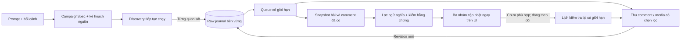

# CSD — đặc tả và kế hoạch triển khai tìm cơ hội thảo luận v1

Ngày 30/10/2026. Kiến trúc được chốt tại [ADR-022](../decisions/ADR-022-conversation-opportunity-architecture.md). Tài liệu này mô tả việc phải xây và cách nghiệm thu; **không phải báo cáo tính năng đã triển khai**. [Master plan](../master_plan.md) là nơi duy nhất ghi owner/trạng thái task. Tiếp tục nhánh `codex/csd-production`, giữ sản phẩm hiện tại và dữ liệu ngoài repository.

## 1. Hợp đồng sản phẩm

**Ưu tiên triển khai được người dùng nhấn mạnh:** đây là công cụ đa chủ đề có mục tiêu thu 1.000 bài phù hợp, không phải dịch vụ thủ công tuyển chọn 1.000 bài café. Dữ liệu café chỉ dùng để kiểm thử và phát hiện giới hạn. Mọi sửa đổi phải cải thiện cơ chế chung và có kiểm tra hồi quy ngoài café; không thêm ngoại lệ theo ID bài hoặc chỉnh nhãn để đủ quota.

**Điều chỉnh người dùng đã xác nhận khi giao triển khai:** chiến dịch thử nghiệm tìm quán cafe cần **1.000 bài tinh tổng hai mạng**, ưu tiên 800 Threads + 200 Facebook; chấp nhận 700 + 300. Mục tiêu và budget campaign tính tổng, có khoảng phân bổ theo nền tảng và báo metrics riêng; không phải 1.000 mỗi mạng. Các đoạn về mục tiêu riêng mạng dưới đây áp dụng khả năng cấu hình/legacy, bị quy tắc tổng này thay thế cho chiến dịch hiện tại.

Đầu vào là mong muốn bằng ngôn ngữ tự nhiên và bối cảnh thương hiệu. Đầu ra ưu tiên các cuộc thảo luận có nhu cầu phù hợp để người dùng tham gia; đồng thời giữ dữ liệu nghiên cứu thị trường. Sản phẩm dùng được cho nhiều ngành, không đưa taxonomy café vào logic chung.

| Nhóm hiển thị | Điều kiện | Ví dụ tổng quát |
| --- | --- | --- |
| **Phù hợp** (`SUITABLE`) | Có nhu cầu/cơ hội trao đổi cụ thể, liên quan chiến dịch, thương hiệu có thể đóng góp phù hợp và có bằng chứng trong nội dung hiện thấy | Hỏi lựa chọn, giá, trải nghiệm, so sánh, vấn đề cần giải quyết ở bài hoặc comment |
| **Chưa phù hợp** (`NOT_YET`) | Có liên quan nhưng chưa có cơ hội tham gia đủ rõ, hoặc điều kiện tham gia chưa phù hợp | Quảng cáo ngành, check-in không có trao đổi, nhu cầu đã giải quyết, chưa đủ ngữ cảnh |
| **Không phù hợp** (`UNRELATED`) | Có bằng chứng nội dung nằm ngoài phạm vi chiến dịch | Từ khóa trùng nghĩa nhưng nói về một chủ đề khác |

`research_value/tags` độc lập với nhãn; một bài Phù hợp cũng có thể có giá trị nghiên cứu. Quảng cáo không tự động là Không phù hợp; page có người dùng hỏi thật vẫn có thể có cơ hội ở comment. Nguồn cá nhân/nhóm/page là tín hiệu ưu tiên, không thay bằng chứng nhu cầu.

Check-in chỉ có ảnh/tên địa điểm liên quan: Chưa phù hợp, đưa vào theo dõi nếu còn ngân sách/độ mới. Khi xuất hiện câu hỏi phù hợp về giá, tính năng, trải nghiệm hoặc nhu cầu khác, đánh giá lại toàn ngữ cảnh và chuyển Phù hợp. Đây là quy tắc chuyển trạng thái chung, không chỉ áp dụng quán café.

Không đủ thông tin để biết có liên quan hay không: `assessment_status` thể hiện chờ xử lý/chờ dữ liệu, nhãn có thể null. Lỗi model, hết quota, text rỗng, không đọc được comment không đồng nghĩa Không phù hợp. UI có ba nhóm nghiệp vụ và chỉ báo đang xử lý; không ép mọi lỗi vào một nhóm.

Đơn vị đếm bài tinh: `(platform, root_post_id)` trong một campaign version. Nhiều comment phù hợp trong cùng post là nhiều vị trí tham gia, **không phải nhiều bài tinh**. Báo thêm yield theo cụm gần trùng; không nhân số lượng bằng bản ghi revision hoặc chạy lại.

Phạm vi bản này là phát hiện, phân tích, xếp hạng và mở đúng vị trí cho người dùng xem. Không tự đăng bình luận, kết bạn, tham gia nhóm hoặc nhắn tin.

## 2. Vừa thu thập, vừa lưu và lọc

**Yêu cầu bắt buộc:** crawler tìm thêm bài trong lúc pipeline đang phân loại các bài trước; dữ liệu tinh xuất hiện tăng dần. Không đợi kết thúc run mới lọc, không đợi tải hết comment của một post mới có thể phân loại bằng chứng đã đủ rõ.

Trình tự **trên từng observation**, không phải trên toàn dataset:

1. Ghi raw observation chứa nội dung candidate đã quan sát và provenance rồi flush bền vững, trước khi lọc ngữ nghĩa hoặc loại thiếu text/reply. Chuẩn hóa identity khi đủ dữ kiện; candidate chưa xác định được ID giữ locator/hash và `IDENTITY_UNRESOLVED`, không bỏ nhưng chưa đếm thành bài duy nhất. Lưu cả phần thiếu/không parse được để phục hồi parser trong phạm vi dữ liệu nội dung an toàn đã giữ. Không gọi thứ chưa truy cập được là “đã lưu”.
2. Transaction cập nhật projection/watermark, tạo job idempotent và checkpoint sau persistence. Crash giữa journal và transaction được replay từ event chưa áp dụng.
3. Worker tạo snapshot và lọc bằng chứng hiện có; worker khác đặt lịch lấy comment/media nếu cần. Job enrichment dùng browser cùng profile phải chia lượt với discovery, không cùng điều khiển một cửa sổ.
4. Ghi quyết định/usage có phiên bản; phát event cập nhật UI và số đếm. Comment/media mới được lưu như revision và kích hoạt đánh giá lại. Commit current view phải kiểm campaign version và snapshot watermark: output đến muộn của snapshot cũ vẫn lưu audit nhưng không ghi đè kết luận mới hơn. UI có thể giữ kết quả gần nhất kèm trạng thái đang cập nhật ngữ cảnh.

Micro-batch model khởi điểm tối đa 8 conversation, flush sau tối đa 2 giây khi có suất API; các số này là cấu hình kỹ thuật để đo/tinh chỉnh. Token/RPM limiter có quyền trì hoãn khi hết suất và phải hiển thị backlog. Không chờ đủ batch để xử lý bài cuối. Không dùng batch API có độ trễ hàng giờ cho luồng kết quả trực tiếp; có thể dùng cho đánh giá offline.

Backpressure: đặt trần backlog/job tokens/bytes và ổ đĩa; lưu hết batch đang nhận rồi giảm/tạm dừng lấy trang tiếp khi downstream chậm. Không bỏ raw, âm thầm bỏ job hoặc tăng concurrency vượt hạn mức. Ưu tiên công bằng giữa discovery, lấy comment cần thiết, và phân loại; revisit cũ là mức ưu tiên thấp hơn công việc hiện tại. Chặn một nguồn không chặn toàn bộ nền tảng còn lại. Request LLM không giữ khóa điều hướng browser; chỉ khóa profile trong thao tác thực sự dùng browser.

Đo riêng `first_result_latency`, journal→decision p50/p95, queue age, enrichment latency, UI event delay. Nghiệm thu phải thấy kết quả tinh **trước khi discovery kết thúc** trong một run đủ dài và UI cập nhật ≤2 giây sau khi lưu quyết định ở tải kiểm thử. Đây không phải cam kết mọi bài được phân loại trong 2 giây.

## 3. CampaignSpec: tiêu chí trước, từ khóa sau

LLM lập schema có version; code validate trước khi dùng. Các trường chính:

| Nhóm | Nội dung |
| --- | --- |
| Nhu cầu | `topic`, `audience`, `needs`, `participation_intents`, `research_intents`, `inclusions`, `exclusions` |
| Bối cảnh thương hiệu | Sản phẩm/dịch vụ, năng lực thực tế, khu vực phục vụ, lợi ích có căn cứ; đánh dấu trường thiếu, không bịa |
| Điều kiện | Địa bàn, ngôn ngữ, độ mới, điều kiện bắt buộc và sở thích mềm tách biệt |
| Nguồn | Nền tảng, các profile/group/page đã biết, nguồn ưu tiên, query families, nguồn gốc từng query |
| Giới hạn | Mục tiêu bài tinh riêng mỗi mạng, raw/time/token/cost caps, comment caps, watch TTL/lượt, retention |
| Tái sử dụng | `campaign_id/version`, `rubric_version`, assumptions, prompt gốc, plan hash, filter preset |

Người dùng có thể nhập prompt tự do và sửa bản tiêu chí ngắn. Không buộc điền một form dài. Chỉ hỏi lại nếu thiếu dữ kiện làm thay đổi thực chất đánh giá phù hợp, ví dụ địa bàn bắt buộc hoặc thương hiệu thực sự cung cấp gì; những giả định ít ảnh hưởng ghi rõ và cho sửa. Bản kế hoạch này không phát sinh câu hỏi phê duyệt mới.

Sinh query theo nhiều dạng nhu cầu: xin gợi ý, so sánh, review, vấn đề gặp phải, tình huống sử dụng, từ đồng nghĩa/ngôn ngữ đời thường, địa bàn. Duy trì cả query rộng và query có intent. Theo dõi hiệu suất nguồn/query bằng dữ liệu đã kiểm; không cắt nguồn chỉ vì model tự cho điểm thấp. Giữ một phần ngân sách khám phá để đo bỏ sót và tránh chỉ tìm đúng những mẫu đã biết.

Các module `campaign-intent/query-expansion/query-planner` cũ không phải planner tổng quát đang chạy production: một phần chỉ chuẩn hóa explicit structure, grammar còn café-specific. Tái dùng normalization/provenance có chọn lọc, viết contract/planner mới.

## 4. Thu bình luận: phải chứng minh trên cả hai mạng

### 4.1 Hiện trạng và đường triển khai

Dataset Facebook 1.156 bài và Threads 1.004 bài hiện có **không chứa nội dung bình luận**. Search parsers mới trả bộ đếm. Threads parser còn loại `is_reply` và caption trống; Facebook parser loại bài thiếu text. `posts.jsonl` hiện lưu bài sau parser, chưa phải backup mọi candidate/comment/media-only; response hash không đủ để phục hồi phần nội dung chưa lưu. Vì vậy không thể tuyên bố đã giải quyết bằng cách đổi prompt LLM.

Tạo collector conversation riêng, nhận permalink/root ID từ discovery. Dùng session, browser host và response observer đã có. Ưu tiên dữ liệu có cấu trúc thực sự được tải khi mở/expand UI, có fallback DOM được kiểm chứng; không coi endpoint không chính thức hoặc cursor suy đoán là hợp đồng ổn định. Nếu API chính thức có capability phù hợp và truy cập đã hoạt động thì dùng adapter đó; endpoint tồn tại không chứng minh đọc được replies trên mọi bài của người khác.

**Kiểm chứng khả năng của Facebook và Threads ngay ở task đầu**, song song với contracts. Sau đó xây lát cắt sản phẩm Threads trước để nhận phản hồi sớm; không để phát hiện Facebook không lấy được comments tới cuối dự án.

| Nền tảng | Luồng phải xây/kiểm chứng | Trường hợp không được hiểu sai |
| --- | --- | --- |
| Threads | Mở root/permalink, đọc root + direct replies, expand reply-to-reply, đi hết cursor trong budget, giữ parent chain; nếu discovery thấy reply thì lần về root | API read replies có thể phụ thuộc quyền; reply bị lọc/ranking, reply-only discovery, text rỗng có media, root không truy cập được |
| Facebook | Mở permalink, đọc comment trang đầu và các lượt “xem thêm”, expand replies, ghi chế độ sắp xếp; thử bề mặt page/profile/group mà session đọc được | “Phù hợp nhất” không phải toàn bộ; đổi sort nếu UI hỗ trợ nhưng không giả định có; group access, comment ẩn/xóa, giới hạn xem, đăng nhập hết hạn |

Không nhờ người dùng gán nhãn comment hoặc duyệt từng post. Agent tự tạo bộ quan sát tham chiếu bằng lượt mở/expand độc lập trong phiên truy cập sẵn có; lưu snapshot/manifest ngoài repo và chỉ lưu báo cáo tổng hợp ở `.brain`.

### 4.2 Mô hình comment và coverage

Mỗi comment/reply lưu `platform`, native ID, `root_post_id`, `parent_id`, depth nếu xác định được, author reference/role, text, media refs, published/observed time, permalink/deep link nếu thật sự có, source observation ID, revision/hash. Không tự bịa deep link hoặc parent khi chưa biết. Ghi `PARENT_UNRESOLVED` và bổ sung sau.

Mỗi capture lưu sort mode, pages/cursors đã đọc, unique comments/replies quan sát được, advertised count nếu có, thời điểm, budget đã dùng, và `coverage_status`:

- `OBSERVED_EMPTY`: lượt tải thành công, danh sách rỗng và có dấu hiệu hết trang/luồng trên bề mặt đó/thời điểm đó; không khẳng định không có comment ẩn. Chưa mở được khung, selector lỗi hoặc chưa bấm xem thêm không được gán empty.
- `PARTIAL`: còn cursor/nhánh chưa mở, hết budget hoặc chỉ đọc một chế độ ranking.
- `EXHAUSTED_VISIBLE`: đã hết phân trang/nhánh trên bề mặt truy cập được; không có nghĩa toàn bộ bình luận tồn tại trên nền tảng.
- `INACCESSIBLE`, `RETRYABLE_ERROR`, `NOT_ATTEMPTED`: không được suy ra “không có nhu cầu”.

Số hiển thị trên nền tảng không dùng làm mẫu số chắc chắn cho recall; nó có thể bao gồm reply, comment ẩn/xóa hoặc cập nhật khác thời điểm. Coverage phải kèm định nghĩa, không dùng một cờ `complete=true` thiếu căn cứ.

### 4.3 Thu có chọn lọc nhưng bảo vệ recall

Với bài liên quan có comment, thiếu text/media hoặc nghi có câu hỏi: ưu tiên đọc comment sớm trong khi tiếp tục discovery. Với bài đã có nhu cầu rõ trong text: có thể trả kết quả ngay; comment bổ sung có thể làm thay đổi thứ hạng/nhãn nếu nhu cầu đã được giải quyết. Không bắt mọi bài phải có comment mới được nhận.

Ngân sách khởi điểm để đo: một lượt lấy tới 50 comment/reply duy nhất hoặc 3 trang dữ liệu hoặc 30 giây browser work, ngưỡng nào tới trước; nhánh chứa nhu cầu được bổ sung ngữ cảnh cha/con với phần budget dự phòng. Những mặc định này là giới hạn vận hành ban đầu, không phải tuyên bố đủ coverage. Đo rồi tăng/chia lịch lại theo nguồn; record bị cắt mang `PARTIAL`.

Không chỉ đọc top comments: lấy thêm trang/nhánh và chế độ mới nhất nếu truy cập được. Dành mẫu audit cho bài triage thấp hoặc chưa thấy nhu cầu để đo bỏ sót. Không dùng heuristic điện thoại/link/page để bỏ qua mọi comment của bài quảng cáo.

Bài ít text không thể được phát hiện bằng keyword trong caption nếu nguồn tìm kiếm không trả nó. Bổ sung source feeds/watchlist (profile/group/page được truy cập), discovery từ reply về root, related sources và OCR/vision có chọn lọc. Những đường này tăng cơ hội tìm thấy, **không bảo đảm tìm hết media-only posts**. OCR/vision không tự biến check-in thành nhu cầu tham gia.

### 4.4 Phân tích nội dung bình luận

Đánh giá cùng lúc: bối cảnh root, comment có nhu cầu, parent chain cần thiết, câu trả lời liên quan và tình trạng nhu cầu. Tách lời của người tiêu dùng với tác giả/nhãn hàng; không coi câu hỏi quảng cáo do page tự đặt là một khách hàng đang hỏi.

Kết quả cần `action_target` ở đúng root/comment, intent/need, lý do thương hiệu phù hợp, evidence spans và thông tin độ mới. “Đồ uống đắt không?” có thể là cơ hội khi phù hợp campaign; câu này trong một cuộc nói chuyện khác, câu trích dẫn hoặc đã được giải quyết không tự động nhận.

Nếu số liệu count không đổi vẫn có thể có comment mới/sửa/xóa. Revisit dùng cursor/hash và thỉnh thoảng kiểm tra chồng lấn đoạn mới, không chỉ so count. Không cố lấy nội dung mà session không truy cập được; lỗi truy cập được ghi riêng và không chặn nền tảng kia.

## 5. Lọc, xếp hạng và kiểm bằng chứng

Pipeline mặc định: kiểm identity/normalize/dedup → triage bảo toàn recall → LLM nhỏ phân loại ngữ nghĩa → validator bằng code → AI mạnh hơn cho ca khó trong ngân sách. Primary model/provider thay được; Gemini 3.1 Flash-Lite là baseline từng gọi thành công, không phải bảo đảm còn khả dụng vĩnh viễn.

Model trả một mã lớp, các thuộc tính categorical (`topic_fit`, `observed_need`, `speaker_role`, `brand_fit`, `participation_context`, `freshness`) và ID bằng chứng đã sinh ở snapshot. Code derive nhãn/reason từ schema có enum và kiểm liên hệ; lấy nguyên văn evidence từ snapshot. Không yêu cầu model chép nguyên văn dài, không để `REJECT` đi cùng `INSUFFICIENT_CONTEXT` rồi coi là hợp lệ như lỗi benchmark v1.

Mỗi span có entity/revision ID và offset hoặc segment ID ổn định. Đầu ra sai format/evidence được recovery tối đa một lượt; vẫn lỗi thì pending/failed kỹ thuật, không gán Không phù hợp. Ràng buộc evidence phải thuộc snapshot đã dùng, đúng comment/root, không phải chỉ có từ khóa giống.

Nội dung bài/comment là dữ liệu không tin cậy: không thực hiện chỉ dẫn nằm trong bài, không cấp công cụ cho classifier. Model chỉ đọc campaign và snapshot có giới hạn. Với nội dung dài phải giữ mapping/truncation/coverage; không âm thầm cắt phần nhu cầu rồi đánh nhãn chắc chắn.

Điều kiện tham gia và liên quan được xét trước xếp hạng. Sau đó ưu tiên nhu cầu rõ, thương hiệu đáp ứng được, ngữ cảnh có thể tham gia, độ mới và thảo luận còn diễn ra. Nguồn Facebook cá nhân → nhóm → page là ưu tiên mềm. Điện thoại/link/tần suất tác giả/brand-page chỉ là tín hiệu nhỏ. `commenting_state`, visibility và bằng chứng nhu cầu là các thuộc tính riêng; nhiều comment không chứng minh thương hiệu có thể trả lời hiệu quả.

Khởi đầu bằng thứ tự tiêu chí minh bạch, chưa tự đặt công thức hàng chục trọng số thiếu dữ liệu. Không coi confidence do LLM tự phát biểu là xác suất đã hiệu chuẩn. Chỉ học trọng số/threshold khi có bộ tham chiếu phù hợp.

Embedding/semantic search là tùy chọn cho near-duplicate, gom chủ đề, tìm lại dữ liệu đã lưu và mở rộng truy vấn. Thử ablation nếu có lợi về chất lượng/chi phí; không dùng similarity để quyết định một cuộc trao đổi có thể tham gia hay không. Không cần vector database để đưa bản đầu vào sử dụng.

## 6. Theo dõi và đánh giá lại

Chưa phù hợp không đồng nghĩa theo dõi vĩnh viễn. Chỉ watch các bài liên quan còn mới/có tín hiệu trao đổi hoặc thiếu context có thể bổ sung. Research-only ít tiềm năng có thể lưu mà không tạo lịch.

Mặc định kỹ thuật khởi điểm: kiểm tra sau 2 giờ, 8 giờ và 24 giờ kể từ lần quan sát đầu; tối đa 3 revisit, TTL 72 giờ, thêm cap thời gian/chi phí theo campaign. Điều chỉnh được theo nhịp ngành; đây không phải SLA phản ứng tức thời. Khi có dữ liệu mới do discovery chủ động gặp lại, đánh giá ngay, không đợi lịch. Nếu quá nhiều mốc đã qua khi app đóng, chỉ gộp một lần kiểm tra, không bắn cả ba job.

Observation hash không đổi thì reuse kết quả khi các điều kiện thời gian còn hợp lệ; freshness/expiry vẫn có thể làm đổi trạng thái dù text không đổi. Phù hợp có thể trở lại Chưa phù hợp khi hội thoại hết hạn, nhu cầu đã giải quyết hoặc không còn điều kiện tham gia. Lưu transition và bằng chứng, không overwrite lịch sử.

Scheduler ở trong CSD và chỉ chạy khi campaign đang được người dùng bật. App đóng thì không có lời hứa giám sát liên tục; khi mở lại không auto-crawl. Resume rõ ràng phục hồi job/cursor và các mốc hợp lệ trong cap. Hết ngân sách/TTL ghi `WATCH_ENDED` kèm lý do; không suy thành Không phù hợp.

## 7. Dữ liệu, queue và tính bền vững

Giữ Electron/TypeScript theo modular monolith. Raw normalized observations và decision/model-response journals append-only dưới `%APPDATA%\csd-desktop`; SQLite cho durable jobs, indexes/projections, checkpoints và current views. Raw là bản lưu các nội dung thực sự quan sát được cùng provenance; không cần lưu cookie/token hay mọi network response chứa thông tin phiên.

Các entity tối thiểu: Campaign/Version, Run, Source/Query, Post, Comment, Observation, ConversationSnapshot, EvidenceSpan, ModelInvocation, Decision, Job, WatchSubscription, CostLedger. Source container (`PROFILE/GROUP/PAGE/UNKNOWN`) tách author role (`CONSUMER/BUSINESS/CREATOR/UNKNOWN`). Account references không chứa secret trong bảng nội dung/export.

Job types: `DISCOVER`, `ENRICH_CONVERSATION`, `CLASSIFY`, `REVISIT`; states `PENDING/RUNNING/SUCCEEDED/RETRY/PAUSED/FAILED`. Có lease, heartbeat, attempt/backoff, budget reservation, run/campaign version và idempotency key. Một writer SQLite có serialization; thao tác nặng không chặn renderer hoặc main event loop. Verify dependency SQLite trong cả Node build và Electron packaged trước khi chọn implementation cụ thể.

Journal event IDs duy nhất; projection transaction có watermark. Nếu crash sau append nhưng trước enqueue: replay phải tạo lại job đúng một lần về mặt logic. Checkpoint không vượt dữ liệu đã lưu. Lưu model response/usage sớm, cache theo model/prompt/rubric/campaign/snapshot/context/version trước khi tạo decision. Job chạy lại dùng cache hợp lệ, không gọi lại model vì UI refresh.

Không tuyên bố exactly-once billing: timeout/crash sau request có thể không biết provider đã tính phí hay chưa. Invocation đó mang `USAGE_UNKNOWN`, reservation bảo thủ, retry có trần; báo cost range. Journal quyết định cho phép rebuild view mà không phải trả tiền model lại.

Stop ngừng giao mọi job mới gồm revisit, cancel request hỗ trợ cancellation, chờ/drain có hạn, lưu in-flight result hợp lệ, pause phần còn lại và flush cả hai session. Khi đạt mục tiêu/hết raw cap, dừng discovery tương ứng nhưng giải quyết/pause backlog rõ ràng theo chính sách run; không gọi hoàn tất phân loại khi hàng đợi còn chờ. Báo riêng lý do kết thúc: đủ mục tiêu, hết budget, cạn nguồn, người dùng Stop, hoặc lỗi.

Retention có cấu hình và dung lượng hiển thị; mặc định không xóa chỉ vì nhãn Không phù hợp. Chỉ xóa theo hành động/chính sách lưu giữ rõ ràng, có tombstone và hủy cache/job liên quan. Không chuyển bài thô/credentials/profile vào git hoặc `.brain`.

## 8. UI, export và migration

UI: nhập prompt/bối cảnh, xem tiêu chí ngắn, Start/Stop/Resume; ba nhóm có thứ tự ưu tiên. Mỗi kết quả hiển thị nhu cầu, bằng chứng ở bài/comment, thời điểm quan sát, nguồn, lý do phân loại, trạng thái coverage/watch và link mở đúng nội dung khi có. Chỉ báo pending/budget/partial coverage giúp người dùng biết giới hạn dữ liệu.

Progress riêng mỗi nền tảng: raw unique posts, comment/reply count, enriched conversations, classified, suitable unique posts, research/not-yet, unrelated, pending/error, chi phí và độ trễ. UI nhận incremental updates, không đọc lại toàn dataset mỗi event. Đếm theo current decision mới nhất, giảm đúng khi opportunity hết hiệu lực.

Mục tiêu cũ `minimumPosts` là **số bài thô**. Migration không âm thầm đổi thành số bài tinh. Config v2 và campaign mới tách `suitable_target`, `raw_cap`, `time_cap`, `cost_cap`; run legacy giữ semantics cũ. Với yêu cầu 1.000 bài tinh, kế hoạch nguồn hướng tới 2.000–3.000 bài thô mỗi mạng nhưng phải có điều kiện dừng khi chất lượng nguồn không đủ; không nới rubric để đạt quota.

Config hiện strict chỉ hai key `keywords,minimumPosts`: thêm migration có version, backup và rollback. Import runs/JSONL cũ idempotent/read-only, tạo first observation; revisions sau không bị dedupe bỏ chỉ vì post ID đã tồn tại. Không chọn snapshot JSON bằng điều kiện cùng số dòng với JSONL như hiện tại: dùng watermark/hash/version.

Giữ export legacy hai sheet Facebook/Threads. Chế độ export mới `opportunity-v1` dùng workbook bốn sheet `Conversations`, `Comments`, `DecisionHistory`, `Manifest`, có cột platform và liên kết bằng ID; áp dụng bộ lọc ba nhóm/phạm vi người dùng đang xuất, ghi schema version và bộ lọc trong Manifest. Kiểm roundtrip ID/evidence/nhãn/quan hệ cha-con. Export từ cùng snapshot/watermark với UI, tránh một nơi dùng nhãn cũ. Raw backup vẫn truy cập được độc lập với export kết quả tinh.

## 9. Nhãn và benchmark do agent hoàn thành

Giữ nguyên workbook `human-review.xlsx` và 158 nhãn/ghi chú gốc (38 Facebook, 120 Threads), không sửa nhãn người dùng để hợp kết luận model. Agent tạo lớp ánh xạ sang rubric mới với provenance `AI_MAPPED_FROM_HUMAN_REVIEW`; hoàn tất 142 bài còn lại bằng AI và tự phân xử mâu thuẫn. Không có task “đợi người dùng gán thêm”.

Protocol:

1. Đóng băng rubric đa ngành và schema evidence; ghi ví dụ biên, đặc biệt quảng cáo có consumer comments, check-in/media, hỏi đã giải quyết, mỉa mai/trích dẫn và từ khóa trùng nghĩa.
2. Hai lượt AI đọc độc lập, không thấy dự đoán của bộ lọc hoặc nhãn của lượt kia. Ưu tiên model/provider khác nếu đã có điều kiện truy cập; cùng họ model thì ghi rủi ro sai số tương quan.
3. Lượt phân xử dùng bằng chứng và thêm context thực sự lấy được; audit cả một mẫu các trường hợp hai lượt đồng ý. Không bịa comment thiếu trong dataset cũ. Chưa đủ bằng chứng: `REFERENCE_UNRESOLVED`. Đóng băng snapshot và `as_of` cho mỗi phép đánh giá; comment/ngữ cảnh xuất hiện về sau tạo reference revision mới, không dùng để chấm ngược quyết định trước đó bằng thông tin tương lai.
4. Bộ 300 bài đã xem/tinh chỉnh chỉ dùng calibration/regression. Tạo holdout mới trước tuning, tách root/near-duplicate/author clusters, có temporal holdout. Không để cùng hội thoại hoặc bản copy đi qua cả train/dev/test. Để suy rộng precision/yield/cost ra run, dùng mẫu ngẫu nhiên hoặc mẫu phân tầng có xác suất chọn/trọng số được lưu. Mẫu cố ý chọn ca khó, lỗi hoặc triage thấp báo riêng, không trộn không trọng số vào chỉ số toàn nền tảng.
5. Đánh giá riêng Facebook/Threads, từng nguồn và post-only so với post+comments. Trước khi tuyên bố đa ngành đã được kiểm chứng, có dữ liệu thật ít nhất ba lĩnh vực khác ngoài café. Fixtures tổng hợp giúp kiểm code nhưng không thay benchmark dữ liệu thật.

Tên đúng là **bộ tham chiếu do AI phân xử**, không phải human gold hay ground truth chắc chắn. Nhãn người dùng là bằng chứng quan trọng nhưng mẫu đã chọn để review có selection bias; không dùng 158 bài để suy trực tiếp chất lượng toàn dataset. Không ép nhận bài “cho đủ chỉ tiêu”.

## 10. Tiêu chí nghiệm thu và chi phí

Các ngưỡng dưới đây là mục tiêu kỹ thuật đề xuất để triển khai, **chưa phải kết quả đã đạt**. Master plan ghi kết luận gate dựa trên bằng chứng; fail một capability không bị che bởi build/test thành công.

| Gate | Điều kiện và cách đo |
| --- | --- |
| Streaming | Kết quả hợp lệ xuất hiện khi discovery vẫn chạy; mỗi raw append có downstream job hoặc trạng thái phục hồi; không mất bài khi API chậm; UI ≤2 giây sau persist decision ở tải kiểm thử |
| Bình luận hai mạng | Probe tối thiểu 12 root/mạng nếu nguồn truy cập cung cấp đủ ca; Facebook phủ profile/group/page, Threads phủ reply chains; ưu tiên bài người khác tìm qua search và tách bài mình sở hữu nếu có; có 0 comment, nhiều trang, nested replies, media-only, inaccessible/partial, comment-only opportunity và revisit |
| Đúng parser/coverage | Parent/root/evidence IDs đúng trong tập kiểm; không nhầm inaccessible với empty; không tuyên bố complete từ count. So sánh với tập comment quan sát bằng lượt mở/expand độc lập cùng session/cửa sổ thời gian; báo unique recall trên tập quan sát đó và sai lệch do thời gian |
| Hiệu quả enrichment | Báo tỷ lệ mở/expand thành công, comment/reply thu được, coverage và lỗi theo nguồn, số cơ hội chỉ thấy nhờ comment, số media-only được phục hồi. Ngưỡng pilot: thành công trên ≥90% các ca mà lượt quan sát tham chiếu đọc được; ca không truy cập được báo riêng, không bỏ khỏi báo cáo nguồn |
| Chất lượng phân loại | Precision Phù hợp ≥90%, recall trên các candidate đã thu ≥85%, precision@20 ≥90% qua nhiều campaign; báo theo từng mạng. Recall không phải recall toàn Facebook/Threads |
| Tin cậy thống kê | Ít nhất 100 output Phù hợp được đánh giá/mạng và đủ positive reference để báo recall; cận dưới khoảng tin cậy 95% precision ≥80% trước bật mặc định. Dùng Wilson cho mẫu ngẫu nhiên nhị thức phù hợp; mẫu phân tầng/cụm dùng khoảng theo thiết kế mẫu, không áp Wilson thẳng cho tỷ lệ có trọng số. Báo khoảng và số mẫu; thiếu dữ liệu là chưa đủ bằng chứng, không PASS |
| Bỏ sót và unresolved | False exclusion ≤5% trong mẫu có liên quan đã audit. Lỗi/abstain trên reference-positive tính miss; unresolved báo coverage và khoảng tốt/xấu, không âm thầm loại để tăng precision. Nếu các khoảng do unresolved làm thay đổi kết luận đạt/không đạt về chất lượng hoặc chi phí: chưa đủ bằng chứng, tiếp tục shadow/enrichment/AI adjudication, không PASS |
| Output/evidence | ≥99,5% output schema+evidence hợp lệ sau tối đa một recovery; mọi result hiển thị Phù hợp phải có refs hợp lệ. Tách evidence hợp lệ cú pháp khỏi evidence thực sự hỗ trợ kết luận |
| Độ bền | Stop/drain/Resume/restart/replay, API timeout/quota, cursor hết hạn, parser đổi shape, partial coverage, duplicate revisions, profile locks và lỗi một mạng không làm mất dữ liệu mạng kia |
| Chi phí | Dưới $3/1.000 cơ hội được tham chiếu xác nhận, từng mạng, tính đủ chi phí vận hành AI lặp lại; không dùng model tự ACCEPT làm bằng chứng mẫu số đúng |

Các probe 12 root là phép kiểm capability sớm, không đủ chứng minh quality gate 100 output hoặc độ phủ toàn nền tảng. Nhóm không có dữ liệu truy cập được phải ghi giới hạn phạm vi, không tạo fixture giả rồi gọi LIVE PASS. Muốn phát hành đủ Facebook + Threads phải có gate comments riêng của cả hai; có thể phát hành sớm phần Threads đã chứng minh mà không gắn nhãn hoàn thành Facebook.

Capability matrix dùng `platform × source_kind × access_scope × operation`: đạt đọc root không tự chứng minh nested replies; đạt page không tự chứng minh group. Fixtures kiểm failure cases khó tái hiện như comment đã xóa, nhưng phải phân biệt fixture với bằng chứng quan sát thật. Pilot không yêu cầu tạo bài/comment hoặc dùng tài khoản người dùng để tương tác nhằm dựng dữ liệu.

Chi phí vận hành AI gồm planning/query expansion được phân bổ, classification, recovery, escalation, embeddings/OCR/vision nếu bật, revisit/reclassification và model-assisted enrichment. Tính cả request lỗi có usage, cache và usage chưa biết. Chi phí xây reference offline một lần báo riêng; chi phí crawl/hạ tầng/session và thời gian chạy cũng báo riêng. Chỉ tuyên bố tổng end-to-end <$3 nếu tất cả khoản đã đo cộng lại đạt, không chỉ token LLM.

`cost_per_1000_output = 1000 × recurring_cost / suitable_output_count`.

`cost_per_1000_confirmed = 1000 × recurring_cost / reference_confirmed_suitable_count` khi toàn bộ đầu ra đã được đánh giá. Khi chỉ audit mẫu đại diện, mẫu số toàn run được ước tính bằng `suitable_output_count × audited_precision` (có trọng số theo thiết kế mẫu nếu cần), báo khoảng theo độ bất định; không chia toàn bộ chi phí run chỉ cho số TP của mẫu audit nhỏ. Không dùng precision từ mẫu chỉ chọn ca khó để suy rộng chi phí. Cả hai mẫu số phải cùng phạm vi run/nền tảng/thời gian với tử số.

Ledger lưu model ID, token input/output/cached/thinking nếu provider cung cấp, đơn giá và thời điểm, billable requests/retries/timeouts. Token × đơn giá là cost estimate theo bảng giá, không gọi là hóa đơn thực thu. Ngân sách thực thi kiểm trước khi cấp job và chừa khoản dự phòng retry/unknown usage.

Mục tiêu 1.000/2.000–3.000 tương ứng confirmed yield khoảng 33–50% theo mỗi mạng. Lọc không tạo ra những cuộc thảo luận vốn không có trong nguồn. Nếu Facebook không đạt, cải thiện query/source/comment discovery hoặc báo không đủ cơ hội trong budget; không hạ tiêu chuẩn để báo đạt.

## 11. Bản đồ code và thứ tự triển khai

### Module hiện có và phần mới

| Phạm vi | Giữ/tích hợp | Phần cần bổ sung |
| --- | --- | --- |
| Điều phối | `src/application/production-service.ts` | `campaign-run-service`, `discovery-service`, `conversation-service`, `classification-service`, `revisit-service`; tách service thay vì nhồi vào vòng crawl |
| Domain | Normalization/provenance hiện có | `campaign-plan`, `conversation`, `conversation-decision`, contracts versioned |
| Browser | browser host, session, profile repository, response observer; hai collectors hiện tại | Conversation collectors/parsers riêng Threads/Facebook; broaden search candidates có identity |
| Persistence | JSONL historical, persist trước checkpoint | Raw observation/decision journal, SQLite job/projection store, replay, migration, cache/usage ledger |
| Model | Benchmark độc lập làm baseline | `ports/model-gateway`, provider adapter, schema validation, rate/budget limiting, evidence validator |
| Desktop | `src/main/index.ts`, preload, shared API, renderer và cooler | IPC versioned cho campaign/progress/results/watch; updates tăng dần; không đưa secret xuống renderer |
| Export/config | `user-config.ts`, `runtime-paths.ts`, `social-workbook.ts` | Config v2, giữ semantics legacy, versioned result export và watermark |

Tên module mới ở bảng là mục tiêu triển khai, chưa phải file tồn tại. Collectors hiện được package từ scripts; module/asset mới phải đi qua build và smoke packaged app, không chỉ chạy ở source tree.

### Task, phụ thuộc và Definition of Done

Trạng thái và owner chỉ ở master plan; bảng này giữ nội dung thực hiện.

| Task | Phụ thuộc | Đầu ra bắt buộc / Definition of Done |
| --- | --- | --- |
| CSD3-00 Chốt kiến trúc | Không | ADR/spec/master nhất quán: streaming save+filter, ba nhóm, comments hai mạng, no-human-label blocker |
| CSD3-01 Contracts + reference v2 | CSD3-00 | Schema campaign/conversation/coverage/decision/jobs; rubric đa ngành; giữ 158 human anchors, AI hoàn tất/ánh xạ/phân xử 300 bài; kế hoạch split/holdout đóng băng, provenance và unresolved rõ |
| CSD3-02 Probe comments hai mạng | CSD3-00 | Manifest và bằng chứng pilot theo mục 10; root/parent/cursor/sort, accessibility và các failure cases; kết luận route/capability riêng Facebook/Threads. Chạy song song CSD3-01 |
| CSD3-03 Durable streaming core | Contract CSD3-01 ổn định | Journal/SQLite/jobs/replay/cache ledger; per-record enqueue; backpressure; config migration; tests crash windows/Stop/Resume/idempotency và packaged SQLite |
| CSD3-04 Discovery + Threads conversations | CSD3-02 Threads, CSD3-03 | Candidate media/reply không bị loại sớm; root/responses/pagination; comments persist/revisions; shared profile scheduling; streaming snapshots và coverage |
| CSD3-05 Planner tổng quát | Contract CSD3-01 ổn định | Prompt → tiêu chí + queries/sources/budget có version; schema validation; ghi assumptions; presets dùng lại; thử ít nhất bốn chủ đề, không hardcode café |
| CSD3-06 Lọc + ranking trực tiếp | CSD3-03/04/05 | Small LLM + validator + escalation bounded; evidence/action targets; kết quả xuất hiện trước crawl end; cache/cost/rate limits và benchmark không rò holdout |
| CSD3-07 Theo dõi có giới hạn | CSD3-04/06 | Check-in→comment mới→Phù hợp; opportunity hết hạn→Chưa phù hợp; TTL/budget/max attempts; no startup auto-resume; đo latency/chi phí revisit |
| CSD3-08 Facebook conversations + nguồn | CSD3-02 Facebook, CSD3-03 | Collector permalink/comment/replies cho bề mặt đã chứng minh; source registry/discovery riêng profile/group/page; bình luận dưới quảng cáo được đánh giá; lỗi riêng nền tảng. Có thể song song CSD3-04 khi contract ổn định |
| CSD3-09 UI + export | CSD3-05/06; hoàn thiện watch sau CSD3-07 | Ba nhóm và pending, progress/cost riêng mạng, evidence links, watch, incremental updates; export legacy còn chạy, export mới nhất quán watermark; UI native/packaged smoke |
| CSD3-10 Evaluation + shadow | CSD3-01/06; gate theo capability CSD3-07/08/09 | Holdout mới/cross-domain thật, metrics/interval/unresolved/source strata, comments added-value, latency, budget toàn pipeline; audit bỏ sót; failure recovery; agent tự thực hiện nhãn/phân xử |
| CSD3-11 Release/rollback | Gate CSD3-10 đạt cho phạm vi phát hành | Build/check/tests có ý nghĩa, packaged smoke, migrations/backup/rollback; bật capability đã đạt, báo hạn chế còn lại; changelog và báo cáo kiểm chứng |

Đường đi đầu tiên: **contracts/reference + probe comments cả hai mạng → durable streaming → Threads end-to-end → watch/UI → hoàn thiện Facebook và gate phát hành**. Planner và Facebook adapter có thể chạy song song theo dependency; Facebook không bị coi hoàn thành khi mới có Threads. Không ước lượng ngày hoàn tất trước khi probe chứng minh được pagination/access thực tế.

## 12. Tài liệu đối chiếu

- [ADR-021: nhánh và sản phẩm hiện hành](../decisions/ADR-021-production-branch.md).
- [Benchmark café v1](../evidence/intent-benchmark-2026-10-30.md): lịch sử post-only, không chứng nhận rubric/conversation mới.
- [Gemini structured outputs](https://ai.google.dev/gemini-api/docs/structured-output): cấu trúc JSON không thay kiểm tra ngữ nghĩa/evidence.
- [Gemini pricing](https://ai.google.dev/gemini-api/docs/pricing): đơn giá cần snapshot tại lúc chạy.
- [Threads API, tài liệu Meta trên Postman](https://www.postman.com/meta/threads/documentation/dht3nzz/threads-api): xác minh capability/quyền bằng phép thử thực tế trước khi chọn route.
